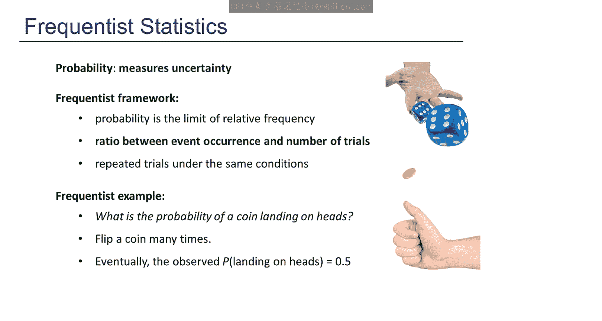
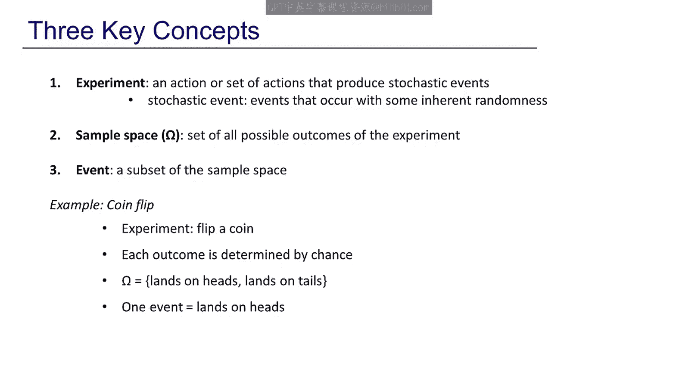
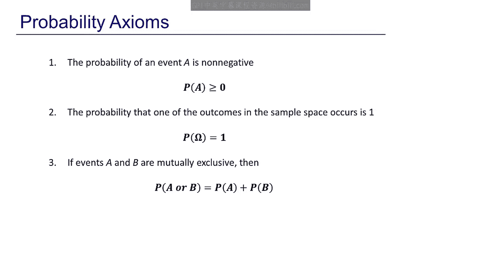
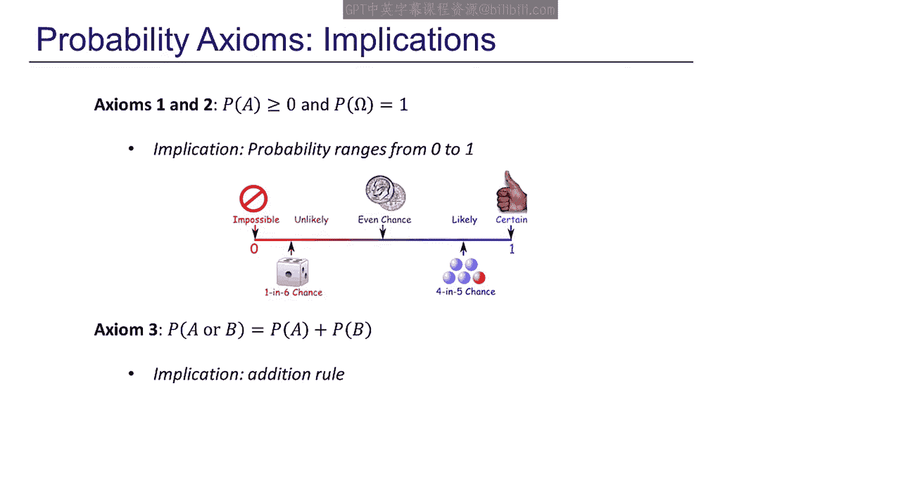
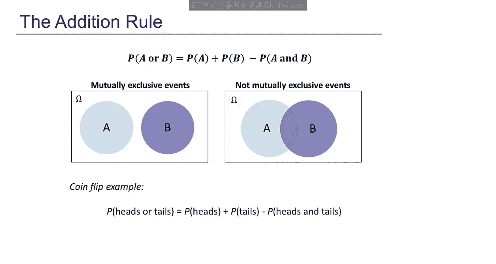
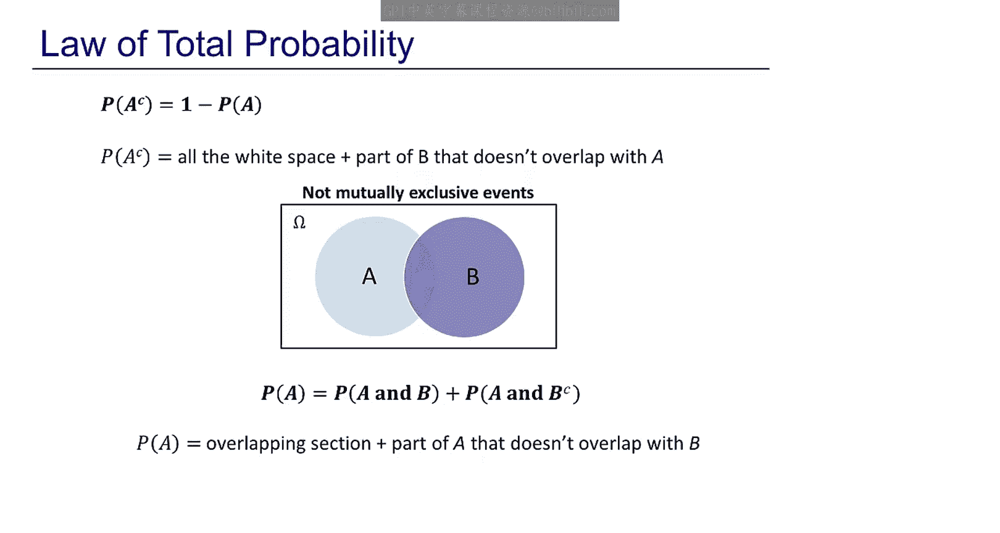
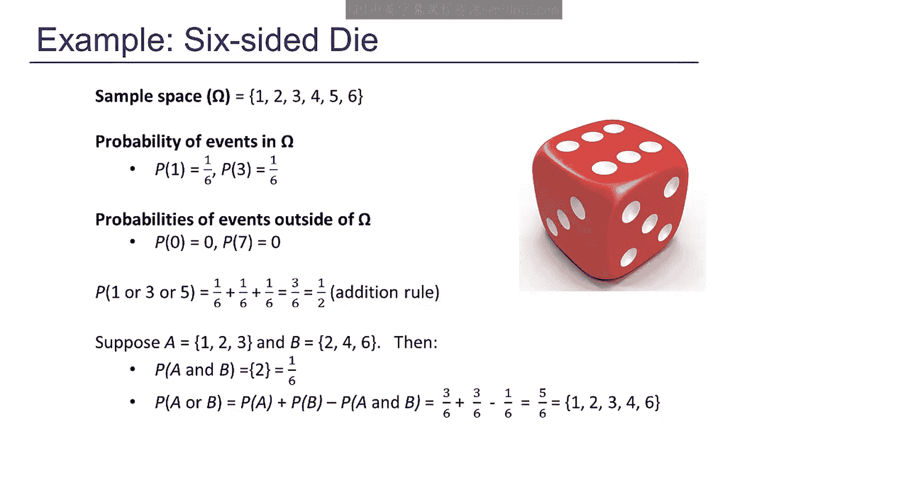

# 约翰霍普金斯大学《数据素养（数据⧸测量⧸回归⧸概率⧸毕业项目）｜Data Literacy》中英字幕（deepseek p48 1_概率定义与公理.zh_en -BV1jXtMemEuh_p48-

Probability definitions and axioms。Probability theory underlies all of statistical analysis。

 although the theories and rules related to concepts such as sample spaces。

 permutations and independence may seem removed from statistics， they are， in fact。

 essential to developing a strong intuitive understanding of the assumptions upon which statistical models are built。

Moreover， developing an understanding of probability theory will allow you to interpret statistical results。

 and particularly the measures of uncertainty surrounding statistical results in an accurate manner。

Interpreting uncertainty is critical， especially if your goal is to make good。

 actionable recommendations based on findings。

Frequentist Stas Let's jump in by first discussing the frequentist framework of probability。

In general， probability measures uncertainty everything in the world occurs with some level of probability。

 ranging from highly unlikely to occur to highly likely to occur。Under the frequentist framework。

 probability is the limit of relative frequency， meaning it is the ratio between event occurrence and the number of trials during which that event may occur。

The frequentist framework assumes that under repeated trials and under the same conditions。

 the true probability of an event will be observed。For example。

 suppose you want to discover the true probability of a coin landing on heads。

 A frequentist would say that you should simply flip the coin over and over and over again。

 Eventually， after flipping the coin many times， you will observe that the probability of the coin landing on heads equals 0。

5。 In other words， over these repeated trials in the limit。

 you will observe that the coin landed on heads 50% of the time。

Let's first define an experiment in the frequentest framework。

 An experiment in this context is an action or set of actions that produce stochastic events。

 A stochastic event is one that occurs with some inherent randomness。 Think back to the coin flip。

 Fping a coin is a stochastic event because the result of each flip is random。

 The result is determined by chance。😊，The next important concept to define is the sample space。

 which we'll denote with omega。 The sample space is the set of all possible outcomes of the experiment。

 In the coin fliplip example， the sample space includes two possible outcomes， heads and tails。

If you were to define the experiment as flipping a coin three times。

 the sample space would include all possible outcomes from those three flips， such as heads， tails。

 heads， and so forth。Relatedly， an event is a subset of the sample space， so with a coin flip。

 the experiment is to flip the coin。Each outcome of the experiment is determined by chance。

 The sample space includes the coin landing on heads and the coin landing on tails。

 And one possible event is the coin lands on heads。

Now let's define the three axioms or fundamental rules of probability。

The first is that the probability of an event， say event A occurring is non negative。

 We can write this by saying that the probability of a is greater than or equal to 0。

The second axiom states that the probability that one of the outcomes in the sample space occurs is one。

 In other words， the probability that some event in omega occurs is one。Third。

 if A and B are mutually exclusive， meaning if one occurs， then the other does not occur。

 the probability of A or B occurring is equal to the probability of A plus the probability of B。

As we move forward in our discussion of probability， we'll build upon these three axioms。

Probability axioms， implications。Let's think about the implications of axioms1 and 2。

 which stated that the probability of a is greater than or equal to zero。

 and the probability of some event in the sample space occurring is1。

The implications of these two axioms is that probability ranges from 0 to 1。

 The probability of anything ranges from impossible， where the probability equals 0 to certain。

 where the probability equals 1。Axiom 3 is generally referred to as the addition rule of probability。

 The formula for this rule depends on whether we are examining mutually exclusive or not mutually exclusive events。

 Let's walk through an example。

The full expression of the addition rule states that the probability of A or B equals the probability of a plus the probability of B minus the probability of A and B。

In the case of mutually exclusive events， such as the diagram depicted on the left。

The last component of the formula is0。 There is no area where A and B overlap。

The diagram on the right depicts two overlapping circles for A and B to calculate the probability of A or B occurring in the case where A and B are not mutually exclusive。

 we need to be sure to subtract the probability of A and B occurring as part of the addition rule。

Let's again return to the coin fliplip example。 Flipping a coin is an example of mutually exclusive events。

 since a coin cannot land on both heads and tails at the same time。

 so the probability of heads or tails equals the probability of heads plus the probability of tails。

 minus the probability of heads and tails， which in this case is 0。

Following from the addition rule， we can see that the law of total probability is that the probability of a complement is equal to 1 minus the probability of a。

Take a look at the graphic on this slide， which shows two not mutually exclusive events， A and B。

The white rectangle is omega。 The sample space。 The probability of a complement includes all of the white space plus the part of B that doesn't overlap with a。

So in terms of the law of total probability， we can say that the probability of a equals the probability of A and B plus the probability of A and B complement。

 or in other words， the probability of a equals the overlapping section plus the part of a that doesn't overlap with B。

I'm sure all of these rules seem quite abstract and hard to apply at the moment。

 Let's walk through an example。

Imagine a traditional six sided eye。 The sample space includes six possible outcomes，1，2，3，4，5 and 6。

The probability that any individual event occurs is 16。 For example。

 the probability of one is 16 and the probability of3 is 16。

The probability of any event outside the sample space is 0。 For example。

 the probability of rolling a 0 is 0， and the probability of rolling a 7 is 0。

According to the addition rule， the probability of rolling a 1，3， or 5 is 1/6 plus 16 plus 16。

 which is equal to1/2。Now suppose that a equals the set， 1，2，3， and B equals the set 2，4，6。

In this case， the probability of A and B is 16， which means getting the outcome of two。

The probability of A or B equals the probability of A plus the probability of B minus the probability of A and B。

 which is equal to 3，6 plus 3，6， minus 16， which equals 56。

As we continue with our discussion of probability， we'll use these rules as the building blocks for more complex concepts。

 such as conditional probability and independence。

