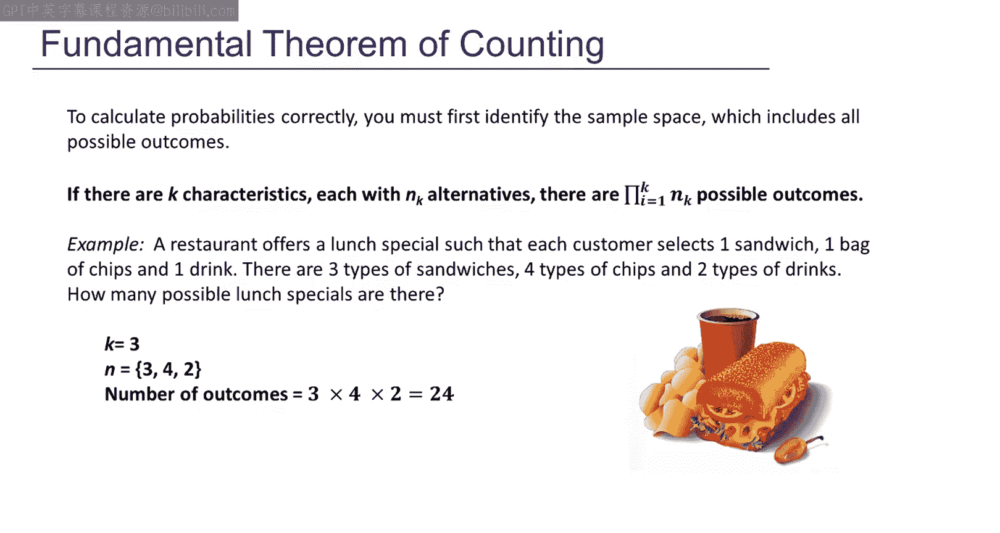
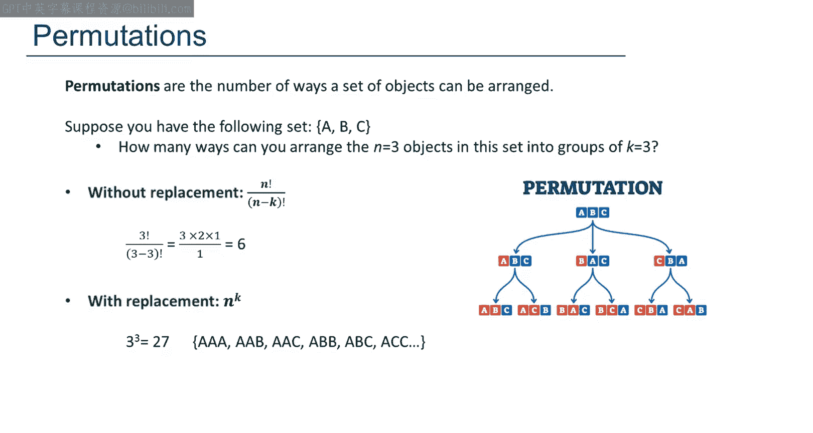
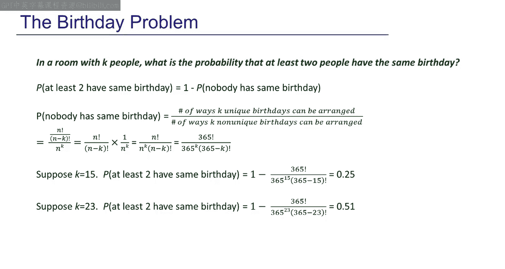
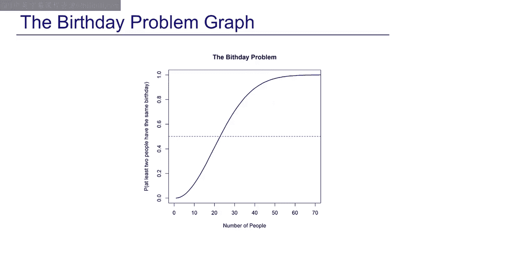
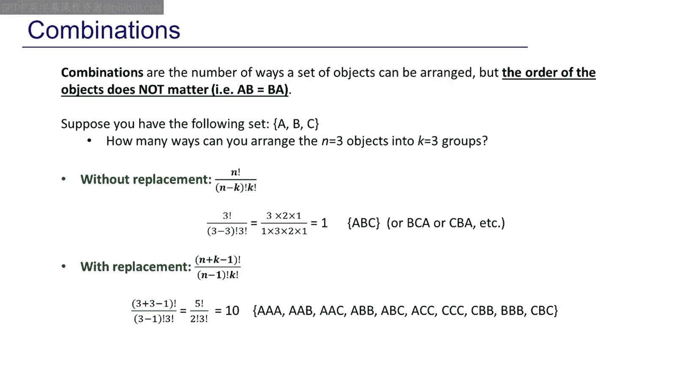
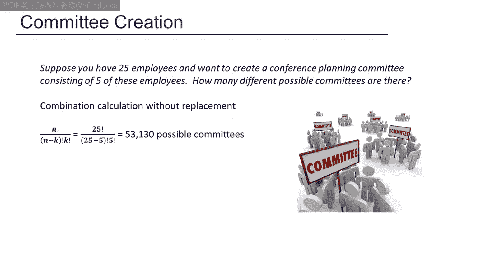
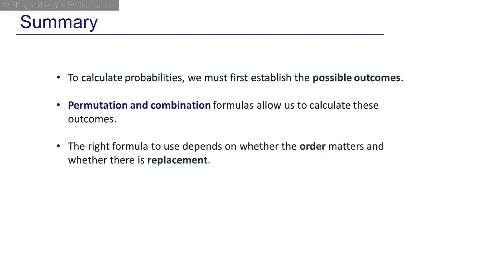

# 约翰霍普金斯大学《数据素养（数据⧸测量⧸回归⧸概率⧸毕业项目）｜Data Literacy》中英字幕（deepseek p49 2_排列与组合.zh_en -BV1jXtMemEuh_p49-

Permutations and combinations。At this point， in our discussion of probability。

 it's important to consider the rules associated with determining the sample space。

 That is the set of possible outcomes。 Sometimes it's quite easy to lay out the sample space。

 such as with flipping a coin or rolling a die。 Other times， it's more complicated。 For example。

 what is the sample space of a combination lock or imagine starting with 100 individuals and trying to form pairs。

 How many possible outcomes are there。 when the number of objects or individuals gets large。

 the rules about combining them get complicated。By the end of this video。

 you should understand how to employ the fundamental rules of determining the sample space。

Let's begin with the fundamental theorem of counting。

 This theorem states that if there are K characteristics， each with n of K alternatives。

 then the number of possible outcomes equals the product of N of K from I equals one to K。

 Let's walk through an example。 Suppose a restaurant offers a lunch special。

 such that each customer selects one sandwich。 one bag of chips and one drink。

 They can choose from among three types of sandwiches。4 types of chips and two types of drinks。

How many total possible lunch specials are there。In this case。

 K equals 3 because there are three characteristics， a sandwich， bag of chips， and drink。

N equals the set 3，4，2， because there are three types of sandwiches。

 four types of chips and two types of drinks。 The number of outcomes is therefore equal to three times 4 times 2。

 which is 24。 There are 24 possible lunch specials。

Let's dive in further。 when calculating the set of possible outcomes。

 we generally use a permutation or combination formula。

Permutations are the number of ways a set of objects can be arranged， and the order matters。

 With a permutation。 In other words， ABC is not the same thing as CB，A。

Suppose you have the following set， A，BC。How many ways can you arrange these n equals three objects into groups of K equals 3？

To perform this calculation， we first need to determine whether we are operating without replacement or with replacement。

 Rement means that the object is replaced after selecting it for inclusion in a group。

If operating without replacement， the formula is n factorial divided by n minus k factorial to calculate a factorial。

 you need to multiply the number by each integer below。 For example。

4 factorial would equal 4 times 3 times 2 times 1。In our current example。

 if operating without replacement， the number of possible arrangements would be three factorial divided by 3 minus3 factorial。

Note that0 factorial is equal to one by definition。 This calculation turns out to be6。

 You can see that there are six different ways to arrange the letters without replacement。

If we're operating with replacement， the number of possible arrangements is equal to n to the k power here we raise 3 to the third power and see that there are 27 possible arrangements with replacement。

 for example， we can have A A A and AA B。 Note that I have not included all 27 arrangements on the slide。

 Ive only included a few so that you can see some examples of arrangements with replacement of the letters。

The birthday problem is a famous example of a probability challenge that requires the use of permutation calculations。

This example also highlights the counterintuitive nature of probability。

 The problem is as follows in a room with K people。

 what is the probability that at least two people have the same birthday。

 Think about this question for a minute。 What is your guess as to the probability that two people have the same birthday in a room with。

 let's say，30 people。Now， let's think about how to calculate this probability。

 The probability that at least two people have the same birthday is equal to one minus。

 the probability that nobody in the room has the same birthday as someone else。

The probability that no two people have the same birthday is equal to the number of ways K unique birthdays can be arranged。

 divided by the number of ways K non unique birthdays can be arranged。

We can calculate the numerator using the permutation formula for non replacement。

 and we can calculate the denominator using the permutation formula for replacement。For N。

 we will use 365 days， as for this example， we'll assume that there are no leapier birthdays。

When we simplify the equation， we see that the formula for calculating the probability that nobody has the same birthday as someone else is 365 factorial divided by 365 raised to the k power times 365 minus K factorial。

Now， suppose that K equals 15， meaning there are 15 people in a room。

 The probability that at least two people have the same birthday is equal to 1 minus the equation I just described with K equals 15。

The probability is 0。25， meaning that in a room of 15 people。

 there is a 25% cent chance that at least two people have the same birthday。

 This probability is higher than most people would guess。Now suppose K equals 23。In this case。

 the probability that at least two people in the room have the same birthday is 51%。 again。

 quite high， given most people's intuitive guests。

The graph on this slide plots the probability that at least two people in a room had the same birthday for k equals0 to k equals 75。

Notice that the line is bounded between 0 and 1。 You can see that the probability increases quite quickly between about 10 and 40。

 Overall， there does not need to be very many people in a room for there to be a relatively high probability that at least two people have the same birthday。

A combination is the number of ways a set of objects can be arranged。

 but here the order of the objects does not matter， In other words， in a combination AB equals BA。

Now suppose you have the following set， ABC。How many ways can you arrange the n equals three objects and decay K equals three groups？

If operating without replacement， the formula is n factorial divided by n minus k factorial times k factorial here。

 if we plug in n equals 3 and K equals 3， we see that there is one possible arrangement。

 Remember that the order does not matter。 So there is only one arrangement that includes the three objects。

 Now， if we're operating with replacement， the formula is n plus K-1 factorial divided by n-1 factorial times K factorial。

 If we plug in n equals 3 and K equals 3， we see that there are 10 possible arrangements。

 which I've listed here on the slide。 Remember， in this case， A， A B is the same as B， A A。

Let's walk through an example of a combination calculation。

Suppose you have 25 employees and you want to create a conference planning committee consisting of five employees。

 how many different possible committee combinations are there？

Note that order doesn't matter in this context。 A committee consisting of Jen， Bob Jill。

 Ted and Sarah is the same as a committee consisting of Bob Ted， Sarah， Jen and Jill。

If we use the combination formula without replacement and plug in n equals 25 and K equals 5。

 we see that there are 53130 possible committees， that's certainly a lot of options。

To summarize， it's important to study permutations and combinations because we must first establish the possible outcomes if we want to calculate probabilities correctly。

 permutation and combination formulas allow us to calculate these outcomes。

 the right formula to use depends on whether the order of the objects matters and whether you are operating with or without replacement。

Even when operating without replacement， it's pretty striking how quickly the number of possible outcomes grows as the number of objects increases。

 and overall， you can see why calculating correct probabilities is both challenging and often counterintuitive。

