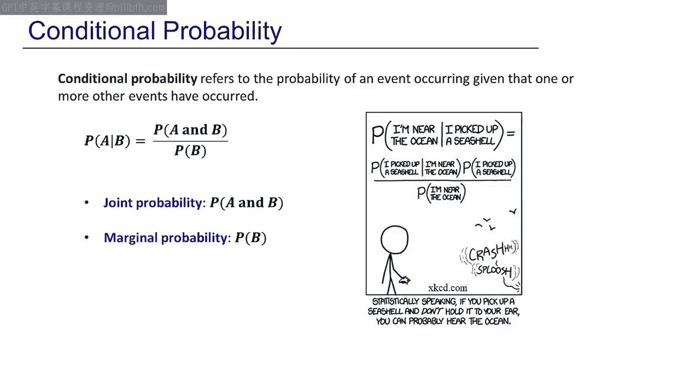
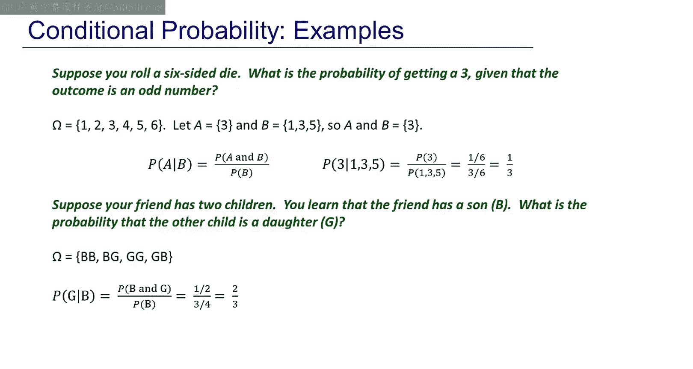
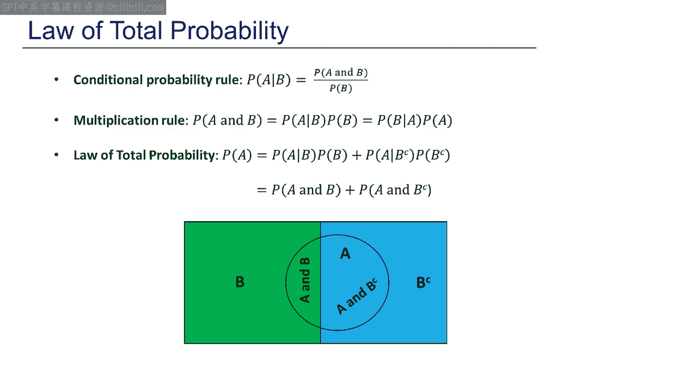
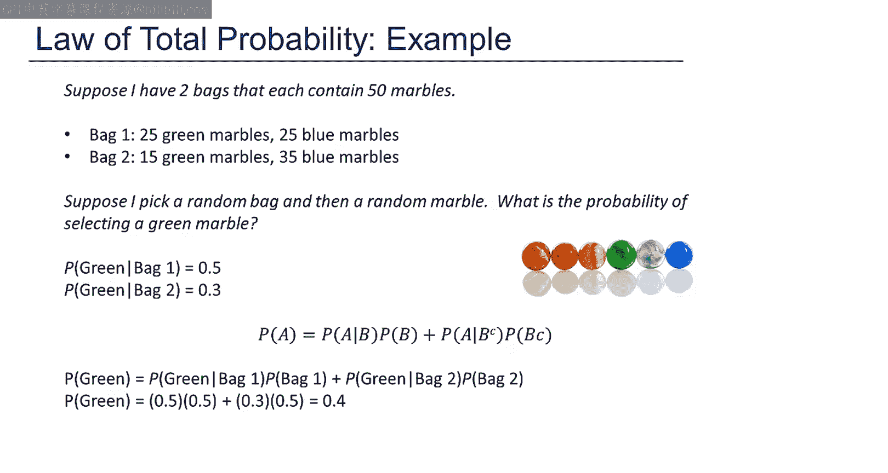
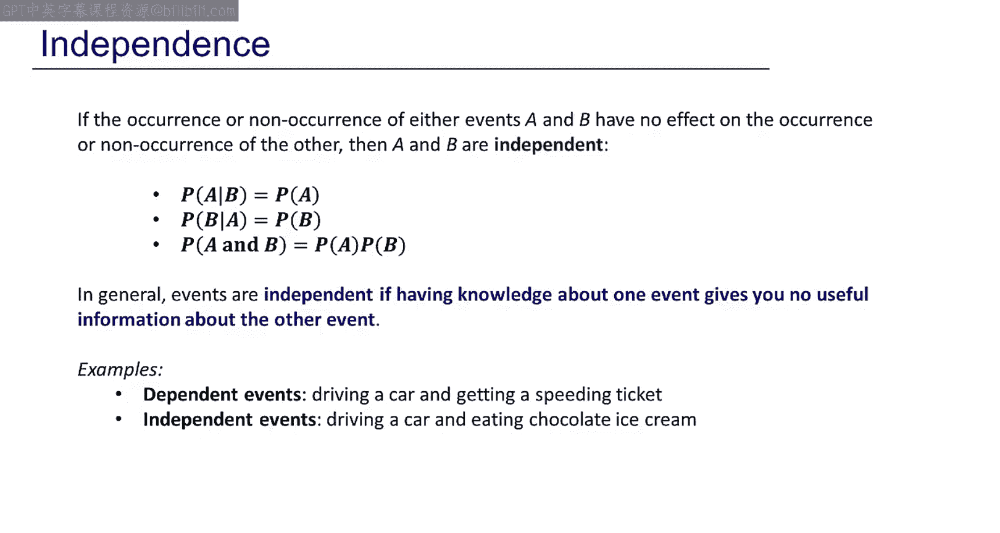

# 约翰霍普金斯大学《数据素养（数据⧸测量⧸回归⧸概率⧸毕业项目）｜Data Literacy》中英字幕（deepseek p50 3_条件概率与独立性.zh_en -BV1jXtMemEuh_p50-

Conditional probability and independence。In our discussion of probability。

 we've now discussed how basic probabilities are calculated and how to determine the number of possible outcomes。

 depending on whether the order of the objects matters and whether there is replacement。

 This video focuses on two additional layers of complexity， conditional probability and independence。

By the end of this video， you should have a handle on these two important concepts and you'll have the tools necessary to tackle challenging probability questions。

Conditional probability refers to the probability of an event occurring。

 given that one or more other events have occurred。

The formula for conditional probability is as follows。

 the probability of a given B equals the probability of A and B divided by the probability of B。

Note that the formula has two parts。 The numerator is called the joint probability of A And B。

 The denominator is the marginal probability。 It's the probability of the event that has already occurred。

 In this case， the probability of B。

Let's walk through a couple of examples to give you some experience with using the conditional probability formula。

First， suppose you roll a six sided die。 What is the probability of getting a three。

 given that the outcome is an odd number。In this case， the sample space， omega， equals 1，2，3，4，5。

 and 6。 Let's let a equal 3 and B equal 1，3 and 5。 The odd number in the sample space。 So A and B。

 the overlap between them is 3。This means we want to calculate the probability of three。

 given that a one，3 or five has occurred。To do this。

 we should divide the probability of getting a three by the probability of getting a1，3 or five。

The probability of getting a three is  one，6， and the probability of getting a one，3， or5 is 3，6。

This means the conditional probability is one third。 So given that the outcome is odd。

 the probability of getting a three is one third。Let's go through another example。

Suppose your friend has two children。 You learn that the friend has a son denoted by B for boy。

 What is the probability that the other child is a daughter denoted by G for girl。

The sample space include the following possible events。 Boy， boy， boy， girl， girl， girl and girl boy。

So what is the probability that the other child is a girl。

 given that the child you know about is a boy to calculate this。

 we would divide the probability that the friend has a boy and a girl。

 which is one half by the probability that one of the children is a boy， which is three/ fourths。

The resulting probability is two third。 This means there is a two third chance that。

 given that one child is a boy， the other child is a girl。

Once we've established the conditional probability rule。

 we can see that the multiplication rule and law of total probability in the conditional probability context follow from it。

The multiplication rule is simply a rearrangement of the conditional probability rule。

It states that the probability of A and B is equal to the probability of a given B times the probability of B。

Likewise， the probability of A and B is equal to the probability of B given A times the probability of A。

The law of total probability states that the probability of a is equal to the probability of a given B times the probability of B plus the probability of a given B complement times the probability of B complement。

 Notice that this is simply an extension of the law of total probability that we observed in our first discussion about probability。

The law of total probability can also be written to say that the probability of a is equal to the probability of A and B plus the probability of A and B complement。

This law is portrayed graphically on the slide。 Let a equal the area inside the circle。

 B is the green area， and B complement is the blue area。

Notice that the probability of a is equal to the probability of A and B plus the probability of A and B complement。

A classic example used to illustrate the law of total probability in a conditional context involves selecting marbles from bags。

Suppose I have two bags that each contain 50 marbles。

 bag 1 contains 25 green marbles and 25 blue marbles。

 while bag 2 contains 15 green marbles and 35 blue marbles。

 Suppose I pick one of the bags at random and then draw a random marble from the bag。

 What is the probability that I select a green marble。 The probability that I select a green marble。

 given bag 1 is 0。5， or 25 divided by 50， and the probability that I select a green marble given bag 2 is 0。

3， or 15 divided by 50。 So to calculate the probability of selecting a green marble。

 I can employ the law of total probability。 I multiply the probability of selecting green given bag 1 times the probability of bag 1 plus the probability of selecting green given bag2 times the probability of bag 2。

When I plug in the right probabilities， I see that the probability of selecting a green marble is 0。

4 or 40%。

A discussion of conditional probability naturally leads to one about independence if the occurrence or non occurrencecur of either event A or B have no effect on the occurrence or non occurrence of the other。

 then A and B are independent events。We can formalize independence in three different ways。 First。

 we can say that if A and B are independent， the probability of A given B equals the probability of a。

Second， the probability of B given A equals the probability of B。In short。

 these first two expressions formalize the idea that B occurring does not change the probability of A and vice versa。

The third expression states that if A and B are independent。

 the probability of A and B is simply equal to the probability of A times the probability of B。

In general， events are independent if having knowledge about one event gives you no useful information about the other event。

Here are some examples。 Suppose you observe someone driving a car and getting a speeding ticket。

 These are dependent events。 knowing that one of these events occurred gives you knowledge about whether the other occurred。

 If you know someone got a speeding ticket， there is a high probability that person was driving a car。

Driving a car and eating chocolate ice cream。 On the other hand are independent events。

 Suppose you learned that someone ate chocolate ice cream。

 I can't see why that would change your guess as to whether or not that person drove a car recently。

 which is why they can be considered independent events。

 We'll return to the concept of independent throughout the rest of this course。

 since independence is a key assumption underlying calculations about uncertainty。

