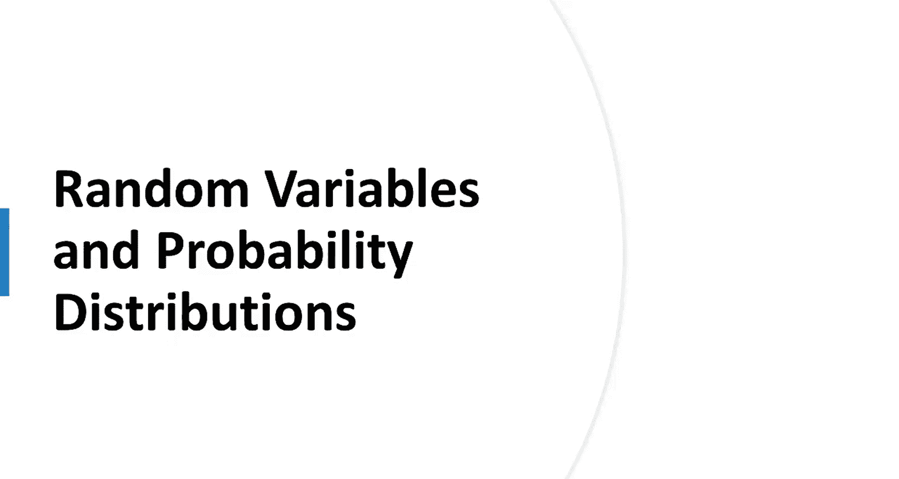
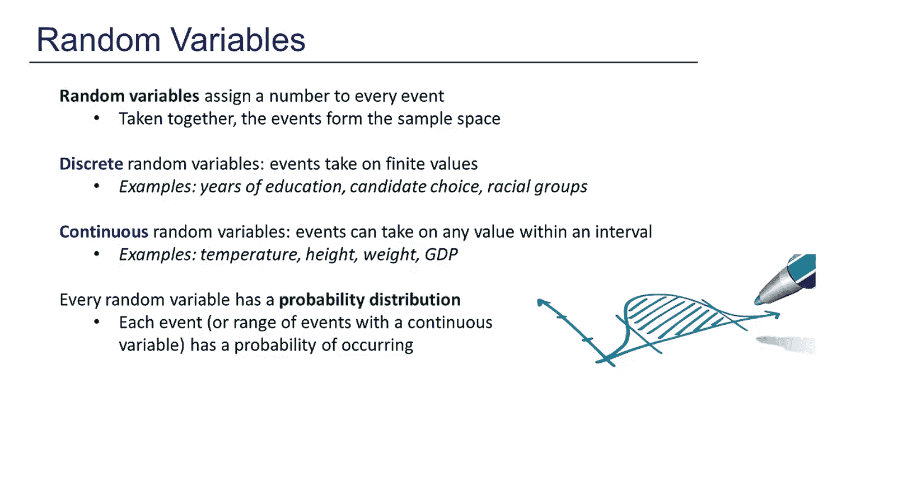
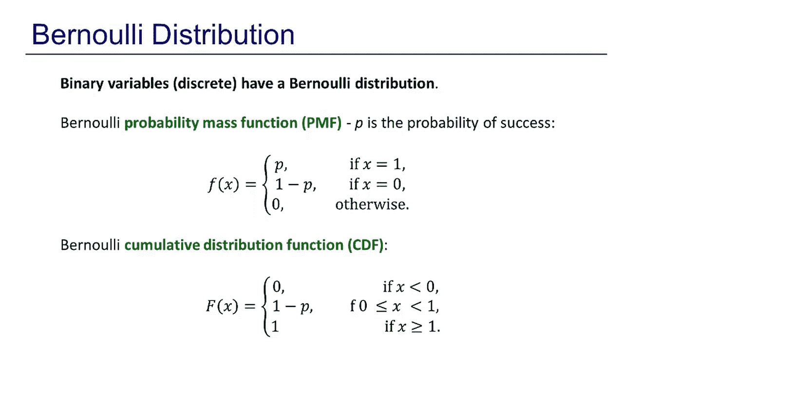
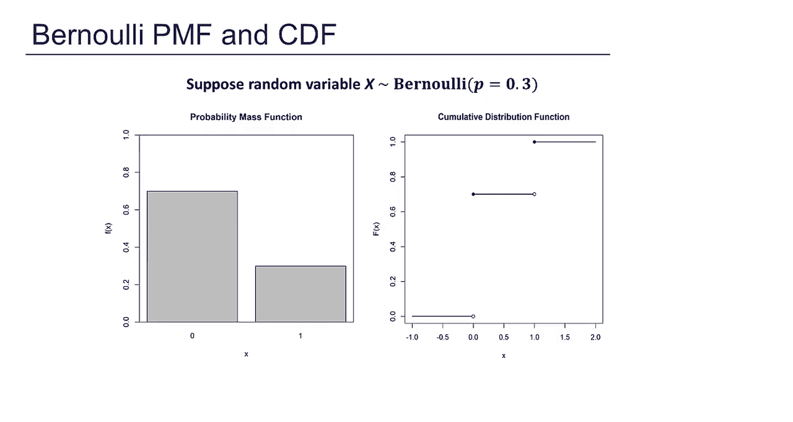
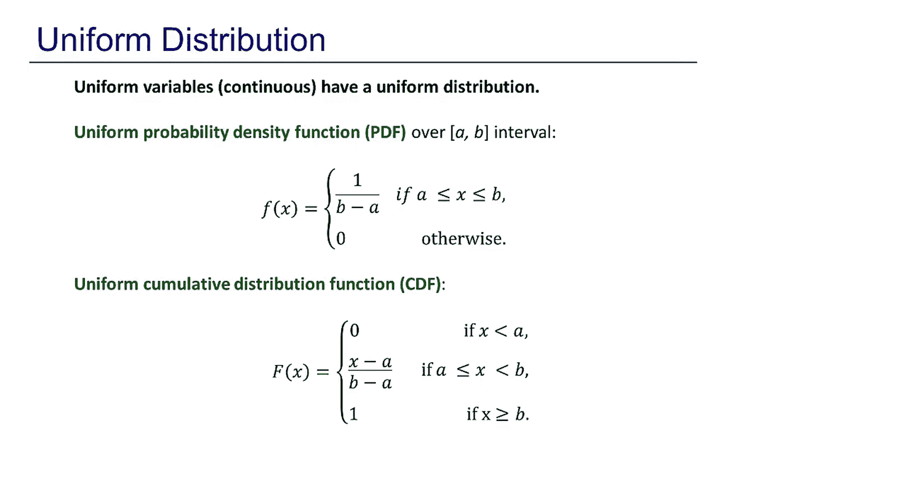
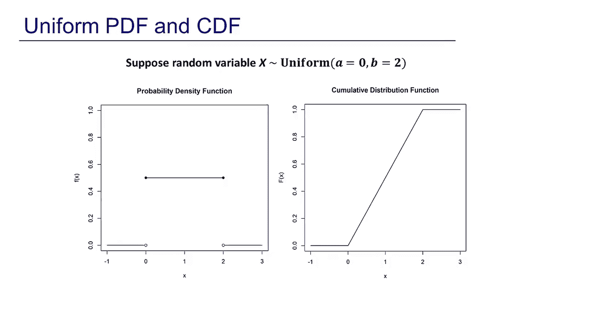
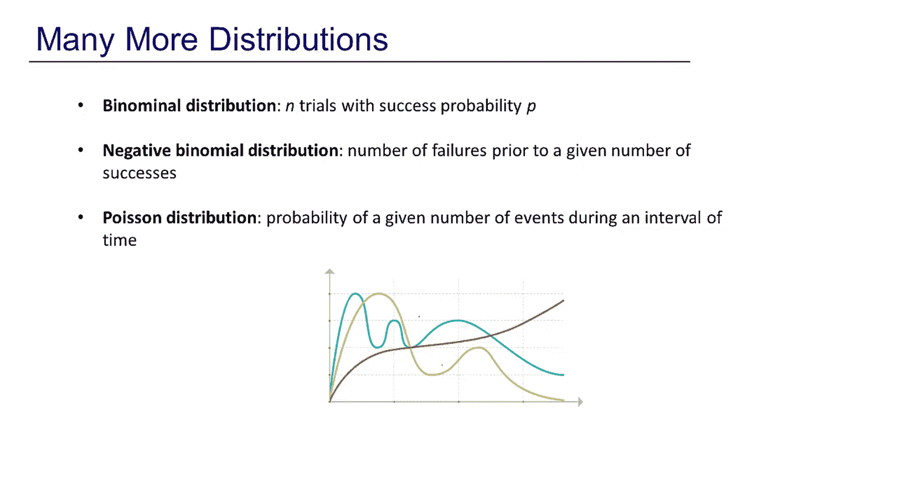

# 约翰霍普金斯大学《数据素养（数据⧸测量⧸回归⧸概率⧸毕业项目）｜Data Literacy》中英字幕（deepseek p51 4_随机变量与概率分布.zh_en -BV1jXtMemEuh_p51-

Random variables and probability distributions。Although you are familiar with the general concept of a variable。

 we'll spend some time in this video discussing the precise definition of a random variable and how these variables can be distributed。

Random variables and their probability distributions are the building blocks of social science。

 As analysts， we are interested in understanding the relationships between variables。

 By the end of this video， you should be able to explain why variables are considered random。

 and the various ways a random variable can be distributed。

A random variable assigns a number to every event。Taken together， these events。

 which should be mutually exclusive and exhaustive， form the sample space。

 There are two key categories of random variables， discrete and continuous random variables。

Discreet random variables include events that take on finite values。

 Some examples include years of education， candidate choice and racial groups。

 Con random variables can take on any value within an interval。 Some examples include temperature。

 height， weight and GDP。Note that some variables can be coded as either discrete or continuous。

 Consider age， for example， age could be treated as either a continuous variable or a discrete variable。

 For example， you could create five categories of age， such as 18 to 24，25 to 40 and so forth。

Every single random variable， whether discrete or continuous， has a probability distribution。

This means that each event or range of events in the case of a continuous variable has a probability of occurring。

A binary variable， which is a discrete random variable that can take on two values。

 has a benoulli distribution。Flipping a coin for example， has a Bnoulli distribution。

 the random variable coin flip can take on two values， heads or tails。

A discrete random variable has a probability mass function or PMF。

 which shows the probability for each outcome。Let's walk through the PMF for a Bernoulli distribution。

Let P indicate the probability of success In the case of a coin flip。 for example。

 we could define success as landing on heads， and the probability of success is therefore05。

The PMF states that the probability that x equals 1 is p。

 and the probability that x equals 0 is 1 minus p。X cannot take on any other value because it is a binary variable by definition。

 so the probability of any other value is 0。Discrete random variables also have a cumulative distribution function。

 abbreviated CDF， which computes the cumulative probability of events occurring。

In the case of the Berulli distribution， the CF is equal to 0 if x is less than 0。

1 minus p if x is greater than or equal to 0， but less than1。

 and equal to 1 if x is greater than or equal to 1。

Let's take a look at this PMF and CDF in their graphical forms。

Suppose we have a random variable X that is distributed Berulli with a probability of success of 0。3。

This means there is a 30% chance that x takes the value 1 and a 70% chance that x takes the value0。

The graph on the left shows the PMF for this distribution。

Here you can see that the probability that x equals 0 is 07。

 and the probability that x equals 1 is 0。3。 The heights of the bars show these probabilities。

The graph on the right shows the CDF for this distribution。

The empty circles indicate exclusion of the corresponding points。

 and the filled in circles indicate inclusion of the corresponding points。

Notice that when x is less than 0， the cumulative probability is 0。

 When x is greater than or equal to 0， but less than1， the cumulative probability is 0。7。

 and when x is equal to or greater than 1， the probability is 1。

For those who remember their high school or college calculus classes。

 you'll recognize that the CDF is calculated by integrating over the PMF。

 and the total area under the PMF curve， or in this case， bars is one。

Let's walk through these functions for another distribution to be sure you have an intuitive understanding of how probability distributions operate。

Uniform variables are continuous variables that have a uniform distribution over an interval between A and B。

For continuous variables， we refer to their probability distributions as probability density functions or PDFFs。

For the uniform distribution， the probability of each event occurring within the interval is equal；

 therefore， if x takes on a value between A and B， the probability of that value is 1 over B minus a。

The probability that x takes on a value outside of the interval is zero。

The CDF shows that the cumulative probability increases over the interval bounded by1。

 when x is greater than or equal to 1。

Let's examine this PDFF and CDF graphically。Suppose random variable X has a uniform distribution with a equal to0 and B equal to 2。

 The Pf on the left shows that the probability of x between 0 and 2 for any value is 0。5。

The CF on the right shows that for values less than 0， the cumulative probability is 0。

 between 0 and 1， the probability increases reaching one at the end of the interval in this case，2。

 and then continues to be one for all greater values。The area under the PDF curve is 1。

 and the CDF is the integration of the PDF。While you could certainly perform the integration by hand using calculus。

 analysts generally find that this is much simpler to do using a statistical software package。

As I've noted， there are many probability distributions。

 each one looks different depending on the parameters。

 and each fits a particular type of stochastic process。The binomial distribution， for example。

 is useful for modeling a series of N trials where there is a P probability of success for each trial。

 It's an extension of the Bernoulli distribution。The negative binomial distribution models the number of failures prior to a given number of successes。

 For example， supposeose rolling a 6 on a die is considered a success。

 The negative binomial distribution models the number of rolls of the die it takes to get a 6。

The Poisson distribution models the probability of a given number of events during an interval of time。

This distribution， for example， could be used to model the number of cases of a disease during a particular time period in a given location。

The key takeaway point is that there are many different probability distributions and that each one captures a different data generating process。

Next， we'll focus on the most famous and commonly used distribution， the normal distribution。

 which is the classic bell curve。

