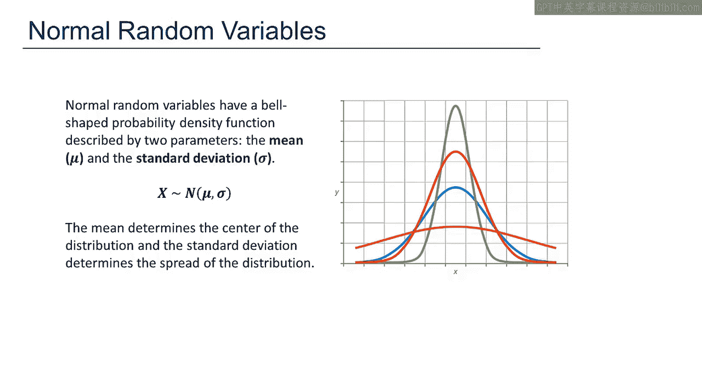
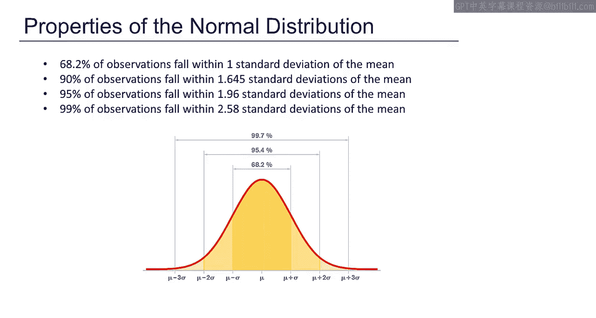
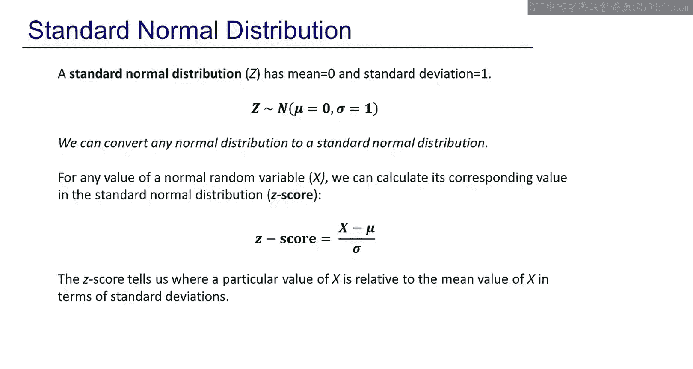
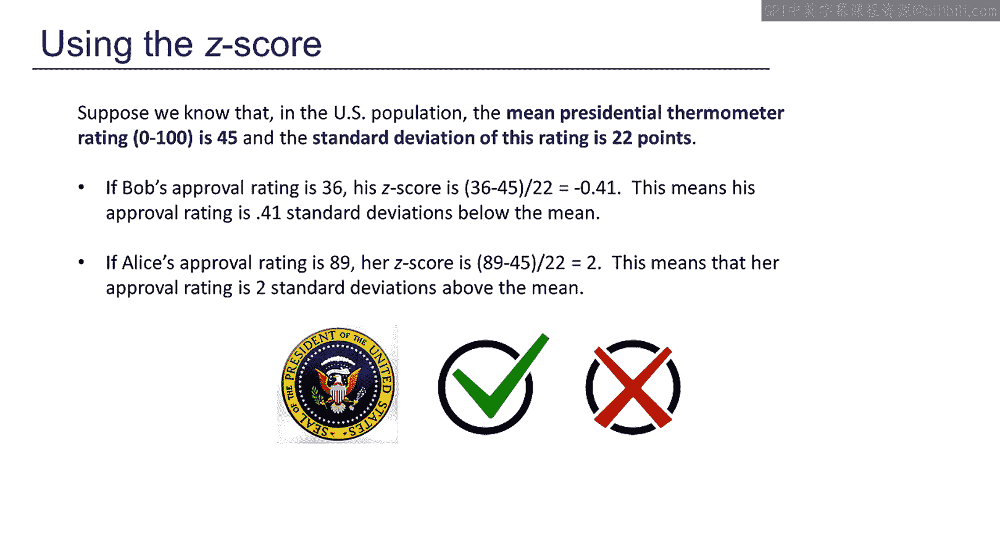
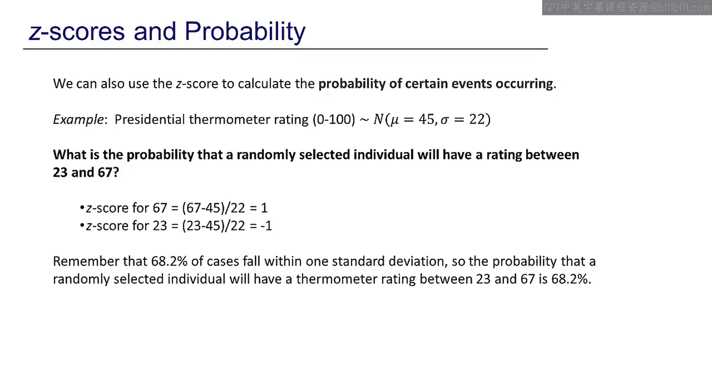
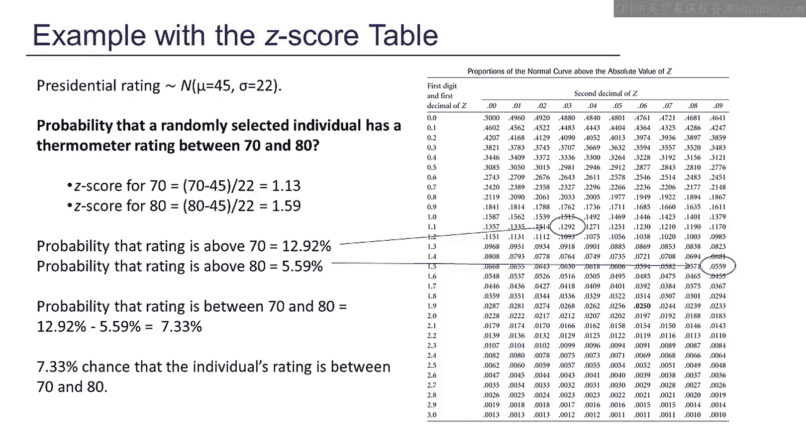
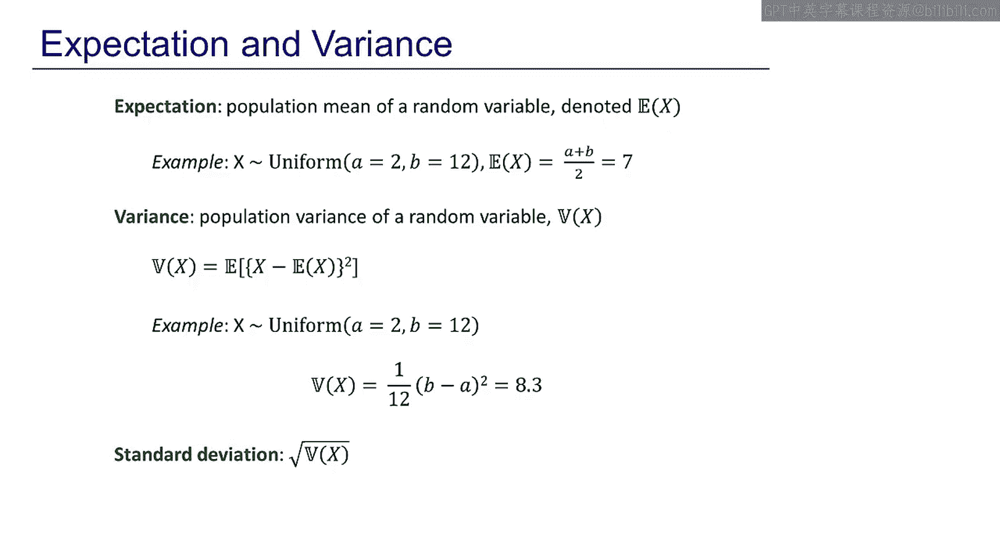

# 约翰霍普金斯大学《数据素养（数据⧸测量⧸回归⧸概率⧸毕业项目）｜Data Literacy》中英字幕（deepseek p52 5_正态分布.zh_en -BV1jXtMemEuh_p52-

The normal distribution， you are undoubtedly familiar with the normal distribution。

 which is the classic bell curve。 It's a symmetrical probability distribution with the highest probability at the center and two tails on either side。

It turns out that many natural and behavioral processes are captured by the normal distribution。

By the end of this video， you should be able to identify the key properties of the normal distribution and use it to estimate probabilities。

Normal random variables have a bell shaped probability density function that is described by two parameters。

 the mean denoted by mu， and the standard deviation denoted by sigma。In formalal notation。

 we would say that a variable x is distributed normally with a mean of mu and a standard deviation of sigma。

The mean identifies the center of the distribution。

 and the standard deviation determines the spread of the distribution。

A larger standard deviation means the curve will be flatter。In the graph on the right。

 the orange normal distribution has a larger standard deviation than the red normal distribution。

With all normal distributions， it's the case that 68。

2% of the observations fall within one standard deviation of the mean。

 and 90% of the observations fall within 1。645 standard deviations of the mean。

This big jump in percentage of observations can be explained by the fact that most of the density is centered around the mean。

As you move toward the tails， there is less area under the curve。

95% of the observations fall within 1。96 standard deviations of the mean。

 and 99% of the observations fall within 2。58 standard deviations of the mean。

We will use these critical values， 1。645， 1。96， and 2。

58 when we discuss confidence intervals and hypothesis testing。

A standard normal distribution is a particular type of normal distribution。

It is a normal distribution that has a mean of zero and a standard deviation of1。

We denote this standard normal distribution using a capital italicized Z。

It's the case that you can convert any normal distribution to a standard normal distribution more specifically。

 if you have a variable that is normally distributed。

 you can take a value of that variable and find its corresponding value in the standard normal distribution。

 which is called the Z score。To do this， you'll use the formula on the slide。

 the z score equals x minus mu divided by sigma， where x is the value of the variable that you're trying to convert。

 Mu is the mean of that variable， and Sigma is the standard deviation of that variable。

The Z score tells us where a particular value of x is relative to the mean value of x in terms of standard deviations。

Let's walk through an example。Suppose we know that in the US population。

 the mean presidential thermometer rating on a scale of 02100 is 45。

 and the standard deviation of this rating is 22 points。

If Bob's approval rating of the president is 36， his Z score is negative 0。41。

We calculate this by subtracting 45， the mean from 36， the particular value of the variable。

 and then dividing by 22， the standard deviation。This means that Bob's approval rating is 0。

41 standard deviations below the mean。If Alice's approval rating of the president is 89。

 her Z score is 89 minus 45 divided by 22， which comes out to be 2。

This means that Alice's rating is two standard deviations above the mean。

We can also use the Z score formula to calculate the probability of certain events occurring。

 For example， let's once again look at the presidential approval rating variable。

 which we said was normally distributed with a mean of 45 and a standard deviation of 22。

How would we calculate the probability that a randomly selected individual from the population holds an approval rating between。

 say， 23 and 67？Well， we would first calculate the z score for 67， which is one。

 This means that an approval rating of 67 is one standard deviation above the mean。

We would then calculate the Z score for 23， which is negative 1。

This means an approval rating of 23 is one standard deviation below the mean。

From earlier in the video， we know that 68。2% of observations fall within one standard deviation of the meat。

 so we can say that there is a 68。2% chance that a randomly selected individual will have an approval rating between 23 and 67。

Okay， so the question on the previous slide was relatively easy to answer because the z scores were one and negative one。

 But what if the scores are something other than one and negative one to calculate these probabilities。

 you can use a standard normal table。 The table requires you to locate the Z score and then tell you the probability of selecting a case above that value。

For example， let's suppose we want to calculate the probability that a randomly selected individual will have a thermometer rating between 70 and 80。

 The Z score for 70 is 70 minus45 divided by 22， which is 1。13。

The Z score for 80 is 80 minus 45 divided by 22， which is 1。59。Now let's turn to the table。

We can locate the probability of a case being above 70 by locating the value in the table associated with 1。

13。The first column in the table requires you to identify the first digit and decimal of your Z score。

 which in this case is 1。1。The first row in the table requires you to identify the second decimal of your Z score。

 which in this case is 0。03。When we find the right cell， we see that the probability is 12。92%。 So。

 again， this means that 12。92% of cases will have a thermometer rating above 70。

We can use the same procedure to find the probability of selecting a case with a thermometer rating above 80 from the table。

 we can see that this probability is 5。59%。So this means that the probability of selecting an individual with a rating between 70 and 80 is 12。

92% minus 5。59%， which is equal to 7。33 percentage points。This means there is a 7。

33% chance that a randomly selected individual's rating is between 70 and 80。

Although we have talked about means and standard deviations for quite some time。

 it's useful to formalize these definitions in the context of random variables。

The expectation is the population mean of a random variable， and it is denoted by E of x。

 Every probability distribution has an expectation。

 though formulas for calculating the expectation vary and can be quite complicated。

In the case of the uniform distribution， the formula for the expectation is quite straightforward。

 It's simply a plus B divided by  two， meaning it's the length of the interval divided in half。

If you have a random variable x that is distributed uniformly with a equals 2 and B equals 12。

 the expectation for that variable is 7。The variance is the population variance of a random variable denoted by V of x in the uniform case。

 the variance turns out to be 1 over 12 times b minus a squared。

In the case of our uniform variable x， the variance comes out to be 8。3。

The standard deviation of a random variable is simply the square root of the variance。These concepts。

 expectation， variance， and standard deviation will be essential when we dive into our next discussion。

 which is about uncertainty。

