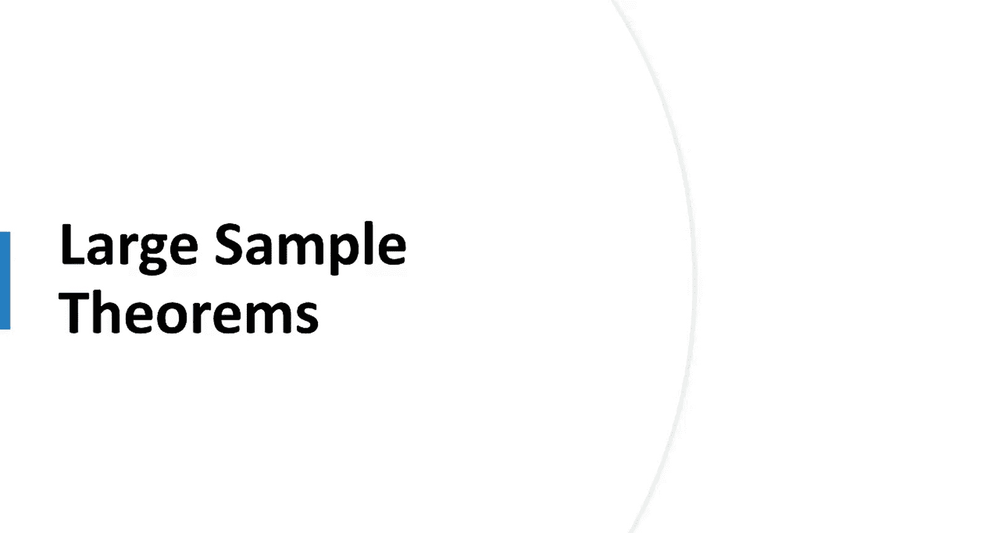
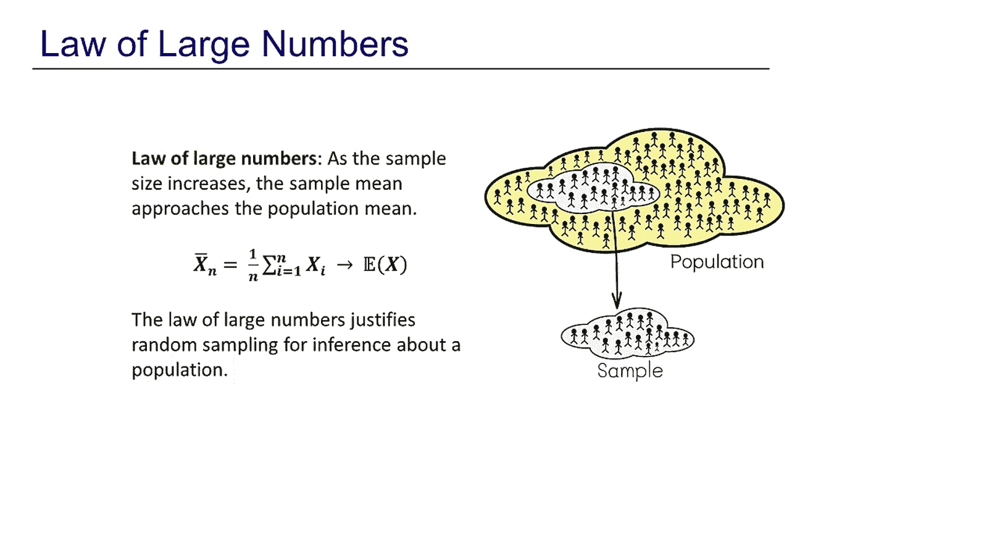
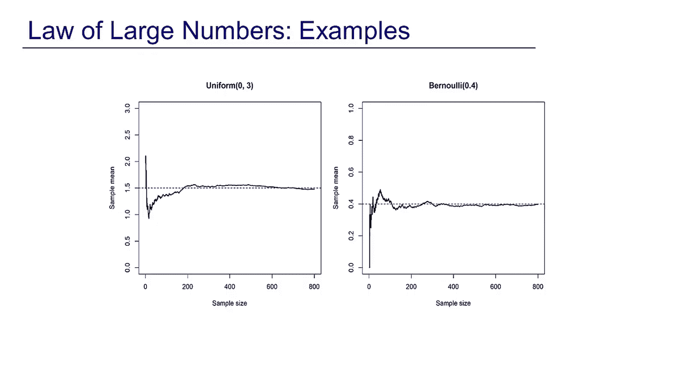
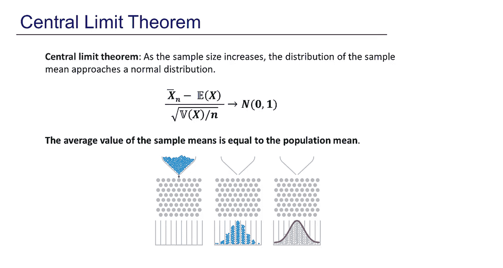
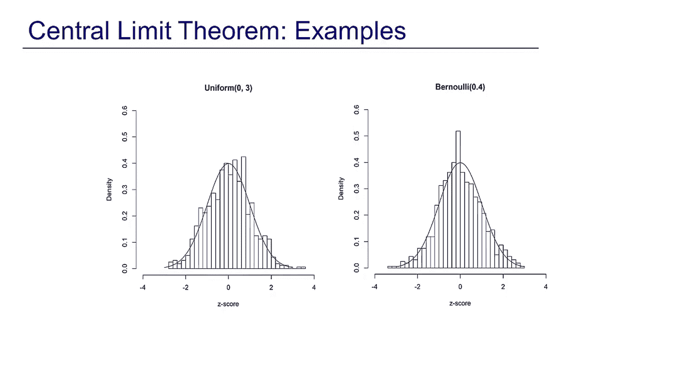
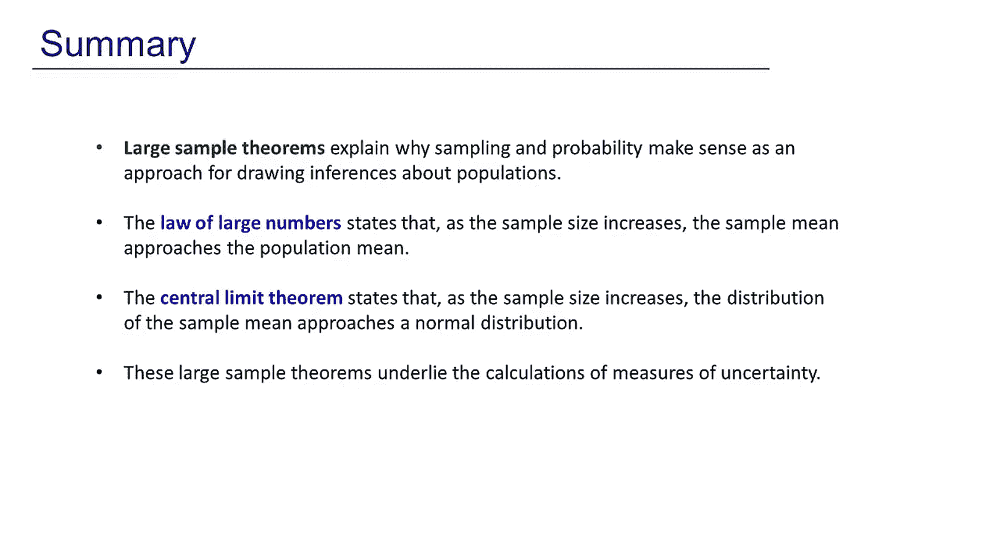

# 约翰霍普金斯大学《数据素养（数据⧸测量⧸回归⧸概率⧸毕业项目）｜Data Literacy》中英字幕（deepseek p53 6_大样本定理.zh_en -BV1jXtMemEuh_p53-

Large sample theorems。The entire frequentist framework of statistics is built upon two fundamental theorems。

 the law of large numbers， and the central limit theorem。

It's useful to spend some time understanding these theorems as they will provide intuition into why inferential statistics is valuable as an approach to learning about how the world works。

 By the end of this video， you should be able to describe these two fundamental large sample theorems and how they support the frequentist framework for statistical inference。

The law of large numbers。The law of large numbers states that as the sample size increases。

 the sample mean approaches the population mean。 Forly。

 we say the sample mean of x approaches the expectation of x， which is the population mean。

 as n increases。The law of large numbers justifies random sampling as an appropriate means of drawing inferences about a population。

Let's look at a few examples。The two graphs on this slide exemplify the law of large numbers。

 Let's start with the graph on the left。 I've drawn a series of samples ranging in size from 1 to 80 from a uniform probability distribution with A equals 0 and B equals 3。

I've plotted the mean for each sample in the graph。Notice that as the sample size increases。

 the sample mean approaches the true mean， which we know to be 1。5。

 given the parameters of the distribution。The same dynamic is portrayed in the graph on the right here。

 I've plotted the means for samples drawn from a Bernoulli distribution with P equals 0。4。Again。

 notice that as the sample size increases， the sample mean approaches the true mean。

 which we know is 0。4。You could certainly conduct these simulations yourself in a statistical software program or online simulator。

 and experiment with changing the sample sizes and the parameters of the distributions。

The central limit theorem is a related theorem that describes the distribution of the sample mean。

It states that as the sample size increases， the distribution of the sample mean approaches a normal distribution。

We can also state this theorem in terms of the standard normal distribution by saying that the sample mean of x minus the expectation of x divided by the square root of the variance。

 divided by the sample size approaches a standard normal distribution as the sample size increases。

The implication of this theorem is that the average value of the sample means is equal to the population mean。

This means that if we sample over and over and over again。

 we will learn the true value of the population mean and also the population standard deviation。

Here are a few examples。These graphs present some examples to illustrate the central limit theorem。

In the graph on the left， I've taken 800 random samples with each sample containing 1000 elements from a uniform distribution。

 with a equals 0 and B equals 3。 I then calculated the Z score for each sample。

 created a histogram of these z scores and overlaid a standard normal distribution。

Notice that the distribution of the Z scores approaches the standard normal distribution。

The graph on the right shows the same thing for a Bernoulli distribution with P equals 0。4。Again。

 I've taken 800 random samples from a Bernoulli distribution， calculated the Z score for each sample。

 created a histogram of the Z scores， and then overlaid a standard normal distribution。Again。

 you can see that the histogram approaches a standard normal distribution。

To summarize， these two large sample theorems explain why sampling and probability makes sense as an approach for drawing causal inferences about populations。

The law of large numbers states that as the sample size increases。

 the sample mean approaches the population mean。The central limit theorem states that as the sample size increases。

 the distribution of the sample meat approaches a normal distribution。Taken together。

 these large sample theorems underlie the calculations of measures of uncertainty。

 which is our next and final major topic that we will cover in the course。

