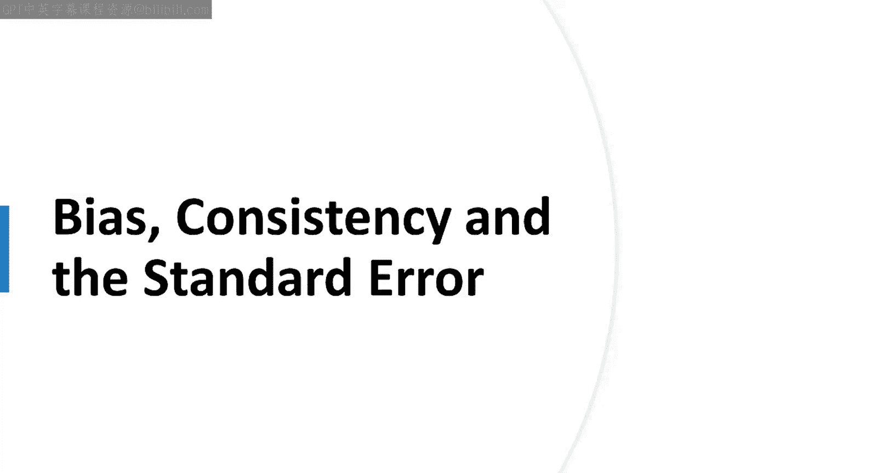
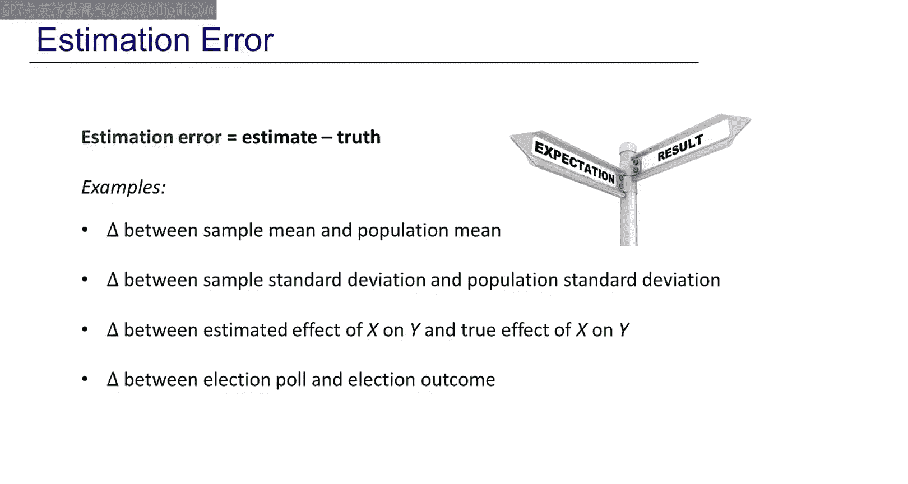
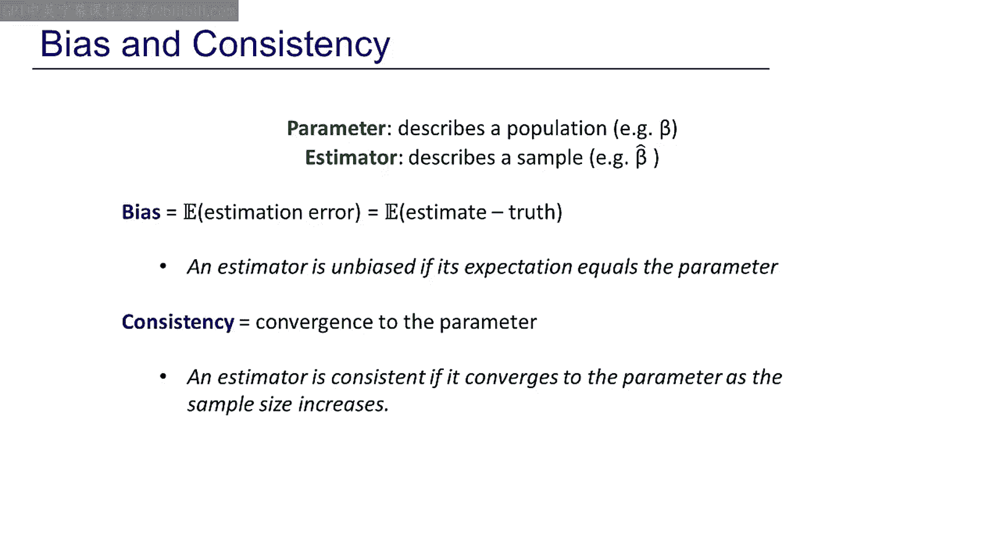
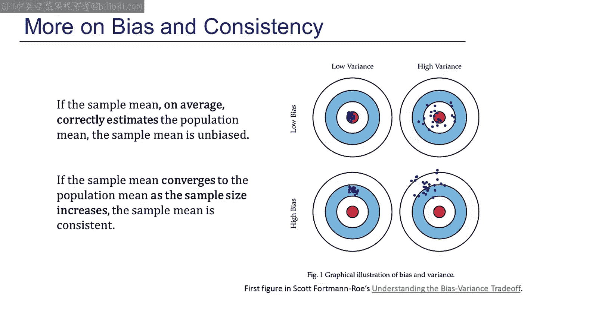
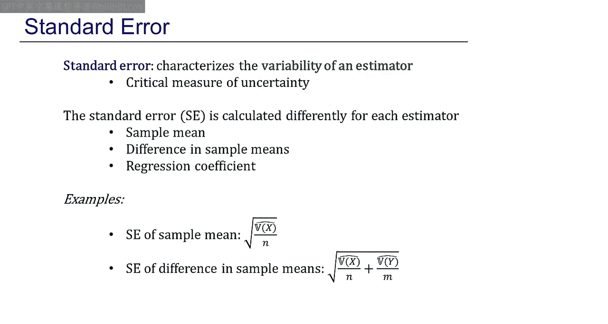
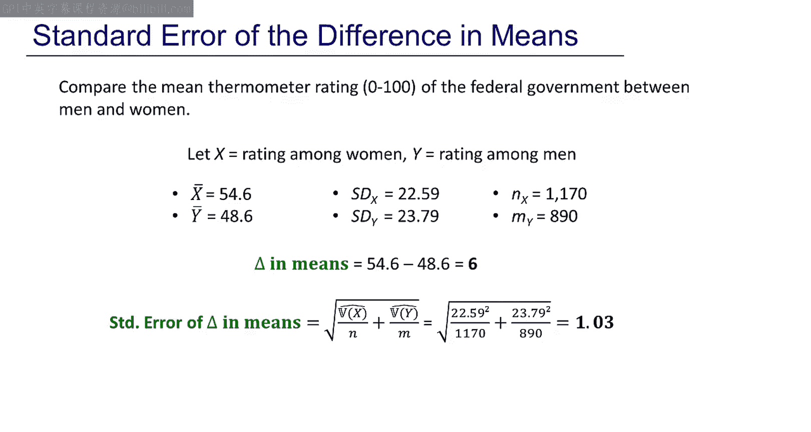
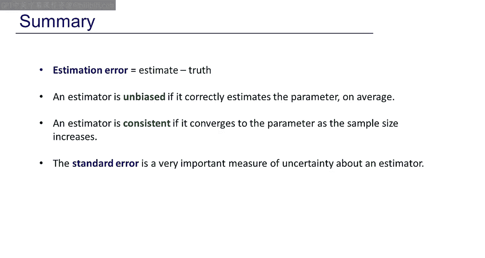

# 约翰霍普金斯大学《数据素养（数据⧸测量⧸回归⧸概率⧸毕业项目）｜Data Literacy》中英字幕（deepseek p54 7_偏差、一致性与标准误差.zh_en -BV1jXtMemEuh_p54-

Bias， consistency and the standard error。This video will be the first in our discussion about measuring and interpreting uncertainty。

 It is impossible to make good， actionable recommendations based on statistical findings without an understanding of the accuracy of those findings。

In short， how much confidence can we have about a particular estimate？

It turns out that there are many different ways to conceptualize and measure uncertainty。

 Estimates might be very similar in repeated sampling， but it may be that these similar estimates。

 in fact， diverge strongly from the truth。Or it may be that in repeated sampling。

 the average estimate is correct， but it's hard to know whether any one estimate from one sample is near the truth。

By the end of this video， you should be able to evaluate whether an estimate is unbiased and consistent。

 Moreover， you should be able to interpret the standard error of an estimate。

In general， estimation error can be defined as the difference between an estimate and the truth。

 Here are a few examples。 Note that Delta is used to mean the difference between two quantities。

The difference between the sample mean and the population mean is one type of estimation error。

 Another example is the difference between the sample standard deviation and the population standard deviation。

 or the difference between the estimated effect of x on y。 and the true effect of x on y。

 Or think about the difference between an election poll and the actual election outcome。

 This difference is called the estimated error。

Let's now turn to defining some key terms that are critical to a discussion of uncertainty。 First。

 note that a parameter describes a population， and an estimator describes a sample。

 Beta is an example of a parameter。 It describes the true relationship between x and y。Beta hat。

 in contrast， is an estimator， it describes the estimated relationship between x and Y using a sample。

Bs is defined as the expected value of the estimation error。

 meaning it's the expected value of the difference between an estimate and the truth。

We can say that an estimator is unbiased if its expectation equals the parameter。

To the extent that the expected value of an estimator does not equal the parameter， it is biased。

Bias is a continuum， an estimator can be very biased or just a little bit biased。

Consistency is defined as convergence to the parameter。

 We can say that an estimator is consistent if it converges to the parameter as the sample size increases。

 While these terms and definitions can seem abstract at first。

 they'll become more meaningful as we move forward in thinking about how much confidence we have in our statistical findings。

Let's spend a few more minutes on bias and consistency to hopefully help you build an intuitive understanding。

If the sample mean， on average， correctly estimates the population mean the sample is unbiased。

 This is visualized in the top two circular plots in the figure on the right。

 Suppose each blue dot is an estimate of the sample mean。

 and the red circle is the true population mean。 If you were to take an average of the blue dots in both of the top two plots。

 you would correctly estimate the population mean。In contrast， look at the bottom two circular plots。

 If you were to take the average of the blue dots in each one。

 this average would diverge sharply from the red circle， meaning the sample mean is biased。

If the sample mean converges to the population mean as the sample size increases。

 the sample mean is considered consistent。Focus on the two circular plots on the left hand side of the figure。

 Suppose these blue dots all reflect very different sample sizes。 Notice that in both these plots。

 the estimated sample means are quite near each other。 This shows that the estimates are consistent。

In contrast， notice that the blue dots are quite spread out in the circular plots on the right hand side。

 These estimates are not consistent。 There is a lot of variation in the mean estimates。

Now that we've discussed two key ways of characterizing the uncertainty of an estimator with repeated sampling。

 let's discuss how we can quantify the variability of a particular estimator。

 The standard error quantifies this variability， and it is a critical measure of uncertainty。

The specific calculation of the standard error for each estimator is different。In other words。

 the formula for calculating the standard error depends on the estimator。

The formula for the standard error of the sample mean， for example。

 differs from the formula for calculating the standard error of the difference in sample means。

 and from the formula for calculating the standard error of a regression coefficient。

To calculate the standard error of the sample mean， for example。

 you would take the square root of the variance of the variable divided by the number of observations。

To calculate the standard error of a difference in sample means。

 say the difference between the mean of x and the mean of y。

 you would take the square root of the variance of x divided by the number of observations in x。

 plus the variance of y divided by the number of observations in y。In practice。

 a statistical software package would calculate these quantities for you。

 or you might need to interpret them in an analysis that's presented in a paper or report。

The important thing to keep in mind is that the standard error measures the variability of a particular estimator。

Let's walk through a relatively simple example。 Suppose we want to learn about the relationship between gender and C federal government thermometer ratings。

 We might conduct a survey to investigate this。 Suppose that the results are as follows。

 Let X equal the federal government thermometer rating among women and Y equal the federal government thermometer rating among men。

Now， suppose that the mean of x is 54。6。 The mean of y is 48。6。 The standard deviation of x is 22。59。

 The standard deviation of y is 23。79。 The number of women is 1170， and the number of men is 890。

The difference in means is equal to 54。6-48。6， which is 6。

 What is the standard error of this difference by plugging in the squared standard deviations。

 which are the estimated variances and the number of observations into the formula。

 we see that the standard error of the difference in means is 1。03。

Once we have the estimate and its standard error， we can draw conclusions about our confidence in the estimate。

 which is what we'll be doing in the next two videos。

 We'll use the standard error to calculate confidence intervals and determine statistical significance。

 This will allow us to determine whether or not the estimate is meaningful。

 Is 6 a meaningful difference between the two means。

 Can we conclude that men and women have meaningfully different thermometer ratings of the federal government。

You'll be able to answer these questions at the end of the module。

To summarize， remember that estimation error is the difference between the estimate of some truth and the truth itself。

We say that an estimator is unbiased if it correctly estimates the parameter， on average。

 We say that an estimator is consistent if it converges to the parameter as the sample size increases。

Finally， the standard error is a very important measure of uncertainty about an estimator going forward we'll use the standard error to calculate the confidence interval for an estimate and determine whether or not an estimate is statistically significant。

