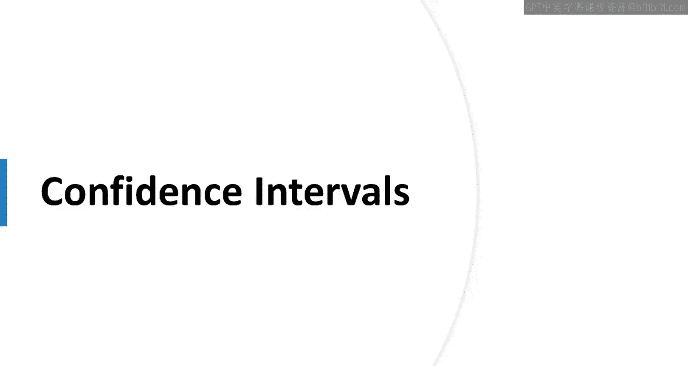
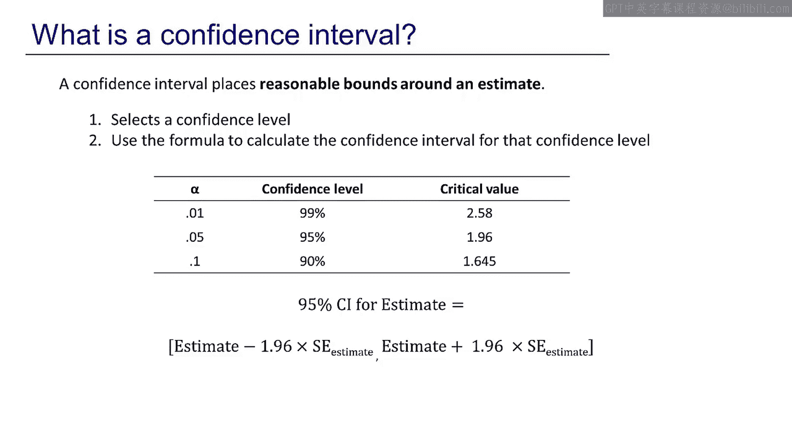
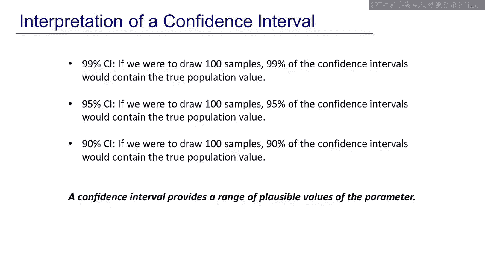
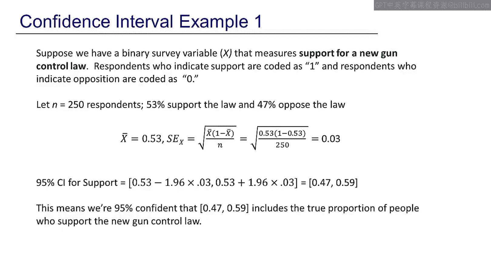
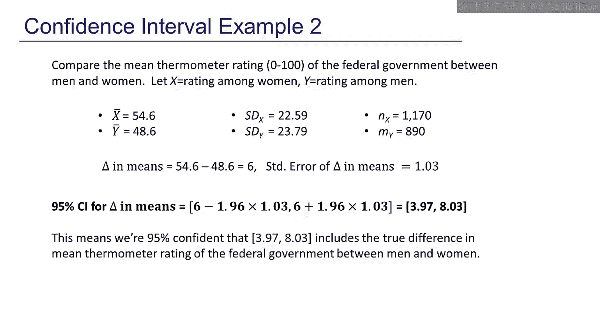
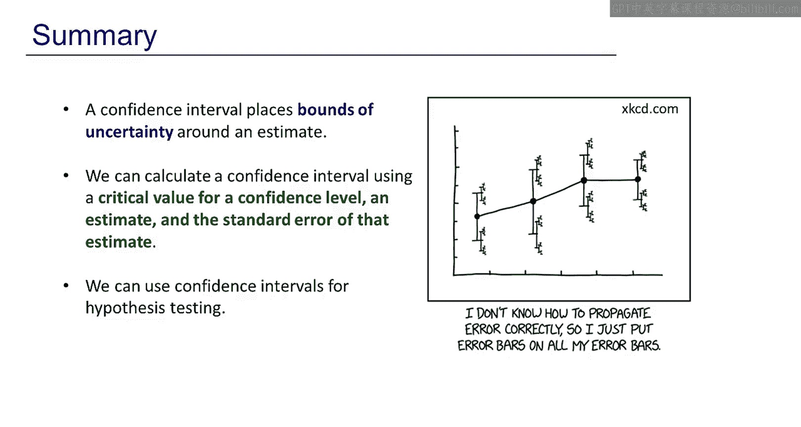

# 约翰霍普金斯大学《数据素养（数据⧸测量⧸回归⧸概率⧸毕业项目）｜Data Literacy》中英字幕（deepseek p55 8_置信区间.zh_en -BV1jXtMemEuh_p55-

Confidence intervals。This video will focus on confidence intervals。

 which is a commonly used means of summarizing uncertainty about an estimate。

 I'm sure you've come across confidence intervals before。

 such as when reading an academic article or technical report。By the end of this video。

 you should be able to construct a confidence interval and explain what it really means。

A confidence interval places reasonable bounds around an estimate。

 There are essentially two steps you need to follow when constructing a confidence interval。

 The first is to select a confidence level， and the second is to use the formula to calculate the upper and lower bounds that form the interval for that confidence level。

You could， in theory， calculate a confidence interval for any confidence level。

 ranging from just above zero to just below 100%。Typically， however。

 researchers calculate a confidence interval at the 90%， 95% or 99% confidence level。

Note that each confidence level is associated with an alpha score。

 which is simply the confidence level written on a zero to one scale。In addition。

 each confidence level is associated with a critical value。

These critical values are related to the standard normal curve。 Remember， for example。

 that 95% of the area under the standard normal curve falls between negative 1。96 and 1。96。

 Similarlyly，99% of the area under the standard normal curve falls between negative 2。58 and 2。58。

We'll talk more about why this matters in the video on statistical significance。For the moment。

 let's return to the construction of a confidence interval。

 The 95% confidence interval for an estimate has two numbers， a lower bound and an upper bound。

The lower bound is equal to the estimate minus the critical value time the standard error of the estimate。

At the 95% confidence level， the critical value is 1。96。

 The upper bound is equal to the estimate plus 1。96 times the standard error of the estimate。

So if we plug numbers into this formula， we get an interval。

A confidence interval has a very specific interpretation for a 99% confidence interval。

 The interpretation is that if we were to draw 100 samples。

99% of the confidence intervals calculated would contain the true population value。

For a 95% confidence interval， the interpretation is that if we were to draw 100 samples。

95% of the confidence intervals calculated would contain the true population value。

 The same interpretation format applies to the 90% confidence interval。In general， however。

 a confidence interval provides a range of plausible values of the parameter。

 Researchers will commonly say， for example， that a 95% confidence interval means we can be 95% confident that the interval contains the true population value。

Here are a few examples First， suppose we have a binary variable such as support for a new gun control law in a survey。

 respondents who indicate support for the new gun control law are coded as1 and respondents who indicate opposition are coded as zero。

Now suppose that you have a survey with 250 respondents and 53% of the respondents express support for the new gun control law。

 while 47% express opposition。If x represents support for the new law， then the mean of x is 0。53。

 and the standard error of x is 0。03。 We can calculate the standard error by plugging the mean of x and number of observations into the standard error formula for the sample mean。

Now that we have the sample mean and standard error of the sample mean。

 we can calculate the 95% confidence interval for the proportion of people who support the new gun control law。

Using the confidence interval formula， we add and subtract 1。

96 times the standard error from our estimate。In this case。

 the confidence interval comes out to be 0。47 to 0。59。

We can therefore say that we're 95% confident that the interval 0。47 to 0。

59 includes the true proportion of people who support the new gun control law。

Here's another example。 For this example， let's return to the scenario of comparing the mean thermometer rating。

 which ranges from 0 to 100 of the federal government between men and women。So in this case。

 we'll be calculating the confidence interval for a difference in means rather than a single proportion。

Let X equal the rating among women and y equal the rating among men。

 The numbers of the same as before。 The mean of x is 54。6。 The mean of y is 48。6。

 The standard deviation of x is 22。59。 The standard deviation of y is 23。79。

 The number of women is 1170， and the number of men is 890。The difference in means is 6 points。

 and the standard error of the difference is 1。03。 We can now calculate the 95% confidence interval for this difference。

 The lower bound is equal to 6-1。96 times 1。03， and the upper bound is equal to 6 plus 1。96 times 1。

03。 The resulting confidence interval ranges from 3。97 to 8。03。

 This means we can be 95% confident that the interval 3。97。 to 8。

03 includes the true difference in mean thermometer rating of the federal government between men and women。

To summarize， a confidence interval places bounds of uncertainty around an estimate。

 we can calculate a confidence interval using a critical value for a particular confidence level。

 an estimate and the standard error of that estimate。

We can use confidence intervals for hypothesis testing and to test for statistical significance。

 which is what we'll do in the next video。

