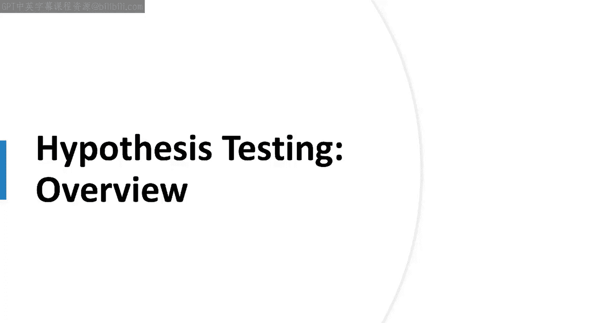
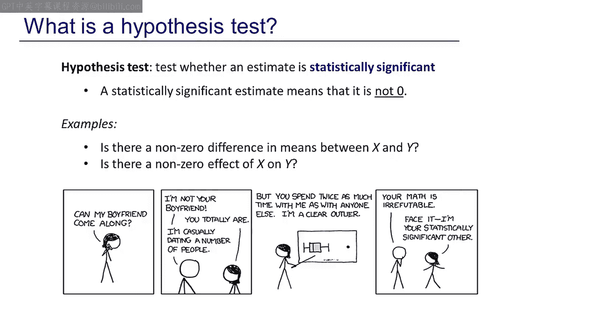
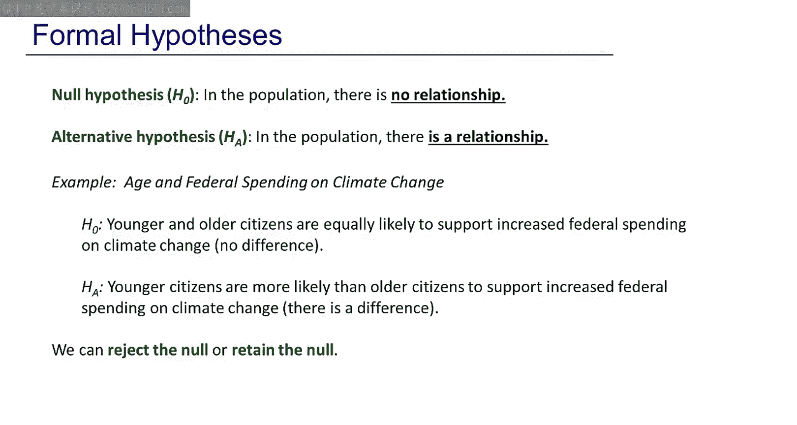
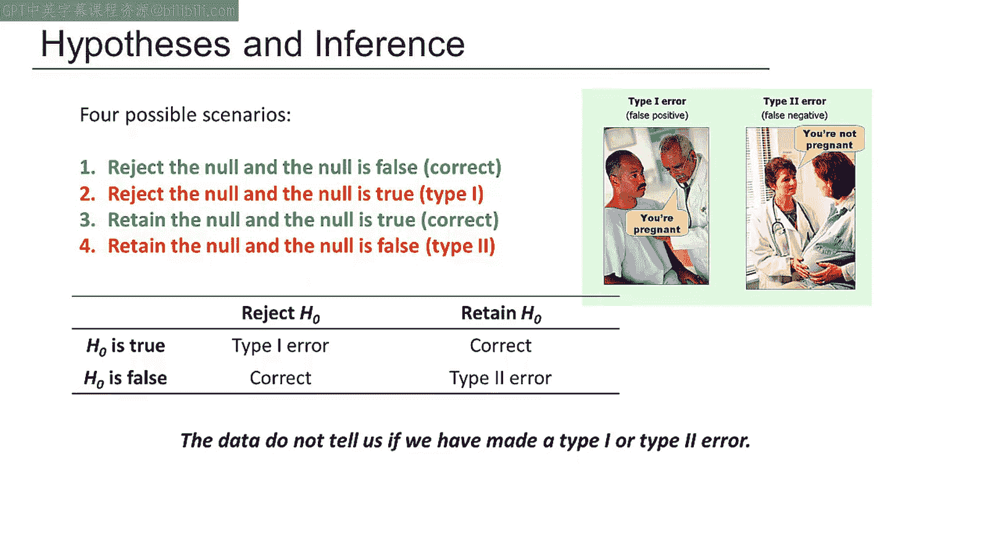

# 约翰霍普金斯大学《数据素养（数据⧸测量⧸回归⧸概率⧸毕业项目）｜Data Literacy》中英字幕（deepseek p56 9_假设检验概述.zh_en -BV1jXtMemEuh_p56-

Hypothesis testing， overview。Welcome to the first of two videos on hypothesis testing。

 Hyth testing will allow us to determine whether a result is statistically significant。

A statistically significant result， generally speaking。

 means that we have a high level of confidence that the result is distinguishable from zero。

Think about trying to estimate the relationship between two variables。

 say small class size and test scores。A statistically significant effect would mean that the data show a non zero relationship between class size and test scores。

Statistical significance is important for distinguishing effects that are very uncertain from effects in which we can have a high degree of confidence。

By the end of this video， you should be able to describe the purpose of a hypothesis test and the relationship between hypothesis testing and statistical inference。

As I noted， a hypothesis test tests whether an estimate is statistically significant。

 which generally speaking， means that the estimate is not zero。

 although hypothesis tests can compare estimates to something other than0。

 they are most frequently used to identify non zero relationships。For example。

 we might want to test whether there is a non zero difference in means between x and y。

 or whether there is a non zero effect of x on y。

While you've certainly heard the term hypothesisesis before。

 today we'll discuss how to construct and test formal hypotheses using statistical language。

A complete hypothesis is composed of a null hypothesis denoted with a capital H and subscript0 and an alternative hypothesis denoted with a capital H and subscript capital A。

The null hypothesis states that in the population， there is no relationship between the independent and dependent variable or no difference in means between two groups。

The alternative hypothesis states that in the population。

 there is a relationship between the independent and dependent variable。

 or that there is a difference in means between two groups。 Let's walk through an example。

 Suppose we are interested in the relationship between age and support for federal spending on climate change。

 The null hypothesis would state that younger and older citizens are equally likely to support increased federal spending on climate change。

 In other words， this hypothesis indicates that there is no relationship between age and support for increased federal spending on climate change。

Being a member of one age group does not change an individual's likelihood of supporting increased federal spending on climate change。

The alternative hypothesis might be that younger citizens are more likely than older citizens to support increased federal spending on climate change。

This means that if we were to conduct a survey and then calculate the percentage of respondents who support increased federal spending on climate change for both age groups。

 we would find that a higher percentage of younger citizens support this policy change。

Depending on the results of the data analysis， we either reject the null or retain the null。

 This is the language that is typically used as opposed to accepting the alternative。In other words。

 the result of the hypothesis is typically stated in terms of what to do with the null hypothesis。

 reject or retain。Once we collect data and calculate the necessary statistics。

 we either reject the null hypothesis or retain the null hypothesis。

 Reing the null leads us to conclude that there is， in fact。

 a relationship between the independent and dependent variable。

 retaintaining the null hypothesis leads us to conclude that there is no relationship between the independent and dependent variable。

After collecting data and calculating the necessary statistics， one of four scenarios will occur。

The first scenario is that you reject the null and in the population， the null is false。

 In this scenario， you've made a correct inference。

 The truth is that there is a relationship between the independent and dependent variable in the population。

 and you've rejected the null， which aligns with the truth。

The second scenario is that you reject the null。 and in the population， the null is true。

 In this case， the truth is that there is no relationship between the independent and dependent variable。

 However， you have rejected the null and therefore inferred that there is a relationship。In short。

 you incorrectly rejected the null。This type of error is referred to as a type1 error。

Under the third scenario， you retain the null and in the population， the null is true。Once again。

 you've made the correct inference。The truth is that there is no relationship between the independent and dependent variable。

 and so you have correctly retained the null。The last scenario is that you retain the null and in the population。

 the null is false here you have once again made a mistake。

 The truth is that there is a relationship between the independent and dependent variable。

 but you failed to reject the null。 This type of error is referred to as a type 2 error。

 The table on this slide summarizes these four scenarios。You can make a correct inference。

 make a type 1 error or make a type 2 error。 The picture on the right hand side of the slide is a funny way of summarizing the two types of errors。

 Imagine a doctor concludes that a male is pregnant and thus rejects the null hypothesis that the individual is not pregnant。

 This is a type 1 error， which is a false positive。 Clearly， the male cannot be pregnant。

 The inference is wrong。 Now， imagine that a doctor concludes that a pregnant female is not pregnant and thus fails to reject the null hypothesis that the individual is not pregnant。

 This is a type 2 error， which is a false negative。 Clearly。

 the woman in this picture is pregnant and once again， the inference is wrong。

Keep in mind that the data you have do not tell you whether you've made a type 1 or type 2 error。

 You are going to either reject the null or retain the null。

 doinging so is either correct or incorrect。 But it is generally impossible to know whether you've made the right inference or not。

 we can only design our study in a scientifically sound manner。

 which dramatically increases our odds of drawing the correct inference。

 only through repeated sampling。 In other words， performing the study over and over again。

 Would we have definitive proof that our inference is either correct or incorrect。

