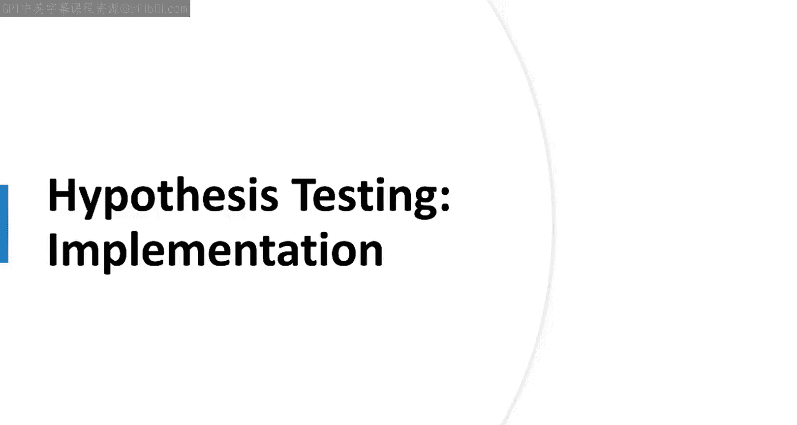
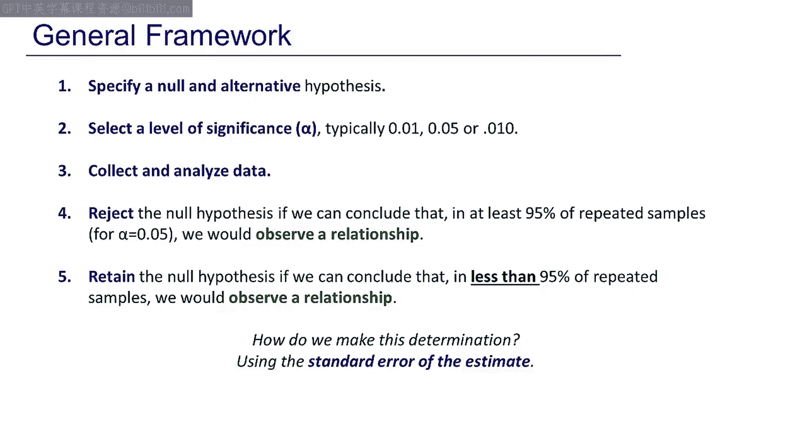
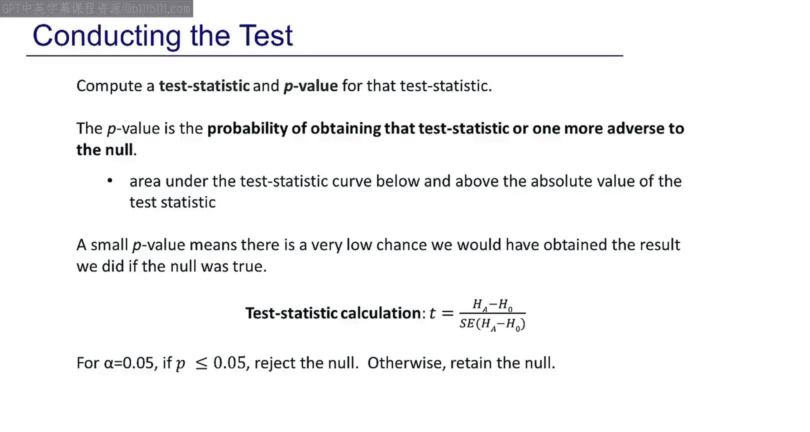
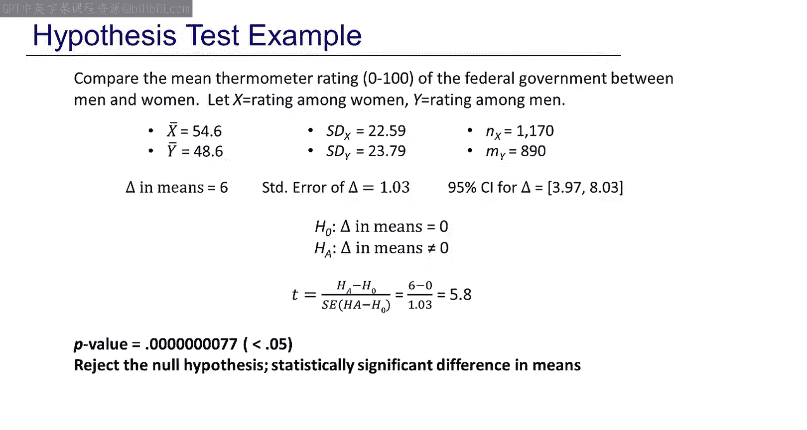
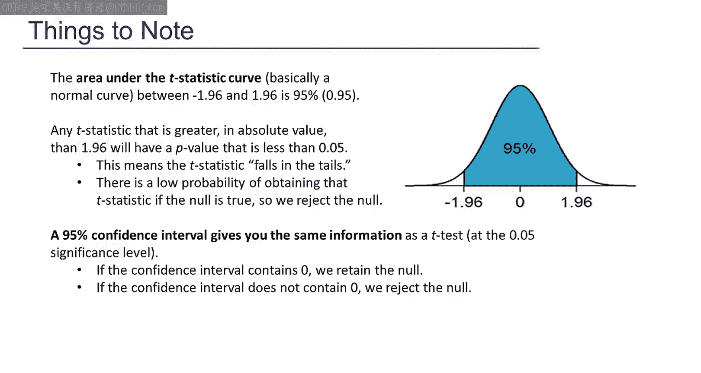
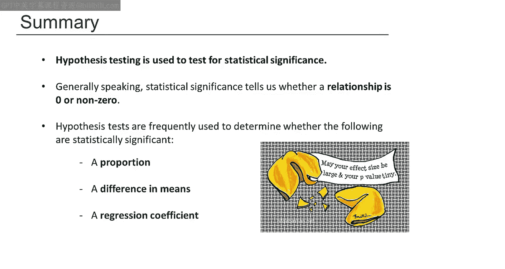

# 约翰霍普金斯大学《数据素养（数据⧸测量⧸回归⧸概率⧸毕业项目）｜Data Literacy》中英字幕（deepseek p57 10_假设检验实施.zh_en -BV1jXtMemEuh_p57-

Hypothesis testing， implementation。In this video， we'll put the concepts we discussed in the previous video into practice By the end of this video。

 you should be able to conduct and interpret a hypothesis test。

This slide displays the steps involved in the decision to reject or retain the null hypothesis。

 let's walk through these steps and then we'll get into the specifics about how the steps are accomplished in practice。

The first step is to specify a null and alternative hypothesis this requires clear thinking about your research question and the relationship you want to examine。

The next step is to select a level of significance。Generally， social scientists use the 0。

05 or 5% level of significance； other conventional levels are 0。01 and 0。

10 or the 1% or 10% significance levels。A significance level is the probability of rejecting the null hypothesis when the null is true。

At the 5% significance level， you would expect to incorrectly reject the null 5% of the time and correctly reject the null 95% of the time。

At the 1% significance level， you would expect to incorrectly reject the null， 1% of the time。

 and correctly reject the null 99% of the time。The choice of which significance level to use is a judgment call at which probability level are you most comfortable making policy decisions based on your conclusions。

After you've defined your significance level， the next step is to collect and analyze data。

Using your analysis， you will then either reject or retain the null。

If you reject the null at the 5% significance level。

 you conclude that in at least 95% of repeated samples。

 you would expect to observe a relationship between the independent and dependent variable。

If you retain the null at the 5% significance level。

 you conclude that you would expect to find a relationship in less than 95% of repeated samples。

How do you make the determination about whether to reject or retain the null？

To make this determination， you need to use the standard error of the sample estimate。

To conduct the hypothesis test， you'll compute a test statistic and determine the associated P value for that test statistic。

The P value is the probability of obtaining that test statistic or one more adverse to the null。

Mathematically， it is the area under the test statistic curve that is above or below the absolute value of the test statistic。

A small P value means that there is a very low chance that we would have obtained the result that we did if the null was true。

The test statistic calculation is as follows。 The numerator is the difference between the null and the alternative hypotheses。

 and the denominator is the standard error of that difference。 Remember， typically。

 the null is 0 as we typically specify the null to be no relationship between the variables under study。

So as you'll see going forward， the test statistic is usually calculated by dividing the estimate by its standard error。

At the 5% significance level， we reject the null if the P value for the test statistic is less than or equal to 0。

05， if the P value is greater than 0。05， we retain the null。

Let's walk through an example by returning to the relationship between gender and C' federal government thermometer ratings。

As before， let X equal the rating among women and y equal the rating among men。

 recall that the mean of x is 54。6。 The mean of y is 48。6。 The standard deviation of x is 22。59。

 The standard deviation of y is 23。79。 The number of women is 1170， and the number of men is 890。

 We also have the difference in means。 Standard error of the difference in means。

And from the previous lecture， the confidence interval for the difference in means。

We can now specify formal hypotheses to test whether the difference in means is statistically significant。

The null hypothesis would state that the difference in the mean federal government thermometer rating between men and women is equal to0。

 and the alternative hypothesis would state that the difference in mean federal government thermometer rating between men and women is not equal to zero。

The test statistic T is equal to 6 minus0 divided by 1。03。

Note that this is the difference in means minus0 divided by the standard error of the difference in means。

 This comes out to be 5。8 with an extremely small P value。Typically。

 researchers use statistical software to determine the P value。

 because the P value is smaller than the critical value of 0。05。

 we can easily reject the null at the 5% significance level。

Take a look back at the confidence interval， which provides another way of determining statistical significance note that the confidence interval does not contain zero。

As a result， we can reject the null。In short， confidence intervals and test statistics provide the same information as to whether or not the relationship under study is distinct from zero。

I've presented a lot of information， so I want to stop here and highlight a few key points。

The first is that the area under the T statistic curve between negative 1。96 and 1。96 is 95%。

In practice， the T statistic curve approximates the standard normal curve。

This means that any T statistic that is greater in absolute value than 1。96 will， by definition。

 have a P value that is less than 0。05。Note that this means that large T statistics fall in the tails of the distribution。

Think about the intuition here， if a T statistic is large and falls in the tail。

 it means there is a low probability of obtaining that T statistic if the null is true。Therefore。

 if the T statistic is large， we reject the null。Also note that a 95% confidence interval gives you the same information as a T test conducted at the 5% significance level。

 If the confidence interval contains 0， we retain the null。

 If the confidence interval does not contain 0， we reject the null。

In summary， hypothesis testing is generally used to test for statistical significance。

 which usually is framed as testing， whether a relationship is zero or non zero。In other words。

 a formal hypothesis test is usually used to test whether a relationship between two variables exists or does not exist based on the data at hand。

For example， researchers use hypothesis tests to determine whether a proportion。

 a difference in means， or a regression coefficient is statistically significant。Going forward。

 we will examine how hypothesis tests are used in a regression context and discuss the limitations of using hypothesis tests to drive decision making。

