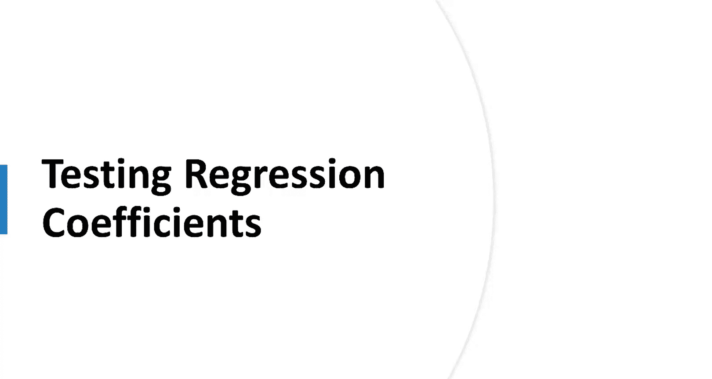
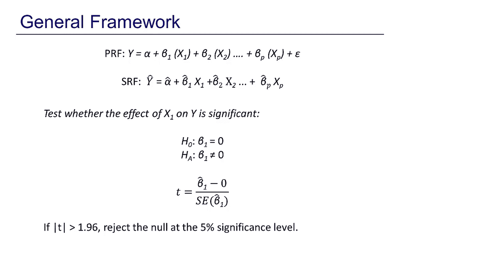
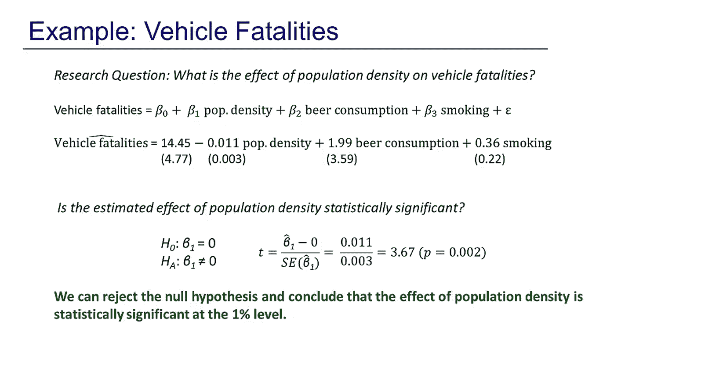
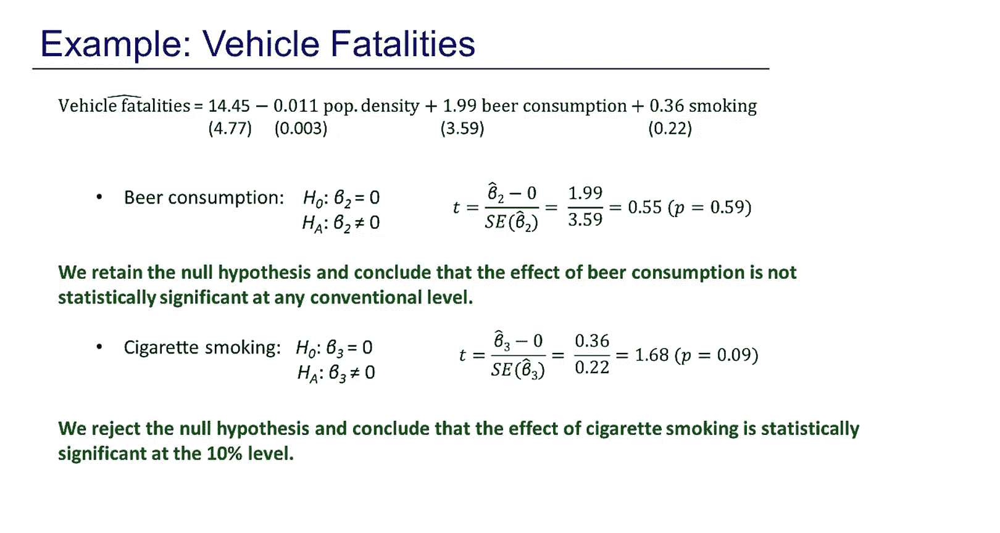
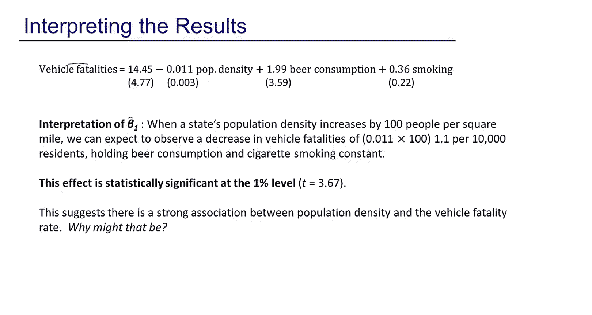
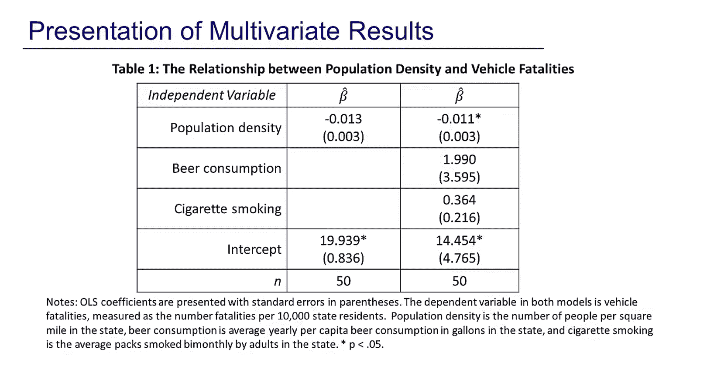

# 约翰霍普金斯大学《数据素养（数据⧸测量⧸回归⧸概率⧸毕业项目）｜Data Literacy》中英字幕（deepseek p58 11_回归系数检验.zh_en -BV1jXtMemEuh_p58-

Testing regression coefficients。At this point， you should know how to construct and interpret a multivariate model and also how to compute and interpret standard errors In this video。

 we'll merge these topics by discussing how to compute and interpret the standard errors of multivariate coefficients。

By the end of this video， you should be able to construct and interpret a hypothesis test for determining if a coefficient is statistically significant。

This slide presents the general framework for conducting a hypothesis test of a multivariate regression coefficient。

After we walk through the steps， we'll apply these rules to a specific example。As you'll recall。

 to conduct a multivariate regression analysis， you first need to specify a population regression function。

 which is how we think the world operates。 You would then collect data and estimate a sample regression function。

The next step in many cases is to determine the statistical significance of the coefficients。

 and in particular， the coefficient of interest。While it's statistically quite easy to calculate the statistical significance of any coefficient。

 keep in mind that we really only care about interpreting the coefficient of interest。

 The controls are important for ensuring that our estimate of the coefficient on the independent variable of interest is accurate。

The statistical significance of the control coefficients， however， is not usually important。

So suppose we want to test whether the effect of x1 on y is significant。

 This effect is captured in our model by beta 1。Our null hypothesis is that beta 1 is0。

 while the alternative hypothesis is that beta 1 is not equal to0。

Note that our alternative hypothesis in real world terms indicates that we think there is a nonze relationship between x1 and Y。

We would next calculate the T statistic by dividing beta 1 hat by its standard error。

 if the absolute value of the T statistic is greater than 1。96。

 we reject the null hypothesis at the 5% level。 If the absolute value of the T statistic is less than 1。

96， we retain the null。

Let's walk through an example。Suppose you are interested in investigating the question。

 what is the effect of population density on vehicle fatalities？Theoretically。

 you might suspect that denser areas have fewer vehicle fatalities because there is a higher degree of walkability。

 more public transportation， and shorter distances between retail establishments and residences。

Let's see if the data at hand support the hypothesis。

We can specify the PRF as follows Vehicle fatalities in each US state is the dependent variable。

 Population density measured as the number of people per square mile is the independent variable of interest。

 and we can control for beer consumption and cigarette smoking。

 as these are other possible determinants of vehicle fatalities that may be correlated with population density。

The SRF appears below the PRf。The standard errors appear below the estimates in parentheses。

Let's examine whether the estimated effect of population density is statistically significant。

Our null hypothesis is that beta 1， which is the coefficient on population density equals0。

 and our alternative hypothesis is that beta 1 does not equal 0。

The T statistic is equal to the estimated coefficient divided by the standard error。

 which in this case is 0。011 divided by 0。003。 The resulting T statistic is 3。67 with a P value of 0。

002。This P value is well below all conventional levels of significance。

 so we can confidently reject the null hypothesis and conclude that the effect of population density is statistically significant at the 1% level。

As I noted earlier， there's no particular reason to care about the statistical significance of the control variables。

Nonetheless， we can certainly compute the statistical significance of these coefficients。

 For example， let's determine whether the estimated effect of beer consumption is significant。

After specifying our nu and alternative hypotheses in the usual way。

 we can calculate the T statistic by dividing the coefficient by its standard error Here。

 the T statistic turns out to be 0。55， with a P value of 0。59。

 This P value is well above all conventional levels of significance。

 so we can confidently say that the estimated effect of beer consumption is not significant。Again。

 however， we shouldn't draw any conclusions about the causal relationship between beer consumption and vehicle fatalities。

 as we have not constructed the model to treat beer consumption as the independent variable of interest。

 Moreover， we should not exclude the variable from the analysis because its' coefficient is insignificant。

 Its purpose is to serve as a control to ensure that our estimated effect of population density is as accurate as possible。

Let's turn to the effect of cigarette smoking。 If we divide the coefficient on this variable by its standard error。

 we see that the T statistic is 1。68， and the P value is 0。09。

This means we can reject the null at the 10% significance level。

 but not at the 5% level or the 1% level for that matter。

So what does it mean to find that an effect is significant at the 10% level， but not at lower levels？

There's not an easy straightforward answer to this question。 If the stakes are very high。

 you may want to collect more data to arrive at a more definitive conclusion。For example。

 imagine testing a drug with serious side effects， you would want to have a lot of confidence in your results before drawing a conclusion。

With that in mind， let's spend a few more moments on interpretation。

The SRF appears again at the top of the slide。How would we interpret the meaning of beta 1 hat？Here。

 a one unit increase in the number of people per square mile is very small。

 so it might make sense to interpret this coefficient in terms of a 100 unit increase。

We would say that when a state's population density increases by 100 people per square mile。

 we can expect to observe a decrease in vehicle fatalities of 1。1 per 10，000 residents。

 holding beer consumption and cigarette smoking constant。

Because we determined that the T statistic is 3。67。

 we can say that this effect is statistically significant at the 1% level。

This model thus suggests that there is a strong association between population density and the vehicle fatality rate。

 based on our domain knowledge about vehicle crashes。

 we might suspect that this is because denser areas have more public transportation and are more walkable。

The analysis itself however， does not provide evidence about a causal mechanism。

 we would need to conduct more research to better understand the relationship we uncovered。

This last slide presents a table that exemplifies the manner in which regression results are frequently presented。

 Let's walk through the components。First， note that the table has a meaningful title that captures the key purpose of the table。

Next， note that the first column lists the independent variables， the intercept and N。

 which stands for the number of observations。The variable names are not labels such as those that appear in a data set。

 but meaningful names that will make sense to an average reader。

The second column presents the results from a bivariate model in which car fatalities is regressed on population density。

The third column presents the results from the multivariate model。

If you thought it was valuable to include more specifications。

 you could add additional columns for those models。The notes below the table are important。

 they explained that the table presents OLS coefficients with standard errors in parentheses；

 the notes also describe how the variables are measured。

This is essential so a reader can interpret the magnitude of the estimates。

The notes also indicate that the coefficients that are statistically significant at the 5% level have an asterisk。

Every table will look a little bit different。 Some tables might include a series of asterisks to differentiate between results that are significant at different levels。

What is most important is to format a table in a way that is easy to understand。

 and it should stand on its own， a reader should be able to make sense of a table without referring to the text and vice versa actually。

Please feel free to spend a few minutes examining the table on this slide and think about how you will present your findings in your own work。

😊。

