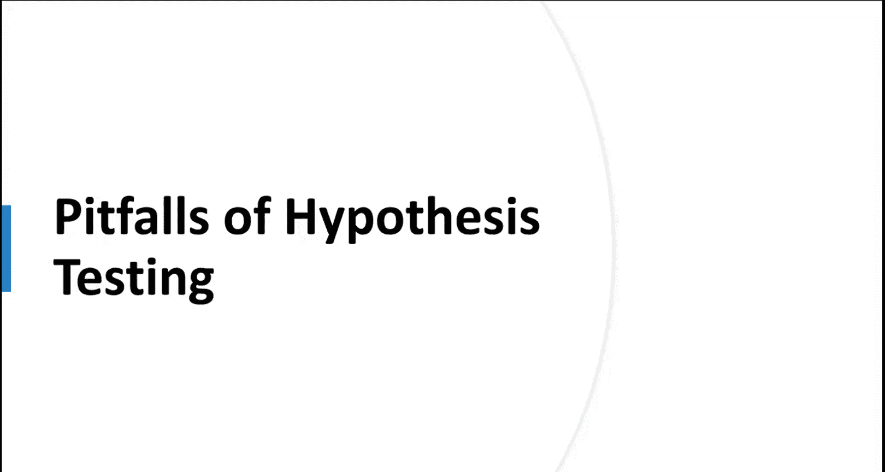
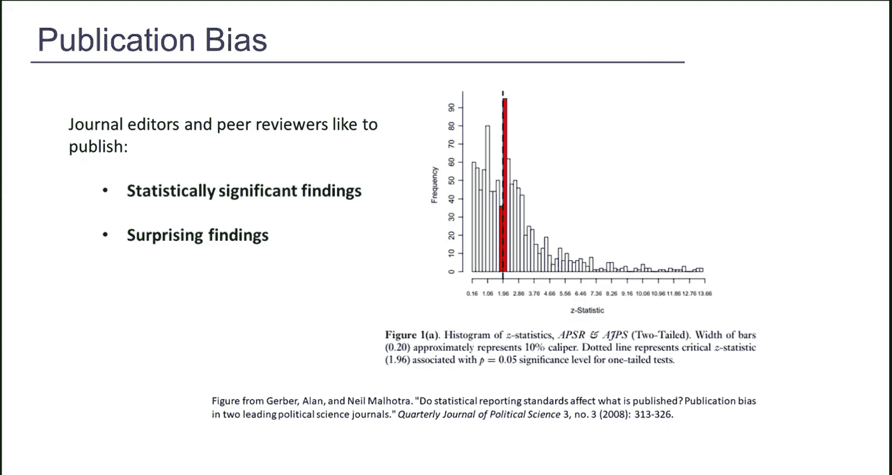
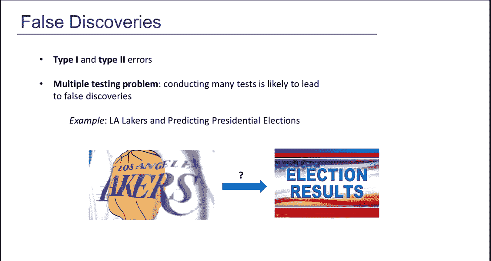
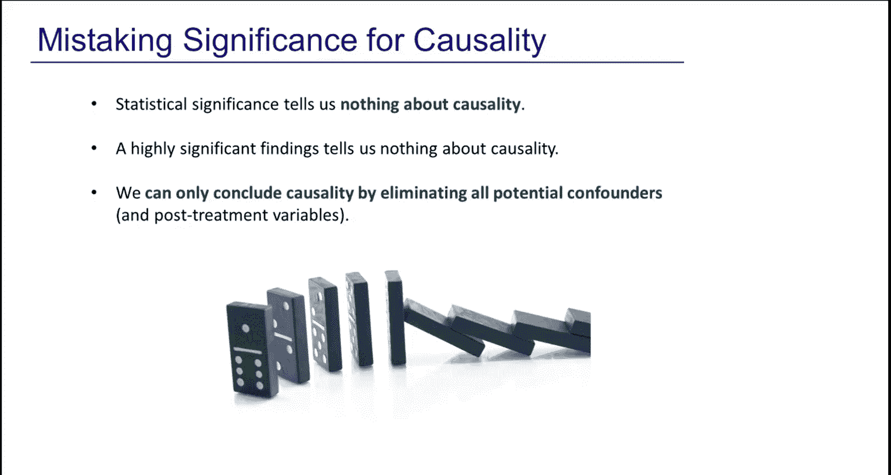
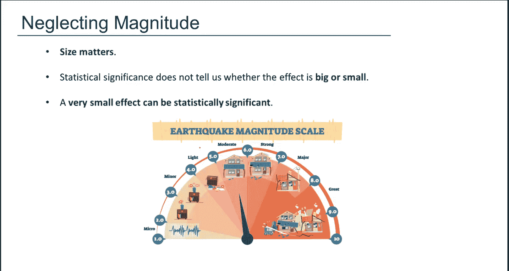
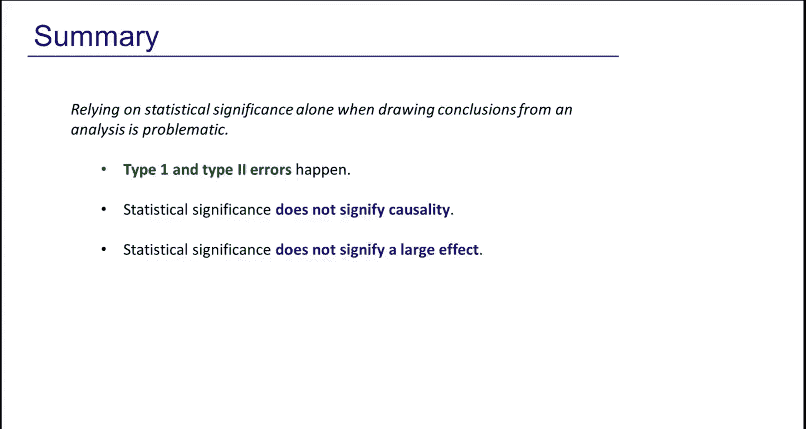

# 约翰霍普金斯大学《数据素养（数据⧸测量⧸回归⧸概率⧸毕业项目）｜Data Literacy》中英字幕（deepseek p59 12_假设检验的陷阱.zh_en -BV1jXtMemEuh_p59-

Pitfalls of hypothesis testing， although hypothesis testing is widely used in all sectors as a means of summarizing uncertainty about estimates。

 it has important limitations。By the end of this video。

 you should be able to explain the pitfalls with relying on hypothesis testing as the primary means of evaluating estimates。

One of the major pitfalls with relying heavily on statistical significance is that it leads to publication bias。

 Journal editors and peer reviewers like to publish findings that are statistically significant and surprising。

This makes sense from a business standpoint， Readers are going to be most interested in studies that uncover interesting and new non zero relationships。

In contrast， not very many readers are going to want to dive into a study with mill findings。

Uncovering a lack of a relationship rarely makes for a good headline or journal title。

The graph on this slide shows the distribution of test statistics that appeared in publications in two prominent political science journals。

Note the huge spike right after 1。96 and the long tail over larger test statistics。

It's clear that published results often just cross the 5% significance level。

 and many results are more significant， very few published results are statistically insignificant。

Another concern with hypothesis testing is the very real likelihood of type 1 and type 2 errors。

 recall that the hypothesis testing framework is probabilistic。

 builtt into the framework is the very real probability that we will sometimes reject the null when it is true and retain the null when it is false。

 Suppose a researcher conducts 10 hypothesis tests and let's assume that we know that all of the null hypothesistheses for these tests are true。

There is a 40% chance that the researcher rejects at least one of these null hypotheses at the 5% level。

This means that there is a 40% chance of making at least one false discovery with these 10 tests。

There are numerous examples of false discoveries in the world； For example。

 many have hypothesized that seemingly unrelated events predict presidential election outcomes。

These predictors include the locations of the Summer Olympic Games and Halloween mask purchasing behavior。

 Some have even tried to argue that the outcomes of sporting events is predictive。For example。

 it turns out that eight out of nine times that the LA Lakers have made it to the NBA finals。

 the Republican candidate has won the presidency in the US。

Does this mean that the performance of the LA Lakers is somehow causally related to a presidential election outcome or even a reliable predictor？

It seems like this is perhaps a false discovery。Related to the previous point is the frequent conflation of statistical significance with causality。

 This is particularly problematic when trying to explain findings to those who do not have a background in frequentist statistics。

Statistical significance tells us nothing about causality。

 even a highly significant finding tells us nothing about causality。

We can only conclude causality by eliminating all potential confounders from the analysis and eliminating all post treatment variables as well。

In short， a statistically significant relationship does not mean that there is evidence of a causal relationship。

 which is critical to understand when devising actionable recommendations based on findings。

Lastly， a downside of relying on statistical significance as the key indicator of whether or not there is a relationship between two variables is that it frequently leads the researcher to neglect the magnitude of the effect。

Statistical significance does not tell us whether the size of an effect is big or small。

 a very teeny， tiny effect can be statistically significant， particularly if we have a lot of data。

But another way， we might be super duper sure that an effect size is minuscule。

Imagine testing a drug to determine if it treats a disease effectively。

Knowing that the drug has a positive， significant effect is not enough to make a decision about whether to use it。

 particularly if there are side effects。 you would also want to know the size of the effect。

Does the drug make a big difference or a small difference in its effect on the disease， In short。

 there are very important questions to ask beyond statistical significance when evaluating statistical findings。

To summarize the previous points， relying on statistical significance alone when drawing conclusions from an analysis is problematic。

This is because first， type1 and type 2 errors are bound to happen， these errors are expected。Second。

 statistical significance does not tell us about causality。 And third。

 statistical significance does not signify a large or meaningful effect in a real world sense。

To properly evaluate an analysis， a researcher must take multiple factors into account。

 including whether the estimates are biased， whether there is a causal relationship。

 and the size of the estimated effect。

