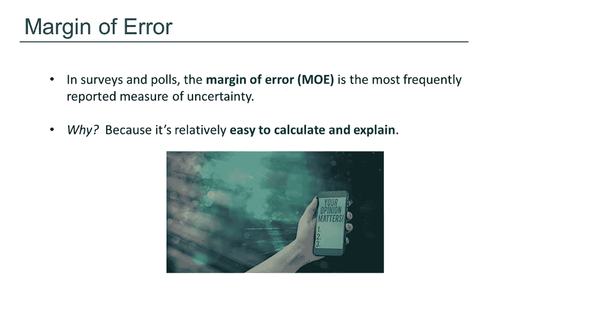
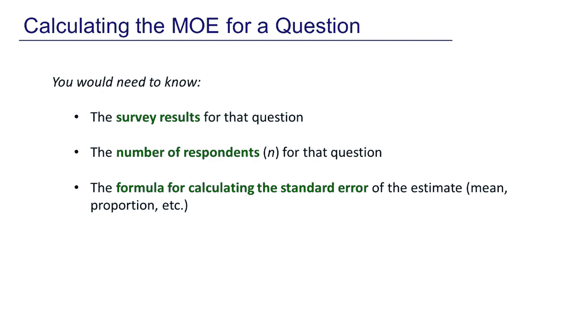
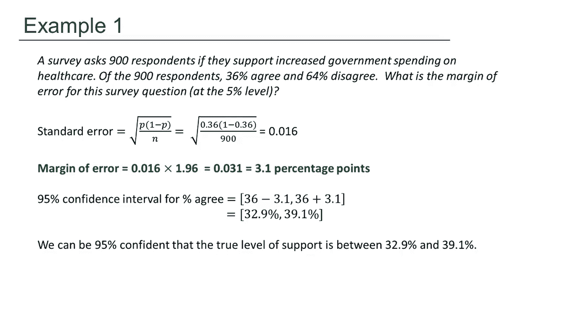
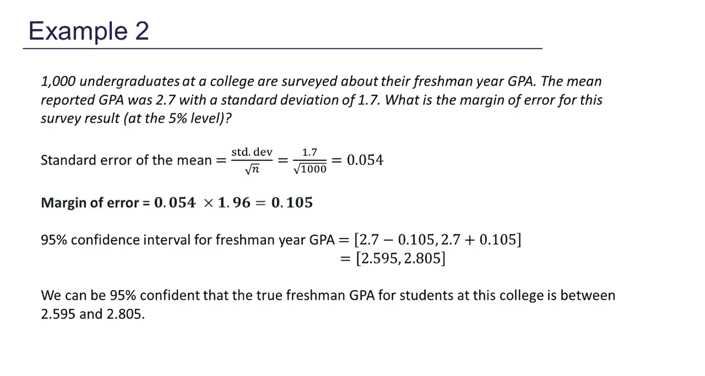
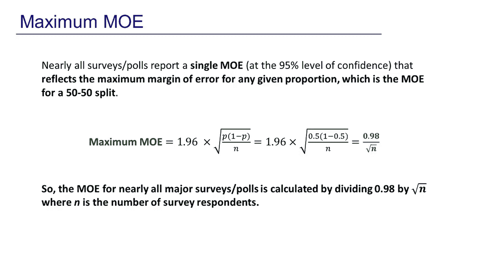
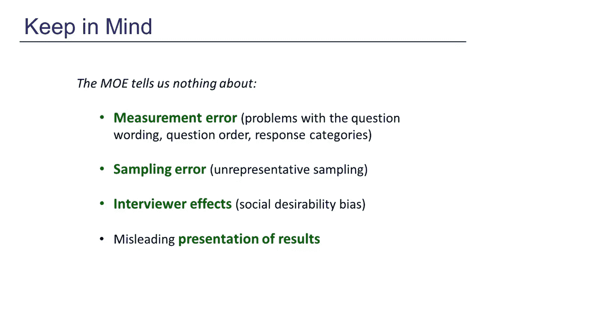

# 约翰霍普金斯大学《数据素养（数据⧸测量⧸回归⧸概率⧸毕业项目）｜Data Literacy》中英字幕（deepseek p60 13_民意调查中的误差范围.zh_en -BV1jXtMemEuh_p60-

Margin of error in polls in the realm of surveys in polls， the margin of error。

 as opposed to the standard error， is the measure most commonly used to capture the uncertainty in the results。

Generally speaking， the margin of error refers to half of a 95% confidence interval By the end of this video。

 you should be able to calculate the margin of error and interpret it correctly。

In surveys and polls， the margin of error abbreviated ME。

 is the most frequently reported measure of uncertainty。

This is because it's a quantity that's relatively easy to calculate and easy to explain。

You've undoubtedly come across the margin of error when you've read about poll results in the news or heard about them on TV。

 Let's explore how this quantity is calculated and what it means。

The exact formula for the margin of error depends on the type of survey question。 As you know。

 there are many different types of questions that can be asked。

 There are single proportion questions such as asking whether respondents approve or disapprove of an elected official。

There are discrete scale questions， such as a five point scale that ranges from strongly agree to strongly disagree。

These kinds of questions are often used to ask respondents about their policy positions。

There are also continuous questions， such as those that ask respondents to provide their GPA， age。

 or salary。Again， the formula for the margin of error for any specific survey question depends on how that question is structured。

Conceptually speaking， the margin of error is equal to the standard error of the estimate。

 which is calculated using the standard deviation of the variable and the number of observations multiplied by 1。

96。 The 1。96 number is used when the researcher is aiming for a margin of error at the 95% confidence level。

 Also known as the 5% significance level。The confidence interval for an estimate for a particular survey question can then be calculated by adding and subtracting the margin of error from the estimate。

To summarize the information presented on the previous slide。

 to calculate the margin of error for a specific survey question。

 you would need to note the survey results for that question。

 the number of respondents for that question， and the formula for calculating the standard error of the estimate。

Again， this formula depends on whether the estimate is a mean value。

 a proportion or some other measure。 This is all quite abstract。

 So let's walk through a few examples。 Suppose a survey asks 900 respondents if they support increased government spending on health care。

Of the 900 respondents，36% agree and 64% disagree。 What is the margin of error for this survey question at the 5% level。

The first step is to calculate the standard error， because this is a proportion。

 we can calculate the standard error by taking the square root of p times 1 minus p divided by the number of observations。

In this case， the standard error is the square root of 0。36 times 1 minus 0。36 divided by 900。

 which turns out to be 0。016。We can then calculate the margin of error by multiplying the standard error by 1。

96， which turns out to be 0。31。 The margin of error for this particular survey question is 3。

1 percentage points。We could then calculate the 95% confidence interval for the percentage of respondents who agree with increased spending on healthcare。

 the lower bound of the confidence interval is equal to 36 minus 3。1。

 while the upper bound is equal to 36 plus 3。1。The resulting confidence interval ranges from 32。

9% to 39。1%， this means we can be 95% confident that the true level of support for increased funding for healthcare is between 32。

9% and 39。1%。

Here is a second example of how to calculate the margin of error for a specific survey question。

 Suppose a survey asks 1000 undergraduates at a college to report their freshman year at GP。

 The mean reported GP is 2。9 with the standard deviation of 1。7。

 What is the margin of error for this survey result at the 5% level。

 The first step is to calculate the standard error of the estimate。

 which in this case is a mean value。This means we need to divide the standard deviation of the estimate by the square root of the number of observations in this case。

 we divide 1。7 by the square root of 1000， which turns out to be 0。054。

We can calculate the margin of error by multiplying this standard error by 1。96。

 which turns out to be 0。105。 This means the margin of error for reported GP is 0。105 points。

We can calculate the 95% confidence interval by adding and subtracting the margin of error from the estimate。

This gives us a confidence interval that ranges from 2。595 to 2。805。

 meaning we can be 95% confident that the true freshman GPA for students at this college is between 2。

595 and 2。805。

While it's certainly possible to calculate a margin of error for each survey question。

 this is not the industry standard， nearly all surveys and polls report a single margin of error at the 95% confidence level。

 This margin of error reflects the maximum margin of error for any given proportion。

 meaning it's the margin of error for a 5050 split。

We can calculate this maximum margin of error by multiplying 1。96 times the square root of 0。

5 times 0。5 divided by the number of observations this comes out to be 0。

98 divided by the square root of the number of observations。

So the margin of error for nearly all major surveys and polls is calculated with this very simple formula。

 Survey researchers can therefore determine their sample size based on their target maximum margin of error。

While the margin of error is valuable as a general measure of uncertainty surrounding the overall survey results。

 there are a few important things to keep in mind。First。

 the margin of error tells us nothing about whether the survey is plagued by measurement error。

There may be problems with the question wording， question ordering， or the response categories used。

Problems with these factors are not reflected in the margin of error。

 There could also be sampling error。 A survey may use a sample that is not representative of the population of interest。

 Again， this issue is not reflected in the margin of error。Third。

 the margin of error does not tell us anything about interviewer effects。

 based on the margin of error alone， we can't say whether the responses are vulnerable to social desirability bias or other types of interviewer effects。

 And finally， the margin of error has no bearing on whether the results of any particular survey are presented properly。

 A researcher might report the correct margin of error。

 but still present the results in a way that does a poor job of conveying the findings and the uncertainty about those findings。

The overall takeaway point， which is one I continuously emphasize。

 is that the margin of error is but one of many factors we should take into account when evaluating an analysis。

