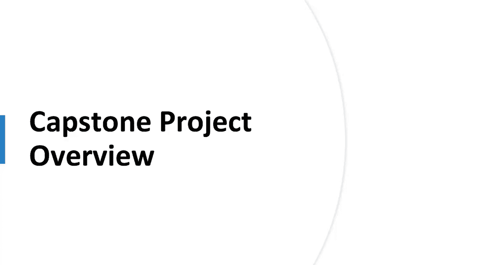
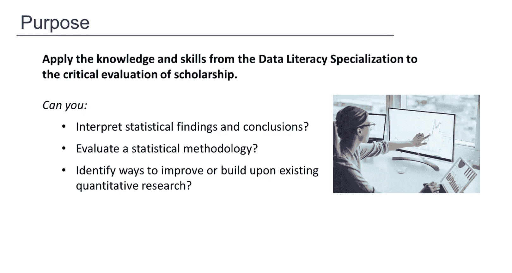
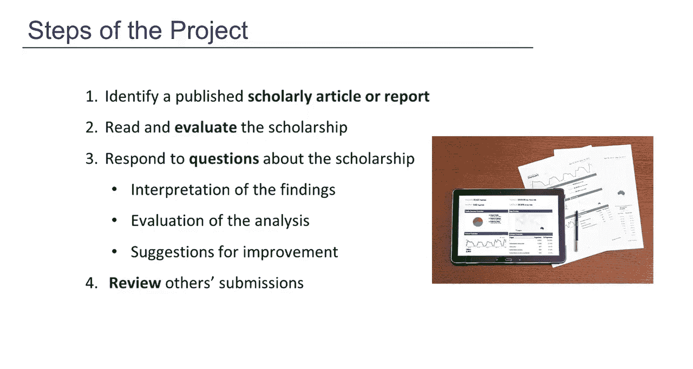
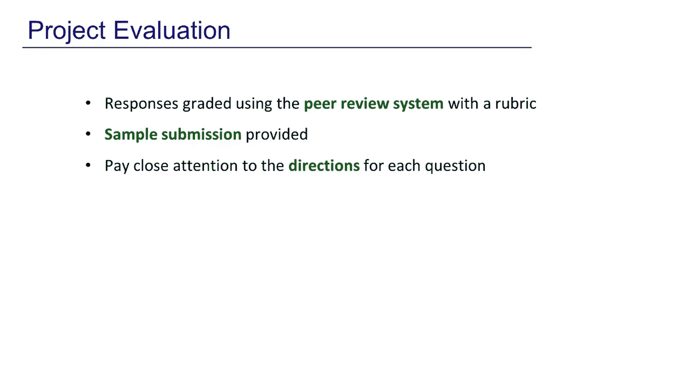

# 约翰霍普金斯大学《数据素养（数据⧸测量⧸回归⧸概率⧸毕业项目）｜Data Literacy》中英字幕（deepseek p61 0_毕业项目概述.zh_en -BV1jXtMemEuh_p61-

Capstone Project overview。Welcome to the Capstone course for the Data litteracy specialization。

 Many congratulations for all of your hard work to get to this point。😊，By this point。

 you should have a firm understanding of how to interpret and evaluate a statistical analysis。

By the end of this video， you should understand the purpose and components of the capstone project。

The purpose of this capstone project is to assess your ability to apply the knowledge and skills you have acquired through the data literacy specialization to the critical evaluation of a piece of scholarship that you will select。

I hope this project gives you an opportunity to take a deep dive into a piece of scholarly work in your area of interest。

 and even to consider how you might build upon that work。

The questions that are part of the Capstone project will specifically assess your ability to interpret statistical findings and conclusions。

 evaluate a statistical methodology that is used to answer an empirical research question。

 and identify promising ways to improve or build upon that research。Taken together。

 these questions will ask you to read， digest， evaluate。

 and reflect on a piece of scholarship that you select for this project。

This slide walks you through the four steps of the capstone project。First。

 you will identify a published scholarly article or report。

The next module in the course will provide more specific guidance on selecting this piece of scholarship and some suggestions for where to look for a good and appropriate piece of research。

In general， the article or report should come from a reputable source。

 address a research question using a statistical analysis。

 and focus on a topic that is of interest to you。You should then read and consider the research once you've had a chance to read through the research in full。

 you should then respond to the specific questions in the peer review assignment。

 which is located in the third module of the capstone course。Again。

 the questions will ask you to interpret the findings， evaluate the analysis。

 and offer concrete suggestions for improvement。After you have submitted the project。

 you will review others' assignments as your final task。

Your capstone project will be evaluated using the peer review system。

 which includes a detailed rubric， This will be similar to the previous peer review assignments you completed as part of the specialization。

There is also a sample submission provided in the third module。

 which will help you ensure that your project meets expectations。

Please read and follow the directions for each question in the assignment carefully。

 pay close attention to the question being asked and the requested format of the response。

 as well as the requested length of the response。I hope that you find this project to be a valuable learning experience and that it empowers you to be an educated consumer of analytical findings。

