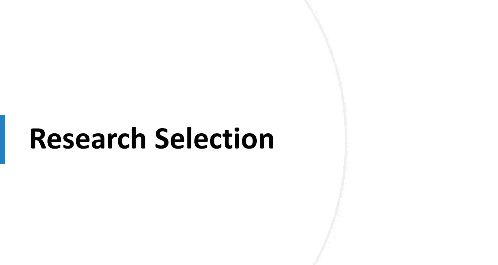
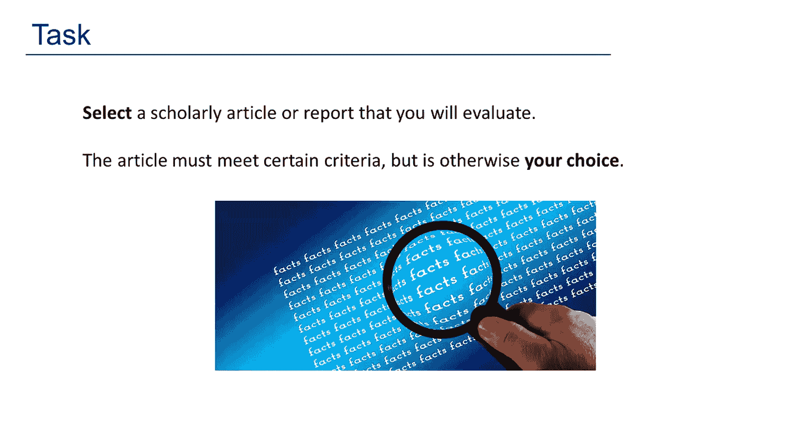
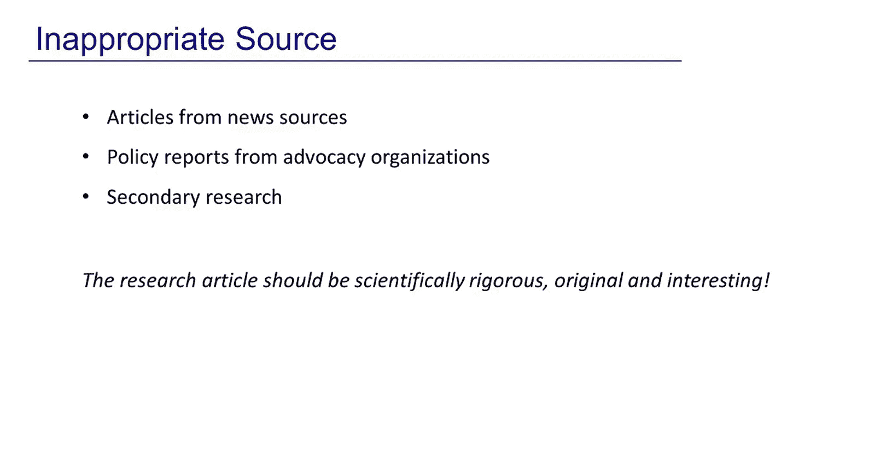

# 约翰霍普金斯大学《数据素养（数据⧸测量⧸回归⧸概率⧸毕业项目）｜Data Literacy》中英字幕（deepseek p62 1_研究选择.zh_en -BV1jXtMemEuh_p62-

Research selection。This video will focus on how you should select a research article or report for this project。

By the end of this video， you should understand the criteria you should use when deciding which article or report select and be able to identify some potential sources of where you can find an appropriate article。

As a reminder， your task for the capstone project is to select a scholarly article or report that you'll then evaluate。

The article that you select must meet certain criteria。

 but otherwise you have a lot of flexibility to select an article that is in your substantive area of interest。

I hope you use this assignment as an opportunity to explore a topic of interest in depth and to consider how to further advance research on this topic。

The article or report that you select should meet four criteria。First。

 it should be a complete article or report， you should not select a piece of a larger project。Second。

 the research should be original and empirical by empirical。

 I mean that the research should examine observable facts。

 It should not be a thought or reflective piece。 While thought pieces are certainly interesting and important as part of a public discussion about critical issues。

 they are not appropriate for this particular assessment project。Third。

 the paper should be published by a reputable organization。

 I'll provide some examples of these organizations On the next slide。

 you should not select a work in progress for this assignment。Finally， and perhaps most importantly。

 the research should include a quantitative analysis that uses one or more of the methods that we have covered in the data literacy specialization。

Please note that the research does not need to use all of the methods， but it should， of course。

 use some of the methods that we have discussed。I've listed some of the methods here on the slide。

 but there are certainly others that we covered as well。For example。

 the research might use descriptive statistics， data visualizations， measurement tools。

 experimental research， survey research， regression analysis。

 or causal inference to support an argument。If the report or article that you select meet these criteria。

 you are in good shape for the project。On this slide。

 I've provided some examples of organizations that publish the types of reports and articles that are appropriate for this assessment。

Please note that not every document published by these organizations fit the criteria outlined on the previous slide。

And there are many organizations that do publish documents that would be a good fit for the project that are not listed。

First， consider research put forth by government agencies and organizations such as the US Department of Education。

 the US General Services Administration and the Millennium Challenge Corporation。

 These are just three of the many agencies of the US government that develop high quality research reports。

 Some state governments likewise develop strong research reports。

 As do the governments of other countries。 These are all good potential sources of research reports for this project。

Second， there are many think tanks and private research organizations that develop high quality articles and reports。

 I've listed just a few on this slide， such as the Sunlight Foundation， Urban Institute Brookings。

 the National Bureau of Economic Research and the Rand Corporation Again。

 remember that not every report these and similar organizations produce is appropriate The article or report must meet the criteria I described on the previous slide。

Finally， peer reviewed journals are an excellent source of original quantitative research。

 there are peer reviewed journals in every subject area。

While many journals operate on a subscription or paywa model。

 some do make recent articles available for free。This slide identifies some inappropriate sources of research for this capstone project。

 Please do not use an article from a news organization， Even a highly reputable one。

 Journalism is distinct from scientific research。While journalism is essential to a healthy democracy。

 it serves a different purpose than scientific research。Further。

 most news articles report on original research rather than present original research conducted by the news organization。

This project asks you to examine the original research itself rather than a summary of it。Second。

 avoid policy reports from advocacy organizations In some cases。

 the line between an advocacy organization and a research organization is blurry， but in general。

 focus on selecting a piece of research that attempts to uncover the truth about an important question rather than a document that seeks to advance a particular policy objective by harnessing confirmatory statistics。

Lastly， be sure to avoid secondary research， which is research that summarizes or reports on original findings。

 such as a news article about a recent study。Overall。

 the research article you select should be scientifically rigorous， original and interesting。

