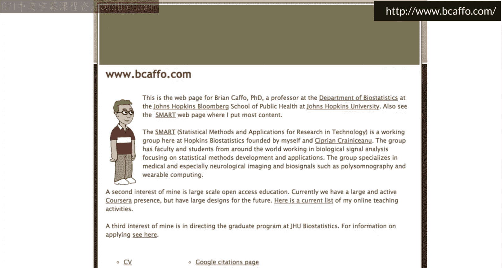
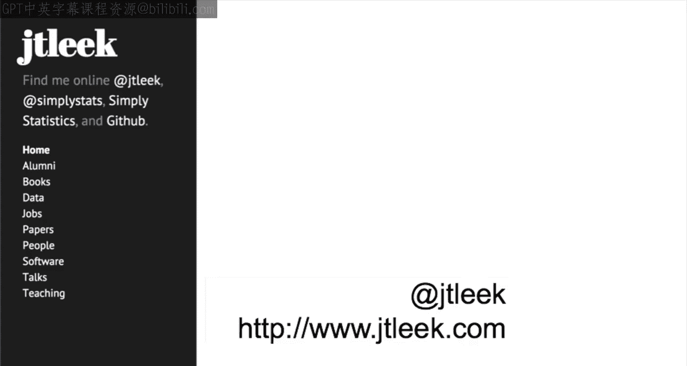
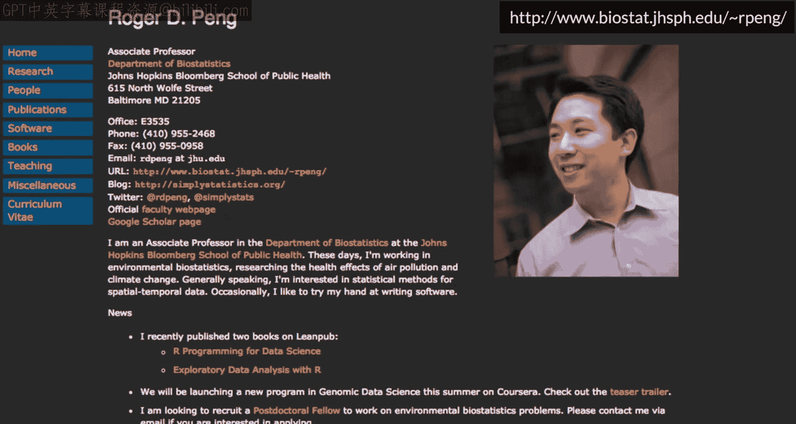
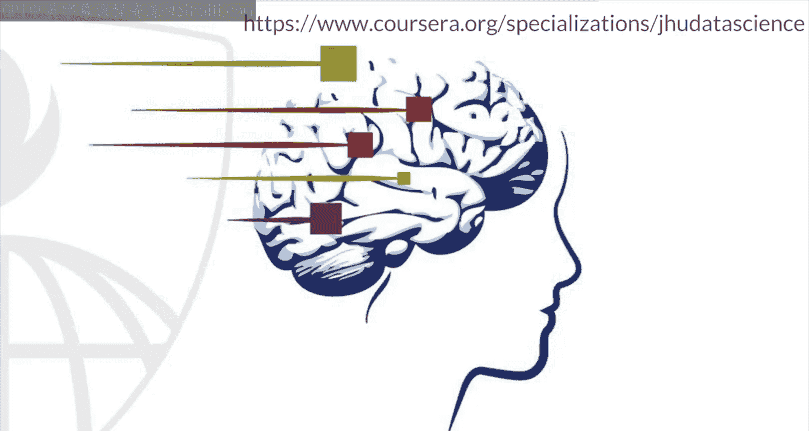

#  001：关于你的讲师们 👨‍🏫

欢迎来到这门课程，这是一门数据科学的速成课。

在本节课中，我们将认识本课程的三位讲师，了解他们的背景和专业领域，这有助于你理解课程内容的设计视角。

## 讲师团队介绍

上一节我们欢迎了大家，本节中我们来了解一下本课程的三位讲师。我们三人是“高管数据科学”专项课程的联合讲师和联合开发者，都将参与这第一堂课，帮助你熟悉并了解数据科学。

以下是关于我们每个人的简要介绍。

*   **布莱恩·卡菲** 是约翰霍普金斯大学的生物统计学教授。他主要致力于神经影像实验数据的分析，领导着一个数据分析科学家团队，负责分析此类数据，并与约翰霍普金斯校区的医学专业人士和科学家进行协作。

*   **我（杰夫·利克）** 也是约翰霍普金斯大学的数据科学家，是这里的生物统计学和肿瘤学副教授。我主要专注于基因组数据的分析，即关于你的基因组的数据，研究如何利用这些数据并将其与个性化医疗等领域联系起来，从而通过基因组了解你与他人之间的差异。

*   **第三位讲师是罗杰·彭**，他也是约翰霍普金斯大学的生物统计学副教授。他主要致力于环境健康研究数据的分析，处理那些将环境健康数据与监管机构和其他相关人员感兴趣的其他公共卫生指标联系起来的数据集。

## 讲师的合作与背景

了解了每位讲师的专业方向后，我们来看看他们之间的合作。罗杰和我实际上还共同运营着一个名为“简单统计”的博客。这个博客探讨许多数据科学议题，涵盖了大量相关材料，在后续的讲座中你可能会看到一些博客文章的内容出现。

此外，我们三人还共同创建了约翰霍普金斯大学的“数据科学”专项课程。那是一个更侧重于实践操作的专项课程，主要关注如何完成数据科学日常工作中的基础性任务。

相比之下，本课程更像是一个关于数据科学概念的速成概述，重点在于这些概念如何应用，以及在你管理团队时如何运用它们。

## 课程总结

本节课中，我们一起认识了本课程的三位联合讲师：布莱恩·卡菲、杰夫·利克和罗杰·彭。我们了解了他们各自在神经影像、基因组学和环境健康数据分析领域的专长，以及他们通过共同运营博客和开发实践课程所建立的合作背景。这为我们理解本课程（一个侧重于概念与管理应用的数据科学速成课）与更偏重实操的“数据科学”专项课程之间的区别提供了背景。