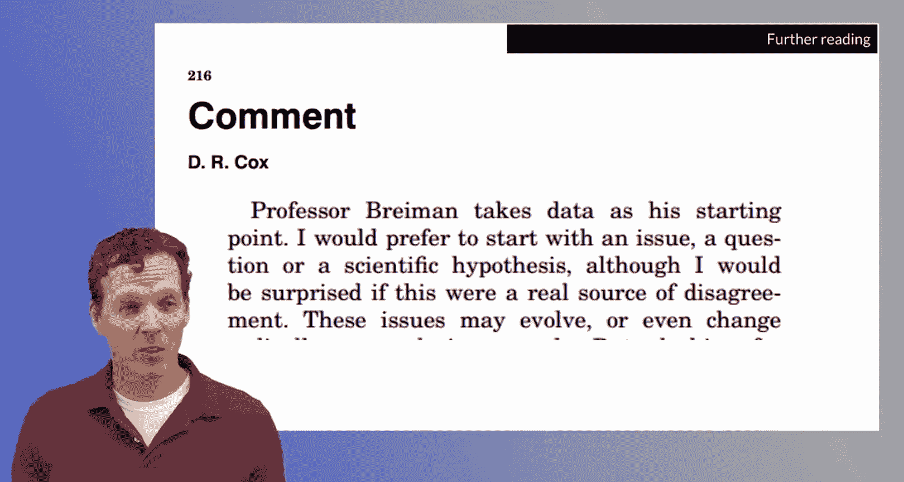
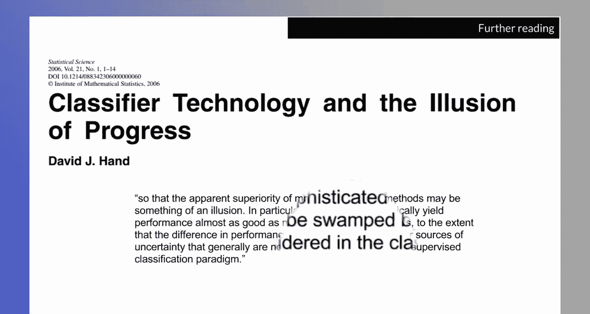

#  005：机器学习进阶阅读 📚

在本节课中，我们将探讨几篇关于机器学习与传统统计学差异的经典文章。这些文章由领域内的顶尖学者撰写，从不同视角剖析了两种方法的哲学、实践与争议，有助于我们更深入地理解数据科学的全貌。

## 概述

如果你希望进一步了解机器学习与传统统计学之间的区别，本节将为你推荐几篇值得深入阅读的文章。这些文献分别代表了统计学界对机器学习浪潮的不同态度，从拥抱到批判，为我们提供了多元的思考维度。

## 推荐文章列表

以下是三篇核心文献，每篇都代表了该领域的一种重要观点。

### 1. Larry Wasserman 的博客文章

上一节我们概述了学习目标，本节中我们首先来看看统计学家 Larry Wasserman 的观点。他撰写了一篇名为 **“The Rise of the Mach”** 的博客文章。这篇文章很好地论述了机器学习与统计学的区别，甚至可以看作是对统计学界的一种呼吁，鼓励其更好地接纳机器学习方法。

### 2. Leo Breiman 的论文

接下来，我们介绍一篇极具影响力的论文。已故的著名统计学家 Leo Breiman 撰写了一篇杰出的论文，题为 **“Statistical Modeling: The Two Cultures”**。本文是许多现代数据科学思想的源泉，且内容通俗易懂，发表在《Statistical Science》期刊上。

Breiman 的方法对传统统计学提出了相当程度的批评，或至少暗示传统统计学已经落后。他在文中指出：
> “在本文中，我认为统计学界对数据模型的关注导致了一种不相干的理论，这阻碍了统计学家使用更合适的算法模型，并阻止他们研究激动人心的新问题。”

他对自身所在的统计学界提出了相当严厉的批评。这是一篇非常有趣的文章，并不像大多数统计学研究论文那样枯燥。

### 3. David Hand 的文章

最后，我们来看一篇对机器学习方法持更批判态度的文章。另一位伟大的统计学家 David Hand 撰写了 **“Classifier Technology and the Illusion of Progress”**。

这篇文章更侧重于批判机器学习方法。其中一段引文如下：
> “因此，更复杂方法表面上的优越性可能是一种错觉。特别是，简单方法通常能产生与复杂方法几乎一样好的性能，以至于性能差异可能被经典监督分类范式中通常未考虑的其他不确定性来源所淹没。”

他 essentially 是在说，构建复杂机器学习算法的努力常常是不值得的，其增加复杂性带来的收益是边际性的。

## 关键洞见与讨论

在介绍了三篇核心文献后，我们来看看其中引发的关键讨论。Leo Breiman 的论文曾邀请另一位极具影响力的统计学家 D.R. Cox 进行讨论，Cox 因 **Cox 比例风险模型** 而闻名。

Cox 教授的一句评论令人印象深刻：
> “Breiman 教授以数据为出发点，而我更倾向于从一个议题、一个问题或一个科学假设开始，尽管如果这真是一个分歧点，我会感到惊讶。”

我非常喜欢这个评论，因为它确实触及了问题的核心。我认为，这也是我对机器学习感到最困扰的地方之一——当你不得不用同一套数据来推导和检验假设时，这对我来说是最难接受的一点。

## 总结

本节课中，我们一起学习了三篇关于机器学习与统计学文化差异的重要文献。从 Wasserman 的呼吁、Breiman 对算法模型的推崇，到 Hand 对“进步幻觉”的警示，以及 Cox 关于问题驱动与数据驱动起点的深刻讨论，这些观点共同描绘了数据科学领域丰富而辩证的图景。理解这些差异有助于我们在实际工作中选择更合适的工具与方法论。