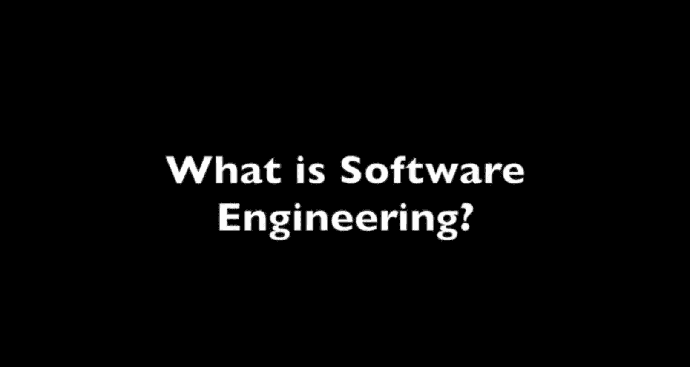
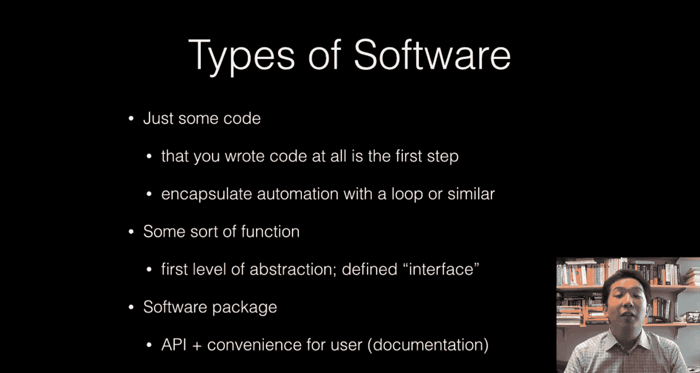
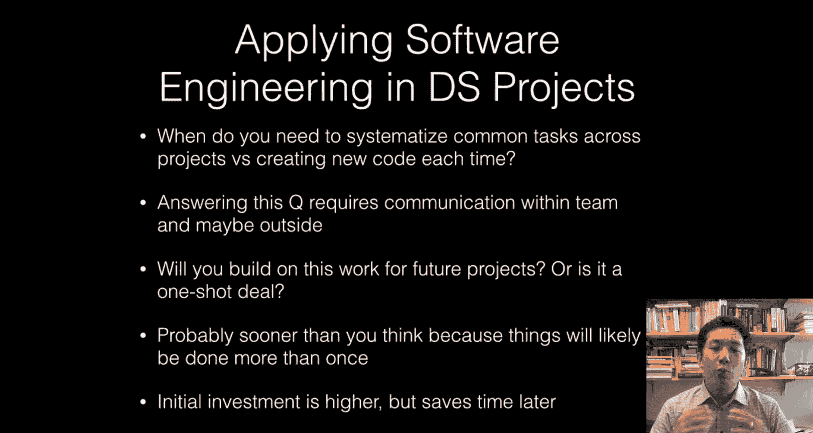
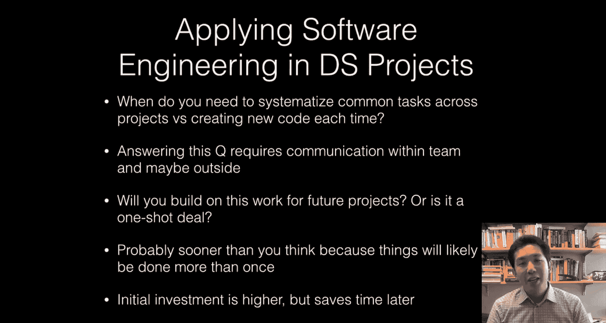
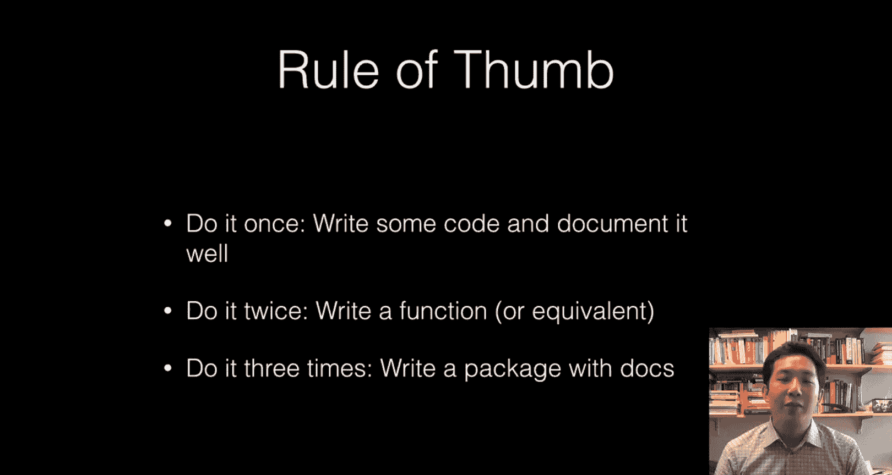
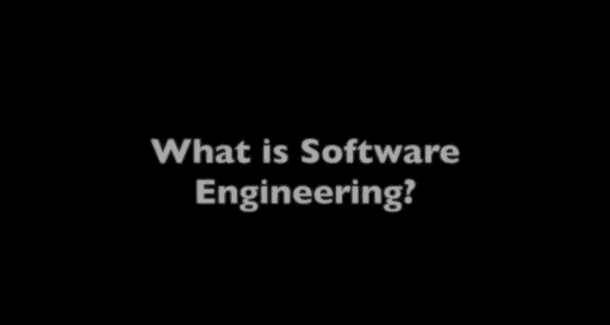

#  006：什么是数据科学的软件工程 🛠️

在本节课中，我们将要学习软件工程在数据科学中的核心概念与重要性。我们将探讨软件如何将数据分析过程系统化、标准化，并了解从简单代码到完整软件包的三个抽象层级。最后，我们将讨论何时需要将通用任务转化为软件，并提供实用的经验法则。

## 软件工程在数据科学中的角色

软件是数据分析中特定方面的泛化。数据分析的某些具体部分可能需要共同实施或应用一系列程序或工具。软件则是将这些工具全部封装到一个特定的模块或程序中，使其能够在各种环境中重复应用。

因此，软件允许对程序进行系统化和标准化，以便不同的人可以使用它，并在任何时候都能理解它将做什么。

## 软件的价值：抽象与接口

软件的有用之处在于，它通过为分析开发一个定义良好的接口，来形式化和抽象一组程序或工具的功能。

软件将拥有一个接口、一组定义清晰的输入和输出。人们可以理解这些输入和输出，而无需担心其内部实现的复杂细节。当然，他们可能对那些细节感兴趣，但在任何特定环境中应用软件，并不一定依赖于了解那些细节。相反，了解该软件的接口对于在任何情况下使用它都至关重要。

例如，大多数统计软件包都有一个线性回归函数，它通常具有定义非常清晰的接口。例如，你需要输入像结果变量和一组预测变量这样的东西，可能还有其他输入，如数据或权重。大多数线性回归函数都以类似方式工作。

重要的是，用户无需确切知道线性回归计算在底层是如何完成的。他们只需要知道需要指定结果变量、预测变量等几项内容。因此，线性回归函数抽象了实现线性回归所需的所有底层细节，使得用户可以在各种环境中应用这个工具。

## 软件的三个抽象层级 🧱

从最简单到最抽象，软件基本上可以分为三个层级。

### 层级一：代码

首先，你可能只是写了一些代码。这是将一组程序自动化封装的第一步。例如，你可能有一个循环，重复执行某个操作多次。这是第一步。

### 层级二：函数

下一步可能是某种函数。无论你使用什么编程语言，通常都会有函数的概念，用于封装一组指令。函数的关键在于，你需要定义某种接口，即函数的输入。然后，函数可能有一组输出，或者可能产生一些副作用（例如，如果它是一个绘图函数）。用户只需要知道这些输入以及输出会是什么。

这是你可能遇到的第一个抽象层级，你需要实际定义该函数的接口。

### 层级三：软件包

最高层级是软件包。它通常是一组函数或函数与其他元素的集合，形式会更正式，因为会有一个非常具体的接口或API需要用户理解。通常，软件包会为用户提供许多便利功能，如文档、示例或教程，以帮助用户将软件应用到许多不同的环境中。

一个完整的软件包在意义上是最通用的，它应该适用于不止一种环境，并且可能对人们更广泛地有用。

## 何时需要系统化？🤔

上一节我们介绍了软件的三个抽象层级，本节中我们来看看一个关键问题：你需要在何时将跨项目的通用任务和程序系统化，而不是在每个新项目上重新创建代码或从头开始编写新代码？

这取决于多种因素。回答这个问题可能需要团队内部以及可能与团队外部人员的沟通，因为你需要了解某个给定过程或某种类型的数据分析被重复的频率，以便权衡投资开发软件包等事物的成本与收益。

在团队内部，你可能需要问自己：你将要进行的数据分析，是未来工作的基础，还是只是一次性的任务？

根据我的经验，真正一次性的任务相对较少。通常，你将不得不进行某种分析或某种类型的分析不止一次，可能是两次甚至三次。在那个时候，你通常已经达到了一个阈值，你会想要编写一些软件，或者至少是一个函数。

因此，你需要将一组给定程序系统化的时间点，可能比你想象的要早，因为事情更有可能被重复执行多次。当然，开发更正式软件的初始投资会更高，但这很可能会在以后节省时间，从而获得回报。

## 经验法则：一次、两次、三次原则 📝

我的基本经验法则是：

以下是判断何时进行系统化的具体步骤：

*   **如果你只做一次**：这种情况确实会发生。只需编写一些代码，并做好详细记录。重要的是，你要确保自己理解代码的作用。这既需要把代码写好，也需要编写文档，因为你需要能够在以后重现它，以防你自己或其他人回头查看并需要理解当时做了什么。
*   **如果你要做两次**：编写一个函数。这允许你抽象一小段代码，迫使你定义一个具有明确定义输入和输出的接口。这将允许其他人访问给定的函数，并将其应用到他们所处的任何情况中。
*   **如果你要做三次或更多次**：你应该考虑编写一个小型软件包。它不必是商业级别的软件，而是一个封装了你在给定分析中要执行的一组操作的小型包，并且编写一些真正的文档，以便人们能够理解应该发生什么，并在需要时将该软件应用到不同的情况中。

## 总结

本节课中我们一起学习了软件工程在数据科学中的核心作用。我们了解到，软件通过抽象和定义良好的接口，将数据分析过程标准化和系统化，提高了效率和可复用性。我们探讨了从代码、函数到软件包的三个抽象层级。最后，我们掌握了判断何时需要将通用任务转化为软件的“一次、两次、三次”经验法则，这有助于我们在项目开发中平衡效率与成本，做出更明智的工程决策。