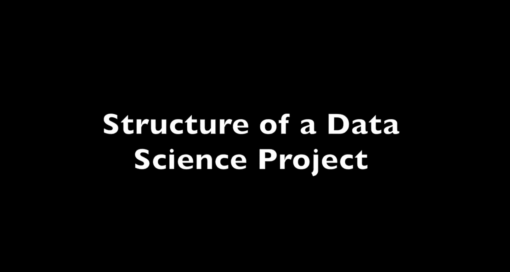
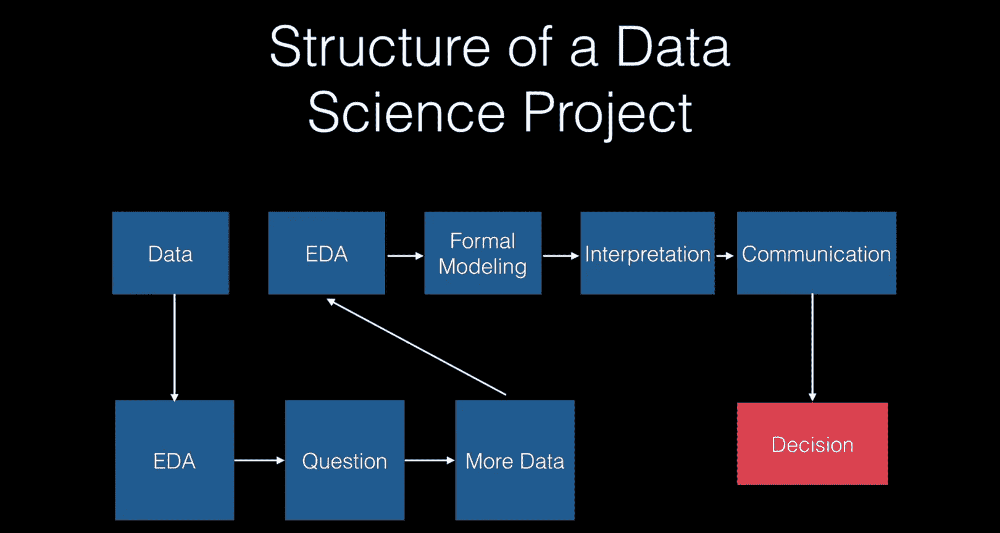
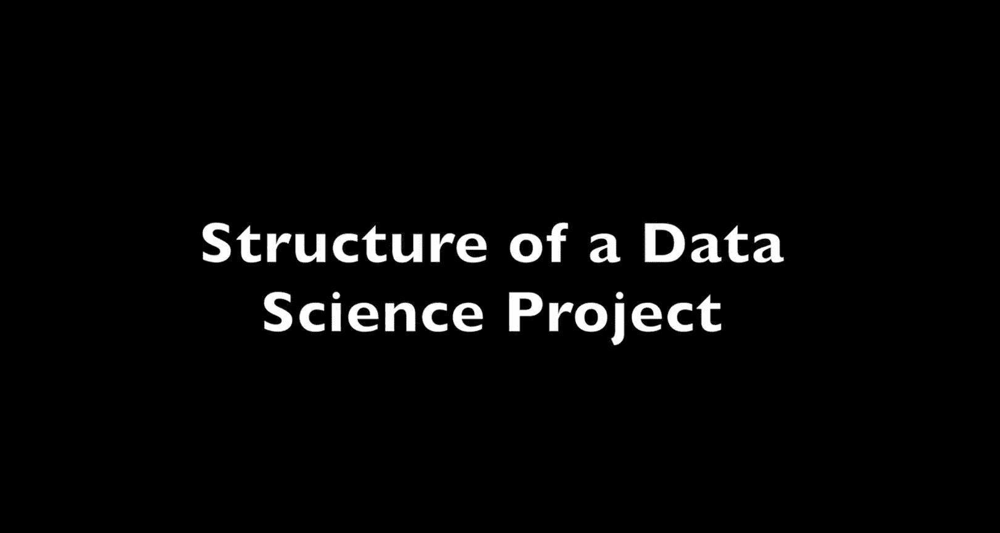

#  007：数据科学项目的结构

在本节课中，我们将学习一个典型数据科学项目的基本结构。了解项目的各个阶段，有助于我们系统地规划工作流程，确保分析过程严谨且结果可靠。

## 概述：数据科学项目的五个阶段

一个典型的数据科学项目通常包含五个主要阶段。我们将逐一介绍这些阶段，并理解它们如何相互衔接，共同构成一个完整的分析流程。

## 阶段一：提出问题与定义问题

这是数据科学项目中最重要的阶段。在此阶段，你需要明确希望通过数据了解什么。清晰地定义问题并不断细化它至关重要，因为它将最终指导你获取哪些数据以及进行何种类型的分析。

定义问题的一部分还包括确定你要提出的问题类型。大致有六种类型的问题，从描述性、探索性、推断性、因果性到预测性和机制性。明确问题的类型和具体内容具有重大影响，因此你应该投入大量时间进行思考。

## 阶段二：探索性数据分析

一旦明确了问题，通常你会获得一些数据。这些数据可能已经存在，需要你去获取，或者由他人提供。接下来就进入探索性数据分析阶段。

探索性数据分析有两个主要目标。第一个目标是评估你拥有的数据是否适合回答你的问题。这取决于多种因素，从非常基本的问题（如数据量是否足够、缺失值是否过多）到更根本的问题（如是否缺少某些变量、是否需要收集更多数据来获取这些变量）。

第二个目标是开始勾勒解决方案的草图。如果数据适合回答问题，你可以开始用它来大致描绘答案可能是什么样子，以获得初步印象。这可以在不进行任何正式建模或统计检验的情况下完成，只是为了形成一个良好的预期。

## 阶段三：正式建模

上一节我们介绍了如何通过探索性数据分析来评估数据和勾勒方案。如果草图看起来可行，数据也合适，就可以进入正式建模阶段。

正式建模是一种具体写下你所提问题、试图估计的参数的方法。它也为挑战你的结果提供了一个框架。仅仅因为在探索性数据分析阶段得出了一个答案，并不意味着它一定是正确的。你需要能够通过各种方法（如敏感性分析或其他类型的分析）来检验你的结果。挑战你的模型并建立一个正式的框架，对于确保你能为回答问题提供强有力的证据至关重要。

## 阶段四：结果解读

完成分析和正式建模后，你需要思考如何解读结果。在数据科学项目的解读阶段，需要考虑多方面的事情。

首先，思考你的结果与你最初提问时的预期是否一致。其次，你需要思考到此时为止所积累的全部证据。你可能已经进行了许多不同的分析，拟合了许多不同的模型，因此拥有许多不同的信息片段。解读阶段的一部分就是整合所有这些信息，权衡不同的证据，以了解哪些更可靠、哪些更重要，并就回答问题获得对证据整体的把握。

## 阶段五：结果沟通与传达

任何成功的数据科学项目都希望将其发现传达给某个受众。这个受众可能是组织内部的，也可能是外部的；可能是广大人群，也可能只是少数几个人。沟通发现是数据科学的重要组成部分，因为它使数据分析过程为人所知，并将你的发现转化为行动。

这引出了最后一部分，它不一定是数据科学项目的正式阶段，但通常会有一些需要做出的决策或需要采取的行动。数据科学项目的开展正是为了支持决策或行动。因此，最后这个阶段不仅取决于数据科学或数据分析的结果，还需要组织内其他不同部门或其他利益相关者的输入。最终，如果做出了决策，所进行的数据分析将为该决策提供信息和支持，所收集的证据也将支持该决策。

## 另一种常见方法：从数据出发

以上是数据科学项目大致经历的五个阶段。然而，还存在另一种非常常见的方法，即真正从数据和探索性数据分析开始。

通常，可能已有数据可用，但可能并不立即清楚这些数据有什么用。因此，进行一些探索性数据分析来查看数据、稍作总结、绘制一些图表以了解其中有什么，并基于数据生成一些有趣的问题，可能会很有用。这有时被称为“假设生成”，因为它会产生原本不存在的问题。

一旦你基于初步的探索性数据分析产生了想要提出的问题，获取更多或其他数据来进行针对你当前问题的探索性数据分析可能是有用的，然后继续进行正式建模、解读和沟通。

以下是需要注意的一点：你必须警惕的是，在一个数据集上进行探索性数据分析，生成问题，然后回到同一个数据集，假装之前没有进行过探索性数据分析，并带着一个“新”问题进入后续阶段。这通常会导致分析中的偏倚，因为问题和结果都源自同一数据。因此，在首先使用数据生成问题时，谨慎行事并尝试获取其他数据非常重要。

这是数据科学的一种次要方法，可能非常有用，并且常常能产生许多从数据中生成的有趣问题。

## 总结

本节课中，我们一起学习了数据科学项目的基本结构。我们了解到一个典型项目包含**提出问题、探索性数据分析、正式建模、结果解读和结果沟通**这五个核心阶段。每个阶段都有其特定目标，且环环相扣。我们还探讨了另一种从数据出发的“假设生成”方法及其注意事项。理解你正处于哪个阶段，对于推进任何数据科学项目都至关重要。