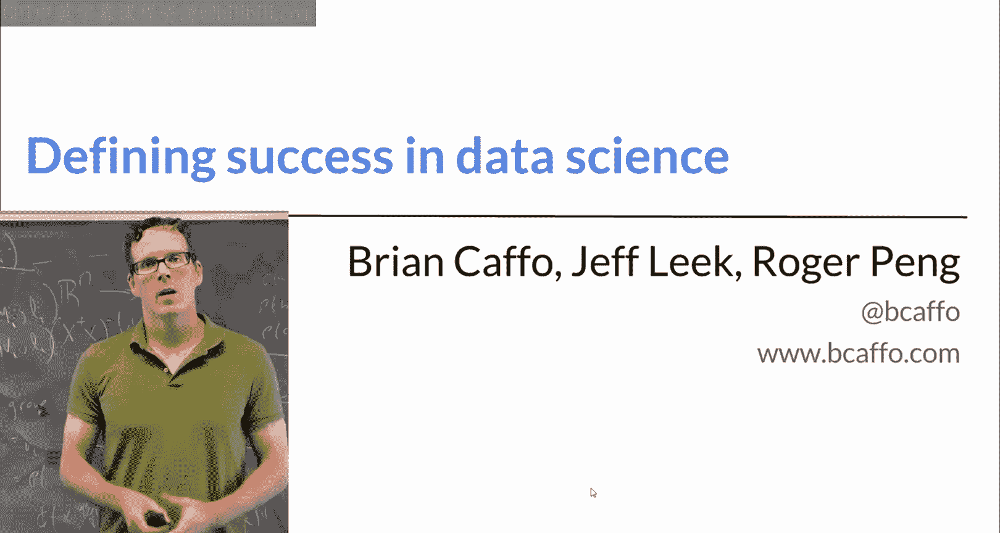
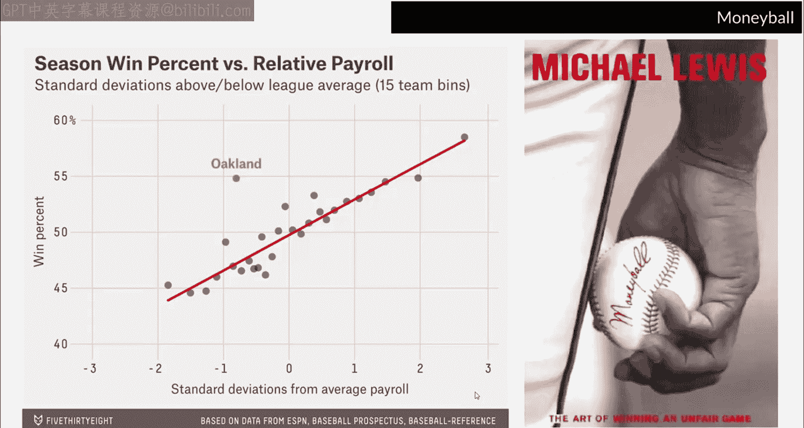
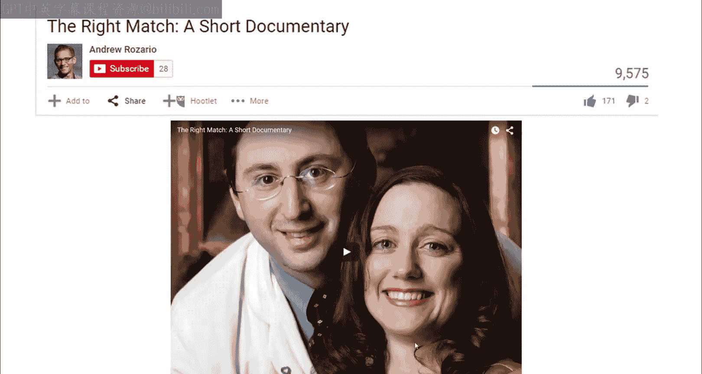
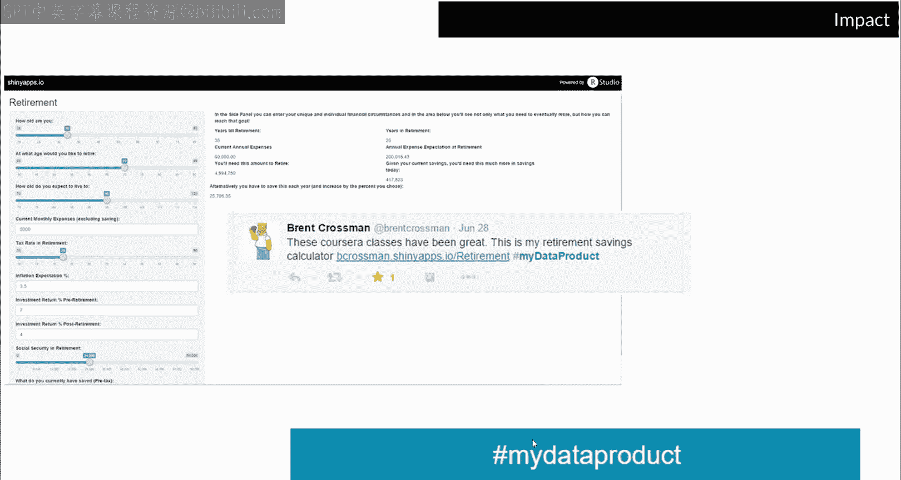

#  009：定义数据科学中的成功 🎯

在本节课中，我们将探讨如何定义数据科学项目的成功与失败。我们将通过多个真实案例，了解成功的数据科学实验如何创造新知识、影响决策，甚至改变政策。同时，我们也会看到，即使结果看似“负面”，只要能明确指导后续行动，也是一种成功。

---

## 数据科学中的成功与失败

上一节我们介绍了课程概述，本节中我们来看看数据科学项目成功与失败的具体表现。

一个数据科学实验最积极的成果是创造了**新知识**。比这更好的是，能够基于这些新知识做出**可执行的决策**。理想的成功是，数据分析的产物（新知识或产品）能产生实际**影响力**。

另一种看似不那么明确、但依然属于成功的情况是：**你通过分析确定，现有数据无法为当前决策提供信息**。如果这个结论是确凿的，那么你就知道了下一步该去哪里寻找答案。这或许是一种“负面”的成功，但它确实是成功的一种形式。

---

## 数据科学实验失败的情形

现在，让我们看看数据科学实验可能失败的方式。

最糟糕的结果是：**决策与明确的证据背道而驰**。即所有证据都指向一个方向，但最终决策却走向了相反的方向。

另一个问题是结果**模棱两可**。这可能是因为研究**统计功效不足**，或者你测量的指标与你希望测量的目标存在偏差。即使得到了结论，测量上的微小误差也可能导致结果既不能支持也不能反驳一组假设。在这种情况下，决策将变得不明确。

还有一种情况是，**不确定性过大，以至于无法创造新知识**。

---

## 成功的经典案例：点球成金 ⚾

如果问起数据科学成功的典范，大多数人首先会想到《点球成金》。这是迈克尔·刘易斯撰写的一部杰出著作，讲述了奥克兰运动家棒球队及其经理如何运用数据科学来提升球队表现。

下图展示了各球队薪资与胜率的关系。奥克兰队是一个明显的异常值：其薪资低于联盟平均水平一个标准差，但其胜率却远高于基于其薪资的预期预测。虽然纽约洋基队（图中右上角）拥有最高薪资和最高胜率，但奥克兰队通过运用数据科学，取得了远超预期的成功。这是一个非常著名的成功案例。

---

## 早期的数据科学家：弗洛伦斯·南丁格尔 📊

我想介绍我最喜欢的数据科学家案例之一，或许也是最早的数据科学家之一：**弗洛伦斯·南丁格尔**。大家可能都知道她作为护士的杰出工作，但可能不太了解她对统计学和图形学领域的贡献。

她是现代图形的早期开发者之一。在这张她创作的著名图表中，她展示了在克里米亚战争中，英国士兵死于霍乱的人数超过了战死沙场的人数。她将这份报告呈递给王室，并最终**改变了相关政策**。这是一个利用数据、创建可视化、并影响政策的早期数据科学典范。

---

## 成功路上的波折：伊格纳兹·塞麦尔维斯 🧼

利用数据科学指导传染病预防的想法由来已久，但其过程有起有落。另一位先驱是**伊格纳兹·塞麦尔维斯**医生，他也是一位敏锐的科学家。

他对比了当地两家产科诊所的感染率，想弄清楚为何其中一家的结果差很多。在细菌理论出现之前，他通过数据和严谨的科学思维推断出，医学生在处理完尸体后直接为产妇接生，会传播某种“尸体物质”导致感染。

他的解决方案是**洗手**。然而，这个案例的“负面”之处在于，尽管他的研究非常出色，但洗手政策在其去世后很长一段时间都未能得到很好执行。直到今天，医院仍在努力推行洗手以预防感染。他的工作留下了长久的遗产，但不幸的是，由于忽视了清晰的数据（以及后续积累的更多证据），很长一段时间内造成了大量生命的损失。这或许不是一个数据科学实验取得“成功”结果的完美例子，尽管实验本身进行得很好。

---

## 现代成功案例：多里·塞吉安与肾脏移植配对 🩺

接下来，我想谈谈我们系的一位校友，**多里·塞吉安**医生。他同时获得了生物统计学硕士学位，他的职业生涯似乎正在将数据科学应用于移植研究领域。

传统移植研究主要关注改进手术技术，而他则专注于数据库，对大量移植受者和捐赠者群体进行统计分析，从而**真正影响政策**。从很多方面来说，他是在用“点球成金”的方式改革移植领域。

一项重大成功是，他通过数据科学工作，评估了潜在的HIV感染已故器官捐赠者库，这推动了新立法出台，允许研究人员研究HIV阳性捐赠者向HIV阳性受者捐赠器官的可行性。这项由奥巴马总统签署的法案，长远来看可能拯救许多生命。

他和他在海军学院担任计算机科学家的妻子，还共同研究了一个肾脏配对捐赠的算法问题。以下是该问题的简化说明：

当两对捐赠者-受者组合彼此不匹配时，可以通过交换捐赠形成一个“配对捐赠链”。他的妻子编写了算法，从捐赠者数据集中挖掘出可以进行大规模、多对同时肾脏移植的匹配组合。约翰斯·霍普金斯大学的移植团队已经成功完成了许多此类复杂手术，其中一些还被《纽约时报》报道。这无疑是数据科学深刻改变一个领域的绝佳例证。

---

## “负面”结果也是一种成功：马丁·林奎斯特的fMRI研究 🧠

我想分享生物统计学领域的另一个例子，一个关于**测量无法达到预期目标**的案例。

我和同事马丁·林奎斯特在fMRI领域工作。许多人想证明大脑某个区域激活后，会导致另一个区域激活。马丁结合数据科学、物理学和生物学知识，**证明了用当前收集的测量数据实际上不可能做到这一点**。

从某种意义上说，这是一个“负面”结果，因为大家想做的事情被证明无法实现。但从积极的角度看，它揭示了真相，避免了人们浪费时间尝试不可能的事，并且促使想要进行此类研究的人去改进数据采集技术。这再次印证了：**证明你无法用现有数据回答你想回答的问题，也是数据科学的一种成功形式**。

---

## 产生影响力的最佳途径：数据产品与应用 📱

最后，我想以一个更积极的论点结束：数据科学实验产生影响力的最佳方式之一，是其产物是一个**人人都会使用的应用**。

在我们Coursera数据科学专项课程的“开发数据产品”课程中，学生们会创建数据科学应用。例如，学生Brent创建的这个应用，允许用户输入多种因素来估算退休储蓄目标。当然，最广为人知的数据科学应用例子包括所有在线零售商的推荐系统。

如今，我们很难想象一天之内不使用任何数据科学应用。**创建一个应用是产生广泛影响力的绝佳途径**。

---

## 总结

本节课中，我们一起学习了定义数据科学成功的多种方式。成功的核心在于创造新知识、驱动决策并产生实际影响。即使结果证明当前数据无法解决问题，只要结论明确并能指导后续方向，这也是一种成功。我们通过《点球成金》、南丁格尔、肾脏移植配对等案例看到了数据科学的巨大潜力，也通过塞麦尔维斯和fMRI研究的例子理解了成功形式的多样性。最终，将分析成果转化为人人可用的数据产品（如应用），是扩大影响力的有效手段。