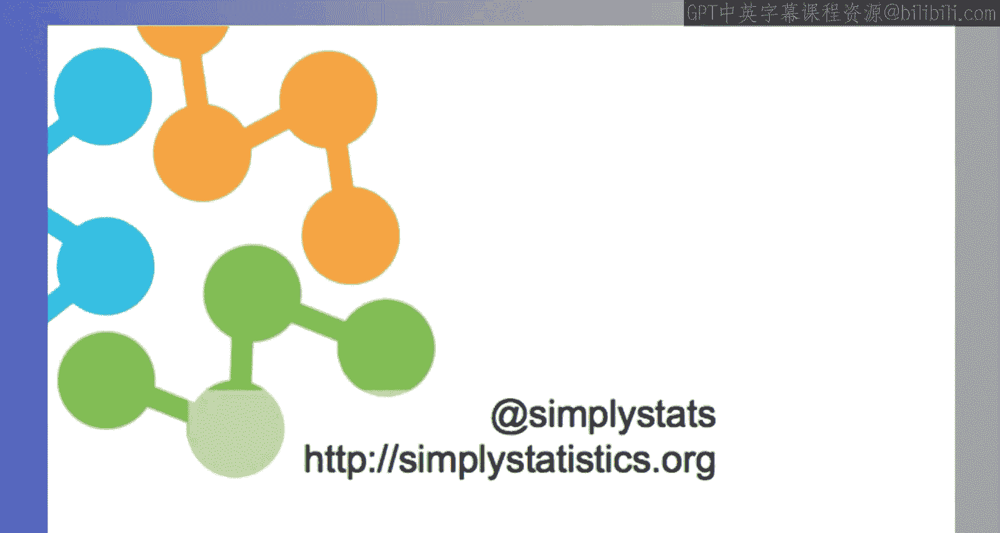

#  012：关于你的讲师 👨‍🏫

在本节课中，我们将认识本课程的讲师，了解他的背景、经验以及他将如何帮助我们学习构建和管理数据科学团队。

欢迎来到这门关于构建数据科学团队的课程。我很高兴能向你们传授关于招聘、管理、组织和评估数据科学团队的知识，以帮助你们的组织更好地利用数据。首先，我想向你们介绍一下我自己。

我对数据和数据科学充满热情。正因为这份热情，我从事着几项与数据和数据科学相关的工作。

以下是关于我的几个方面：

*   **博客与社交媒体**：我在 Simply Statistics 上撰写博客。你也可以在 Twitter 上通过 @SimplyStats 找到我。我经常讨论数据科学议题、统计学议题，以及一些与学术界相关的内部话题。我与两位同事——Roger Peng 和 Rafael Irizarry——共同进行这些活动。Roger Peng 是本系列课程中与我共同授课的另一位讲师。
*   **教学工作**：我还在约翰霍普金斯大学的数据科学专项课程中任教。约翰霍普金斯大学的数据科学专项课程包含九门系列课程，其重点是教导那些将实际从事日常数据科学工作的数据科学家如何完成他们的工作。这套课程非常受欢迎，注册人数已超过200万。而本“高管数据科学”系列课程，正是建立在数据科学专项课程的成功及其引发的广泛兴趣之上。
*   **管理与研究**：最后，我实际上在约翰霍普金斯大学管理着一个数据科学家团队。我是约翰霍普金斯大学生物统计学系的副教授，领导一个致力于基因组学数据科学的团队。你可以将此理解为利用基因组信息来个性化健康管理或理解自然生物变异的一种方式。因此，我日常工作的很大一部分就是实际管理数据科学团队、组织他们并促使他们与他人协作。我将分享一些我在约翰霍普金斯大学从事这些工作的经验，希望能帮助你们更好地管理自己的数据科学团队。我期待着在课程中与你们相见。

本节课中，我们一起认识了本课程的讲师。他不仅是一位热情的数据科学传播者、一位经验丰富的教育者，更是一位在约翰霍普金斯大学实际领导数据科学团队的管理者。他的多重身份确保了本课程的内容既有理论高度，又有丰富的实践经验作为支撑。在接下来的课程中，他将基于这些亲身经历，为我们深入剖析构建和管理高效数据科学团队的方方面面。