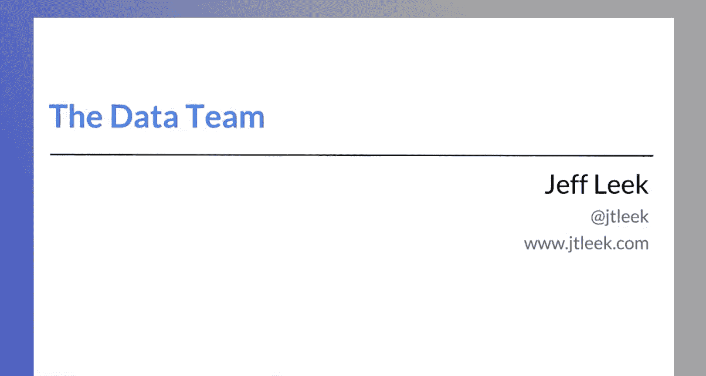
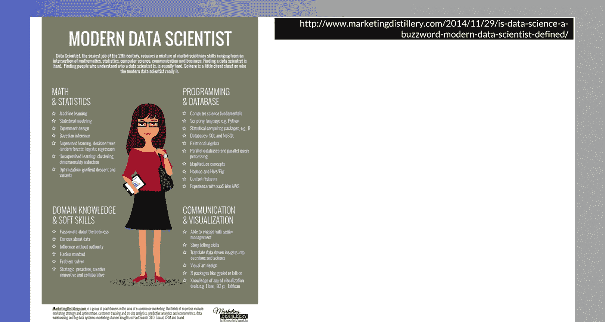
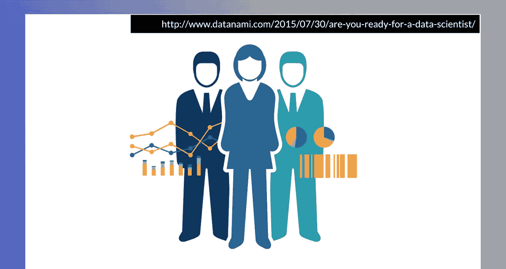

#  013：数据团队 👥

在本节课中，我们将要学习构建数据科学团队的基础知识。数据科学并非单打独斗，而是一项团队运动，需要不同角色的人员协同工作，共同解决实际的数据科学项目。

## 核心角色介绍

上一节我们提到了数据科学是团队协作，本节中我们来看看构成这个团队的核心成员。

### 数据工程师 🛠️

数据工程师是团队中的基础设施专家。他们的主要职责是构建和维护数据处理的“管道”与平台。

以下是数据工程师的核心工作内容：
*   **构建数据库**：设计和实施用于存储和管理数据的数据系统。
*   **提取数据**：从数据库或其他数据源中提取数据，供分析人员使用。
*   **部署算法**：将机器学习算法开发为生产级别的应用，部署在服务器上，使其能够处理海量数据，甚至实现实时运行。

数据工程师的技能侧重于**基础设施开发**，涵盖硬件和软件两方面。他们通常不直接进行深入的数据分析。

### 数据科学家 🔬

数据分析与洞察挖掘的任务主要由数据科学家承担。他们是连接数据与业务价值的桥梁。

以下是数据科学家的典型工作流程：
*   **获取数据**：从数据工程师构建的系统中提取所需数据。
*   **分析与实验**：对数据进行探索性分析、统计建模和机器学习实验。
*   **可视化与沟通**：将分析结果通过图表等形式可视化，并向数据科学经理及组织内其他成员汇报，推动项目进展。

数据科学家开发的预测模型或算法，通常会移交给数据工程师进行大规模部署和实施。

### 数据科学经理 📋

数据科学经理是团队的协调者和领导者，确保团队高效运作并与组织其他部分顺畅对接。

数据科学经理的关键职责包括：
*   **团队管理与协调**：促进团队成员间的互动，确保项目持续推进。
*   **团队建设**：负责招募人才，构建和培养数据科学团队。
*   **内外沟通**：作为团队对外的接口，与组织高层管理及其他部门的同级协作者沟通，确保信息畅通。同时，他们也需要向组织内外宣传团队的能力和价值，争取资源与支持。

## 团队协作模式

了解了各个核心角色后，我们来看看他们如何协同工作。数据科学团队作为一个整体单元运作。

团队成员通常各自负责特定项目或某个数据科学问题的子任务。他们会定期举行小组会议和联合汇报，共同讨论想法、同步进度。在与团队外部人员（如其他部门同事或管理层）互动时，他们有两种主要方式：一是直接进行一对一会议沟通；二是通过数据科学经理作为中间桥梁进行协调。

无论通过哪种方式，团队都必须能够清晰地沟通数据基础设施的现状、团队的工作进展，并确保所有问题都能得到有效解决。

## 总结

本节课中我们一起学习了数据科学团队的构成与协作。我们认识到一个高效的数据科学团队需要**数据工程师**负责基础设施、**数据科学家**专注分析与建模、**数据科学经理**进行管理与协调。这三者紧密合作，通过清晰的内部沟通和有效的外部对接，共同解决复杂的数据科学问题，为组织创造价值。