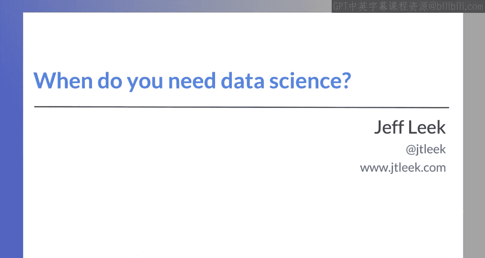

#  014：何时需要数据科学 🧭

在本节课中，我们将要学习数据科学在不同规模组织中的应用阶段。我们将探讨初创公司、中型组织和大型企业在构建数据科学能力时，各自需要关注的核心任务和团队构成。

## 概述

与数据科学的互动方式，在一定程度上取决于组织的类型，并且在很大程度上取决于组织的规模。

## 初创阶段：打好基础 🏗️

上一节我们介绍了数据科学的基本概念，本节中我们来看看组织在初创阶段应如何着手。

当您还是一家初创公司、处于早期阶段，或者只是一个拥有极小团队的个人时，您可能还不需要过多地担心如何进行实验、机器学习或预测分析。首要任务是确保您的数据基础井然有序。

实现这一目标的方法是确保您专注于基础设施建设。

以下是初创阶段需要优先完成的基础设施任务：
*   **构建数据存储基础设施**：例如数据库等。
*   **开发数据提取软件**：用于获取数据的程序。
*   **部署数据服务与交互服务器**：用于向他人提供数据以及供您自己提取数据的服务器。

所有这些都需要首先进行基础设施建设。因此，您最初招聘到数据科学团队的人员，可能并不一定是传统意义上的“数据科学家”——他们不分析数据，也不做机器学习。他们可能会做一些分析，但主要职责是确保机器正常运行、数据被安全地收集和存储。

## 中型组织：组建团队与实现价值 🔬

在打好基础之后，对于中型组织而言，下一步就是组建真正的数据科学团队。

希望此时您已具备基本的基础设施，可以开始考虑组建真正的数据科学团队。为此，您可以引入真正被称为“数据科学家”的人员。这类人员将实际使用数据：他们可能从数据库中提取数据、运行实验、构建机器学习算法，或者分析数据以识别您所关心的行为模式和趋势。

此时，您需要考虑组建数据科学团队，并实施这些数据科学构想和产品。例如，数据科学家可能会构建一个预测消费者行为的机器学习算法。一旦算法构建完成，您可能需要将其部署回您的系统，并进行扩展以便能在全部数据上运行。您可能还想构建某种可视化工具，让非数据科学家也能与之交互，而这又将工作交回给数据工程团队。

此时仍然存在基础设施方面的考量，因为您此时可能已经收集了大量数据，需要确保其安全性，拥有数据库，并能够进行扩展。但现在，您正逐步迈向更完整的数据科学视图。

## 大型组织：协调与管理 🤝

对于大型组织，您拥有上述所有要素：数据基础设施、进行实验的数据科学团队，并且可能正在利用这些实验来做决策。

但现在，您增加了一个额外的组成部分，即真正地管理团队，确保每个人任务明确且协调一致。此时，数据科学经理的角色变得更加重要，您可能需要协调多个从事不同项目的数据科学家团队。您可能有一个专门负责构建机器学习项目的团队，另一个专门负责运行实验并从实验中得出结论的团队。

然后，必须有人负责协调这些活动，确保它们与组织内的正确人员（无论是市场团队、业务部门还是其他合作方）相连接。在这个规模上，完整的数据科学基础设施才真正到位。

## 总结

本节课中我们一起学习了数据科学能力建设的三个阶段。**初创公司**的核心是**打好数据基础设施**的基础；**中型组织**在基础设施就绪后，重点在于**组建数据科学团队并实现分析价值**；而**大型组织**则需要在拥有成熟团队和设施的基础上，强化**跨团队的协调与管理**，以确保数据科学工作与整体业务战略紧密相连。理解所处阶段有助于更有效地规划和投入数据科学资源。