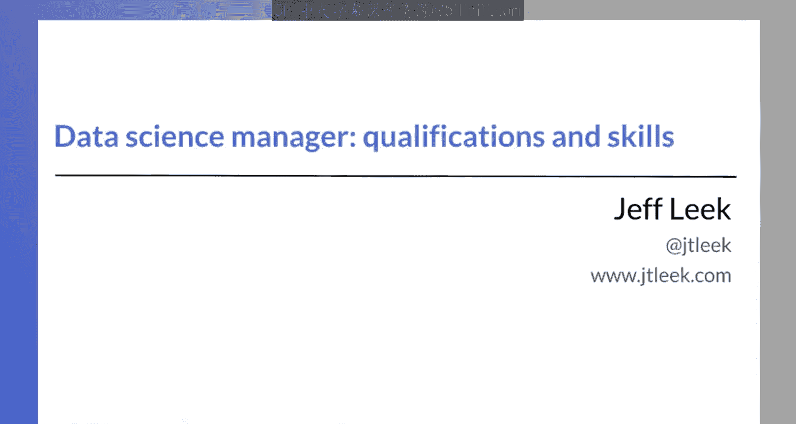
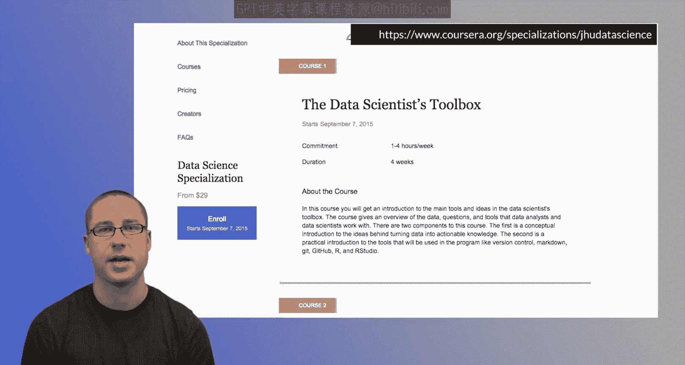
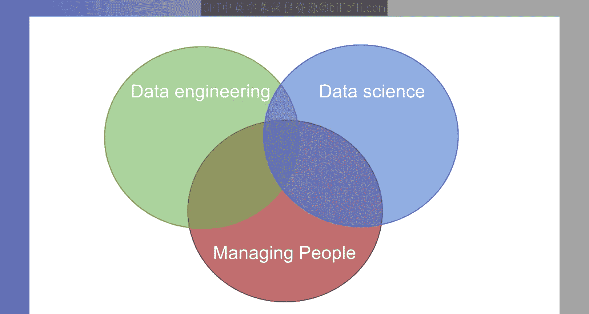

#  017：数据科学经理的资格与技能 🧑‍💼

在本节课中，我们将探讨数据科学团队中的最后一个关键角色——数据科学经理。我们将了解他们的职责、所需技能以及理想的背景，帮助你理解如何成为一名成功的数据科学经理，或者如何与这个角色高效协作。

## 数据科学经理的职责

数据科学团队的最后一位成员是数据科学经理。接下来，我们将详细讨论担任这一职位所需的资格和技能。如果你正在学习本课程，这些内容可能正是你需要培养的资质。

那么，数据科学经理具体做什么呢？首先，他们可能负责组建数据科学团队。这包括识别并招募数据工程师和数据科学家加入团队，为他们安排工作，设定目标和优先级。他们需要找出组织中那些需要通过数据科学来解决的问题，并将合适的人员分配到正确的问题上。

其次，他们管理数据科学流程。正如你将在其他课程中学到的，数据科学是一个过程，而非一次性的任务，它是一个需要精心管理的迭代过程。确保这一点是他们的职责之一。他们需要确保数据科学团队内部成员之间能够有效互动，同时也能与组织外部的其他人员进行良好协作。

此外，他们还需要与其他团队互动。他们可能需要向更高层管理层汇报，也可能需要与组织中同级别的其他部门人员进行互动或协作。因此，他们在这方面需要具备出色的沟通技巧。

## 数据科学经理所需的技能

上一节我们介绍了数据科学经理的职责，本节中我们来看看他们需要具备哪些技能。

以下是数据科学经理所需的核心技能：

*   **技术与硬件知识**：理想情况下，他们应了解团队所使用的软件和硬件。如果他们拥有数据科学或数据工程背景，那将非常理想。因为这能让他们真正了解所涉及的基础设施。当问题出现时，他们可能就能对如何修复数据科学基础设施或调整效果不如人意的机器学习算法提出很好的建议。虽然这不是硬性要求，但拥有这些知识会很有帮助。
*   **明确的角色认知**：他们需要清楚数据科学家、数据工程师以及其他团队分别做什么，以及哪些工作可能属于或不属于数据科学的范畴。这其中的一部分作用是充当“过滤器”，能够筛选掉那些不一定适合用数据科学解决的问题，从而专注于那些真正适合的问题。
*   **对可行性的判断力**：他们需要知道哪些目标可以实现，哪些不能。数据科学非常有用，对组织来说是一个强大的工具，但它并非万能。总有一些问题是数据科学无法解决的，可能是因为数据不可用，也可能是因为当时的算法不足以进行那种预测，或者是我们虽然能解决问题但无法扩展到所需的规模。因此，他们需要对数据科学能做什么、不能做什么有一个全局性的认识。
*   **强大的沟通能力**：这一点显而易见。因为他们既要与自己的团队沟通，也要与其他部门对接，所以需要能够清晰地传达工作进展和情况。

## 数据科学经理的背景

了解了所需技能后，我们来看看通常什么样背景的人能成为数据科学经理。

数据科学经理的理想背景通常结合了数据领域的专业知识和一定的管理经验。具体路径可能包括：

*   **路径一**：拥有数据科学背景（无论是自己分析数据还是构建数据科学基础设施），外加一些管理培训。如果你已经完成了数据科学专项系列课程，现在正在学习本系列课程，那么你可能就属于这种情况——拥有数据科学背景加上管理背景。
*   **路径二**：拥有数据工程背景，再加上管理经验。
*   **路径三**：拥有一些管理经验，同时也学习过一些数据科学和数据工程的知识。理想情况下，你的学习深度至少应达到能够在团队成员遇到困难时提出建议的水平。在高层面上，知道如何指导和设定优先级、了解可行与不可行固然很好，但如果可能的话，理想的情况是你也能深入其中，帮助团队成员解决问题。在某种程度上，最优秀的经理都懂得足够多的数据科学或数据工程知识，从而能够以这种方式为团队做出贡献。

## 数据科学经理的关键特质

最后，我们来总结一下一名优秀的数据科学经理应具备哪些关键个人特质。

他们的关键特质包括：

*   **精通数据科学**：对数据科学有深入的了解。
*   **支持与激励**：数据科学和数据工程工作在一个组织中常常会因为各种原因令人感到挫败。因此，保持积极、支持的态度并善于激励团队，对于数据科学经理来说至关重要。
*   **坚韧不拔**：这一点也非常重要。数据科学经理常常需要向上级或可能对此不太满意的人员汇报令人失望的预测算法结果或失败的实验。他们必须愿意以积极、友好的方式去处理这些情况，并推动团队继续前进。因此，脸皮厚、抗压能力强对数据科学经理来说非常重要。
*   **友善而执着**：他们待人友善但目标坚定。他们能够走出去，真正与人们合作、沟通，同时以对整个组织及其团队真正有益的方式倡导并运用数据科学。

这就是你在寻找数据科学经理时应关注的特质：一个能够组织整个流程、保持其运转、引导人们解决正确问题并最终解决组织实际难题的人。

---

本节课中，我们一起学习了数据科学经理的核心职责、必备技能、常见背景路径以及关键个人特质。总结来说，一名出色的数据科学经理是技术知识、管理能力、沟通技巧和坚韧品质的结合体，他/她既是团队的构建者与流程的守护者，也是组织内外沟通的桥梁，最终目标是引领团队用数据科学创造真实价值。