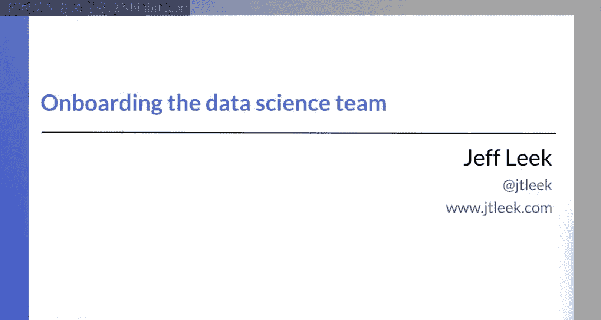
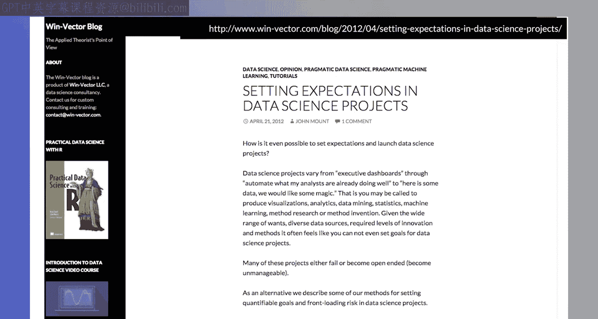
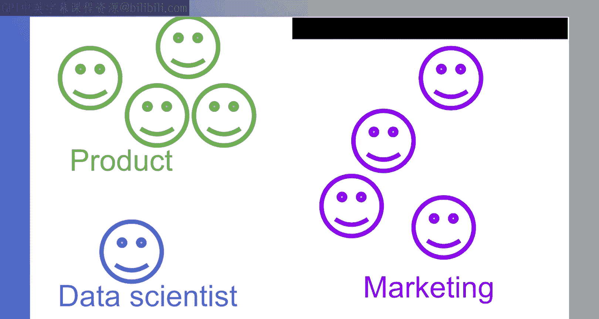
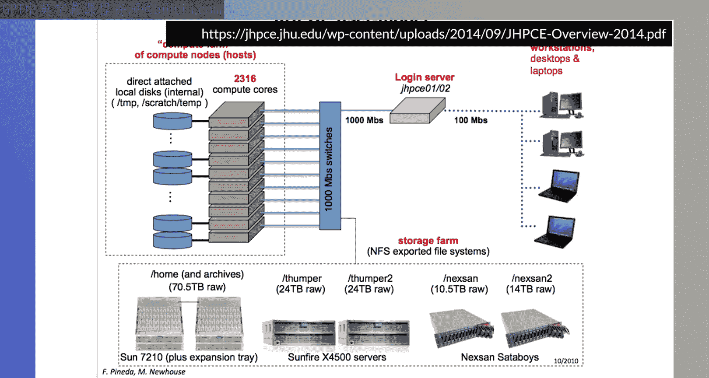
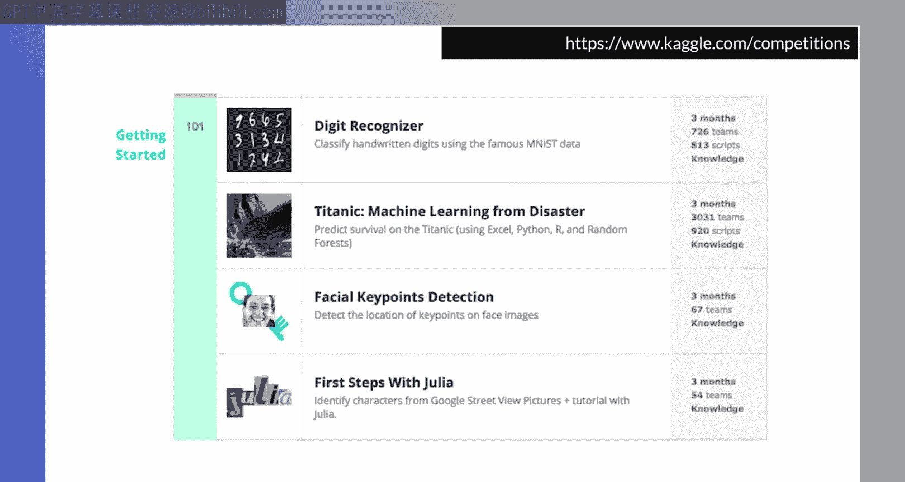

#  020：数据科学团队的入职 🚀

在本节课中，我们将学习如何为新加入的数据科学团队成员设计一个高效的入职流程。一个结构化的入职系统能帮助他们快速融入团队、理解职责并开始创造价值，避免因缺乏指导而浪费时间。

## 初始会议与职责明确 📋

上一节我们介绍了招聘的重要性，本节中我们来看看入职的第一步。一旦新成员开始工作，首要任务是安排一次初始会议。

这次会议通常由其经理主持，需要涵盖以下核心内容：
*   **职位概述**：明确该职位的整体定位。
*   **期望与项目**：说明对他们的期望，特别是希望他们完成的具体项目。
*   **协作对象与时间**：明确他们需要与谁互动、在什么时间范围内互动，以及是由他们主动发起还是由经理安排。
*   **联系人信息**：提供在整个流程中需要联系的所有人员的联系方式。
*   **内外政策**：建立团队内部互动、沟通、反馈与评审的准则；同时明确与外部团队或人员互动的规则，例如沟通是否需通过数据科学团队管理层，或是否需要短期嵌入其他团队。

## 信息归档与人力资源流程 📁

在明确了职责与规则后，需要确保这些信息能够被新成员随时查阅。

理想情况下，这些信息应被整理并存储在部门内部可访问的地方，例如一个内部网站或共享文档。这能确保他们始终有据可查，知道该联系谁以及如何行事。

接下来是人力资源相关流程。新成员需要设置薪酬、福利并完成必要文件。虽然这不属于数据科学工作本身，但却是入职过程中必不可少的一环。

## 团队与协作方介绍 👥

完成基本行政流程后，下一步是帮助新成员建立人际关系网络。

经理最好能亲自带领新成员与数据科学团队的所有成员见面，确保大家互相认识并进行简短交流，让每个人都知道团队的新成员是谁。

同样，也需要将他们介绍给外部的关键联系人，例如他们将合作的其他部门或协作者。进行直接介绍能确保所有人都知道新数据科学家或数据工程师已就位，并了解如何联系以及协作流程。

## 设备、基础设施与沟通渠道设置 💻

数据科学家或数据工程师需要合适的工具来开展工作。

以下是需要准备和说明的事项：
*   **设备与软件**：提供工作电脑，告知可安装的软件、采购权限以及获取软件的流程。
*   **数据基础设施**：说明如何与公司的全局基础设施交互，包括如何进行数据提取、他们的用户名是什么等。同样，最好有文档（如PDF）详细说明数据存储位置、使用的数据库类型以及从数据库中提取数据的教程。
*   **沟通渠道**：根据组织习惯，为他们设置并启用相应的沟通工具，如电子邮件、内部聊天工具或Slack等团队协作平台。

## 启动首个具体项目 🎯

在设备设置就绪后，让新成员快速进入工作状态的最佳方式是立即分配一个初始项目。

虽然你希望他们能立即发现并解决组织的所有问题，但这通常不现实。每个组织都有其独特性和特定关注点。因此，最好的方法是让他们立即开始一个**小型、明确、具体**的项目。

对于数据科学家，这可能是一个可以立即着手的小型分析任务。对于数据工程师或经理，同样是一个短期的具体项目。这样做的好处是：
*   **快速建立信心**：完成一个项目能给他们带来成就感。
*   **最佳融入方式**：立即参与项目工作是融入团队最有效的方式。
*   **热身与学习**：通过一个短期项目，他们可以熟悉环境、流程并“试水”。

当然，他们后续会参与更大规模或长期的项目，但一个立即可以着手并交付成果的初始项目至关重要。

---

本节课中我们一起学习了数据科学团队入职的关键步骤：从明确的初始会议、信息归档、人力资源流程，到团队介绍、工具配置，最后以启动一个具体的初始项目收尾。一个流畅的入职流程能最大化新成员的早期贡献，并帮助他们快速成为团队的高效成员。