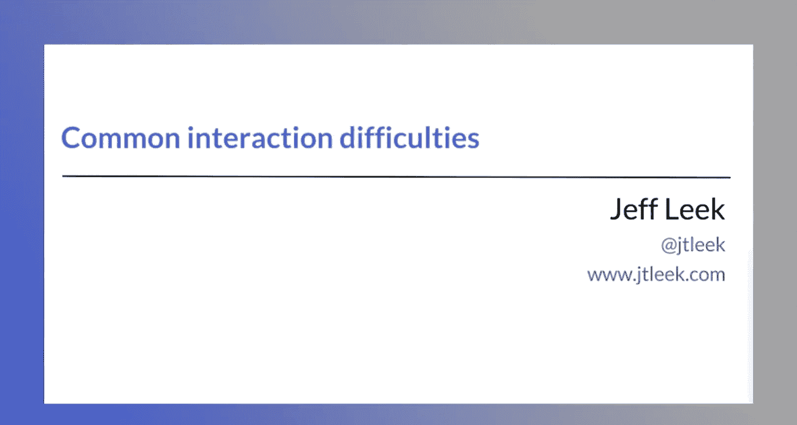
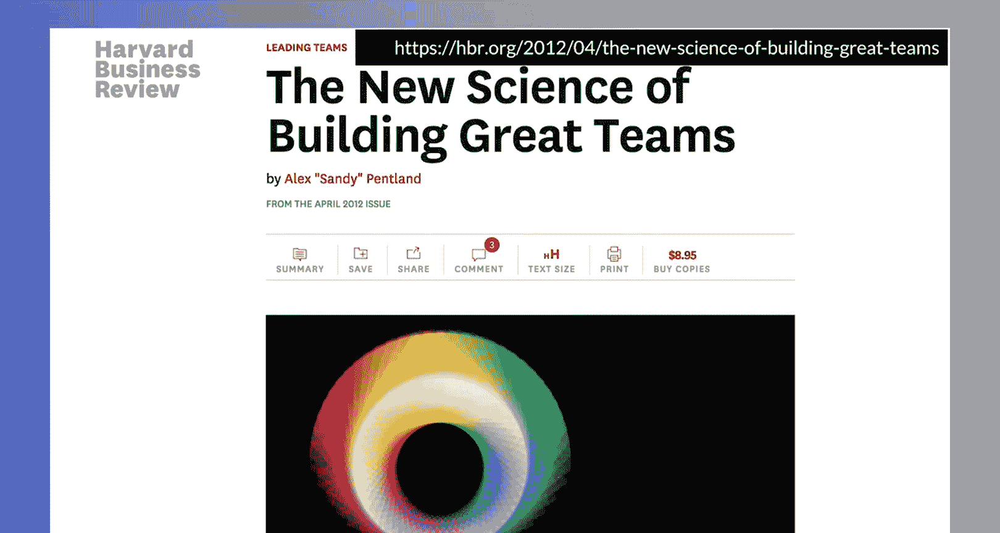

#  026：常见的互动困难

在本节课中，我们将探讨数据科学团队在与组织内其他部门互动时可能遇到的常见问题，并学习如何识别和解决这些问题。无论团队组建得多么出色，跨部门协作的挑战依然存在。理解这些挑战并掌握应对策略，对于确保数据科学项目成功至关重要。

上一节我们介绍了数据科学团队的组建与管理，本节中我们来看看团队在对外协作中可能遇到的障碍。

## 缺乏互动

当数据科学团队是独立设置，且没有与外部部门建立固定或常规的嵌入或协作机制时，最容易出现缺乏互动的问题。

以下是识别和解决互动缺乏问题的步骤：
*   **识别问题根源**：问题可能出在数据科学家身上（例如，不知如何联系、不知该问什么问题），也可能出在外部部门身上（例如，没有主动联系）。
*   **判断项目状态**：需要判断缺乏沟通是因为当前没有需要解决的实际问题（此时应考虑将数据科学家重新分配到其他项目），还是因为沟通渠道不畅。
*   **评估工作量**：检查是否因为数据科学家忙于手头工作而忽略了与协作者的沟通。
*   **采取主动措施**：管理者可以更积极地发起对话，通过邮件等方式连接各方。但需注意平衡，避免过度打扰数据科学家和数据工程师，因为他们需要不受干扰的时间来完成大部分工作。
*   **人员调配**：如果因缺乏动力、沟通不畅或项目本身并非真正的数据科学项目而导致进展停滞，管理者需要做出人员调配的决定，这是数据科学经理或高管职责的重要部分。

互动频率也取决于项目规模。构建一个快速的机器学习算法时，应有频繁的快速互动；而构建一个大规模的数据管理基础设施时，与领导团队的互动间隔可能较长，这属于正常情况。

## 缺乏授权

当数据科学家被嵌入到外部团队工作时，可能会感到孤立，并觉得没有被充分授权做出决策。

解决授权问题需要理解双方立场：
*   **协作者忽视建议**：如果协作者忽视数据分析结果，管理者需要主动说服对方，解释利用数据的重要性，以及数据如何能帮助其获得更好的实验结果。
*   **数据科学家的问题**：也可能是数据科学家提出的想法超出了数据范围，或者其分析结果不足以说服协作者。管理者需要理解双方，并承担起沟通桥梁的责任。
*   **管理者的缓冲角色**：在领导层期望与现实存在差距时（例如，领导要求上周就完成某个机器学习算法，但数据科学家表示需要六周），数据科学经理需要收集信息、进行汇报，并在事情未达预期时承担压力。
*   **纠正误解**：一个常见的误解是，因为计算机速度快，所以数据科学或机器学习开发也应该是即时的。管理者需要解释为何有时开发一个优秀的算法需要较长时间。
*   **提供内部支持**：管理者的角色包括为团队提供倾听、建议新想法，以及**识别何时停止优化**。在数据工程和数据科学领域，**“完美是优秀的敌人”**。当一个足够好的解决方案已经能完成任务时，管理者需要判断是否值得为了最后3%的准确率或节省一点计算资源而继续投入。

## 缺乏理解

这个问题可能源于数据科学团队不理解他们正在处理的问题，也可能源于其他部门不理解数据科学能做什么。

管理者可以通过以下方式管理这个过程，增进组织内部的理解：
*   **确保团队理解业务**：当数据科学家以咨询角色处理一次性问题时（例如，被问及“T检验如何工作”），他们可能并不真正理解背后的业务问题，从而给出不恰当的建议。
*   **教育协作者**：市场部、产品部或其他协作者可能不了解数据科学的能力范围。管理者有责任帮助确保每个人都知道什么是可能的，什么是不可能的。
*   **建立常规互动机制**：确保独立的数据科学团队定期与其他小组互动，或在一段时间内嵌入到其他团队工作。
*   **定期组织内部分享**：定期向整个组织进行演示，内容可以包括团队能力、新技术介绍以及项目进展。
*   **提升团队内部知名度**：在组织内宣传数据科学团队，确保大家知道“这个问题可以找数据科学团队处理”或“我们目前没有相关数据，但值得收集”。

本节课中我们一起学习了数据科学团队在跨部门协作中常见的三类困难：**缺乏互动**、**缺乏授权**和**缺乏理解**。我们探讨了每类问题的表现、根源以及作为管理者可以采取的应对策略，包括主动沟通、充当缓冲、纠正误解、管理期望以及通过机制建设增进组织内部的理解。有效管理这些互动困难，是发挥数据科学团队价值、推动项目成功的关键。