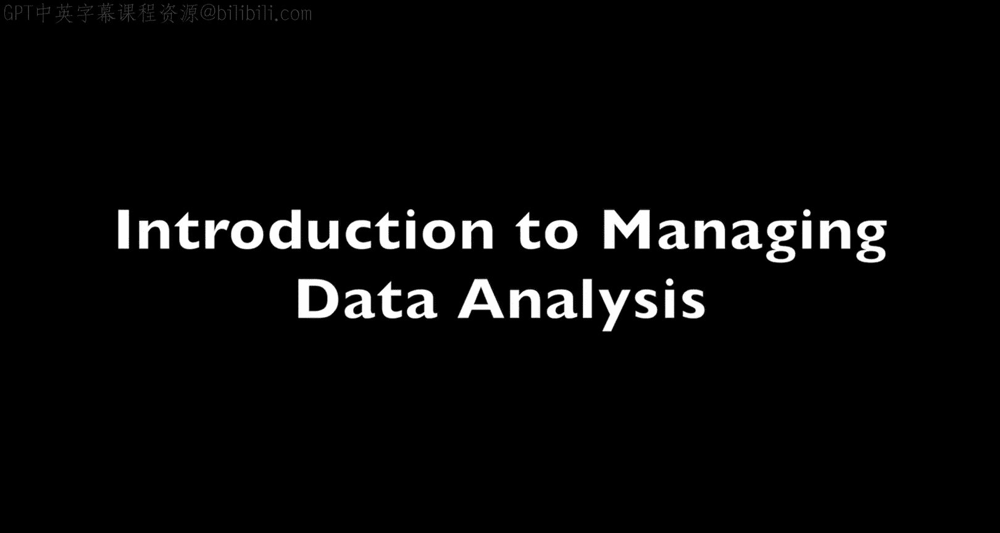

#  029：数据分析过程管理概述

在本课程中，我们将学习如何管理整个数据分析过程。数据分析之所以困难，是因为它本身是一个我们尚未完全理解、甚至难以清晰描述的过程。即使是精通数据分析的人，也常常难以解释他们具体在做什么，以及背后的思考过程。

## 艺术与科学的区别

上一节我们提到了数据分析的复杂性，本节中我们来看看如何理解这种复杂性。我们可以通过一个比喻来理解数据分析。

假设你是一位歌曲创作者，试图创作一首热门歌曲。你拥有许多可用的工具，也听过许多优秀的歌曲，因此对一首好歌的要素（如时长、主歌/副歌/桥段的结构）有所感知。我们积累了大量音乐理论，例如哪些音符组合起来好听，哪些不好听，应该使用哪些和弦等。我们拥有关于创作优秀歌曲的各类知识。

但最终，歌曲创作者必须注入创造性的火花，将所有元素整合起来，创作出人们真正想听的音乐。这就是歌曲创作的艺术。

1974年，斯坦福大学的计算机科学家唐纳德·克努特在一篇文章中探讨了艺术与科学的区别。他的核心观点是：**科学是我们理解得足够透彻，以至于可以将其教给计算机的东西；除此之外的一切都是艺术**。

理解这一点对本课程至关重要：**数据分析是一门艺术**。

## 数据分析作为一门艺术

当我们分析数据时，我们拥有许多可用的工具。以下是我们可以使用的主要工具类别：

*   **统计方法**
*   **机器学习方法**
*   **各类软件包**

该领域的研究者已经开发出大量工具。然而，对于任何一个给定的数据集，最终都需要由人来完成以下关键工作：

*   提出正确的问题。
*   组合适当的方法。
*   解释结果。
*   以引人关注的方式传达你的发现。

## 课程核心：管理迭代过程

本课程的核心就是关于管理这个完整的过程，以及你在分析数据、产出连贯结果时所经历的迭代。我期待在本课程中与你一同工作，引导你走过这个数据分析过程。

## 总结

本节课中我们一起学习了数据分析的本质。我们了解到数据分析更像一门艺术而非纯粹的科学，因为它需要人类独特的洞察力、问题构建能力和创造性整合。尽管我们拥有强大的统计工具、机器学习算法和软件，但成功分析的关键在于**管理者**如何提出正确问题、选择方法、解释结果并进行有效沟通。本课程将聚焦于管理这个动态且迭代的完整数据分析过程。