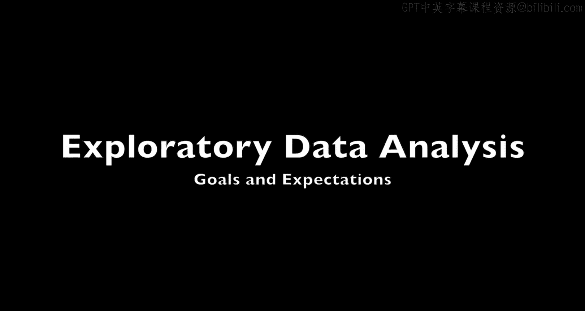
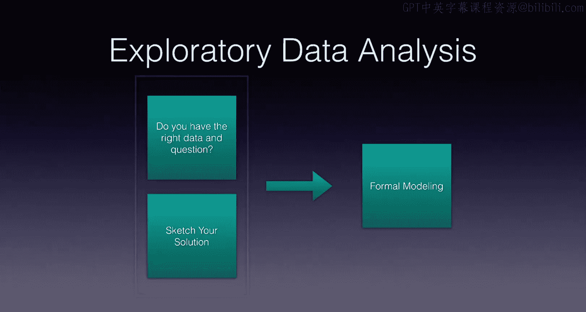
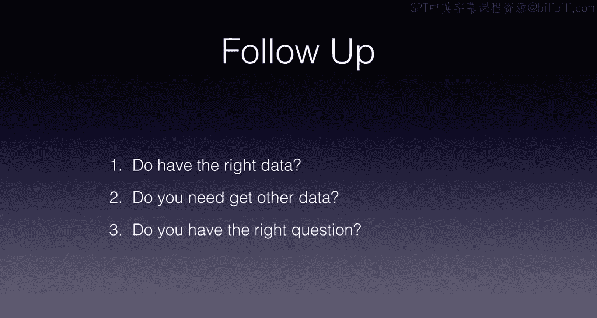

#  034：探索性数据分析的目标与期望

在本节课中，我们将学习探索性数据分析（EDA）的核心目标与预期成果。EDA是任何数据分析流程中的重要环节，它帮助我们在深入建模前，理解数据、验证假设并明确分析方向。

上一节我们介绍了数据分析的整体流程，本节中我们来看看探索性数据分析的具体目标和执行步骤。

## 探索性数据分析的核心目标

探索性数据分析的主要目标是回答三个关键问题：
1.  你拥有的数据是否足以回答你感兴趣的问题？
2.  如果数据不足，是否需要获取其他数据？
3.  基于对数据的初步观察和理解，你提出的问题是否恰当？是否需要调整、细化或聚焦于特定变量？

简而言之，EDA让你有机会审视数据，检查数据是否合适，是否需要更多数据，以及是否需要完善你的问题。

## EDA的初步工作：检查数据“包装”

在开始深入分析前，首先需要对数据进行初步检查，这就像收到一个包裹后先检查外包装一样。

以下是检查数据“包装”的几个关键步骤：

*   **核对数据维度**：确认数据表的行数和列数是否符合预期。例如，如果被告知有10行数据和60个特征，那么数据表就应该有10行和60列。
*   **验证变量存在**：检查数据中是否包含了预期应有的所有变量。这通常只需查看元数据（如变量名）即可完成，无需查看具体数值。
*   **查阅配套文档**：确保你拥有描述变量的配套文档，如数据字典或代码簿。

这些检查可以在不查看任何具体数据值的情况下完成。

## 审视数据边缘

检查完整体结构后，下一步是查看数据的“边缘”，即开头和结尾部分。

*   **查看前几行**：确认数据读取正确，前几行的数值符合预期。
*   **查看最后几行**：这有助于发现数据文件末尾可能存在的垃圾信息（如注释、笔记），尤其是在从Excel等工具导出的数据中常见。同时也能确认所有预期数据都已正确读入。
*   **检查格式与排序**：确保数字位于正确的列和行中，格式无误。如果数据按日期排序，查看首尾日期可以验证时间范围是否正确。

审视数据边缘能帮助快速发现并解决一些常见的基础性问题，避免在后续深入分析时造成麻烦。

## 始终检查你的“N”

在处理新数据集时，应时刻牢记“ABC”原则：始终检查你的“N”（即各种计数和数字）。

*   **总体计数**：检查观测总数（样本量）是否符合预期。
*   **内部结构计数**：例如，如果你有多个受试者，且每个受试者应被测量三次，那么你需要确认数据集中每个受试者确实对应三条测量记录。

数据集中及围绕数据集有各种“N”需要核对，以确保一切结构正确、就位。

## 可视化数据：绘制图表

查看数据、发现潜在问题的最直观方式是绘制图表。图表在两方面特别有用：

1.  **建立数据预期**：通过散点图、箱线图等，可以快速了解变量间的关系以及变量的分布情况（如是否偏斜、是否包含预期的正负值等）。
2.  **展示摘要与偏差**：图表能同时可视化数据的集中趋势（如均值、中位数）和离散情况（偏差）。而表格通常只提供摘要统计量。图表让你能直观看到是否存在异常大的偏差或意料之外的数据值。

虽然表格在数据分析中也有其作用，但图表在同时展示“预期”和“非预期”方面具有独特优势。

## 利用外部数据源进行验证

尝试使用至少一个外部数据源来验证你的数据集。具体方法取决于你的问题和手头数据。

*   **核对总体特征**：如果你知道某个特征在总体中的平均水平大约是10，那么检查你数据中该特征的平均值是否也在10左右，这能增加你对数据合理性的信心。
*   **检查相关性**：将你数据中的测量值与另一个你预期与之相关的（即使不完全相同）外部指标进行比较，查看它们是否确实相关。这有助于验证你的数据测量的是否是目标概念。

这种与独立外部数据源的简单比对，能让你对数据的格式和来源有更多信心。

## 尝试构建初步解决方案

完成上述检查后，下一步是尝试构建一个初步的解决方案或模型。

*   **从最简单的方案开始**：尝试最明显、最简单的分析方法。简单的方案往往能揭示关键信息。
*   **建立“初步模型”**：这个初步模型将成为你后续分析的基础和焦点。它并非一成不变，之后可能会被更改。我们称之为“初步证据”或“主要模型”。
*   **进行后续分析**：围绕这个初步模型，进行各种次级分析，以检验它是否合适。很多时候你会发现初步模型并不正确，从而需要聚焦于另一个模型并将其设为主要模型。

探索性数据分析的一个关键产出，就是形成这个初步的解决方案或主要模型。

## 回顾与决策

完成整个EDA流程后，你需要回到最初的那三个问题：

1.  你拥有正确的数据吗？
2.  是否需要获取其他数据？
3.  你的问题正确吗？是否需要调整？

此时，你可能需要根据发现，对数据和问题进行微调。如果决定继续推进，就可以利用EDA技术来完善你的初步模型，并进而转向更正式的建模阶段。

---

本节课中我们一起学习了探索性数据分析的目标和核心步骤。我们了解到，EDA是一个通过检查数据“包装”、审视数据边缘、核对关键计数、可视化数据、进行外部验证以及构建初步模型来理解数据、验证问题可行性的过程。它为后续深入、正式的数据分析奠定了坚实的基础。