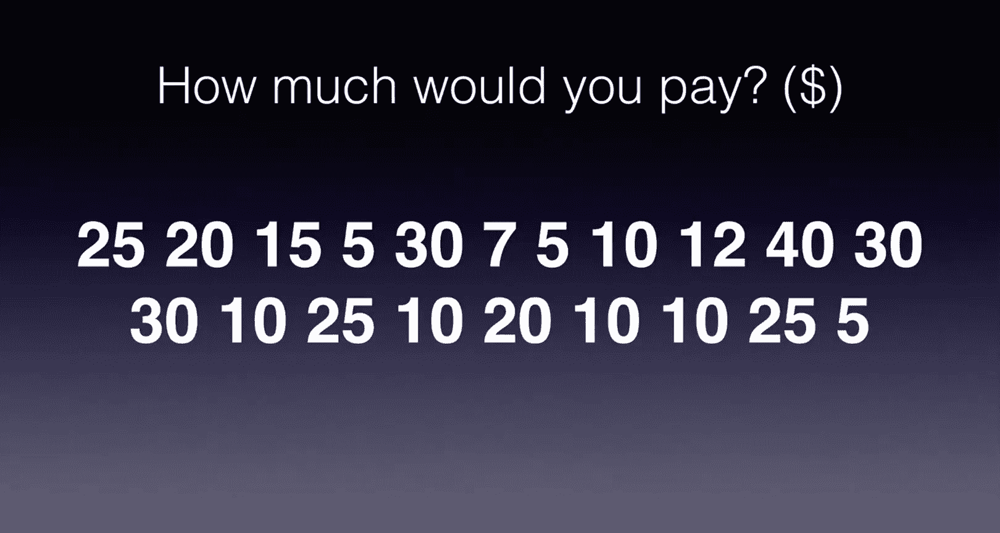
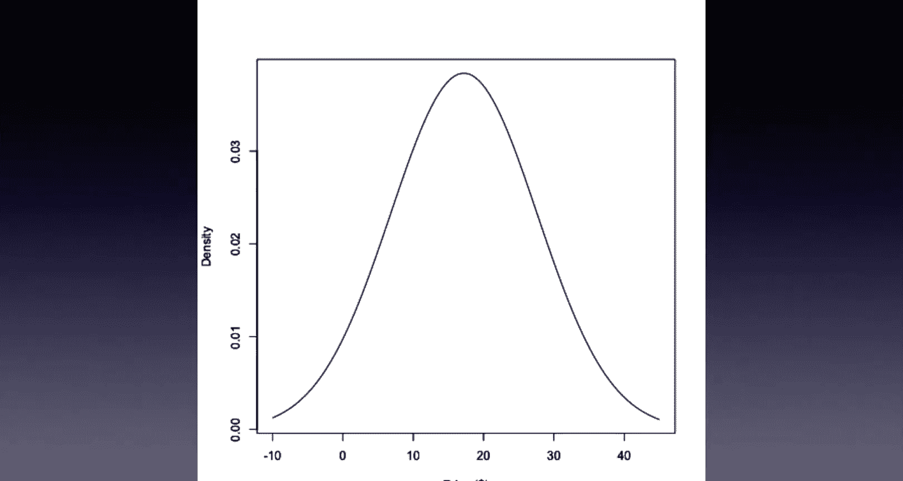
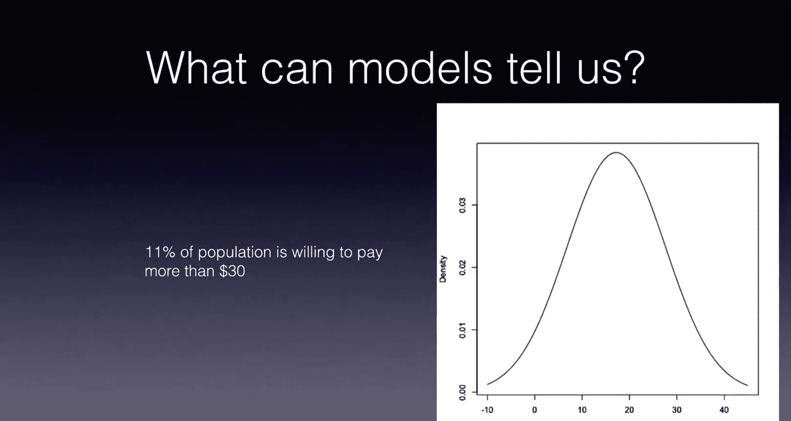
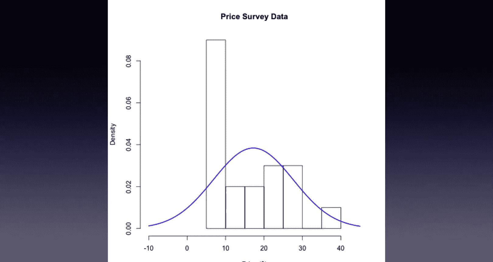
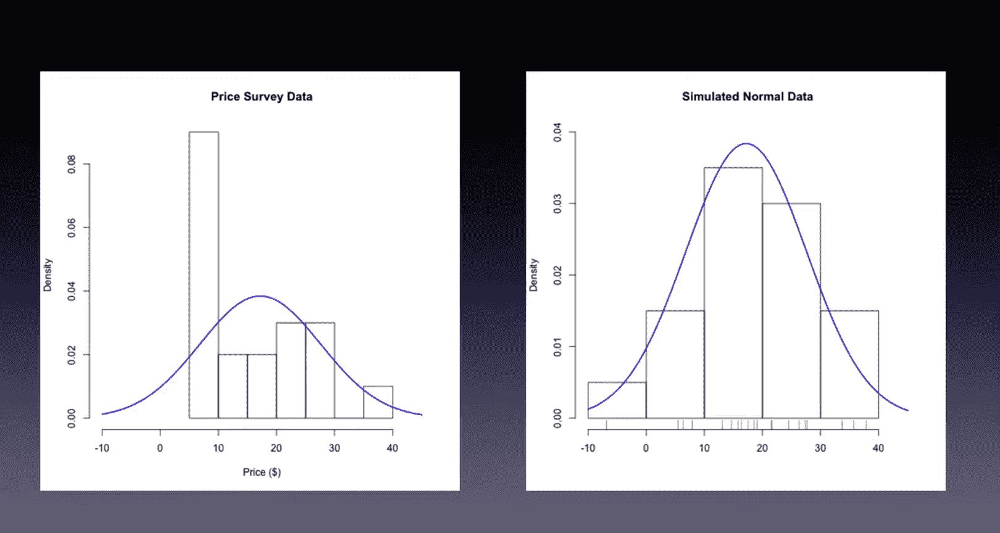
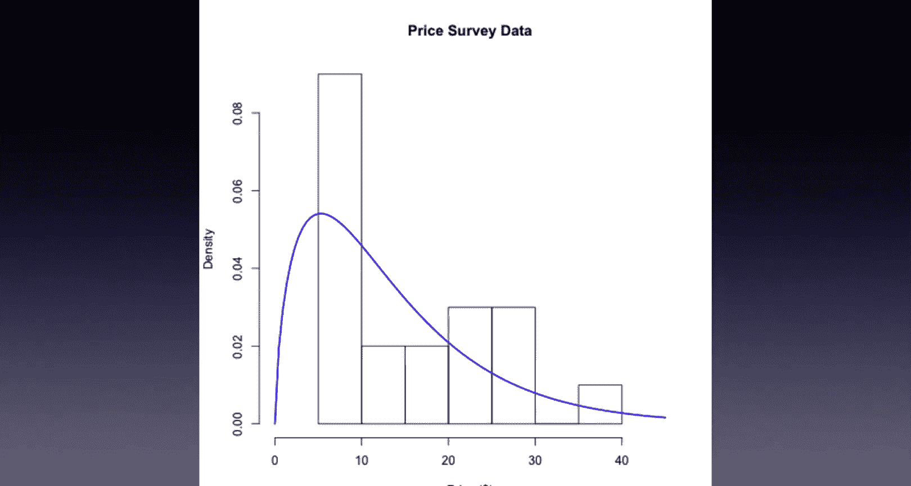
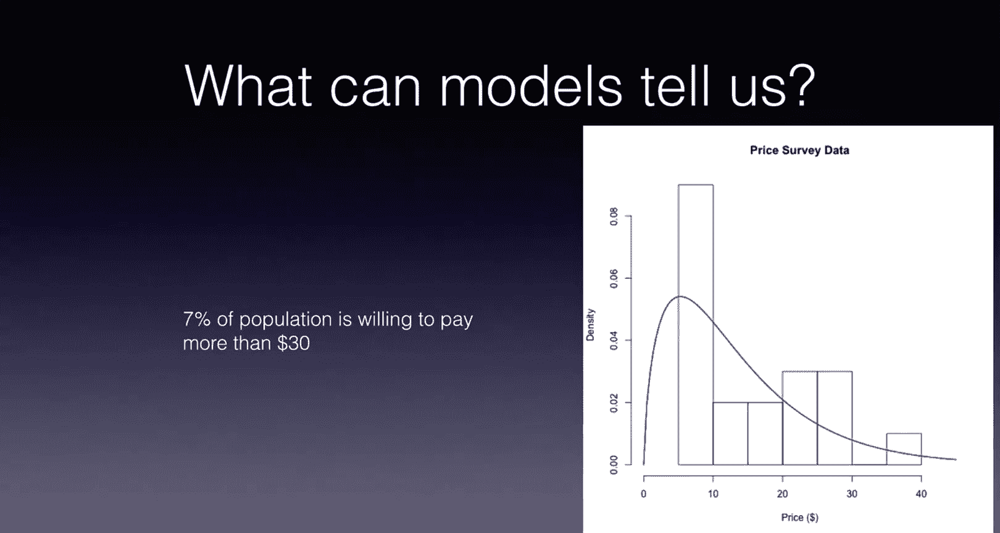

#  035：使用统计模型探索数据（第一部分）📊

在本节课中，我们将要学习如何使用统计模型来探索数据。我们将了解模型是什么，为什么需要它们，以及如何通过比较不同模型（如正态分布和伽马分布）来更好地理解数据并做出预测。


## 什么是模型？🤔

上一节我们介绍了探索性数据分析的目标。本节中我们来看看什么是统计模型，以及为什么我们需要它们。

模型是我们为了帮助理解现实世界而构建的构造物。例如，在生物学中，人们常使用小鼠作为人类的模型，因为无法直接在人类身上进行某些实验。我们讨论的模型是数学模型，它们帮助我们描述和理解我们所关注的总体。

总体通常过于复杂，难以一次性全面思考。例如，要描述美国所有3亿多人口及其相互关系几乎是不可能的。因此，我们需要模型来简化问题，让我们能够以合理的方式思考总体。模型代表了总体的特征和关系，并通过施加结构来帮助我们。例如，我们可能假设两个变量之间存在线性关系，这有助于简化我们对总体中变量关系的思考。

需要记住一句统计学中的名言：**所有模型都是错误的，但有些是有用的**。重点不在于找到“正确”的模型，而在于开发一个能帮助你讲述关于总体的故事、真正有用的模型。

## 没有模型会怎样？🚫

为了理解模型的价值，我们可以先设想一下完全没有模型的情况。这能让我们体会到事情的困难程度。

假设你正在开发一款新产品，想知道人们愿意为此支付多少钱。一个简单的方法是进行一项调查，例如询问20位潜在消费者他们愿意支付的价格。这就是数据，没有附加任何模型。

以下是我为一本名为《数据科学编程》的书籍进行类似调查时得到的20个数据点（单位：美元）：
```
15, 20, 25, 10, 30, 12, 18, 22, 28, 8, 35, 10, 10, 40, 5, 15, 20, 25, 10, 30
```

这就是没有模型的情况。答案“数据告诉了我们什么”就隐藏在这些数字中。问题在于，这种“平凡模型”（即没有模型）并不有用，因为它没有提供任何**数据摘要**或**数据简化**。既然所有模型都可能是错的，那么尝试找到一个有用的模型，总比使用一个几乎肯定无用的“无模型”状态要好。

## 使用正态模型📈

现在，让我们尝试使用一个具体的模型来探索数据。一个常见的选择是**正态模型**，它基于我们熟悉的正态分布（钟形曲线）。

正态模型的好处是只需要估计两个参数：**均值（μ）** 和 **标准差（σ）**。我们可以直接从数据中计算这些值：
*   **样本均值**：`mean(data)`
*   **样本标准差**：`sd(data)`

在查看实际数据之前，设定对模型的期望非常重要。我们期望从正态分布总体中抽取的代表性样本数据看起来是什么样子？



以下是正态分布的曲线图，它告诉我们，如果数据真的来自正态总体，我们预期会看到这样的形态。


模型非常有用，因为它们能告诉我们关于总体的许多信息。例如，根据拟合数据的正态模型，我们可以计算出：
*   68%的总体愿意支付的价格在 `$6.81` 到 `$27.59` 之间。
*   11%的总体愿意支付超过 `$30`。

请注意，这张图中**没有实际的数据点**。我们只是用数据计算了均值和标准差，然后画出了理论分布曲线。



## 设定期望：绘制“假想图”🎨

在将模型与实际数据比较之前，一个非常有用的技巧是绘制“假想图”。我们可以使用软件模拟从正态分布中生成数据，看看它应该是什么样子。



以下是模拟20个来自完美正态分布的数据点并绘制其直方图的结果，蓝色的理论正态曲线覆盖在上面：


可以看到，直方图与蓝色曲线匹配得很好。这就是“正常”数据应有的样子。绘制这样的假想图能有效帮助我们设定正确的期望。有时，甚至用手粗略画一下预期的图形也很有帮助。

从这张假想图中，我们已经能发现正态模型的一个潜在问题：曲线的左侧包含了**负值**。而在我们的场景中，人们愿意为书籍支付负的价格是不合理的。这表明正态模型可能不是最合适的，但它仍然可能是一个有用的起点。

## 将模型与实际数据比较🔍

现在，让我们看看实际调查数据在正态模型下的样子。下图是20个实际数据点的直方图，并覆盖了根据这些数据拟合的正态分布曲线（蓝色）：


对比之前看到的“假想图”，你觉得这个拟合效果如何？可能看起来并不太好。



以下是这个图形中存在的问题：
1.  直方图在 `$10` 左右有一个巨大的尖峰，而正态分布曲线并没有预测到这样一个尖峰。
2.  数据中没有接近零或负值的点，但正态分布的理论曲线却覆盖了这些区域。

这表明正态模型与数据的拟合度不佳。

## 尝试不同的模型：伽马分布🔄




当模型拟合不佳时，我们可能需要修正模型或修正数据。如果数据收集成本很高，修正模型通常是更可行的选择。

因此，让我们尝试另一个模型：**伽马分布**。伽马分布的一个关键特性是它**只允许正值**，这更符合“支付价格”的现实情况。

我们可以重复之前的步骤：用伽马分布拟合数据，并绘制图形进行比较。下图是实际数据与拟合的伽马分布曲线：


这个拟合也并非完美。例如，曲线在 `$0` 到 `$5` 的区间内覆盖了没有数据点的区域，`$10` 处的尖峰也没有被完美捕捉。但重要的是，**不同的模型会得出不同的预测**。

*   **正态模型**预测价格分布的峰值在 `$20` 左右，并估计有 **11%** 的人愿意支付超过 `$30`。
*   **伽马模型**预测峰值在 `$7` 到 `$10` 之间，并估计只有 **7%** 的人愿意支付超过 `$30`。

## 总结与下一步🚀



本节课中我们一起学习了如何使用统计模型进行探索性数据分析。

我们了解到：
1.  **模型是简化复杂总体、帮助我们理解和讲述数据故事的工具**。没有模型，数据只是一堆难以解读的数字。
2.  **所有模型都是错的，但有些是有用的**。目标是找到能提供有意义的摘要和预测的实用模型。
3.  **设定期望至关重要**。通过绘制“假想图”，我们可以预先知道如果模型正确，数据应该是什么样子。
4.  **比较模型与实际数据**是评估模型适用性的关键步骤。如果拟合不佳（如正态模型产生负值预测），就需要考虑其他模型。
5.  **不同模型会导致不同结论**。选择伽马分布而非正态分布，会显著改变对“愿意支付超过30美元的人数比例”的预测。

从目前的分析中，我们得到了关于“人们愿意为产品支付多少钱”这个问题的一个初步“草图”。我们知道了价格分布的可能形状，并对总体行为有了更好的感知。

接下来你可以：
*   **继续精炼模型**，尝试其他可能拟合更好的分布。
*   **收集更多或更好的数据**，如果怀疑初始调查样本有偏差。
*   **进行更正式的建模**，以测试你的假设和预测对各种因素的敏感性。这将是我们后续课程要讨论的内容。



通过本节的学习，你已经掌握了使用统计模型探索数据、形成初步见解的基本流程。