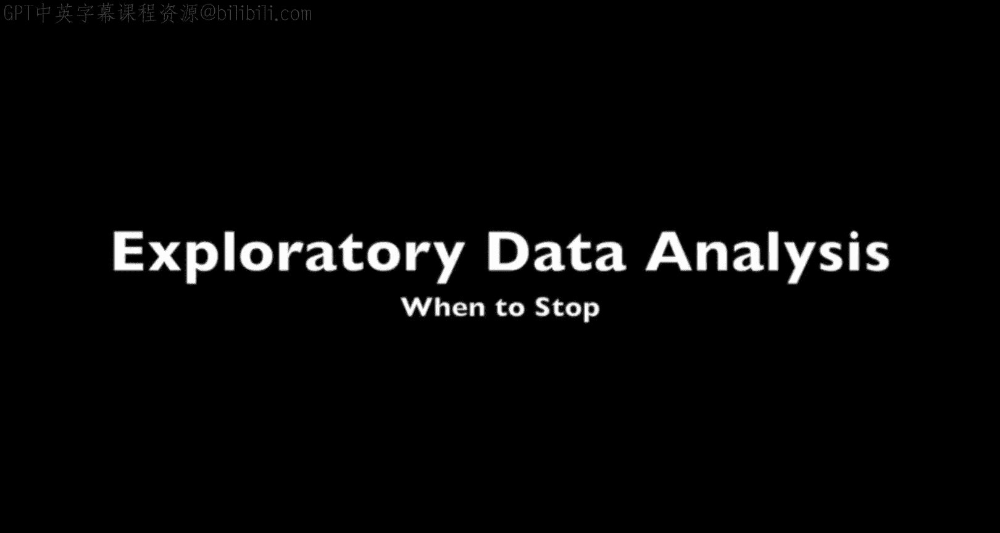
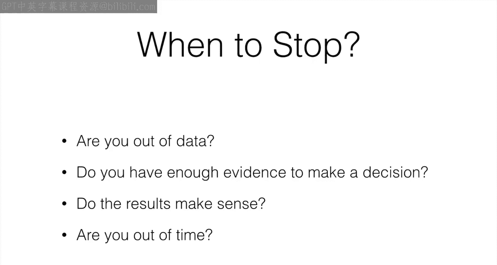
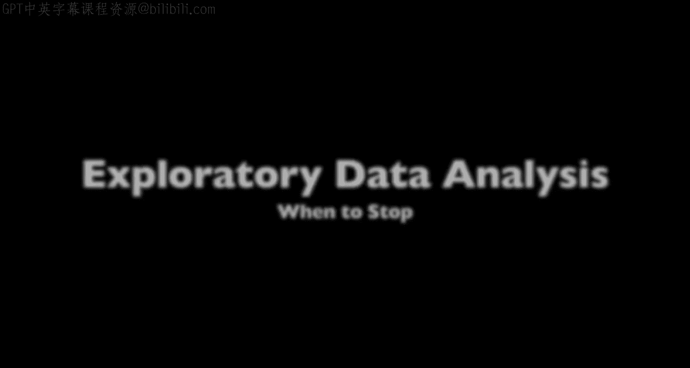

#  037：何时停止 🛑

在本节课中，我们将探讨探索性数据分析（EDA）这一高度迭代的过程，并学习如何判断何时应该停止迭代，进入数据分析的下一阶段。

探索性数据分析是一个高度迭代的过程。然而，人们很容易陷入无限迭代的诱惑。本讲座将讨论何时停止这个过程，并进入数据分析的下一阶段。

到目前为止，本系列讲座中的示例通常只展示了EDA迭代的一个阶段。但实际上，大多数探索性数据分析都会迭代数次，因为你可能会修正问题、更新数据或更改模型。通常，你得到的每一个新答案都会引发更多问题，因此理论上这个过程可以无限进行下去。但真正的问题是：**你何时应该停止？** 因为我们无法永远进行下去，所以最终必须确定答案并进入下一阶段。本讲座提出了几个你可以自问的问题，以帮助你判断何时该停止。

---

## 判断何时停止的四个关键问题 🤔

以下是四个核心问题，可以帮助你评估是否应该结束探索性数据分析阶段。

### 1. 数据是否已耗尽？ 📊

随着探索性数据分析的迭代进行，你可能会到达一个阶段：**你手头已经没有更多数据来回答新产生的问题了**，因此无法继续推进。

例如，在分析臭氧与温度关系的例子中，我们发现两者之间的关系似乎是非线性的。但数据本身无法告诉你这种关系为何是非线性的，或者它是如何以这种方式呈现的。因此，数据可能会提出一些假设，供你进一步探索，但最终你可能需要去收集尚未测量的新数据。

此外，如果你的分析很成功，已经回答了最初设定的问题，这通常也表明你可能“数据耗尽”了。因为接下来，你往往需要**获取另一个独立的数据集来复现你的发现**，以确保你所得出的关系或答案确实是真实的。因此，这也是一个信号，表明你需要获取更多数据。

---

### 2. 是否有足够证据做出决策？ ⚖️

数据分析通常是为了支持某种决策。为决策所做的分析，与为研究论文、产品发布或技术报告所做的分析是不同的。你可能已经拥有足够的信息或证据来做出决策，而这些证据可能基于数据集之外的许多外部因素。

决策可以依赖于多种不同的输入，你的分析可能只是其中之一。**时刻牢记数据分析的目的至关重要**。如果不清楚分析数据的确切目的，你可能会在项目中投入过多或过少的资源。最后，分析的目的可能会随时间变化，这很常见，并且可能同时存在多个并行的目的。因此，跟踪这些目的以及你为何要分析数据，将有助于你专注于：**需要迭代多少次数据分析才能获得合适的答案**。

---

### 3. 结果能否置于更广泛的背景中？ 🌍

这个问题的另一种问法是：**这些结果合理吗？** 为了回答这个问题，你可能需要查阅文献，或与组织内外熟悉该领域的专家交流，看看你的发现是否符合他们的预期。

无论你的发现是否符合现有文献或人们的普遍认知，这都可能有好有坏。如果不符合，这可能引领你走向新的发现，因此可能是件好事。另一方面，如果你的发现符合预期，这也不一定总是好事。特别是，如果你的数据符合你的预期，这可能仅仅表明你提出的问题不够尖锐。如果你的问题本身比较模糊，那么数据中可能会有很多不同的模式都符合该问题的预期。

因此，如果你发现的结果“看起来合理”，这可能是一个信号，表明你实际上需要**将问题打磨得更精确一些**。如果结果不符合你的预期，这可能很有趣，但绝对需要跟进调查。请记住，每一颗未经雕琢的钻石背后，都有九十九块煤。这可能意味着你只是犯了一个简单的错误，需要仔细检查。

实际上，无论你对“这些结果合理吗”这个问题给出何种答案，你都需要做的是：**检查你所做的工作**，仔细核对，确保没有简单的错误。如果没有发现错误，你可能还想尝试在独立数据中复现你的发现。如果你能复现你的发现，那么无论它们是否符合最初的预期，你都可以对发现的可信度有更多信心。

---

### 4. 时间是否耗尽？ ⏳

这个问题听起来有些武断，但却非常现实。另一种问法是：**资金是否耗尽？** 每个项目都有时间预算和资金预算。即使你不直接控制这些预算，了解它们也很重要，因为它们将帮助你管理数据分析过程。

重要的是，你可能最终需要为获取更多资源或时间进行论证，并需要说服他人。因此，知道何时停止数据分析或探索性数据分析过程，以便准备结果进行展示，并在必要时为项目的延续进行论证，是非常关键的。**跟踪你的时间和资金预算**，是管理数据分析过程、顺利过渡到下一阶段或在需要时争取更多资源的重要组成部分。

---

## 总结 📝

本节课我们一起学习了如何判断何时应停止探索性数据分析的迭代过程。我们介绍了四个关键的自问问题：

1.  **数据是否已耗尽？** 📊
2.  **是否有足够证据做出决策？** ⚖️
3.  **结果能否置于更广泛的背景中（是否合理）？** 🌍
4.  **时间（或资源）是否耗尽？** ⏳

通过回答这些问题，你可以更好地管理整个数据分析过程，并决定是否应该停止探索性分析，进入建模、验证或结果呈现的下一阶段。记住，数据分析的目标是获得洞察并推动行动，而非无休止地探索。