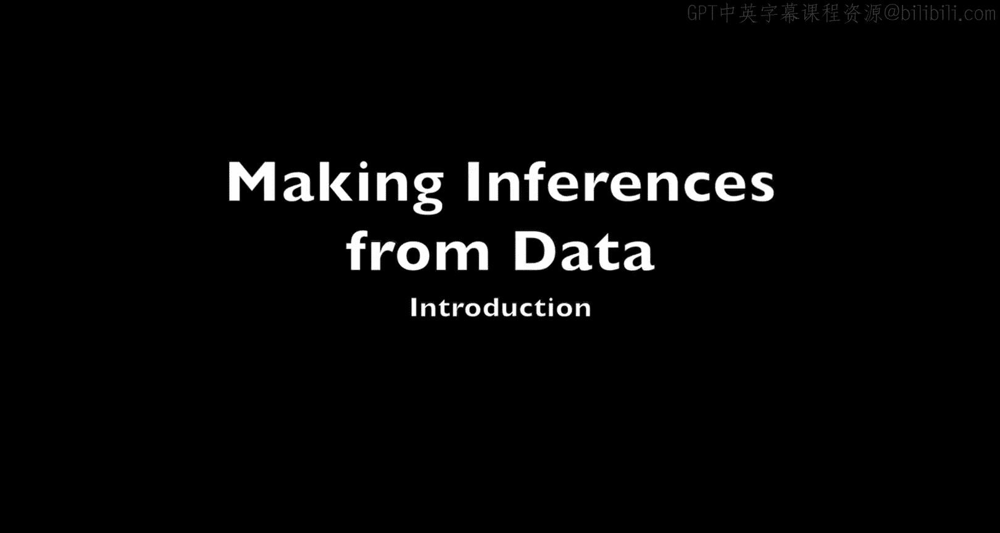
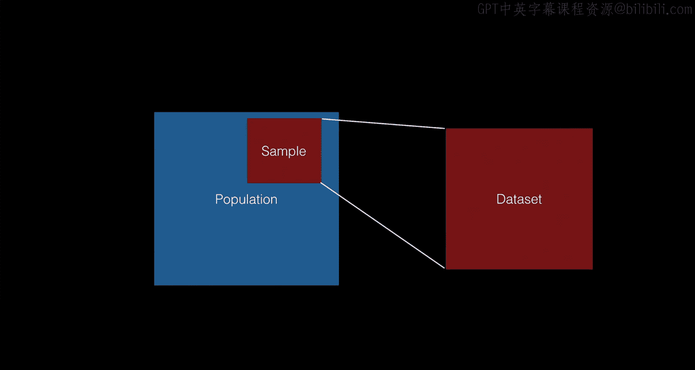
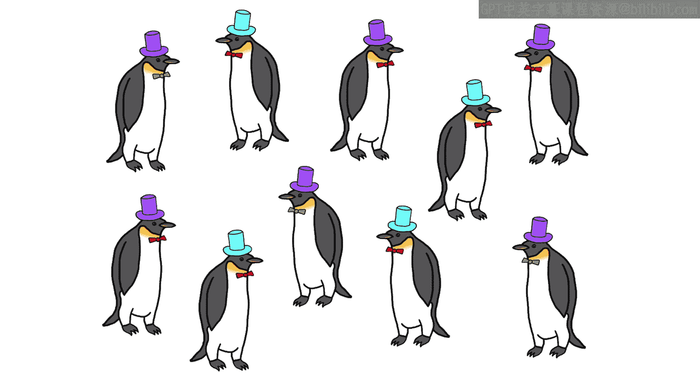
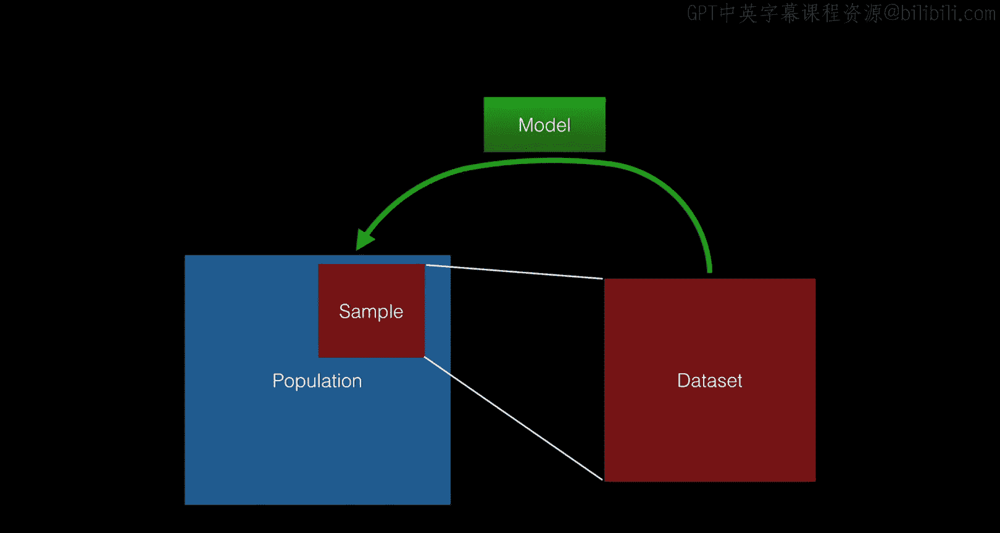
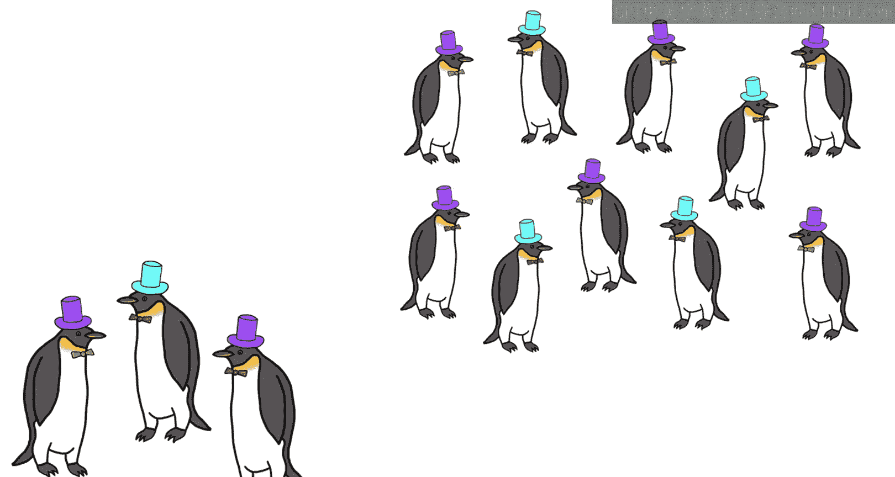

#  038：介绍 🧠

在本节课中，我们将要学习**推断**的核心概念。推断的任务是，对我们无法直接观察到的事物做出陈述。本讲座将介绍从数据中进行有效推断所需的三个基本要素。

---

## 定义推断的目标 🎯

推断的目标是能够对我们无法直接观察到的事物做出陈述，并且能够描述我们对这些陈述的**不确定性**。

我们通常将这些无法观察、想要进行推断的事物称为**总体**。为了进行推断，我们需要从总体中收集一个**样本**，这个抽样过程最终会形成我们的**数据集**。

因此，从数据中进行推断，你需要三个简单的要素。

---

## 推断的三要素 📋

以下是进行数据推断所必需的三个核心组成部分。

### 1. 总体

首先，你需要能够识别你正在对其做出推断的**总体**。当然，你必须有一个关于这个总体的问题，但这是次要的。一旦你明确了总体，你就能清晰地说明你在对什么进行推断。

**定义总体是迄今为止最重要的任务**。如果你不能清晰地描述总体，那么你实际上无法进行任何推断，因为没有一个可以推断的对象。确保你能准确描述总体，将有助于你在分析数据后更好地讲述整个故事。同样，确定一个你想要提出和回答的重要问题也很关键，但想必你已经做到了这一点。

### 2. 抽样过程

接下来，你需要能够描述**抽样过程**。你需要能够讲述数据如何从总体中产生并最终进入你的实验室的故事。如果你不能描述这个过程，那么将很难理解你的推断有多有效。你越能清晰、准确地描述数据的来源，你的结果就越有说服力。

### 3. 总体模型

最后，你需要一个**总体模型**。你需要一个模型来描述总体中的元素如何相互作用或彼此关联。这个模型可以复杂也可以简单，取决于我们试图回答的问题类型。重要的是，这个模型将我们观察到的数据与我们未观察到的总体联系起来，它本质上是一个关于世界如何运作的简化图景。

---

## 一个简单的示例 🐧

为了更具体地理解这些概念，让我们来看一个简单的运行示例。

### 总体与问题

假设有一个由10只企鹅组成的基本总体。每只企鹅都戴着一顶绿松石色的帽子或一顶紫色的帽子。我们想要问的基本问题是：**这个企鹅总体中，有多大比例戴着绿松石色的帽子？**

问题在于，我们无法收集整个总体的数据。因此，我们需要从这个总体中抽取一个样本。

### 抽样与数据

抽样过程是数据来到你手中的方式。假设我们要抽取三只企鹅。我们站在10只企鹅面前，选择最先走向我们的三只。这样，我们就得到了一个包含三只企鹅的数据集。

### 模型与假设

现在，总体模型描述了总体中单位的特征如何相互关联。对于这个简单问题，我们不需要做太多假设。但我们可以假设，例如，总体中的单位是**相互独立**的。也就是说，一只企鹅戴什么颜色的帽子，不会影响另一只企鹅的选择。

### 进行推断

根据我们三只企鹅的小数据集，我们可以估计总体中戴绿松石帽子的比例。从数据中，我们估计这个比例是三分之一（1/3）。因此，我们推断总体中大约有33%的企鹅戴绿松石帽子。

我们的最终估计是**0.33**。然而，因为我们知道真实的总体（10只中有4只戴绿松石帽），真实比例是**0.4**。我们的估计（0.33）与真实值（0.4）之间存在差异，这是我们预期的**变异**。

那么，我们如何知道0.33是否是一个好的估计呢？我们将在下一讲中讨论如何判断你的推断是否良好。

---

## 总结 📝

本节课中，我们一起学习了数据推断的基础。我们明确了推断的目标是描述未知总体并量化不确定性。实现这一目标需要三个关键要素：**明确定义的总体**、**清晰的抽样过程描述**以及一个连接数据与总体的**模型**。通过一个企鹅戴帽子的简单例子，我们看到了如何应用这些要素来得到一个估计值，并认识到估计值与真实值之间通常存在差异。理解这些基本要素是进行任何严谨数据分析的第一步。