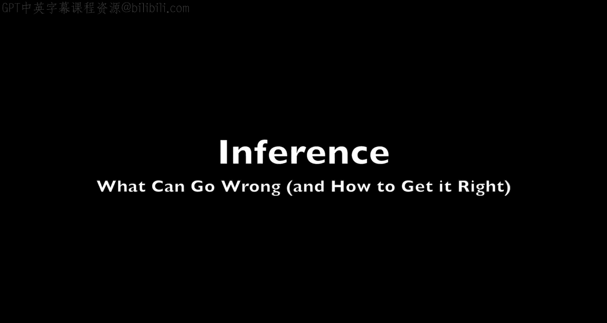
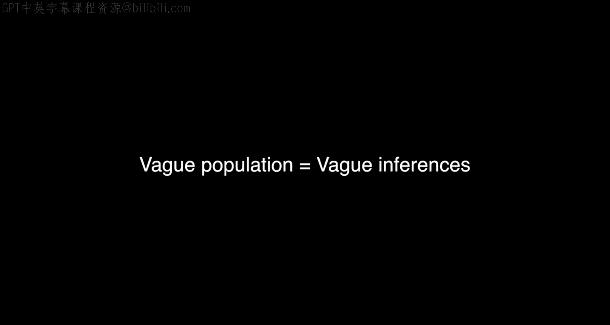
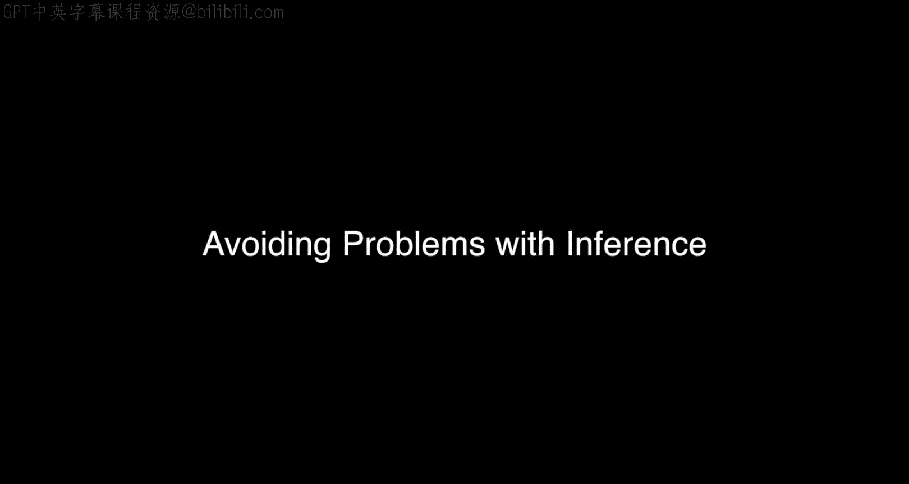

#  040：可能出错的地方 🧐

在本节课中，我们将要学习从数据中进行统计推断时，可能遇到的各种问题及其影响。理解这些潜在陷阱对于确保分析结论的可靠性和有效性至关重要。

---

## 概述

统计推断的质量可能受到多种因素的影响。本次课程将探讨推断过程中可能出错的地方，这些问题通常源于我们对总体、抽样过程或总体模型的假设被违反。

---

## 推断中的基本问题

当我们进行推断时，出现的基本问题通常源于对总体、抽样过程或总体模型的假设被违反。接下来，我们将逐一探讨这些问题及其后果。

---

### 问题一：总体定义不明确

第一个问题是总体定义不明确。这是一个重大问题，因为模糊定义的总体会导致模糊的推断。总体定义模糊的迹象通常是结果难以解释或无法解释。

这个问题无法通过数据本身或修正数据来解决。它需要更清晰地思考你试图推断的总体类型。

---

### 问题二：抽样过程指定错误

第二个可能遇到的问题是抽样过程指定错误。这会导致样本数据不能代表总体，通常被称为“便利抽样”。

例如，在进行观察性或实验性研究时，你可能只是招募了最容易接触到的人进入研究。这可能不是一个能代表你总体的抽样过程，而只是一个便利样本。其结果就是产生所谓的“选择偏差”。

研究中的个体只代表了总体的一部分，而非整个总体。因此，如果你拟合任何模型或从数据中估计任何特征，这些估计值将不适用于你最初设计的目标总体，而可能适用于某个你无法准确定义的其他总体。

即使你的总体模型正确，即使你清楚目标总体是什么，如果你的抽样过程没有明确指定、充分表征或未被正确理解，那么你收集的数据和做出的推断将只适用于某个你尚未充分表征的其他总体。

---

### 问题三：总体模型指定错误

最后一个问题是总体模型指定错误。回想一下我们之前说过的话：所有模型都是错误的。因此，你肯定会错误地指定总体模型。

真正的目标不是得到完全正确的模型，而是得到一个能合理近似总体情况的模型。如果你的模型错误，可能会发生几件事：

1.  **低估不确定性**：数据估计中的某些不确定性可能未被考虑，导致你低估了对总体某些特征的确定程度。
2.  **参数难以解释**：从模型中估计出的任何参数可能变得无法解释。如果你的模型不正确，不能正确反映数据或总体中的关系，那么你估计的参数将不适用于该总体，并且可能难以解释。
3.  **预测效果差**：在预测类问题中，如果模型不正确，你的预测效果可能会很差，并且误差很高。

---

## 关键问题与应对策略

你需要知道的是，在参与数据分析过程时应该提出哪些问题。以下是三个与推断中可能遇到的违规类型相关的基本问题及其应对策略。

以下是每个问题对应的思考与解决方法：

*   **问题一：我们能否描述总体？**
    *   **解决方法**：在推断过程开始前进行更多思考。花额外时间思考总体是什么，并咨询该领域的专家（可以是组织内部或外部的）。

*   **问题二：我们是否理解抽样过程？**
    *   **解决方法**：
        1.  你可以自行收集数据，从而指定抽样过程。
        2.  收集关于总体特征的辅助数据。如果你拥有关于总体的辅助数据（例如某些特征），就可以量化你收集的样本与总体辅助数据之间的差异。
        *   **示例**：你可能拥有研究中参与者的性别数据。如果总体男女比例大致是50:50，但你的数据集是70:30，那么你就可以描述所收集数据与目标总体之间的这种差异。辅助数据对于表征样本中可能存在的任何选择偏差非常有用。

*   **问题三：我们是否拥有合适的总体模型？**
    *   **解决方法**：
        1.  通过彻底的探索性数据分析来评估模型。
        2.  在拟合统计模型时，使用稳健的推断方法。
        3.  使用非常灵活的模型，例如机器学习方法。许多机器学习技术可以从数据中学习模型，而无需你非常具体地指定它。当你不完全理解总体中的关系时，这非常有用。

---

## 最终挑战：抽样变异性

做出良好推断的最终挑战是抽样变异性。我把它留到最后是有原因的，因为即使你做对了其他所有事情，抽样变异性也依然存在。

你已经定义了总体，描述了抽样过程，并为总体建立了一个合理的模型。但仅仅因为你是从总体中抽样数据这一事实，就会引入不确定性，因为你没有全部数据。

每次抽取样本都会略有不同，你对总体的任何估计也会随着每次抽样而略有不同。我们将在关于解释数据分析的课程中进一步讨论这一点。

这里需要知道的重要一点是：**你应该始终要求为从数据中获得的任何估计值提供一个不确定性的度量**。无论是任何汇总统计量还是可以从数据中估计的任何模型参数，都应附带一个不确定性的度量。因为如果你是从总体中抽样数据，不确定性总是存在的。

---

## 总结

本节课中，我们一起学习了统计推断中可能出错的几个关键方面。

*   始终思考总体是什么。
*   始终评估抽样过程，并思考所收集数据与你试图推断的总体之间的差异。
*   始终尽可能仔细地诊断你的模型，或者使用非常灵活的方法来建模你的总体。
*   最后，始终要求为从数据中得出的任何估计值提供一个不确定性的度量。

这些就是推断中可能出错的地方，以及你如何尝试保护自己免受这些问题影响的方法。