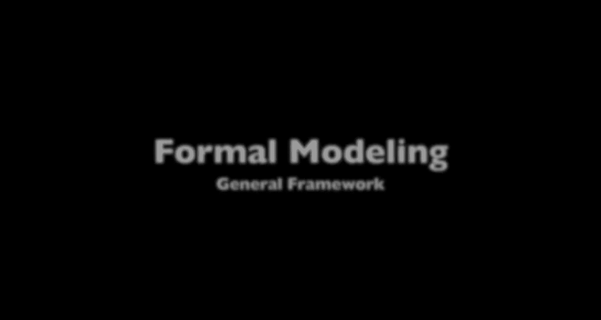
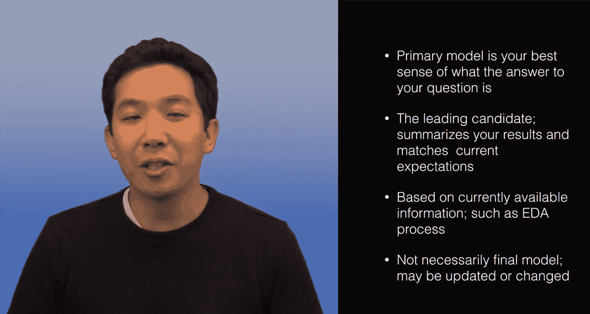
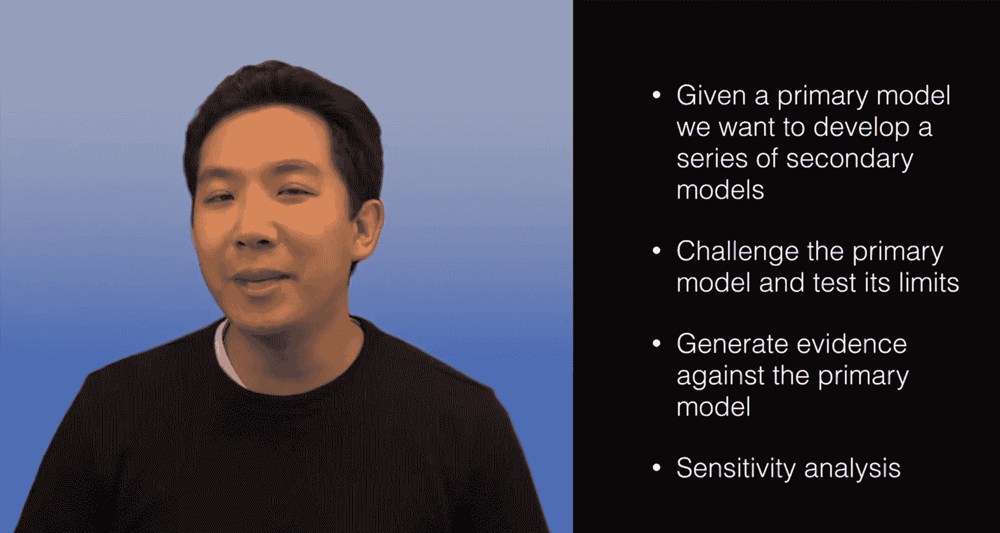
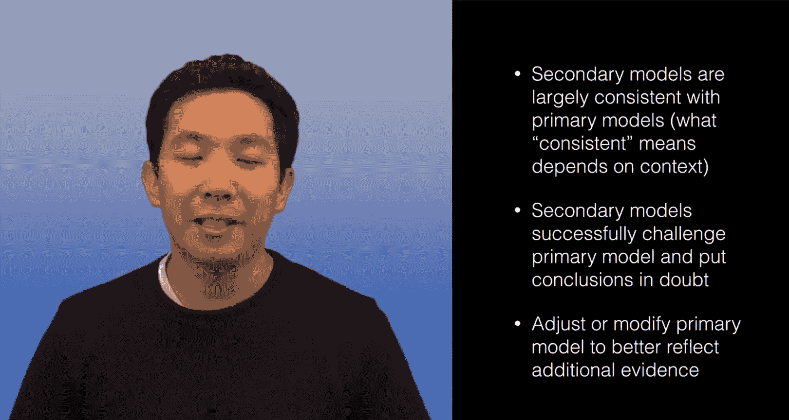
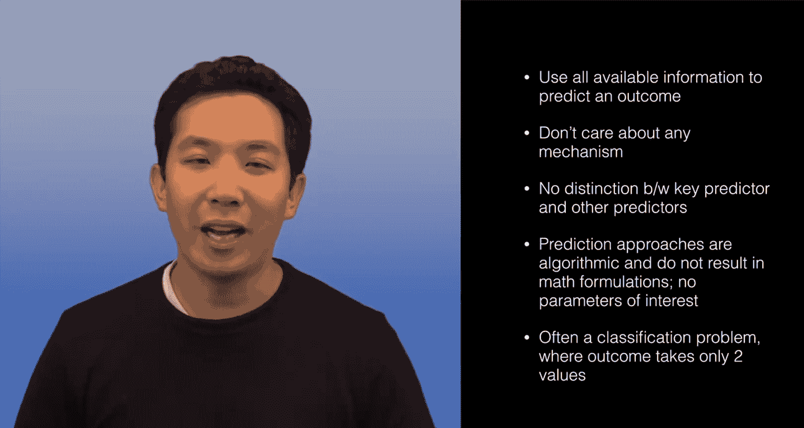
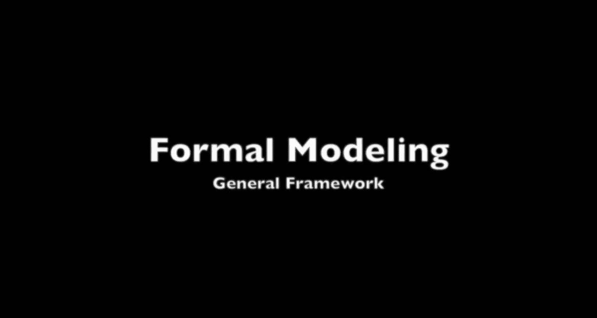

#  041：一般框架 📊

在本节课中，我们将要学习**形式化建模**。形式化建模是为数据精确指定统计模型，并为挑战和检验这些模型提供严格框架的过程。

上一节我们介绍了探索性数据分析，本节中我们来看看如何将初步的分析思路转化为严谨的模型。

## 什么是形式化建模？🤔

形式化建模是使用数学符号或计算机代码，精确地描述你试图估计的内容，并提供一个严谨的框架来挑战和检验你的发现。仅用文字描述模型通常难以达到这种精确度，因此我们需要借助数学或代码。

在形式化建模中，**参数**扮演着重要角色。参数通常代表总体的特征，例如变量间的关系、均值或标准差。由于它们是总体的特征，因此通常是未知的，我们需要从数据中进行估计。形式化建模允许你明确指定你感兴趣并试图估计的参数类型。

例如，在线性回归中，回归模型的系数就是参数，你的目标通常是估计它们。其公式可以表示为：
`Y = β₀ + β₁X₁ + β₂X₂ + ... + ε`
其中，`β` 代表需要估计的参数。

## 形式化建模的一般框架 🔄

形式化建模的一般框架与本课程一直讨论的思路相似，包含三个基本步骤：**设定预期**、**收集信息**和**修正预期**。

### 第一步：设定预期（确立主模型）

首先，你需要建立一个**主模型**。这是基于你目前掌握的所有信息（包括探索性数据分析）得出的、你认为最合理的解决方案。它不一定是最終模型，而是你用来构建正式分析的起点，后续可能会根据新信息进行更新。

### 第二步：收集信息（构建次级模型）

在确立了主模型之后，下一步是构建一系列**次级模型**来测试和挑战你的主模型解决方案。

以下是次级模型的主要构建思路：
*   **添加变量**：在主模型的基础上引入新的预测变量。
*   **删减变量**：尝试移除主模型中的某些变量。
*   **改变函数形式**：使用不同的数学关系（如非线性）来连接变量。

这个过程也称为**敏感性分析**，目的是检验你的主模型结论对于模型设定（如变量增减、形式变化）的敏感程度。

### 第三步：修正预期

最后，你需要根据次级模型的结果来修正你的预期。
*   如果次级模型的结果与主模型**基本一致**（“一致”的具体含义取决于上下文和应用场景），那么你可以进入下一阶段或报告结果。
*   如果次级模型**成功挑战**了主模型，甚至让你对初始结论产生怀疑，那么你就需要调整或修改主模型，以更好地反映所有次级模型产生的新证据。

然后，你可以用新的主模型和一组新的次级模型重新开始这个过程，**迭代循环**，直到得到一个你认为能够合理总结数据并回答问题的模型。

## 形式化建模的两种主要情境 📈

我们通常在两种基本情境下使用形式化建模：**关联性分析**和**预测性分析**。

### 关联性分析

关联性分析的目标是，在控制许多其他潜在**混杂因素**的前提下，考察两个或多个特征之间的关联。

在这种分析中，变量可以分为三类：
1.  **结果变量**：我们认为是随着关键预测变量变化而变化的因素。
2.  **关键预测变量**：我们主要感兴趣的预测变量，想知道结果如何随其变化。通常数量很少（常为一个）。
3.  **潜在混杂变量**：一个很大的变量类别。它们通常既与关键预测变量相关，也与结果变量相关，可能会混淆关键预测变量与结果之间的真实关联。在模型中需要对其进行调整或控制。

### 预测性分析

预测性分析与关联性分析不同，其目标是利用所有可用信息来**预测一个结果**。你通常不关心机制或变量如何工作，只关心能否从一组变量中生成良好的预测。

预测性分析的特点包括：
*   **无关键预测变量之分**：通常所有预测变量都被平等看待，因为它们都可能为预测结果提供信息。
*   **模型形式复杂**：使用的模型通常无法用简洁的数学符号表示，只能通过计算机代码或算法来指定。
*   **无特定参数**：目标不是估计特定参数，而是使用任何特征组合、函数形式或模型类型进行预测。
*   **常为分类问题**：结果通常是取两个不同值的类别变量，你试图预测其中一个类别。

一个好的预测算法会帮助你确定哪些变量对预测有用，哪些没用。

## 总结 📝

本节课中我们一起学习了形式化建模的核心概念与一般框架。形式化建模是通过数学或代码精确指定模型、并系统检验模型的严谨过程。其核心框架是“设定预期（主模型）-收集信息（次级模型/敏感性分析）-修正预期”的迭代循环。我们主要将其应用于两种情境：关注变量间关联并控制混杂的**关联性分析**，以及专注于利用所有信息进行结果预测的**预测性分析**。在接下来的课程中，我们将通过具体例子来展示如何应用这个框架。