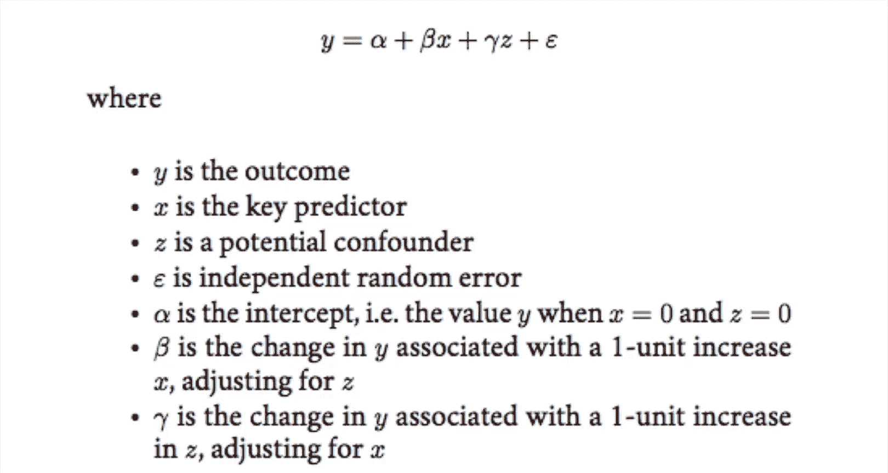
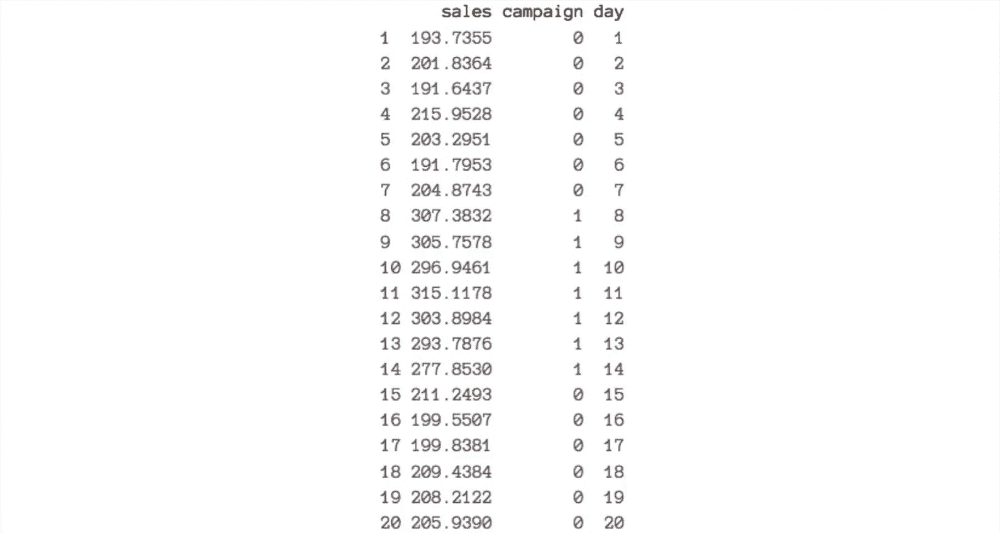
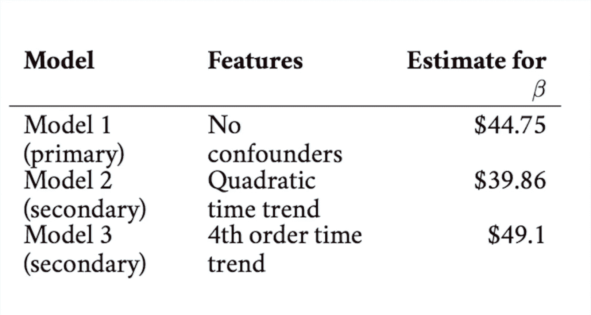

#  042：关联性分析 📊

在本节课中，我们将通过一个具体案例，学习如何进行关联性分析，并了解如何运用正式模型来检验你的发现。

关联性分析的核心在于探究两个或多个变量之间的关系。其基本模型形式通常如下：

**公式：** `y = α + βx + γz + ε`

在这个公式中：
*   `y` 代表**结果变量**。
*   `x` 代表我们关注的**关键预测变量**。
*   `z` 代表一个**潜在的混杂因素**。
*   `ε` 代表独立的**随机误差**。
*   `α` 是**截距**，表示当 `x` 和 `z` 都为0时 `y` 的值。
*   `β` 是核心参数，表示在调整了 `z` 的影响后，`x` 每增加一个单位，`y` 的**平均变化量**。
*   `γ` 表示在调整了 `x` 的影响后，`z` 每增加一个单位，`y` 的平均变化量。

我们分析的主要目标就是估计 `β` 的值。模型中的 `α` 和 `γ` 虽然必须被估计，但我们通常不关心其具体数值，因此它们有时被称为“**干扰参数**”。

---

上一节我们介绍了关联性分析的基本模型框架，本节中我们来看一个具体的商业案例。

假设你正在推广一款新产品，并考虑在Facebook上投放广告。你想知道这些广告的效果如何，最终目标是卖出更多产品、赚取更多利润。

一个简单的实验设计是：进行为期一周的广告试点。你可以观察广告投放前一周、投放期间一周以及投放后一周的销售数据变化，比较这三个阶段的销售总额是否有显著提升。

在理想情况下，你可能会看到这样的数据：广告投放前，日均销售额约为200美元；投放期间，日均销售额跃升至300美元；广告结束后，日均销售额又回落至200美元。这直观地表明，广告活动似乎每天带来了约100美元的销售额增长。

此时，你的**主模型**可以非常简单：

**公式：** `每日销售额 (y) = α + β * 广告活动指示变量 (x) + ε`

这里的 `x` 是一个指示变量（例如，投放期间为1，否则为0），而 `β` 就是我们关心的、广告带来的日均销售额增长。

---

然而，现实世界的数据很少如此“干净”。更常见的情况是，数据存在噪声，并且可能存在背景趋势干扰我们的判断。

例如，在更真实的数据中，你可能发现销售额在广告开始前就呈现上升趋势。这就引出了一个关键问题：观察到的销售额增长，真的是由广告引起的，还是仅仅反映了本已存在的背景上升趋势？

为了回答这个问题，我们需要构建**次级模型**来调整这些背景趋势。

首先，我们拟合之前提到的简单主模型，估计出的 `β` 值为 **44.75美元**（即模型认为广告每天带来约44.75美元的销售额增长）。

接着，我们构建一个次级模型，在模型中引入一个关于时间的二次项趋势，以捕捉可能的背景变化：

**公式：** `每日销售额 (y) = α + β * 广告活动指示变量 (x) + γ₁ * 时间 + γ₂ * 时间² + ε`

用这个模型重新估计 `β`，我们得到的结果是 **39.86美元**。

为了更全面地探索，我们甚至可以拟合一个更复杂的模型，例如加入时间的四次多项式来捕捉更复杂的背景趋势：

**公式：** `每日销售额 (y) = α + β * 广告活动指示变量 (x) + γ₁ * 时间 + ... + γ₄ * 时间⁴ + ε`

这个复杂模型给出的 `β` 估计值是 **49.10美元**。

---

现在，我们有了三个模型的估计结果：
*   **模型1（主模型）**：`β` = 44.75美元
*   **模型2（二次趋势模型）**：`β` = 39.86美元
*   **模型3（四次多项式模型）**：`β` = 49.10美元

面对从约39美元到49美元这样一个范围，我们该如何评估和决策？以下是几个关键的评估维度：

**1. 效应大小**
你需要判断这个范围（39-49美元）在实际业务背景下意味着什么。如果广告成本很低，只要有任何正收益就值得，那么这个范围差异可能不重要。但如果广告成本很高（例如每天20美元），那么39美元（净收益19美元）和49美元（净收益29美元）的差异就可能影响决策。你需要评估，基于模型给出的证据范围，投放广告的风险和收益是否匹配。

**2. 模型合理性**
并非所有模型都同样合理。主模型可能不合理，因为它完全忽略了背景趋势。而包含四次多项式的模型3可能过于复杂，为了捕捉一个平滑趋势而引入了不必要的复杂度。模型2（二次趋势模型）在复杂度和捕捉背景趋势的能力之间似乎取得了较好的平衡。模型的合理性取决于你对业务背景的理解，以及将现实因素转化为数学模型的能力。

**3. 简约性**
当不同模型讲述相似的故事时（例如，如果你不关心39美元和49美元的差异），通常选择更简单、参数更少的模型是更好的。原因有二：首先，参数更少的模型更容易解释和沟通；其次，从统计角度看，用更多的数据来估计更少的参数通常更有效率，这能降低参数估计的不确定性。

---

本节课中，我们一起学习了关联性分析的基本流程。我们通过一个广告效果评估的案例，演示了如何构建**主模型**来捕捉核心关系（广告与销售额），以及如何构建**次级模型**来调整潜在的混杂因素（如背景趋势）。

最终得出结论时，需要综合考虑**效应大小**、**模型合理性**和**简约性**，并结合外部因素（如广告成本、市场时机等）做出商业决策。分析过程往往需要在拟合主模型和次级模型之间进行多次迭代，直到获得足够可靠、可用于决策的答案。

关联性分析虽然可能涉及更复杂的情况，但其核心框架通常遵循“**建立主模型 -> 通过次级模型检验和调整 -> 综合评估**”这一模式。