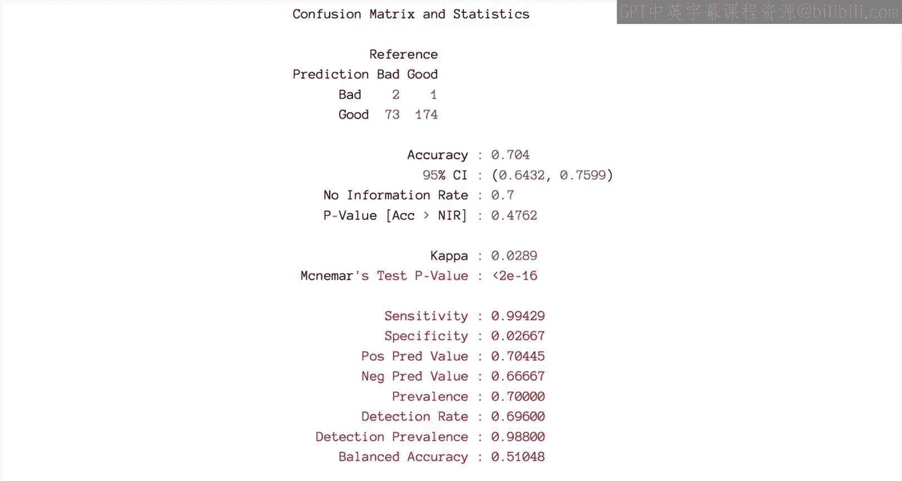

#  043：预测建模实例 🎯

在本节课中，我们将通过一个具体实例，学习如何在预测分析场景中进行正式的建模思考。我们将探讨预测模型的目标、评估方法以及实际应用中的关键考量。

---

## 预测分析与关联分析的区别

上一节我们介绍了关联分析的基本概念，本节中我们来看看预测分析与关联分析的核心区别。

在关联分析中，基本目标是确定一个关键预测变量与结果变量之间，在存在许多其他潜在混杂因素的情况下，是否相互关联。

但在预测分析中，目标通常是利用所有可用信息来预测结果。因此，通常不需要区分关键预测变量与其他预测变量，只需使用所有信息。此外，变量是否以某种因果或机制方式与结果相关并不重要。只要它们携带关于结果的任何信息，在预测场景中就可能有用。

这是因为在预测中，通常不关心变量之间如何相互关联，或它们与结果如何关联的详细理解。目标只是能够产生稳健且高质量的预测。因此，任何可能在此过程中发挥作用的变量都可能对你有用。

---

## 预测问题的期望

当我们构建预测模型时，我们希望找到能够对结果产生良好区分的特征或特征集合。因为通常结果会是某种二元结果或多类别结果，即只能取两个值或少数几个值。这是预测问题的典型设置。

你希望利用收集到的一组特征和开发的模型，能够区分这两个类别。

以下是一个简单示例，展示了单个预测变量在二元结果上产生良好区分的情况。这些数据是模拟的，目的是展示其外观。

在Y轴上，我有结果的值，仅为0和1。这是一个二元结果，可以将其视为未患病与患病，或任何类似的二元类别结果。

在X轴上，我有一个模拟的预测变量，其范围大致在-2到2之间，并且是连续的，因此取其间所有不同的值。

我可以看到，图中我高亮了一个灰色区域，大约在中间附近。在该灰色区域内，结果可以根据预测变量的值取0或1。因此，在该灰色区域内，结果可以取任一值。

在灰色区域的右侧，你会注意到结果总是1；在灰色区域的左侧，你会看到结果总是0。

大多数预测算法的目标本质上是**最小化该灰色区域的大小**，因为灰色区域是**不确定性最大**的区域。这是预测变量结果实际上可以取两个值的范围，因此存在一些不确定性。

一旦超出该灰色区域，你几乎具有绝对的确定性，因为结果要么是0，要么是1。因此，目标是通过使用可以收集到的某些特征集合来最小化这个灰色区域的大小。

---

## 实例：信用风险评估

对于这个例子，我将使用一组个人信用状况的数据。数据取自UCI机器学习库，这是一个用于各种机器学习和预测类型数据集的优秀存储库。

该数据将个人分类为良好信用或不良信用，并包含各种变量来帮助你预测这些人的信用状况。

我们将遵循的基本流程如下：

以下是该流程的步骤：
1.  首先，将数据拆分为训练集和测试集。
2.  然后，将模型拟合到训练数据。
3.  接着，基于模型但在测试数据上进行预测。
4.  最后，将测试数据上的预测结果与我们从测试数据中已知的真实情况进行比较，以评估我们的表现。

以下是我们拟合模型的一些结果。我不会深入讨论模型的细节，因为目前这并不重要。

但这里有一个你可能制作的图表。基本思想是：在X轴上，我们拥有预测为良好信用质量的概率；在Y轴上，我们拥有实际真实情况，即你是良好信用还是不良信用。

因为这是测试数据集，我们实际上知道真实情况。因此，我们可以将真实情况与我们的预测进行比较。

你会注意到几件事。首先，它看起来不太像我模拟数据的那张图。因此，它不太符合我们对沿着X轴范围有非常好区分的期望。正如你将看到的，不良和良好的值都存在。因此，区分度不一定那么好。

现在你会注意到，在X轴大约0.6的范围内，有一大簇点，它们大多属于良好信用质量类别。因此，正如你所看到的，随着预测概率的上升，实际良好信用质量的人数也在增加。所以至少存在一种关联。这很好。

但你会注意到一件事：预测分数都处于较高的一端，它们基本上都大于0.5，因此范围不大。

最终，尚不清楚这个预测算法是否特别好，而且它似乎在寻找能够区分良好和不良信用风险人群的良好特征组合方面遇到了一些困难。

---

## 模型评估与指标

计算一组关于预测算法的汇总统计量也很有帮助，你可以在这里看到。

在最顶部是所谓的**混淆矩阵**，它显示了预测数量在真实类别（称为参考类别，即不良或良好）与我们预测为不良或良好之间的分布。

你会立即注意到，大多数预测只是“良好”。因此，该算法基本上只是将每个人分类为良好信用质量。我猜这是有道理的，因为该数据集中的大多数个体都具有良好信用质量。因此，如果你要进行预测，最简单的方法就是说你有良好信用，那么你的预测在大约70%的情况下是正确的。

你可以看到该算法的准确率约为70%，这还可以。但问题是该算法的**特异性**非常差，这意味着如果你实际上信用不良，算法将你分类为此类的概率只有大约2.6%，所以非常低。因此，如果你确实信用不良，算法将很难识别出来。

---

## 评估预测结果时的考量

当你看到像这样的预测模型结果时，有几件事需要考虑。

以下是需要考虑的关键点：
*   **预测质量**：首先，你必须问自己，模型的准确度是否足以满足你的目的。你看到了这个特定模型的汇总统计量，准确率为70%，特异性为2.6%。这对你的目的来说足够好吗？这取决于你的目的。例如，在许多医学应用中，结果是例如疾病的存在，你可能希望该测试或算法具有非常高的**敏感性**。因此，如果他们确实患有疾病，你希望算法能够识别出来，因为这样你可以让他们接受治疗，并走上康复之路。然而，如果该疾病的治疗非常痛苦或有很多不良副作用，你可能需要谨慎决定让谁接受治疗，特别是你不想让没有患病的人接受一个将非常痛苦且有很多副作用的治疗。在那里，你会希望确保如果某人没有患病，算法能够识别出来。
*   **指标权衡**：根据将要做出的决策以及这些决策的后果，你会倾向于重视不同的指标。例如，在我们刚刚查看的具有良好和不良信用质量的金融应用中，将良好信用误判为不良与将不良信用误判为良好可能具有不对称的成本。因此，一种情况可能成本很低，而另一种情况可能成本很高。所以，你需要考虑，根据你的决策结果，在你的场景中，哪些类型的指标（敏感性、特异性或所有其他类型的指标）对你来说最重要。每个场景都会有所不同。因此，你不会总是希望为每个应用程序都专注于某个给定的指标。
*   **调参的重要性**：几乎所有预测算法的一个标志是**调优参数**。大多数算法都有很多很多调优参数，尽管它们被称为调优参数，但根据你如何设置它们，它们通常会对算法的预测质量产生非常大的影响。因此，你应该注意如何设置它们以及如何调整它们。据我所知，没有一个预测算法是单一的一组调优参数适用于所有问题的。因此，对于你带入预测算法的任何新数据集，你可能需要稍微调整一下，这没关系。但最重要的事情是，你要确保记录下你设置的所有调优参数以及选择这些调优参数的过程，因为最终你会希望这个模型是可复现的。如果你无法记住或无法复现调优参数，你将永远无法复现算法本身。
*   **其他数据的可用性**：我想提到的最后一件事是关于其他数据的可用性。如今，许多预测算法非常擅长探索复杂数据的结构并做出非常好的预测，尤其是在你正确设置调优参数之后。因此，如果你的模型效果不佳，可能需要改用另一种算法或程序，因为不同的程序在不同的设置、不同类型的数据结构和不同类型的数据设置中可能效果很好。算法并非必然可互换，你可能需要更改算法。然而，如果你尝试了几种算法，无论你如何调整它们，它们似乎都产生了类似质量的预测，那么可能是时候获取更多数据或其他数据来帮助你预测结果了。可能只是你拥有的数据集仅具有预测你感兴趣结果的固有有限能力，你必须获取具有更好预测能力的其他数据。因此，在构建预测算法并查看结果时，请考虑到这一点，即始终存在这种可能性：你必须引入额外数据来改进你的预测。

---

## 总结

本节课中我们一起学习了预测建模的核心思想。我们了解到预测分析的目标是利用所有可用信息最小化预测的不确定性区域，而非探究因果关系。通过信用风险评估的实例，我们实践了从数据拆分、模型拟合到预测评估的完整流程。关键收获在于，评估预测模型时需结合具体应用场景权衡准确率、敏感性、特异性等指标，重视调优参数的选择与记录，并认识到有时改进预测可能需要引入新的数据源。