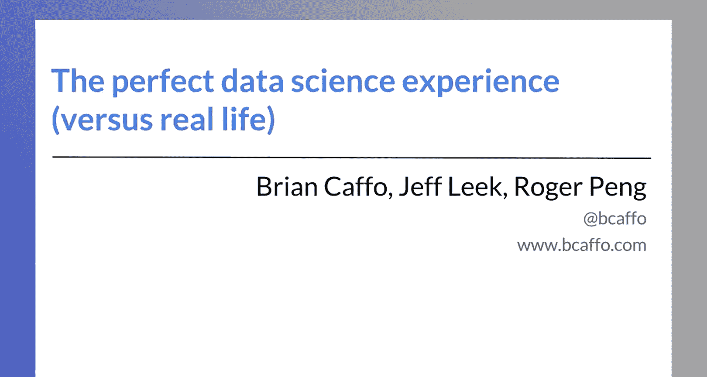

#  050：理想与现实中的数据科学（第二部分）

在本节课中，我们将对比理想中的数据科学实践与现实中通常发生的情况，并探讨两者之间的关键差异。

上一节我们介绍了理想数据科学体验的框架，本节中我们来看看现实世界中数据科学项目通常会遇到的挑战。

## 理想的数据科学体验

在理想的数据科学体验中，整个过程遵循一套清晰、可控的步骤。

以下是理想情况下的关键特征：

*   **先验假设**：你拥有预先明确定义的研究假设。
*   **实验设计**：你可以自由运用实验设计方法。例如，你可以进行**A/B测试**，对感兴趣的干预措施进行随机化分配。如果存在你不感兴趣的干扰变量，你可以对其进行分层处理。
*   **随机抽样**：你从感兴趣的研究总体中获得了随机样本。这意味着从样本中得出的结论，有望推广到你真正关心的总体。
*   **数据匹配假设**：你测量的数据确实能够检验你感兴趣的假设。这是一个重要的方面，我们稍后会详细讨论。
*   **数据创建顺畅**：创建数据库、进行数据合并等所有过程都顺利进行。没有数据缺失、录入失败或匹配不唯一等问题。
*   **分析稳健**：分析过程稳健，无需依赖复杂的建模技术。简单的**T检验**等方法就足以完成任务。
*   **结论清晰**：你能从实验中获得简洁的知识，并且根据数据可以做出明确的决策。

这就是完美的场景。

## 现实中的数据科学

然而，现实中的数据科学实践往往与理想情况大相径庭。

以下是现实中通常会遇到的挑战列表：

*   **假设不明确**：通常没有预先明确指定的强假设。数据本身需要用来启发和形成假设，并且你常常不得不使用同一份数据集来生成假设和检验假设。
*   **多重比较问题**：由于经常需要同时考察多个假设，多重比较成为一个问题。
*   **实验设计受限**：使用实验设计的机会往往有限，或者数据完全是观察性的。随机化可能无法实现。甚至在生物统计学中常见的一种情况是，数据是回顾性的，你只能观察结果并回溯查看他们具有哪些协变量。
*   **总体偏差**：被研究的总体可能并非你真正感兴趣的总体。例如，如果你是谷歌公司，却在分析雅虎的搜索数据，这显然不理想。但如果你只有这些数据，那也只能用它。
*   **测量不匹配**：你没有评估假设所需的精确测量指标。根据我的经验，这是一个非常普遍的问题。
*   **数据问题**：数据本身存在问题。在合并数据时可能出现匹配不唯一或多重匹配的情况，存在数据录入错误，或者有数据缺失。
*   **需要复杂建模**：由于上述所有错误、复杂性以及数据的观察性质，最终往往需要采用**高级建模技术**。
*   **需要高级计算**：因为需要高级建模，所以需要**高级计算**来拟合你的高级模型。这又带来了计算稳健性问题，即模型对你所做假设的敏感程度等。
*   **结论不确定**：你的结论可能是不确定的。
*   **决策支持有限**：你的决策空间可能并没有因为使用了数据而比什么都不做时获得实质性的更多信息。

本节课中，我们一起学习了理想数据科学体验的特征，并详细探讨了现实项目中常见的诸多挑战。理解这种差距是管理数据科学项目、设定合理预期和制定有效应对策略的第一步。