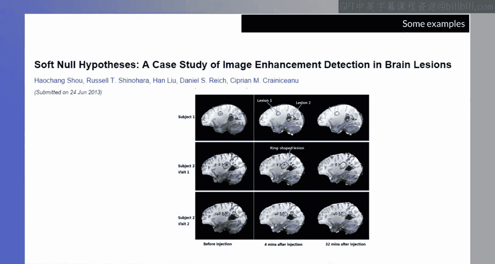
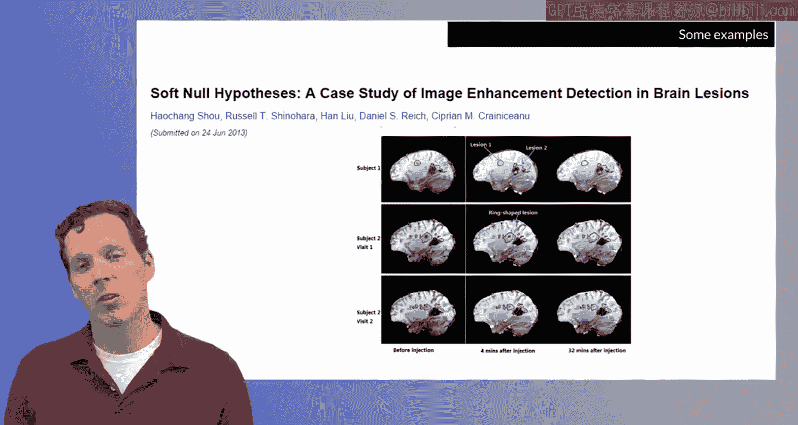
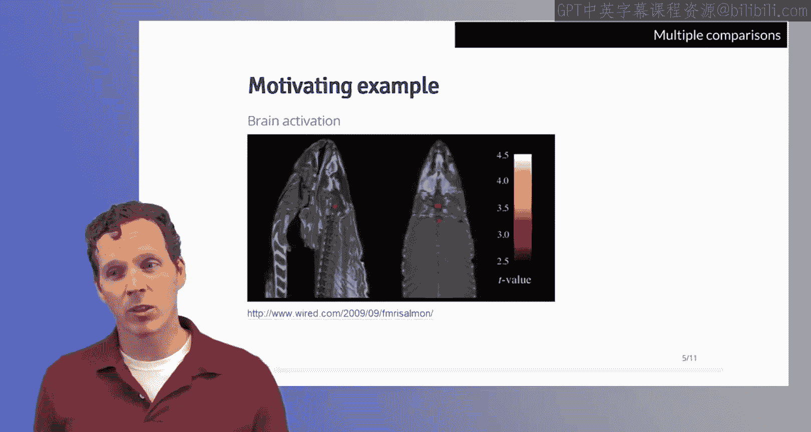
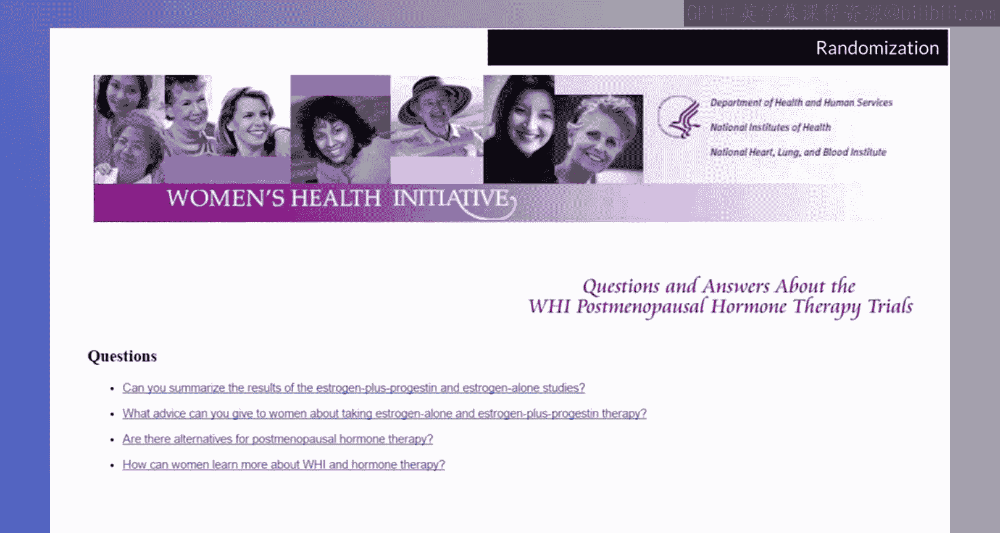
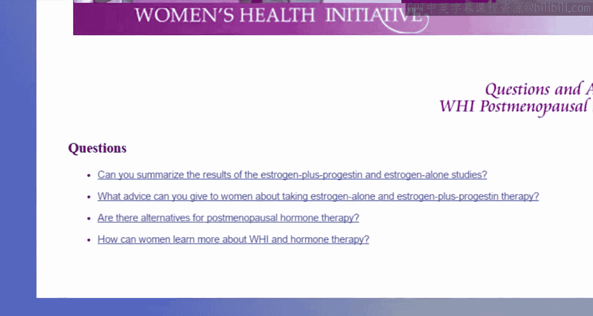
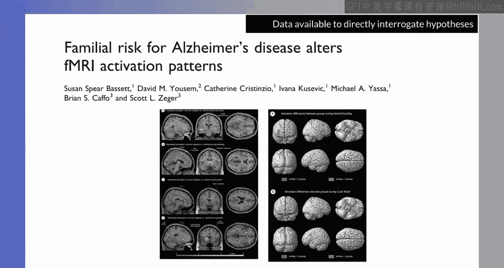
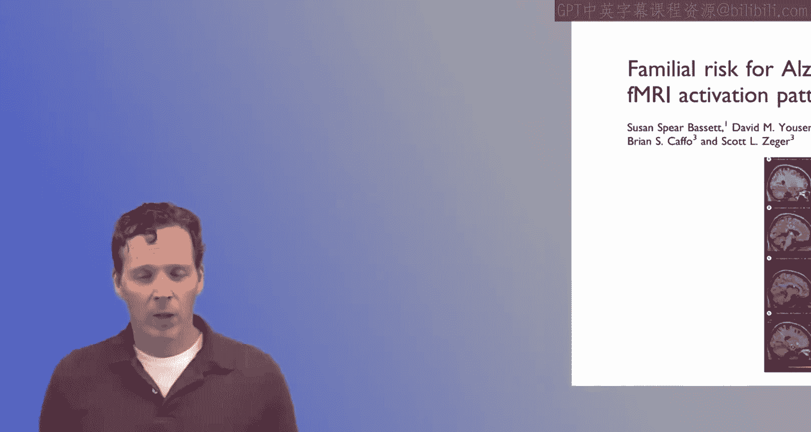
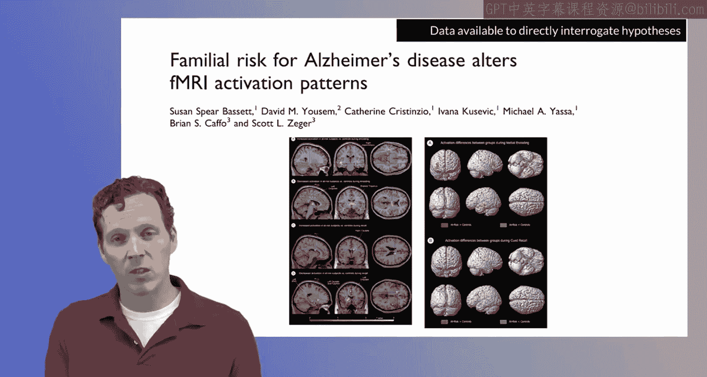
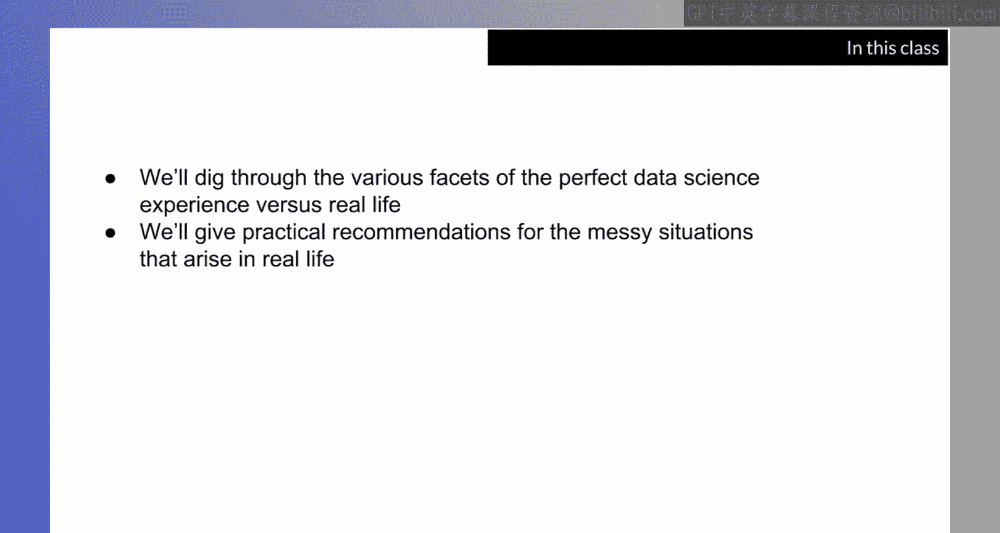

#  051：数据分析中的挑战与应对示例 🧪

在本节课中，我们将通过几个具体示例，探讨数据分析过程中可能出现的各种情况，包括成功案例和常见陷阱。这些例子将帮助我们理解理想的数据科学实践与现实操作之间的差距。

---

## 多重假设检验与数据复用 🔄

上一节我们讨论了数据分析的基本流程，本节中我们来看看一个关于假设检验的复杂案例。我的同事在多发性硬化症研究领域撰写了一篇论文，专门探讨了使用数据来形成假设所引发的问题。

他们研究的重点是磁共振成像（MRI）在多发性硬化症脑部研究中的应用。一个核心挑战是如何精确定义该疾病的标志之一——脑部病变的“增强”现象，即特定区域血流量增加的情况。

由于最初无法明确清晰地提出假设，他们建立了一个分析框架。这个框架的特殊之处在于，它**使用同一数据集既识别假设，又检验这些假设**。作为统计研究人员，他们的重点是以严谨的方式进行这一过程。这个案例展示了在某些情况下，假设无法立即清晰形成，因此数据不得不承担双重任务：既生成假设，又验证假设。

---

## 多重比较问题：死鲑鱼的启示 🐟

既然我们谈到了脑成像领域（这也是我的研究方向），多重比较问题常常出现。在一个特别著名的例子中，研究人员将一条死鲑鱼放入功能性磁共振成像（fMRI）机器中，这种机器本用于检测大脑活动。

显然，死鲑鱼不可能有大脑活动。然而研究发现，如果进行**大量、大量的统计检验，并且没有进行正确的校正**，你甚至能在死鲑鱼的扫描数据中“看到”大脑激活的信号。这个例子生动地说明了忽视多重比较校正可能导致的荒谬结论。

---

## 随机化的重要性：妇女健康倡议研究 👩⚕️

一个近十年内发生的、关于随机化的著名案例来自“妇女健康倡议”研究。

该组织进行了一项关于激素替代疗法的随机对照试验。在当时，这种疗法是绝经后妇女的一种标准治疗手段。

这项随机试验的结果，与当时关于激素替代疗法有效性和安全性的普遍认知相矛盾。这引发了关于随机试验价值与大量观察性数据价值的深刻反思。就本讲座而言，我们无需深入该研究的细节，但足以说明的是，**由于随机化的设计，这项随机试验的结果具有极大的说服力**。

此前所有仅仅观察妇女是否接受激素替代疗法并跟踪其健康状况的观察性研究，其严谨性都无法与这一项将妇女随机分配至治疗组或对照组的单一研究相比。值得一提的是，如果你对激素替代疗法的后续研究感兴趣，可以访问妇女健康倡议的相关网站查看常见问题解答。

自那以后，又经过了十年的研究来进一步细化这一科学问题。本讲座的重点在于强调**随机化在这一特定情境下的极端重要性**。

---

## 测量误差的挑战：阿尔茨海默症研究 🧠

下面是一个我参与的研究案例，它展示了“无法测量你想测量的东西”这一困境。这项研究在两个方面存在测量问题。

我的同事苏珊·巴塞特希望研究阿尔茨海默症。理想情况下，我们想知道人们在患上阿尔茨海默症之前，他们的大脑在功能性磁共振成像扫描中是什么样子。这非常重要，因为如果能在人们出现症状之前就发现大脑的某些变化，或许就能进行治疗。因此，寻找疾病的前兆是阿尔茨海默症研究的一个重大课题。

在这项特定研究中，测量方面存在两个问题：
1.  **技术限制**：fMRI机器并不直接测量大脑激活，它测量的是通过血氧水平变化反映的、大脑激活的**代理指标**。在活体人类中，我们无法以期望的空间精度直接测量大脑激活。
2.  **前瞻性未知**：我们无法提前知道谁将会患上阿尔茨海默症，只能进行推测。

因此，她的研究方法是：一组是**家族高风险人群**（有患病的兄弟姐妹或父母），另一组是**无家族史的人群**。但这并不意味着高风险组的每个人都会患病（实际上只有相对较小的一部分会），也不意味着另一组没人会患病（在这项长达15年的研究中，后来确实有人患病）。

问题的关键在于，她无法直接测量她需要的东西——无法前瞻性地确定谁将在未来患病。如果能做到，这个问题就不值得研究了。为了应对这一测量难题，她采用了**大样本量**的策略。通过在一组中纳入更可能患病的人群，在另一组中纳入患病概率较低的人群，并需要足够大的样本量来抵消两组中实际患病者与健康者比例混杂所导致的效应减弱。

这个案例再次说明，**你希望进行的测量与实际能进行的测量往往存在差距**。这在数据科学实验中非常普遍。就像苏珊所做的那样，你需要设法解决，例如通过进行当时规模最大的fMRI实验之一，来克服这个问题。

---

## 课程展望与总结 🎯

在本课程中，我们将深入探讨理想数据科学体验与现实情况之间的各个方面。我们将以“理想状态 vs. 实际情况”这一概念作为所有讨论的出发点。

我们将针对数据分析中出现的各种混乱情况提供实用建议，特别是当你作为管理者而非直接分析人员时，如何管理和指导团队为这些问题寻找不同的解决方案。

本节课中，我们一起学习了数据分析中的几个关键挑战：**假设检验与数据复用的风险**、**忽视多重比较可能导致的错误发现**、**随机化在确立因果关系中的核心价值**，以及**应对测量误差和代理指标的策略**。理解这些现实挑战，是迈向有效数据科学实践的重要一步。欢迎加入本课程，期待与你一同探索。