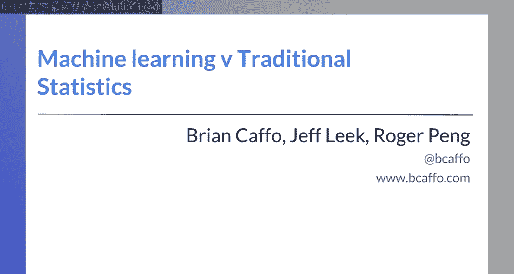
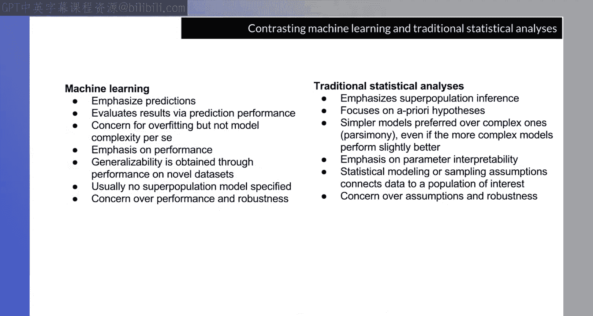
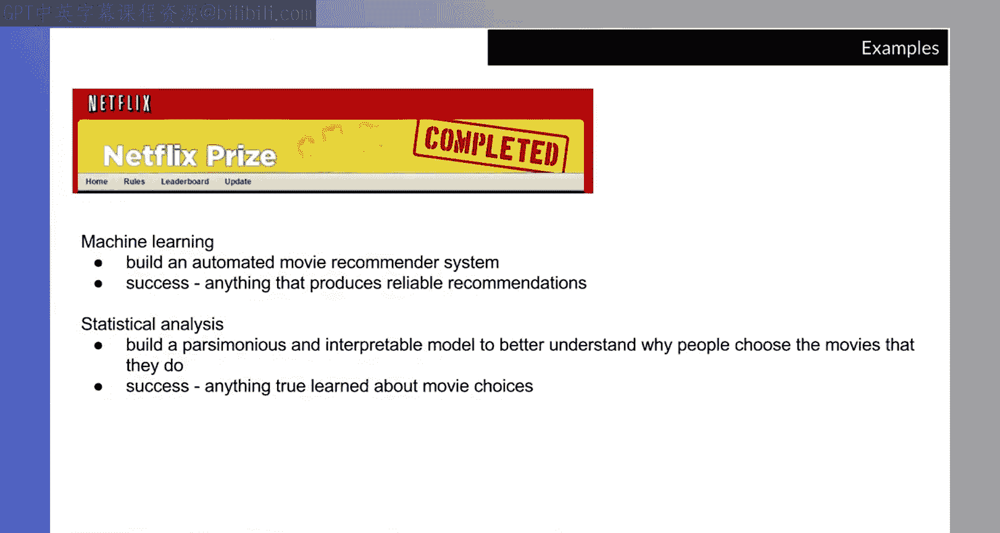
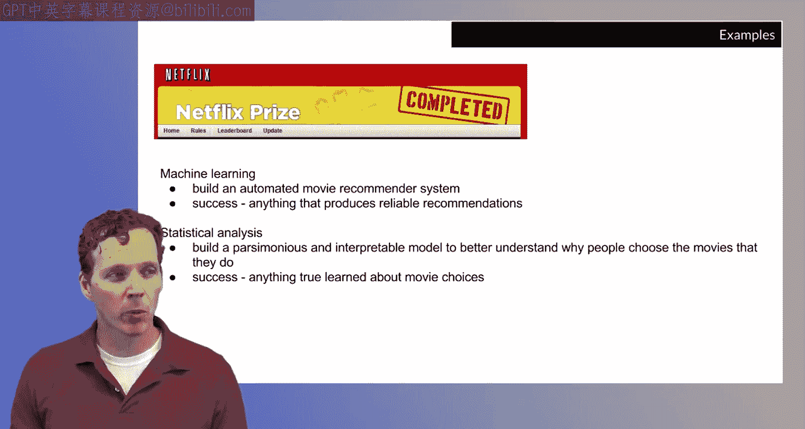
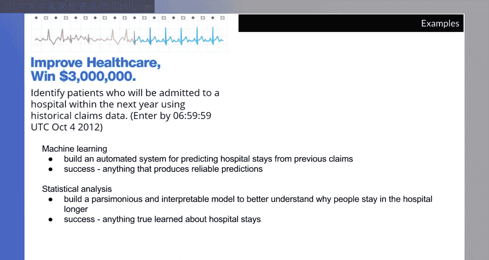
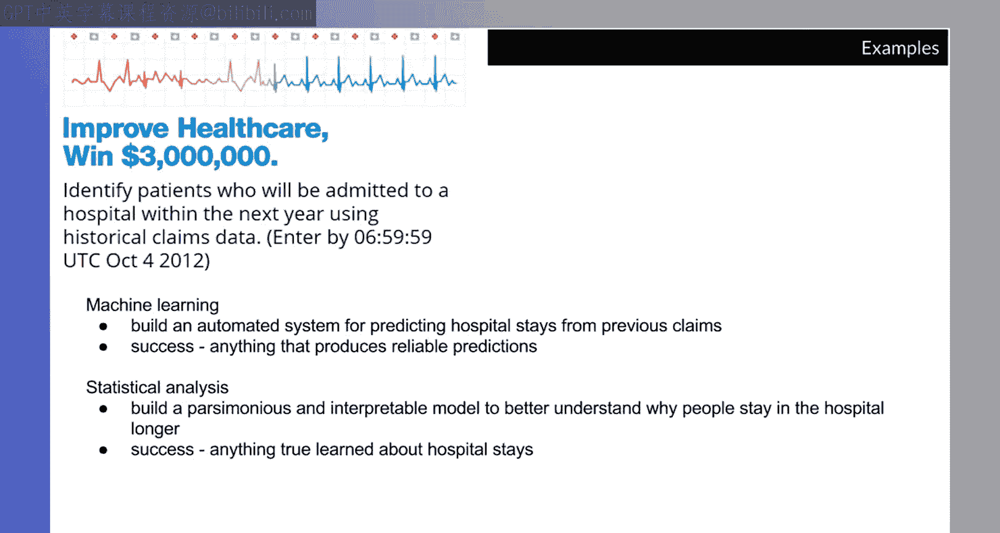
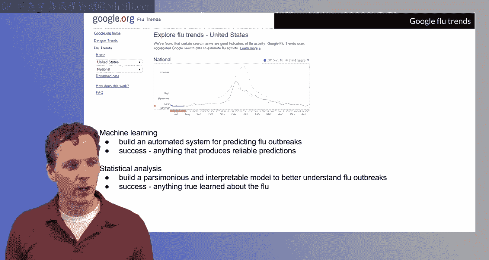
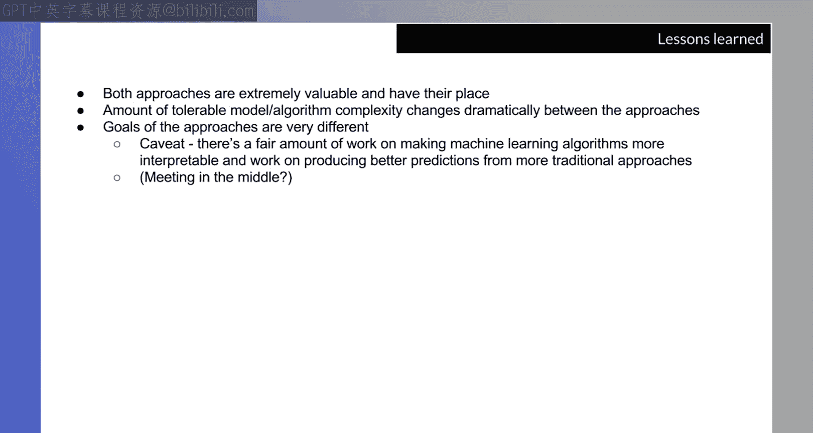

#  052：机器学习与传统统计学（第一部分）📊




在本节课中，我们将探讨机器学习与传统统计学之间的核心区别。理解这两种分析方法的差异，有助于我们明确在不同场景下应选择何种工具，以及如何解读分析结果。后续课程的大部分内容将更侧重于传统统计学方法，但其中的许多原则对机器学习同样具有指导意义。




## 概述

机器学习与传统统计学都是数据科学领域的重要支柱，但它们的侧重点和目标有所不同。本节将对比这两种方法，并通过实际案例说明它们在实际应用中的差异。

## 机器学习的特点 🧠

上一节我们介绍了课程的整体框架，本节中我们来看看机器学习的核心特征。机器学习主要强调预测能力，并通过预测性能来评估模型的好坏。

以下是机器学习的一些关键特点：

*   **目标**：核心目标是进行**预测**。模型的好坏主要由其在新数据上的预测准确度决定。
*   **评估**：通过**预测性能**来评估模型，例如使用准确率、均方误差等指标。
*   **过拟合**：非常关注**过拟合**问题，即模型在训练数据上表现过好，但在新数据上表现不佳。
*   **模型复杂度**：不单纯追求简单模型。只要预测性能好且没有过拟合，即使模型比较复杂也是可以接受的。
*   **泛化性**：模型的**泛化能力**通常通过在新数据上的表现来证明，遵循“用数据说话”的原则。
*   **模型假设**：通常不指定明确的**超总体模型**，即不假设数据来自某个更大的统计总体。
*   **性能与鲁棒性**：高度关注算法的**性能**和**鲁棒性**。


## 传统统计学的特点 📈




与机器学习不同，传统统计学有其独特的研究范式和目标。传统统计学侧重于从样本推断总体，并强调模型的可解释性。

以下是传统统计学的一些关键特点：




*   **目标**：侧重于**超总体推断**。假设手头的数据集是我们感兴趣的更大总体的一个样本。
*   **假设**：关注**先验假设**，即分析前就设定好的研究假设。
*   **简约性**：遵循**简约性原则**。在同等条件下，更倾向于选择更简单的模型。即使简单模型的预测性能稍差，只要差距不极端，仍会优先选择简单模型。
*   **参数解释**：强调**参数的可解释性**。例如，在回归分析中，关心每一个回归系数的具体含义。
*   **统计模型**：通过**统计模型**或抽样假设，将样本数据与总体联系起来，这是统计建模的核心。
*   **假设检验**：除了鲁棒性，还非常关注连接数据与总体的那套**统计假设**是否成立。

## 实例对比分析 🔍

为了更清晰地展示两者的区别，我们来看几个著名的预测案例，并思考如果采用传统统计学方法会如何不同。


### 案例一：Netflix 大奖赛 🏆


Netflix 大奖赛是一个著名的机器学习竞赛，目标是构建最佳的影片推荐系统。

*   **机器学习目标**：构建一个自动化的、能产生可靠推荐的机器学习算法。成功与否取决于推荐系统能否让用户给出高评分。
*   **传统统计学视角**：如果从统计学角度研究，目标将是建立一个简约且可解释的模型，以深入理解人们选择电影的原因。研究者会关注样本是否代表全体 Netflix 用户或更广泛的观影人群，并希望得到关于电影选择的真实且简约的结论，即使这些结论对提升预测准确度帮助不大。



### 案例二：Heritage Health 大奖赛 🏥

该竞赛旨在根据历史保险理赔数据，预测个人后续的住院时长。




*   **机器学习目标**：构建一个自动化系统来预测住院时长。成功意味着能产生可靠的预测，且预测越可靠越好。评估标准可以是一个简单的预测误差公式，例如：
    ```数学
    误差 = (实际住院天数 - 预测住院天数)^2 的平均值
    ```
*   **传统统计学视角**：如果进行科学研究，目标是建立一个简约且可解释的模型，以探索保险理赔数据与住院行为之间的真实关系。例如，发现某些特定的理赔组合可能导致更高的住院风险，从而为早期干预提供依据。

### 案例三：Google 流感趋势 🤒


Google 流感趋势通过分析搜索词来预测流感爆发。



*   **机器学习目标**：构建一个自动化系统，以比美国疾病控制与预防中心更快的速度可靠地预测流感爆发。
*   **传统统计学视角**：流感研究人员则希望建立模型来理解流感为何在特定区域爆发。他们需要更具体的医学数据（如处方药数量）来构建解释性强的模型，而不仅仅是搜索词。


## 总结与融合趋势 🤝



本节课我们一起学习了机器学习与传统统计学的主要区别。机器学习以**预测性能**为核心，追求自动化与高精度；而传统统计学以**总体推断**和**可解释性**为核心，强调简约性和假设检验。两者因其目标不同，在模型复杂度、评估方式上存在显著差异。


值得注意的是，这两个领域正在相互融合。机器学习界开始引入统计模型来评估算法，并努力提高模型的可解释性；而统计学界也在尝试增加模型复杂度以提升预测能力。这种“中间相遇”的趋势使得二者的界限逐渐变得模糊，但理解其核心哲学差异，对于正确选择和应用数据分析方法仍然至关重要。