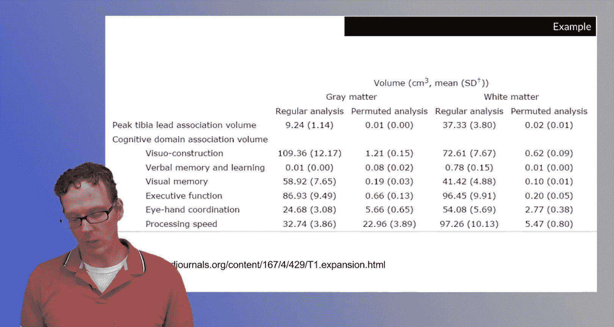
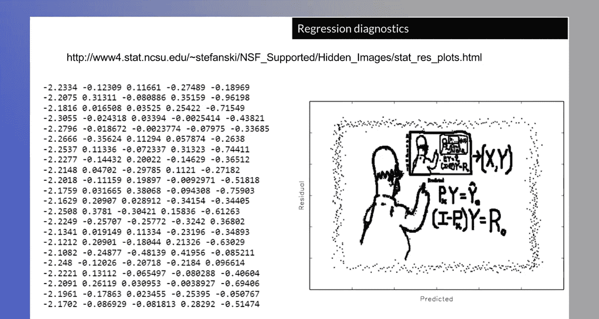
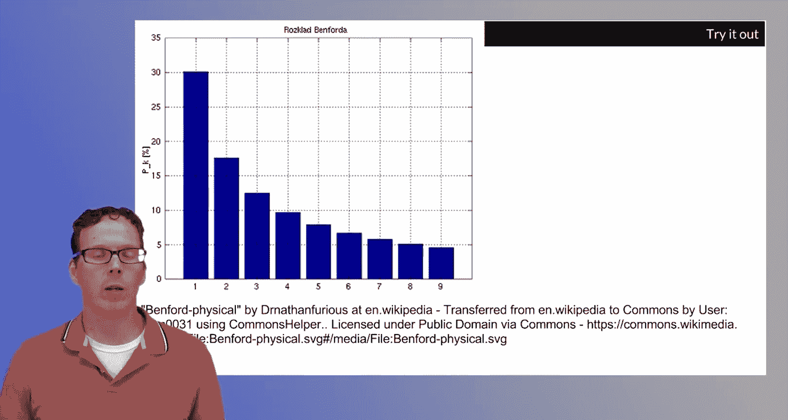
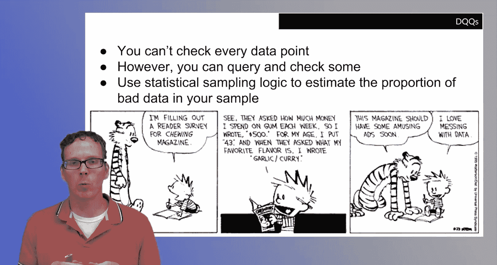

#  054：管理数据提取 📊

在本节课中，我们将学习如何在现实世界中管理数据提取过程。数据提取是指将原始数据转化为可用于分析的数据集的一系列步骤。这个过程常常充满挑战，因为真实世界的数据往往非常混乱。作为管理者，你可能不会亲自执行这些操作，但你需要掌握一些工具来确保团队交付的数据质量。

上一节我们介绍了数据科学项目的整体流程，本节中我们来看看数据提取这个具体环节中管理者可以使用的质量控制方法。

## 创建汇总表（Table 1）📋

在开始任何建模之前，创建一个被称为“Table 1”的汇总表是发现数据错误的有效方法。在流行病学和生物统计学中，论文的第一张表通常用于总结样本的人口统计学信息。这种方法同样适用于其他领域的数据质量检查。

以下是创建和检查汇总表时需要注意的几个关键点：

*   **计算均值和标准差**：不仅要报告均值、中位数和分位数，还要报告标准差。标准差能帮助你发现异常值。
*   **检查单位**：确保所有数据的单位一致且正确。单位错误是常见的数据问题来源。
*   **定期比较**：在每周或每月的会议中讨论这些汇总表，并保留旧版本。即使是很细微的变化，也可能提示数据中出现了错误或有意义的变动。

让我分享一个关于单位检查的亲身经历。我们曾研究长期暴露于铅环境对大脑体积的纵向影响。在创建汇总表时，我们起初忽略了单位跟踪。直到分析后期，我们才发现大脑体积的下降速度快得离谱（例如，从房子大小缩小到豌豆大小）。经过对单位的深入讨论和文献回顾，我们不仅修正了错误，还发现了数据中的一些异常测量值，从而提升了整体数据质量。

## 回归诊断 🔍

在建模阶段之后，回归诊断是检测数据错误的另一个极其有用的工具。回归诊断可以帮助我们发现模型无法捕捉的系统性模式或异常观测值。

以下是一些关键的回归诊断概念和指标：

*   **残差**：残差是观测到的响应值（结果）与模型预测值之间的差异。其公式为：
    `残差 = 观测值 - 预测值`
    在残差图中，我们需要检查是否存在系统性模式，以及是否有远离主体分布的极端大值。
*   **帽子值**：帽子值衡量了某个数据行的解释变量在其预测变量空间中的变异程度。它告诉你这行数据相对于其他数据行有多么“不寻常”。
*   **影响度量**：这类指标通过比较包含或删除某个数据点前后模型的变化，来衡量该点的影响力。主要包括：
    *   **DFFITS**：删除该点前后，模型对所有点拟合值的变化。
    *   **DFBETAS**：删除该点前后，模型各个斜率估计值的变化。
    *   **库克距离**：将删除该点前后所有斜率估计值的变化汇总为一个单一指标。
*   **PRESS残差**：也称为“留一法”残差或交叉验证残差。它计算的是当某个数据点被排除在模型拟合之外时，模型对该点的预测误差。

你应该与分析师合作，确保在回归分析后生成这些诊断图。它们不仅能评估模型本身，还能帮你定位异常数据点，进而深入调查这些点为何对模型有如此大的影响。

## 本福特定律 📉

本福特定律是一种有趣的数据质量检查方法，它描述了在许多真实数据集中，首位数字出现的频率分布规律。该定律指出，数字在**对数尺度**上，而非自然尺度上，是均匀分布的。

具体来说，数字1作为首位数字出现的概率约为30.1%，数字2约为17.6%，以此类推，数字9出现的概率最低，约为4.6%。

当所研究现象的数字**理应**遵循本福特定律时（例如，某些财务数据、人口统计数据），你可以利用这一定律进行检查。如果数据的首位数字分布严重偏离本福特定律预测的分布，则可能暗示存在系统性数据错误或人为操纵。但请注意，并非所有数据都适用此定律（例如，电话号码的区号部分就不适用）。

## 数据质量查询与抽样检查 ✅

最后，你可以通过数据质量查询和抽样检查来直接验证数据。

由于逐行检查所有数据通常不现实，你可以采用随机抽样的统计方法。随机抽取一部分数据行进行人工核查。

因为这是一个良好的随机样本，你可以根据样本中“坏”行的比例，来**估计**整个数据集中错误数据的比例。这样，你就能通过检查相对少量的数据，从统计上了解整个数据集的大致质量状况。

---

本节课中我们一起学习了管理者在数据提取过程中确保数据质量的几种实用工具：在分析前创建并监控汇总表（Table 1），在建模后利用回归诊断图发现异常，在特定场景下应用本福特定律检查数字分布，以及通过随机抽样进行直接的数据质量评估。这些方法能帮助你在面对真实世界中混乱、复杂的数据时，更好地把控数据质量。