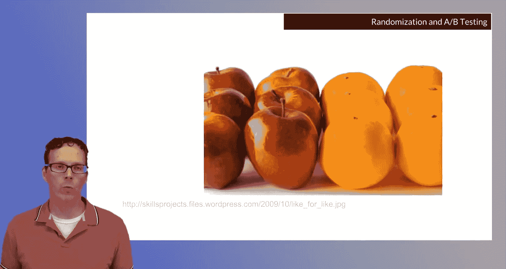
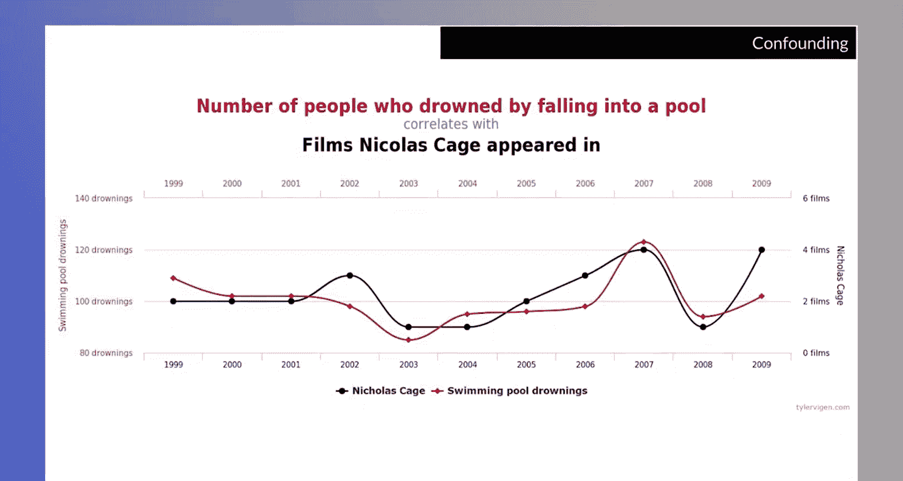
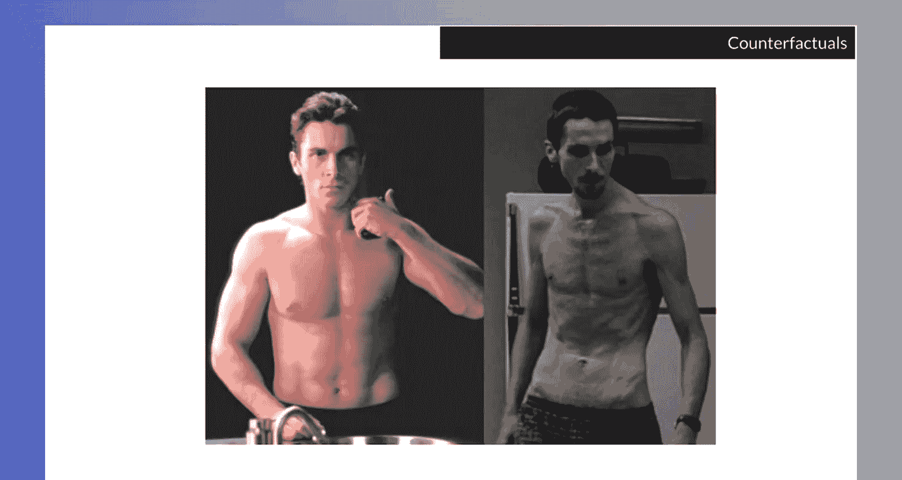
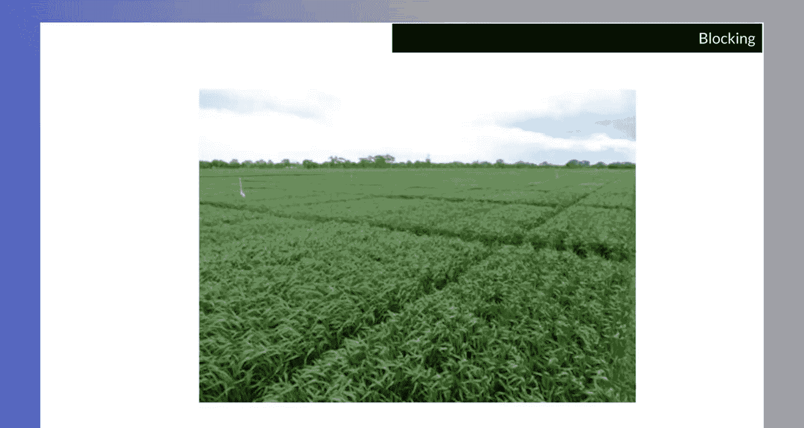

#  055：实验设计与观察分析 🧪

在本节课中，我们将要学习实验设计与观察分析的核心区别。我们将探讨这两种方法各自的优势、适用场景以及关键概念，为后续深入学习具体技术奠定基础。

---

上一节我们介绍了课程的整体框架，本节中我们来看看现代统计学先驱之一，R.A. Fisher的一句名言。他曾说：“在实验完成后再请来统计学家，无异于让他进行尸检——他或许能说出实验死于何因。”这句话强调了在数据收集之前进行周密规划的重要性。

## 实验设计与观察研究

实验设计与观察研究是两种根本不同的数据收集与分析范式。

### 实验设计

在实验设计中，研究者对实验的多个方面拥有严格的控制权。良好的实验设计能够通过一些技术手段来提升结论的可靠性。

以下是实验设计的一些关键优势：
*   **控制已知重要因素**：通过区组化（Blocking）和分层（Stratification）等技术来实现。
*   **控制未知因素**：通过随机化（Randomization）来实现。我们后续会有专门讲座讨论随机化。
*   **获取无偏样本**：通过随机抽样（Random Sampling）帮助我们获得能够外推到目标总体的无偏样本。
*   **简化分析过程**：如果实验设计良好且执行顺利，通常简单的分析就足够了，并且效果更好。
*   **隔离目标效应**：帮助我们将关注的处理效应与其他干扰因素分离开。

### 观察研究

观察研究则处于相反的境地，研究者对实验几乎没有控制权。

观察研究同样有其优点和挑战，以下是其主要特点：
*   **可行性高**：在无法进行设计实验时（例如出于伦理原因，不能随机分配人吸烟），观察研究往往是可行的。
*   **样本量大**：由于数据是自然产生的，观察研究通常能获得非常大的样本量。
*   **成本较低**：与设计严密的临床试验（通常每位受试者花费数千美元）相比，观察研究的单条记录成本要低得多。
*   **分析复杂**：由于无法在设计中控制已知重要因素或引入随机化来控制未知因素，分析者必须尝试测量所有可能的变量，因此需要更复杂的建模。
*   **需要大样本**：为了适应更复杂的分析，观察研究几乎总是需要更大的样本量。

R.A. Fisher的著作《统计方法、实验设计与科学推断》是该领域的经典之作，奠定了现代实验设计思想的基础。

## 核心主题概览

以上内容为接下来的几讲设定了舞台，我们将深入探讨实验设计与观察分析中的几个关键主题。

### 抽样与偏差

我们将讨论抽样与偏差，并以《芝加哥论坛报》错误宣布杜威击败杜鲁门赢得总统选举的具体案例为例。他们的错误很大程度上源于一种特定的偏差抽样——他们抽取的人群集合并不适合得出他们想要的结论。

### 随机化与A/B测试

我们将探讨随机化在A/B测试中的应用。随机化是指当你有一个待研究的处理（例如有两种水平）时，将观测单元随机分配到这两个水平的过程。

经典的例子是药物试验：随机分配一组人服用药物，另一组人服用安慰剂。其理念在于，除了接受药物或安慰剂这一区别外，接受药物的组和接受安慰剂的组在其他方面是相似的。这样你就是在进行“苹果对苹果”的比较。随机化有助于确保可能污染结果的其他因素至少以高概率在组间均匀分布。随机化是所谓临床试验和A/B测试的基础，后者是数据科学与生物统计学中的基石方法。

### 混杂

混杂是观察数据分析中的另一个核心主题。当你没有随机化时，你需要考虑那些可能污染结果的变量，即必须思考混杂问题。

这里有一个有趣的例子：淹死在游泳池里的人数与尼古拉斯·凯奇出演的电影数量之间存在相关性。这显然不是因果关系，而是由其他未测量的变量（如时间趋势、夏季电影上映频率等）导致的混杂。

### 因果推断与反事实

最后，我们将讨论因果推断与反事实。因果推断旨在利用观察或实验数据获得真正的统计因果，而不仅仅是关联。我们将只考虑一种特定的因果推断思维方式，即反事实思想。

反事实思想是沿着这样的思路思考：如果我的每个观测单元没有接受它们实际接受的处理，会发生什么？当然，你实际上无法观察到这一点。如果你给一个人用药，你只能观察到用药后的他，而无法观察到如果他没有用药会发生什么。但反事实思维构成了因果思维的基础。

这种思维方式将帮助我们：A) 改进我们设计统计分析方案的方式，因为我们将以因果的视角进行思考；B) 帮助我们以质疑自身假设的方式思考观察数据分析，以便在尝试从关联跃迁到因果时，清楚我们做出了哪些假设。

### 区组化

我们将讨论的最后一个主题是区组化。区组化源于农业实验的思想：假设你有一块田地，其中可能存在某种梯度（例如，水分或土壤肥力沿作物行的分布不同）。如果你知道诸如土壤或水分等因素可能影响你希望研究的结果（如作物产量），那么当你要进行随机化时，为何不在各行内部进行呢？确保以“行”为条件，在行内进行随机化，这就是区组化的过程。

另一个常见于基因组学的例子是：假设你研究小鼠，而小鼠是按窝出生的。每一窝幼鼠都有遗传继承关系。如果你在研究某个处理，为何不在同一窝小鼠内部进行随机化，而不是在所有小鼠中不考虑其父母地进行随机化呢？按父母进行区组化的原因，正是为了控制与父母相关的遗传因素。

---

本节课中我们一起学习了实验设计与观察分析的基本区别。实验设计强调控制与随机化，适用于理想化的、可控的研究场景；而观察研究则在控制有限时，依靠大样本和复杂模型来探索关联。两者之间还存在许多灰色地带。希望本讲能让你开始思考不同方法各自的优势、潜力与陷阱。在接下来的几讲中，我们将深入探讨上述一些主题的细节。