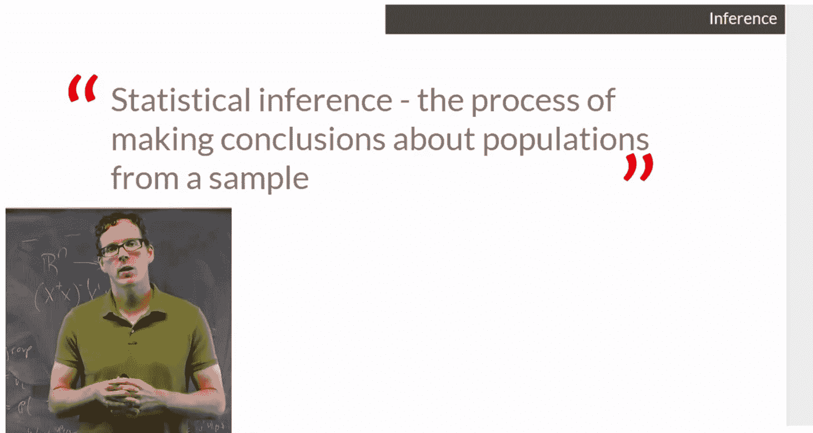
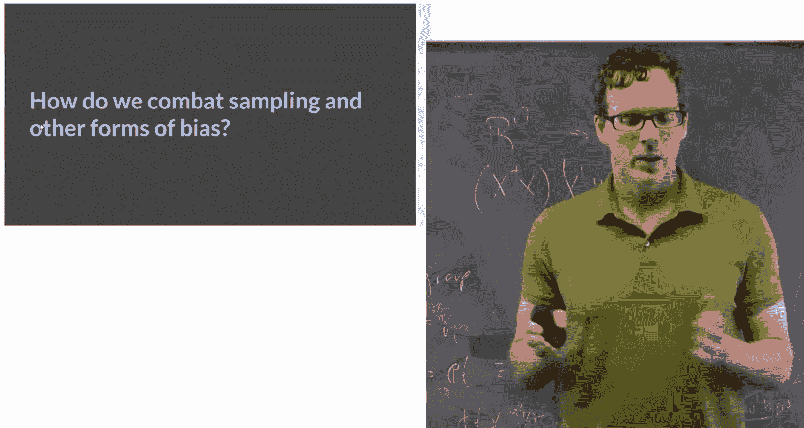

#  060：抽样偏差与随机抽样 📊

在本节课中，我们将要学习统计学中的一个核心挑战：**偏差**。我们将重点探讨**抽样偏差**——即当你的研究样本不能代表你希望得出结论的总体时会发生的问题。理解并处理偏差对于从数据中得出有效、可推广的结论至关重要。

---

上一节我们介绍了偏差的概念及其重要性，本节中我们来看看**抽样偏差**的具体含义。

我想将今天讨论的这种偏差与我们之前讨论过的其他概念（如随机化）区分开来。**随机化**的目标是使我们研究的两个组（例如实验组和对照组）尽可能具有可比性。如果我们对一组受试者随机分配处理和对照，那么除了是否接受处理或对照外，他们在其他方面（大概率上）是相似的。

但这并不意味着你所研究的患者集合就一定代表了你希望得出结论的更广泛的患者总体。例如，临床试验中的患者通常非常遵守用药规定，而普通人群可能并非如此。这一点当然也适用于像A/B测试这样的讨论。

---

那么，为什么这很重要呢？它之所以重要，是因为**统计推断**——统计学的核心组成部分——是一个从样本对总体做出结论的过程。仅仅谈论我们的样本是不够的，我们实际上希望将这种知识推广到样本之外，这就是统计推断的过程。如果我们的样本不能代表我们希望推断的总体，那么我们就会遇到问题，并可能发生像下图所示的情况。

当《芝加哥论坛报》宣布杜威击败杜鲁门时，事实上是杜鲁门赢得了选举。这个案例的根本原因是一种奇怪的抽样方案，导致了错误的结论。

另一个著名的例子是所谓的**金赛报告**。在该报告中，研究对象的集合包含了许多有心理障碍的人和囚犯。这项工作的主要批评在于，其结论无法推广到这个被研究的、有些特殊的人群之外。有趣的是，金赛的回应是收集更多的受试者，但同样不是有代表性的受试者。这当然不能解决问题，简单地增加一个有偏样本的数量并不能纠正偏差，从某种意义上说，这反而会使情况变得更糟。

---

既然抽样偏差如此棘手，我们能做些什么呢？这就是我们今天要讨论的重点：处理偏差的不同策略。以下是三种主要的应对策略。

**1. 随机抽样**
这是最好的策略之一。随机抽样就是尝试从我们感兴趣的总体中随机抽取受试者。这通常很难做到。例如，在民意调查中，有一整套科学致力于获得准确的调查结果，并使你的样本随机化，以避免固有的偏差，防止犯下《芝加哥论坛报》式的错误。常用的一种策略是随机拨号（随机电话调查）。尽管如此，如果能够实施，这是一个好策略，但通常它并不可行。

**2. 重新加权**
当随机抽样不可行时，重新加权是另一种策略。重新加权的思路是这样的：假设在你的样本中，男性数量是女性的两倍，但你知道在你希望推断的总体中，男女人数相等。那么，在进行数据分析时，你会**提高**样本中女性的权重，并**降低**男性的权重，以便在加权推断中，男性和女性的贡献是相等的。这个过程需要你了解总体在这些重要特征上的人口统计数据，并且你在样本中测量了这些特征。

**3. 建模**
我认为处理偏差的第三个重要策略是建模。在建模的情况下，我们会说，我们希望理解为什么在我们测量的任何指标上，性别（或其他因素）会产生差异。我们会尝试建立模型来解释它，然后使用我们的统计模型来对其进行调整。这种方法的问题在于必须实际构建模型。我们的结论是否对这种模型构建具有稳健性？像随机抽样这样的方法对许多假设都相当稳健，而建模常常会因与假设相关的错误而充满风险。

---

本节课中我们一起学习了偏差的多种形式及其对分析（尤其是统计推断）的潜在污染。我们今天重点讨论了**抽样偏差**，即样本不能代表你希望推断的总体。我们探讨了三种应对抽样偏差的策略：
*   **随机抽样**：在设计阶段实施，但在你的案例中可能适用也可能不适用。
*   **重新加权**：在分析阶段进行，但需要你掌握关于权重的具体知识。
*   **建模**：同样在分析阶段进行，但需要进行模型构建，并且可能对你构建模型时所做的某些选择敏感。

希望你觉得这节课有用，期待在下节课见到你。