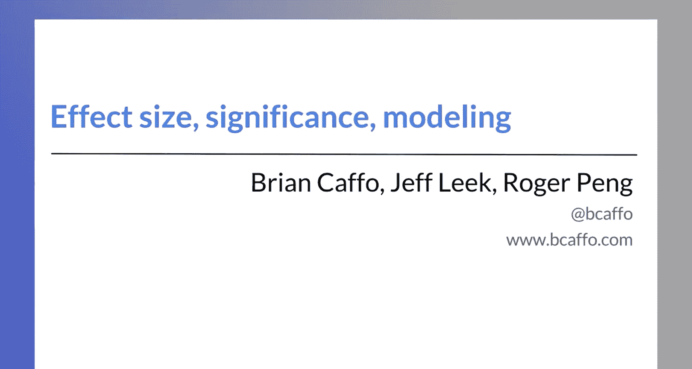
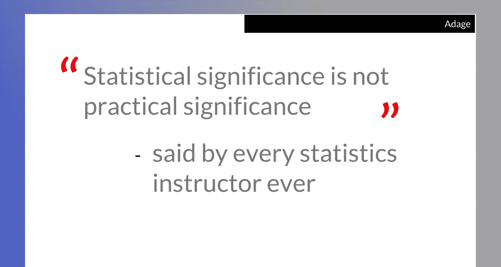

#  063：效应大小、显著性建模 📊

在本节课中，我们将要学习如何正确解读统计显著性，理解效应大小的重要性，以及如何将假设检验的结果置于具体情境中进行评估。我们将探讨为什么仅仅报告P值是不够的，并介绍几种补充工具来帮助做出更明智的决策。

## 统计显著性与实际显著性

在每一门统计学课程中，都会强调一个核心观点：**统计显著性不等于实际显著性**。

这个观点旨在说明，仅仅因为样本量足够大，我们可能检测到非常微小但在实际中并不重要的效应。然而，实际情况远比这句话复杂。本节中，我们将探讨在假设检验中，得到一个显著或不显著的结果究竟意味着什么。

## 通过思想实验理解情境的重要性

为了深入理解，让我们来看几个思想实验。

### 实验一：大型流行病学研究

一项关于营养的大型流行病学研究，发现了一个略微显著的结果（P值为0.049），该结果将热狗消费与结直肠癌发病率关联起来。

这里的问题是：**更大的样本量是增强了证据的说服力，还是削弱了它？**

一方面，巨大的样本量可能意味着研究非常有力，我们应该相信它。另一方面，也可能意味着尽管样本量巨大，却仅仅勉强达到显著性，这可能只是大样本量带来的某种偶然现象。事实上，这在统计学中是一个尚未完全解决的问题。一个研究规模巨大这一事实，如何影响对特定P值证据强度的判断，在许多情况下并不明确。

### 实验二：设计良好的A/B测试

一个设计良好的A/B测试（随机化良好，缺失数据少，样本质量高）发现，一个广告活动在促进在线购买方面并不显著优于另一个（P值略高于显著性标准阈值）。

这里的问题是：**良好的研究设计是否增强了我们对“不显著”这一结果的信心？**

同样，这取决于你如何解读。你可以认为，既然设计如此精良，如果效应真实存在，本应更容易检测到显著性，因此这个“不显著”的结果可能更倾向于支持“无差异”的结论。另一种看法是，结果非常接近边界，如果样本量再大一点，可能就会拒绝原假设。

以上两个实验的核心要点是：**情境至关重要**。我们不能脱离具体情境来解读假设检验的结果。P值和假设检验结果并非可以在不同设置间随意移植、脱离背景的“无单位”量。

## 超越P值：需要关注的要素

上一节我们介绍了情境的重要性，本节中我们来看看在解读结果时，除了P值，还需要关注哪些关键要素。

首先，**效应大小很重要**。仅仅报告假设检验结果或P值本身，会丢失效应大小的信息。因此，你通常希望看到实际的估计值。

例如，如果是比较两个广告活动的点击购买率，你不仅需要P值，还需要看到具体的差值：
`效应大小 = 广告活动1的点击购买率 - 广告活动2的点击购买率`

其次，**问题本身的背景很重要**。不同领域对证据强度的要求截然不同。

以下是需要考虑的几个关键背景问题：

*   **可容忍的错误水平是什么？** 在某些决策场景（如必须选择A或B方案）中，你可能可以接受较低的证据标准，因为必须做出选择。这与像美国食品药品监督管理局这样的监管机构形成鲜明对比，后者对新药上市的证据要求极其严格，标准截然不同。
*   **可能存在哪些偏差？** 如果一个巨大的样本存在严重偏差，那么检测到的效应可能只是反映了这种偏差，而非真实的因果关系。
*   **是否存在多重比较问题？** 研究者是否在不断尝试不同的假设，直到找到一个显著的结果？我们将在后续课程中详细讨论这个问题。

## 总结与核心工具

本节课中我们一起学习了，假设检验是一个工具，但很少应该被孤立使用。如果你管理的分析师只报告P值或假设检验结果，你需要推动他们提供更多信息。

总而言之，**没有替代品可以取代结合情境对结果进行的批判性审查**。置信区间、效应大小等工具应与假设检验结合使用。

在接下来的几节课中，我们将重点介绍三种非常有用的补充工具：

*   **评估多重比较问题**：确保分析者没有通过不断尝试假设来“钓鱼”直到找到显著结果。
*   **将效应大小与其他已知效应进行比较**：这有助于判断检测到的效应在实际中是否重要。
*   **进行阴性对照分析**：这是一种强大的方法，用于评估分析过程中是否存在系统性偏差。

掌握这些工具，将帮助你更全面、更准确地理解和运用数据科学分析的结果。