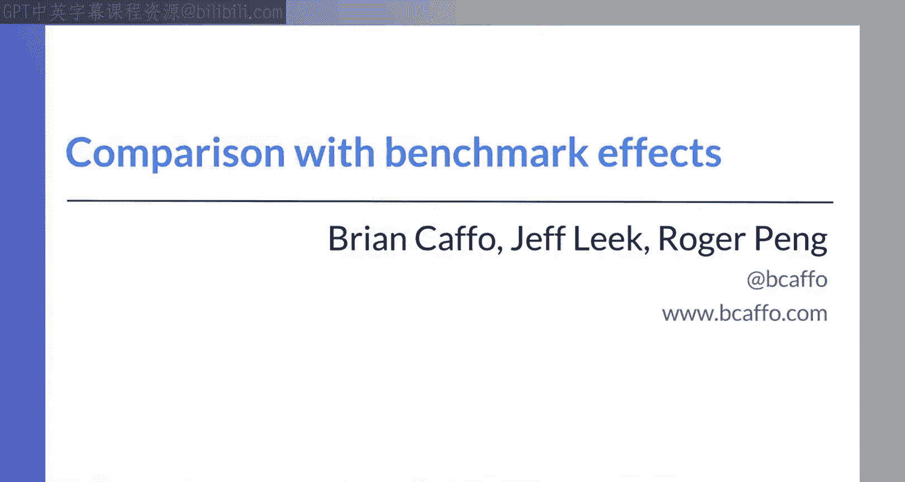
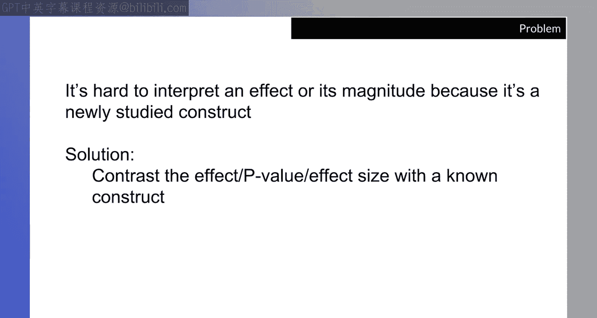

#  064：与基准效应比较 📊

在本节课中，我们将学习如何解释那些我们不太熟悉的研究效应。核心方法是：将未知效应与已知的基准效应进行比较，从而获得更直观的理解。

## 概述

当我们研究一个全新的或不太熟悉的领域时，直接解读效应大小或显著性水平可能非常困难。这些数字本身可能缺乏直观意义。本节将介绍一种解决方案：通过将新效应与一个广为人知的基准效应进行对比，来帮助我们和他人更好地理解其实际含义。

## 问题阐述

我们面临的核心数据分析问题是：如何解释一个效应或其量级？当这个效应来自于一个新研究的构念时，解释工作尤其具有挑战性。

## 解决方案：与已知构念对比

为了解决上述问题，我提出的方案是：将待研究的效应、P值、效应量或显著性水平，与一个已知的构念进行对比。

## 案例分析：铅暴露与脑容量

为了具体说明这个方法，让我们来看一个例子。我的同事布莱恩·施瓦茨发表了一篇论文，题为《过去的成人铅暴露与通过脑部MRI测量的神经退行性变相关》。

他们的研究发现了一个未经调整的效应估计值：**骨矿物质每增加1微克铅/克，脑容量减少1.41毫升**。更简单的理解是：铅暴露每增加一个单位，脑容量大约减少1.14毫升。

这项研究关注的是在铅制造厂工作的人群。研究者担心长期铅暴露会导致脑容量加速下降，其速度超过正常衰老过程。

那么，我们该如何理解这个“-1.14”的效应呢？虽然我们给出了单位解释，但问题在于，我仍然不太清楚这个数字到底意味着什么。

## 引入基准：正常衰老

将新效应置于相关现象的背景下进行理解，这就是我们的核心思路。在这个案例中，虽然我不是铅暴露领域的专家，但我对正常衰老过程有所了解。

已知在40岁以后，正常衰老每年会导致脑容量下降约0.5%。这个估算可能略高，但大致在这个范围。

如果我们取这个“每年0.5%”的下降率，并参照布莱恩研究中的平均脑容量数据，就可以计算出：**1.41毫升的减少量，大致相当于正常衰老情况下约20%的年下降量**。

因此，我们可以这样重新表述：铅暴露每增加一个单位所导致的脑容量损失，大约相当于40岁以上人群在一年中经历的正常脑容量损失的20%。

## 方法优势

对我而言，这个对比后的解释更加清晰。因为我熟悉健康脑衰老领域，但不熟悉铅暴露对大脑的影响。通过将陌生的铅暴露效应与熟悉的正常衰老效应进行对比，我获得了更深刻的理解。

我建议你在分析中尝试使用这种技术：当你面对一个复杂的效应度量时，将其与你非常熟悉的某个事物进行对比。这是一种非常强大的解释和沟通工具，尤其适用于向不同背景的听众解释新概念时。将新构念置于一个房间里所有人都熟悉的框架内，能极大地提升沟通效果。

这种与基准效应对比的技术在流行病学、公共卫生和生物统计学领域被广泛使用。

## 总结

本节课中，我们一起学习了如何通过与基准效应进行比较，来更好地解释和理解新研究中的效应。当直接解读效应大小有困难时，将其与一个已知的、易于理解的效应（如本例中的正常脑衰老）进行对比，可以化抽象为具体，使分析结果更具实际意义和沟通力。