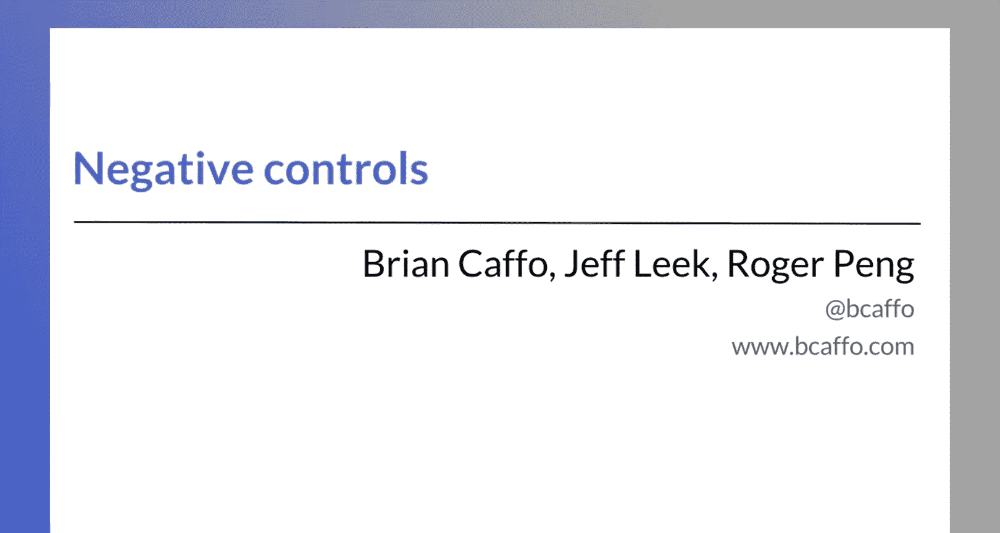
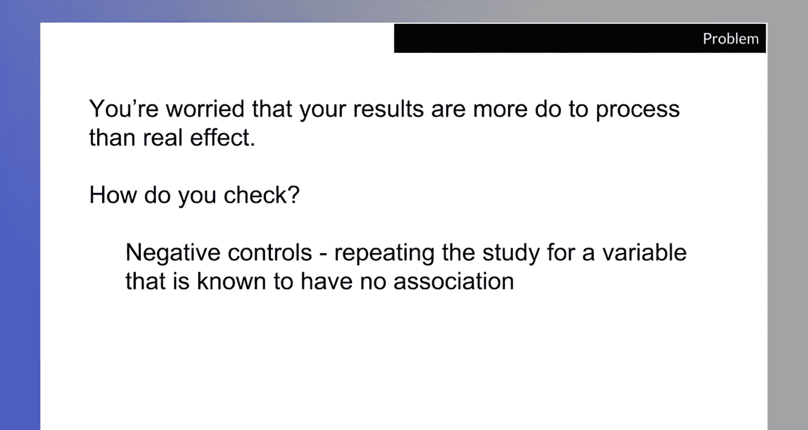

#  065：阴性对照 🧪

在本节课中，我们将学习一种称为“阴性对照”的实用技术。这项技术用于检验统计分析结果的可靠性，帮助我们判断一个显著的发现是真实存在的效应，还是仅仅由数据处理过程或偶然因素造成的假象。

上一节我们讨论了如何评估统计结果的显著性。本节中，我们来看看如何通过阴性对照来验证我们的分析过程本身是否可靠。

## 核心问题：过程还是真实效应？

我们担心分析结果更多是由数据处理过程（如数据清理、模型选择、算法偏差）导致的，而非真实存在的内在效应。如何检验这一点呢？统计学中的显著性检验等方法虽然能评估数据不确定性，但阴性对照提供了一种更贴近数据科学实践的、非常实用的解决方案。

## 什么是阴性对照？

阴性对照的核心思想是：**对一个已知不存在关联的变量重复整个研究分析过程**。

如果在这个“明知不会有结果”的测试中，你的分析过程仍然产出了“显著”的结果，那就强烈表明你的分析流程本身存在问题，可能会制造出虚假的关联。

## 一个经典案例：大脑“连接性”研究

让我用一个我所在领域的著名例子来说明。

在脑科学研究中，“连接性”是一个热门概念，它指的是大脑不同区域的活动会相互关联、同步变化。研究者们开发了各种工具来测量这种连接性。

有趣的是，有研究者将这些工具应用到了大脑的一个特殊区域——**脑室**。脑室内充满的是脑脊液，并没有脑组织。因此，理论上，脑室内的两个点之间不应该存在由大脑活动驱动的“连接性”。

然而，当研究者使用与分析大脑区域完全相同的技术流程，去分析脑室内两个位置的信号时，他们竟然发现了“显著”的连接性结果。

这个发现非常关键，因为它证明了所观察到的“显著关联”并非真实的大脑活动连接，而纯粹是**分析过程或数据本身的问题**所导致的。后续研究发现，这主要与两个因素有关：
1.  **头部运动**：受试者头部移动会在脑室的两个位置产生相似的模式，从而造成虚假的相关性。
2.  **生理噪声**：呼吸和心跳等生理活动会动态改变信号特征，也可能产生伪相关。

这个案例的精髓在于：研究者通过在一个**已知理论上不应有效应**的场景下，完整复现了备受关注的分析流程，并发现了效应，从而揭示了原有分析流程中存在的系统性偏差。

## 阴性对照的作用与特点

这类阴性对照为调查由混杂因素或多重比较等问题引起的虚假效应，提供了一种简单有效的方法。在上述案例中，两个体素（脑成像的最小单位）之间的相关性实际上就被头部运动**混杂**了。

以下是选择一个好的阴性对照变量的关键特征：
*   **真实性**：该变量应存在于你的数据集中，并经历与目标变量完全相同的处理流程（如数据清洗、变换、建模）。
*   **已知无关联**：你必须能从逻辑或理论上确信，该变量与你的研究结果之间不可能存在真正的因果关系或关联。

## 实施建议与替代方案

这是一个简单的技术。如果你对团队成员执行的漫长、复杂的数据整理和分析过程感到不安，或者他们构建了多个模型，一个很好的检验方法是：要求他们**针对一个从表面看就绝不可能有关联的变量，重复整个分析过程**，看看会得出什么结果。这是一个极佳的“理智检查”方法，可以有效检验过程本身的影响。

当然，阴性对照的一个常见批评是：很难找到百分之百确定不存在任何效应的变量。因此，人们也常采用其他策略，例如：
*   **置换检验**：这是一种更高级的方法，通过随机打乱其中一个变量的顺序，从而**人为地打破**变量间可能存在的任何关联，然后在多次置换中构建一个“无效应”的零分布，用于检验原假设。

## 总结

本节课我们一起学习了阴性对照技术。我们了解到，阴性对照是通过对一个已知无关联的变量重复分析流程，来检验该流程是否会产生虚假显著结果的有效方法。它像一个“照妖镜”，能帮助我们区分一个发现是真实的科学效应，还是分析过程制造的幻影。在复杂的数据分析项目中，引入阴性对照是提升结果可信度、进行质量控制的实用策略。