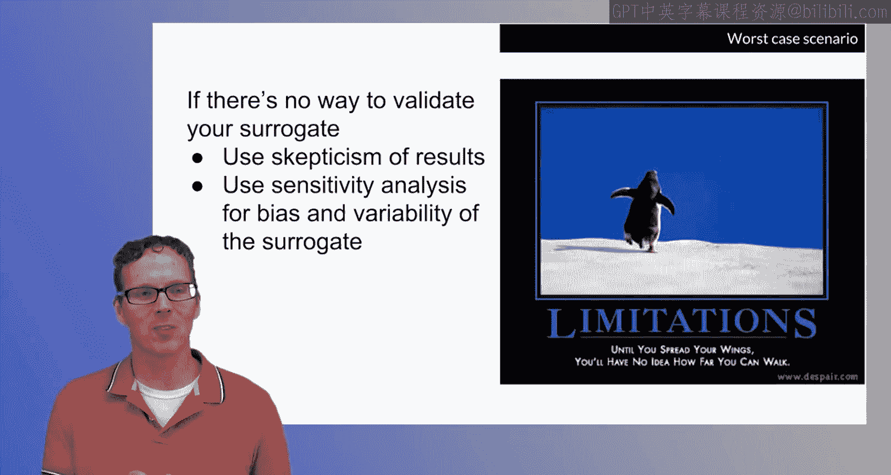

#  067：相关的估计目标 📊

在本节课中，我们将学习一个数据分析中非常普遍的情况：当你无法直接测量真正关心的目标变量时，该如何处理。我们将探讨替代变量的概念、其优缺点，以及在实际工作中可以采取的策略。

## 引言：无法测量理想，就测量现实

上一节我们讨论了估计目标的重要性，本节中我们来看看当理想的测量目标无法直接获得时，我们该怎么办。这引出了“替代变量”的概念。

核心思想是：如果你无法测量你想要的变量，那就测量你能得到的变量。这就像一句老话说的：“如果你不能和你爱的人在一起，那就爱你身边的人。” 在数据分析中，这意味着我们常常需要用**替代变量**来近似我们真正关心的**目标变量**。

一个不那么鼓舞人心的经典笑话也描绘了类似困境：一个醉汉在路灯下找钥匙。警察问他是否在这里丢了钥匙，醉汉说“不，我丢在那边了”。警察问“那你为什么在这里找？”，醉汉回答“因为这里有光”。我们希望在使用替代变量时，不要像这个醉汉一样，仅仅因为“这里有光”（数据容易获得）就进行搜索，而应确保我们的“钥匙”（真实洞察）就在附近。

## 什么是替代变量？🤔

在许多调查或研究中，直接测量最相关或最理想的指标往往非常困难，甚至不可能。这时，我们会使用一个更容易测量、但与真实目标相关的变量作为替代。

以下是几个经典的替代变量例子：

*   **身体质量指数**：作为**体脂百分比**的替代。BMI仅通过身高和体重计算，而精确测量体脂百分比需要更复杂的技术。
*   **国内生产总值**：经济学家常用它作为**经济福祉**的替代指标，尽管他们承认这只是对经济福祉的一种粗略概括。
*   **食物频率问卷**：用于估算**卡路里摄入量**。通过询问人们上周吃了什么来推断其热量消耗，这是一个噪声很大的测量方法，但要精确记录人们的饮食数据本身就很困难。
*   **选民意向调查**：询问人们是否会投票，得到的是“可能投票者”，但这不等于“实际投票者”。
*   **网站流量**：测量的流量可能包含大量网络爬虫（如搜索引擎爬虫）的访问，而非真实的用户访问。
*   **功能性磁共振成像**：在神经科学领域，我们真正想测量的是**神经元信号**，但实际得到的是一个名为“血氧水平依赖信号”的粗略代理信号。

因此，无法测量目标变量，只能测量一个相近的替代变量，这是一个非常普遍的问题。

## 优秀替代变量的特征 ✅

那么，一个好的替代变量应该具备哪些特征呢？

以下是优秀替代变量的关键特征：

1.  **无偏性**：即使替代变量有噪声，与真实目标变量不完全一致，它也不应存在系统性偏差（即不会系统地偏大或偏小）。理想情况下，替代变量围绕真实目标变量的方差是已知的。
2.  **可校准性**：在部分样本中能获得真实值（金标准），从而可以研究和校准替代变量的准确性。

一个无偏替代变量的例子是：用一个有噪声但无偏的秤测量体重。虽然单次测量不准确，但多次测量的平均值会接近真实体重，并且你知道其测量误差的分布情况。在这种情况下，你可以在分析中使用这些信息。

然而，这种“无偏且方差已知”的情况非常少见。更常见且可实现的是第二种情况：**进行金标准研究**。

## 策略：金标准研究与校准 🔬

如果你有条件，最好的策略之一是在一个子集样本上进行金标准研究。

例如，在研究智能手环（如Fitbit）的计步功能时，它并非直接测量步数，而是测量手腕的加速度，并通过算法预测步数。其估算的卡路里消耗则更不直接。

一个严谨的研究方法是：让受试者在实验室环境中佩戴设备，同时使用更精确的方法（如代谢面罩）直接测量其真实的步数和卡路里消耗。这样，你就在这部分样本上获得了“金标准”数据。

利用这部分数据，你可以：
*   评估设备的准确性。
*   建立校准模型：`预测步数 = f(加速度数据)`。
*   将这个模型应用到那些只有设备数据、没有金标准数据的大规模样本中。

进行金标准研究非常有益。根据科学界的经验，当我们深入研究这些替代变量的准确性时，常常会惊讶地发现它们比我们想象的要**不准确得多**。因此，如果条件允许，强烈建议花时间对你使用的替代变量进行校准研究。

## 当缺乏金标准时：承认局限与敏感性分析 ⚠️

如果上述策略都不可行（即没有金标准数据，也无法从外部数据验证），那么你必须承认分析的局限性。

在这种情况下，你需要：

1.  **对结果保持怀疑态度**：时刻意识到你的结果基于一个有噪声的替代变量。
2.  **进行敏感性分析**：评估替代变量的偏差和变异性对结论的影响。

敏感性分析是指，假设替代变量存在一定程度的误差（例如，食物频率问卷可能每天平均低估100卡路里的摄入），然后将这种误差纳入分析，观察你的核心结论是否会因此改变。这是一种“试探”方法，用于理解未测量真实目标所带来的后果。

## 何时应该放弃？ 🚫

最后，我们需要思考：什么时候应该放弃使用某个替代变量进行分析？

一个实用的判断标准是：**在开始分析或收集数据之前，先思考你将如何解释结果**。

问自己：考虑到你使用的替代变量相对于真实目标如此不准确和不可靠，是否**任何可能的结果**（无论是你希望看到的，还是完全相反的）都不会真正改变你的决策或认知状态？如果答案是肯定的，那么进行这项分析可能就没有意义。

在这种情况下，你需要：
*   改进你的替代变量。
*   设法进行金标准研究。
*   寻找新的、更好的变量。
*   或者直接放弃这个分析方向。

在投入成本进行一项分析之前，先思考能否从嘈杂的替代变量中获得任何有价值的信息，这是非常必要的。

## 总结 📝

本节课我们一起学习了如何处理无法直接测量目标变量的情况。我们介绍了**替代变量**的概念，探讨了优秀替代变量的特征（无偏、可校准）。我们学习了两种主要策略：**进行金标准研究以校准替代变量**，以及在缺乏金标准时**通过敏感性分析和保持怀疑态度来评估局限性**。最后，我们讨论了在替代变量质量过差时，应考虑放弃分析，转而寻求更好的测量方法。理解并妥善处理替代变量的局限性，是做出稳健数据决策的关键一步。