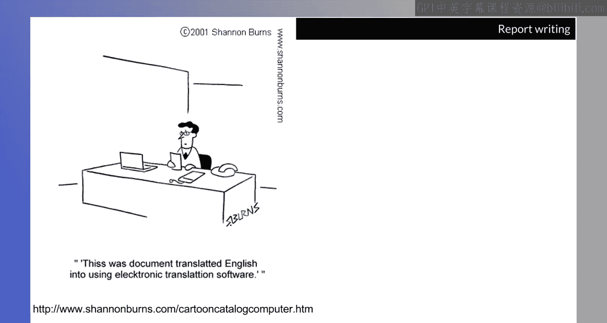

#  068：报告写作 📝

在本节课中，我们将学习如何撰写清晰、可复现的数据科学报告。报告写作是数据科学项目中的关键环节，但常常存在问题。我们将探讨三个核心策略，帮助你或你的团队提升报告质量。

上一节我们介绍了报告写作的重要性，本节中我们来看看提升报告质量的第一项策略：检查效应。

## 检查符号、量级与单位

一份优质报告的基础是确保其内容的准确性。以下是三个需要重点检查的方面：

*   **符号**：检查效应的方向是否符合预期。例如，在分析阿尔茨海默症症状与脑容量的关系时，我们预期脑容量随症状加重而减少。如果报告中的系数显示为正（即脑容量增加），这就值得警惕并需要解释。
*   **量级**：将所研究效应的量级与其他已知效应进行比较。例如，可以说“由某因素导致的脑容量损失，相当于正常衰老十年的损失量”。这有助于读者直观理解效应的大小。
*   **单位**：确保所有效应的单位清晰明确，并标注在所有图表坐标轴上。混淆单位可能导致荒谬的结论（例如，得出人脑每年增长到房屋大小的错误结果）。深入理解单位有助于从根本上理解问题。

上一节我们讨论了如何确保报告的准确性，本节中我们来看看如何让报告更容易被理解。

## 聚焦于解释与可解释性

报告的核心价值在于传达洞见，而不仅仅是展示数字。提升解释性的方法如下：

*   **与已知效应对比**：这不仅是检查量级的方法，也是增强解释力的有力工具。通过对比，让陌生的概念变得熟悉。
*   **鼓励简约性**：在模型选择上，应**崇尚简约原则**，即使用尽可能简单且不失效的模型。例如，如果一个回归模型能达到复杂机器学习算法95%的预测性能，那么牺牲5%的性能以换取模型极强的可解释性通常是值得的。在报告中，应着重解释回归系数等易于理解的结果。
*   **进行效应批判**：当发现一个显著或令人兴奋的效应时，应主动扮演“怀疑者”的角色。思考可能的替代解释或混杂因素。例如，发现铅暴露与脑容量损失相关时，需质疑：“这真的是铅暴露导致的，还是暴露组与非暴露组人群的体重指数不同造成的？”这种批判性思维将引导你进行更深入的分析（例如，在模型中同时纳入铅暴露和体重指数），以巩固或修正你的结论。

上一节我们探讨了如何让报告内容更易于理解，本节中我们来看看如何确保报告的分析过程可以被他人验证和复现。

## 使用可复现的研究工具

可复现性是现代数据科学的基石。它确保报告中的每一个数字都能被追溯和重新生成。Ben Hammer 有一条精辟的推文：“写代码时，请记住你是在与未来的自己合作。”

为了实现报告的可复现性，应鼓励使用将数据分析与报告撰写合二为一的工具。这类工具能自动生成包含所有分析步骤的文档。目前最流行的两种工具是：

*   **`knitr`**：这是一个专门用于 **R** 语言的工具，其理念是将分析与报告“编织”在一起。
*   **`Jupyter Notebook`**：这是一个支持多种编程语言（如 Python、R）的交互式笔记本工具。

使用这类工具，可以确保报告不仅呈现结果，还完整记录了从原始数据到最终分析结果的全部路径。

## 总结

本节课中我们一起学习了提升数据科学报告质量的三个核心策略：
1.  **严格检查**报告中效应的**符号、量级和单位**，确保基础准确性。
2.  **聚焦于解释与可解释性**，通过对比、崇尚简约模型和进行自我批判，让报告清晰传达洞见。
3.  **采用可复现的研究工具**（如 `knitr` 或 `Jupyter Notebook`），将分析与报告无缝结合，确保结果可被验证和追溯。遵循这些策略，将能显著提高报告的专业性、可信度和沟通效率。