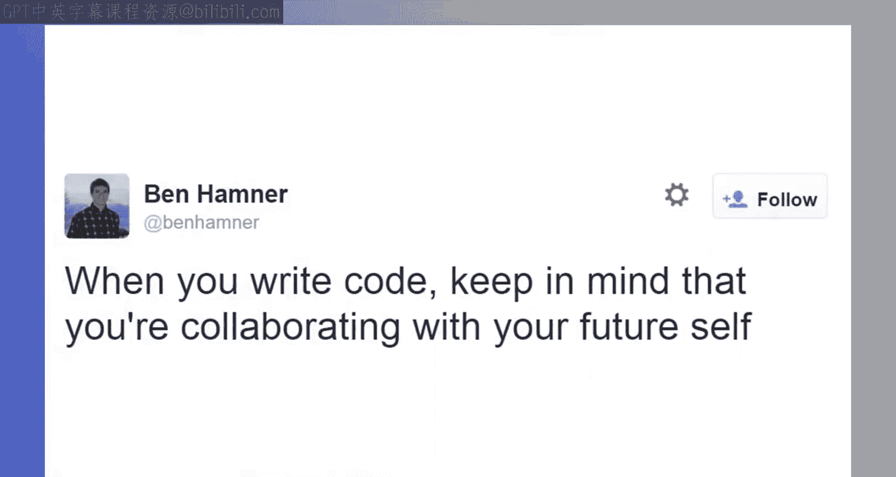
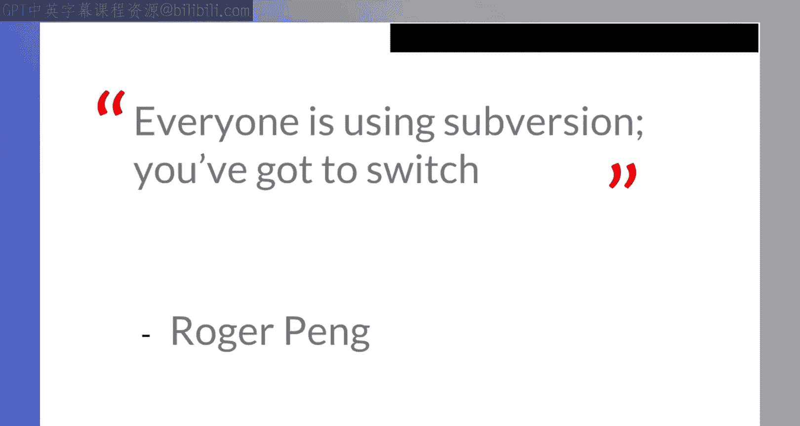
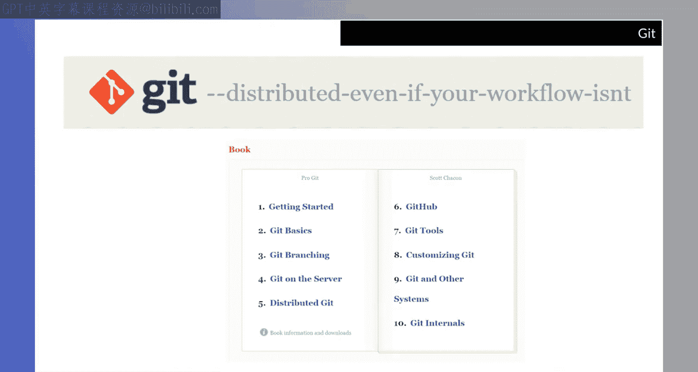

#  069：版本控制 📚

在本节课中，我们将要学习版本控制的概念、重要性以及如何在数据分析工作中实践它。版本控制是确保代码可追溯、可协作和可恢复的关键工具。

---

上一节我们讨论了撰写可重复报告的重要性。本节中，我们来看看如何通过版本控制来管理代码和分析过程的历史记录。

记住本课程的核心主题：对比现实与理想的数据分析实践。我认为版本控制是少数几个能够轻松达到理想状态的主题之一。它只需要投入少量工作，却常常能节省大量时间。

请思考这句话：当你编写代码时，请记住你正在与未来的自己合作。能够查看代码、回溯到之前的版本并了解分析过程的历史，是数据分析中极其重要的一环。我们在报告撰写部分讨论过创建可重复报告的重要性。这当然是完成高质量、有良好文档记录的分析的一个组成部分。而持续保存代码的所有版本是另一个关键部分。它不仅有助于备份和归档，还能精确记录你所做的每一步，这对数据分析目的至关重要。

总而言之，版本控制是一种良好的实践。与本课程中许多其他主题不同，它相对容易实现，并且完全在你的掌控之中。

---

以下是关于版本控制工具演变的个人经历分享。

说到这里，我想借此机会“抱怨”一下Roger Pang。我使用版本控制已经很久了。我认为我最早使用的是RCS，一个相当古老的版本控制系统，然后是CVS。后来有一天，Roger Pang走进我的办公室说，所有人都在用一个叫Subversion的程序，我必须切换，因为没人再用CVS了。我抗拒了一段时间。但我想，Roger在计算方面几乎总是对的。于是我切换到了Subversion，这是一个将我的所有CVS仓库转换为Subversion仓库的巨大工程。

然而，就在第二天，Roger又走进我的办公室说，所有人都在用Git，我必须停止使用Subversion。于是我又抗拒了很长一段时间，坚持使用Subversion。但当我最终切换到Git后，我感到非常满意。我注意到Git已经存在了一段时间，并且似乎会持续下去，至少在可预见的未来不会被下一个版本控制系统取代。

---

上一节我们了解了版本控制工具的演变。本节中，我们来看看当前推荐的工具和实践。

对于你管理的团队成员，你应该鼓励他们在分析中使用Git、Subversion、Mercurial等版本控制工具。为了让你对软件有所了解，如果我必须给出一个建议，我会推荐Git。

**Git**是版本控制软件。它帮助你完整保存代码和分析文件（甚至数据文件）的历史记录。你可以回溯到任何时间点，或者在回退后再次前进。任何被提交到Git仓库的内容都不会丢失。因此，Git是实现版本控制的工具。

然后，你需要一个地方来托管它。你可以自己搭建。如果你在一家公司，公司可能已经部署了版本控制系统。如果你在一家较小的公司，你可能需要考虑使用Git托管服务。最流行的托管服务中，我最熟悉的两个是**GitHub**（我认为它显然是最大的）和**Bitbucket**。这些不是版本控制工具本身，而是托管你代码和文件的地方。本质上，它们为你托管Git软件并跟踪你的文件。这些都是极好的工具。

我强烈建议将使用Git和版本控制作为最佳实践和管理策略的一部分，鼓励甚至要求使用这些工具。

---

本节课中，我们一起学习了版本控制的核心价值。我们了解到，版本控制不仅是与未来自己协作的关键，也是确保分析过程可追溯、可恢复的最佳实践。我们回顾了版本控制工具的演变，并重点推荐了当前主流的Git工具及其托管服务（如GitHub和Bitbucket）。作为管理者，推动团队采纳版本控制，是提升数据分析工作质量和效率的重要一步。