# 高管数据科学：第1课：什么是数据科学

在本节课中，我们将要学习数据科学的定义、核心要素以及它在实际场景中的应用。我们将通过具体案例来理解数据科学如何通过回答具体问题来创造价值。

---

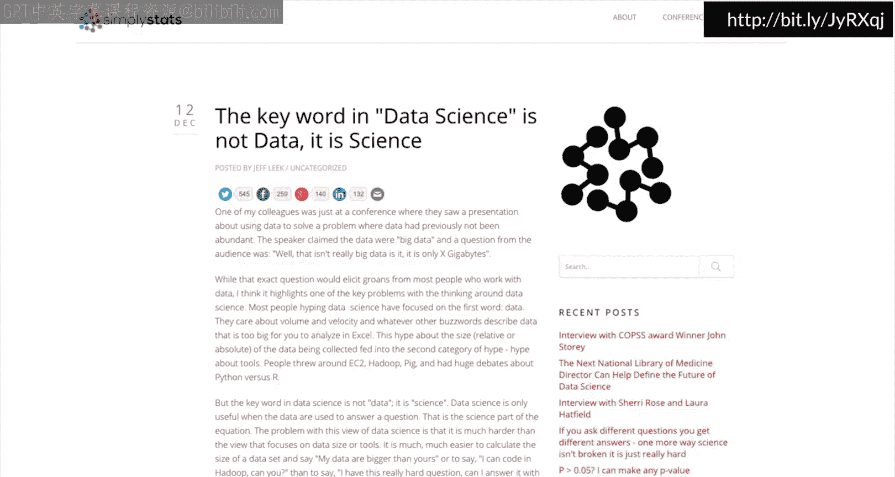

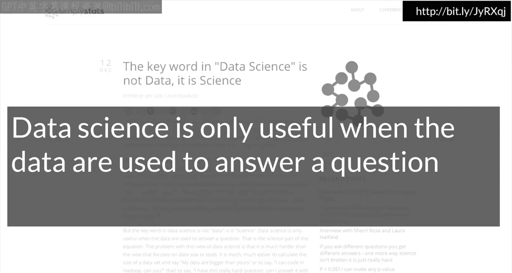

## 概述

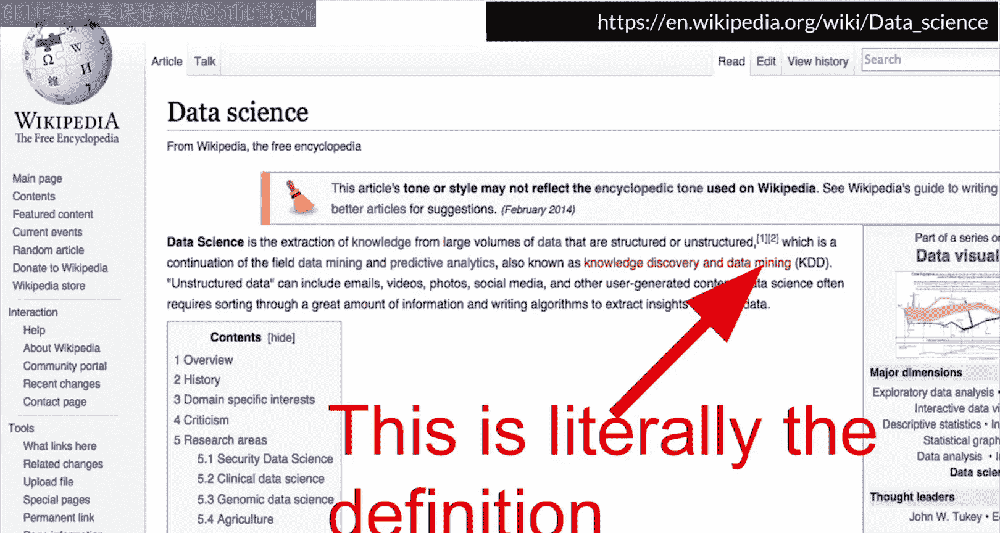

数据科学的核心在于“科学”而非“数据”。它的价值在于利用数据来回答对组织有用的、具体且明确的问题。维基百科的定义也强调了这一点：数据科学是通过数据来理解和分析实际现象的科学。

## 数据科学的核心：回答具体问题

数据科学之所以有用，是因为它能利用数据来解答对组织至关重要的具体问题。以下是几个经典案例，用以说明这一点。

### 案例一：点球成金（Moneyball）

在电影《点球成金》中，核心问题是：**能否在预算有限的情况下打造一支常胜的棒球队？** 团队通过量化球员技能并引入新的评估指标来回答这个问题。这个案例之所以是数据科学问题，关键在于他们利用收集到的数据来解答“如何组建一支低预算强队”这一具体问题。

### 案例二：奥巴马竞选团队的数据分析

奥巴马竞选团队面临的问题是：**如何找到那些会投票给奥巴马的人，并确保他们在选举日当天去投票？** 团队通过分析数据和进行实验来识别目标人群。结果发现，关键人群并非大家普遍认为的中间派选民。这个案例的核心数据科学问题是：**能否利用数据来解答关于选民投票率以及如何确保特定团队赢得选举的问题？**

### 案例三：Netflix 推荐系统挑战赛

Netflix希望用户持续观看电影，因此需要不断推荐他们可能喜欢的影片。这里的问题是：**如何向用户展示他们会喜欢的电影，以使他们持续观看？** Netflix利用用户偏好数据，通过机器学习技术进行预测。尽管使用了高级技术，但核心问题始终是：**如何识别人们会喜欢的电影？**

## 数据科学的工作流程

上一节我们通过案例了解了数据科学如何解答问题。本节中我们来看看完成这一过程通常涉及哪些关键步骤。

数据科学不仅仅是利用数据回答问题，它还包含一系列其他环节。一个完整的数据科学流程通常包括：

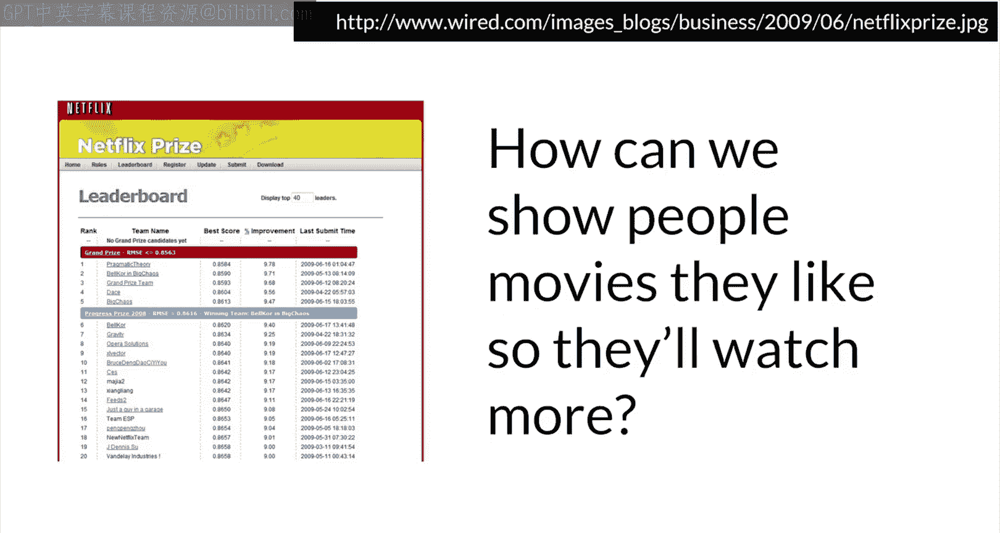

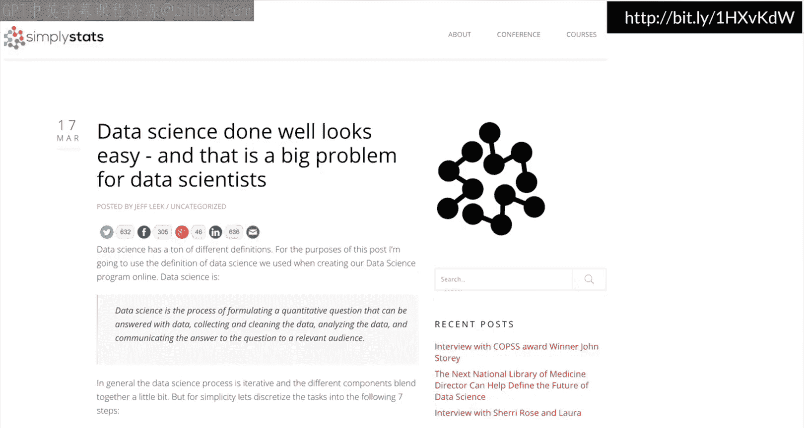

1.  **提出可量化的问题**：明确需要解答的具体问题。
2.  **识别与获取数据**：找到可以用来回答问题的数据源。
3.  **数据清洗与整理**：处理原始数据，使其变得规整、可用。
4.  **数据分析与建模**：运用统计学、机器学习或神经网络等方法分析数据。
5.  **结果传达与沟通**：将分析得出的答案有效地传达给相关人员。

## 数据科学的工程实现挑战

在讨论数据科学时，工程实现的环节常常被忽略。这涉及到如何将分析模型实际部署并扩展到大规模应用中。

以Netflix推荐系统挑战赛为例，获胜团队融合了大量机器学习算法，并通过巧妙的平均方法整合了它们的预测结果。然而，这种方法的计算复杂度极高。Netflix最终并未在实际系统中部署这个获胜方案，因为当时的计算能力无法将其扩展到所有用户。这个例子说明了数据科学流程中的不同组成部分：一方面是**从数据中学习、发现正确预测模型**的数据科学本身；另一方面是**如何实际实施或扩展该技术以应用于大规模用户群**的数据工程。

## 数据科学中的权衡

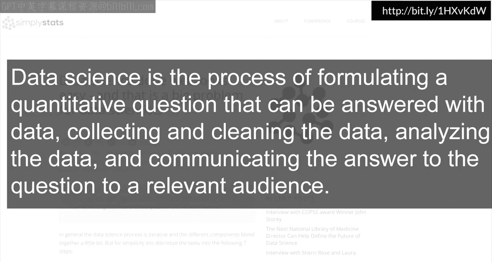

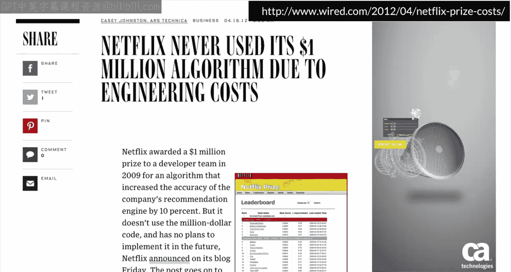

在数据科学实践中，我们经常需要在不同目标之间做出权衡。以下是常见的权衡维度：

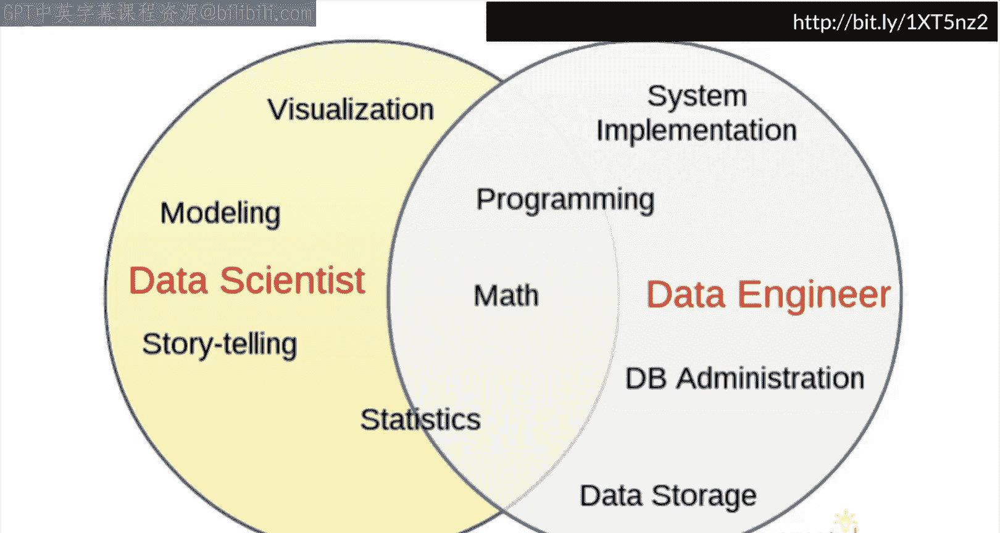

*   **可解释性 vs. 准确性**：模型越复杂（如某些深度学习模型），可能预测越准，但越难理解其决策原因。
*   **可解释性 vs. 速度/可扩展性**：简单、快速的模型可能更容易解释和部署，但预测性能可能有限。
*   **准确性 vs. 速度**：追求极高的精度可能需要更复杂的计算，从而降低响应速度。

你可以想象一个模型在**可解释性、简洁性、准确性、速度和可扩展性**这些维度上各有表现。你需要根据所要解决的具体问题，来判断哪些维度更为重要。

## 识别炒作与现实：数据科学的成熟度曲线

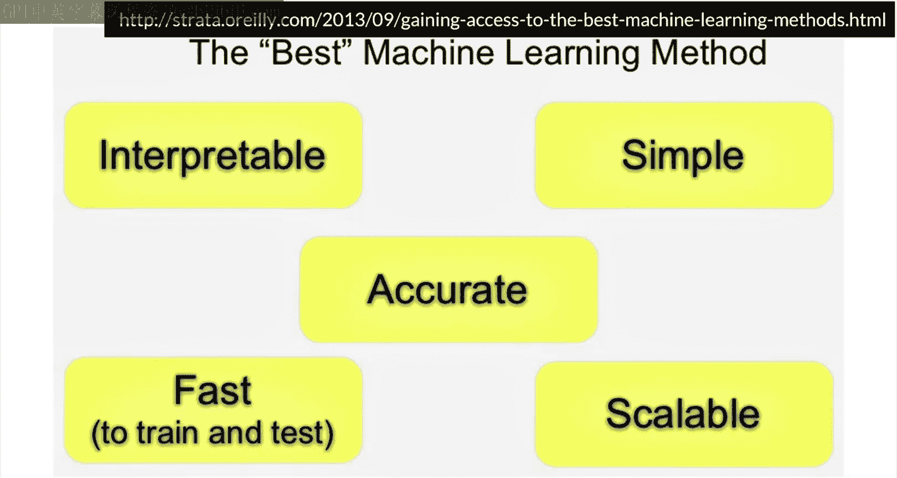

数据科学领域也存在炒作周期。新技术通常会经历“过高的期望峰值”，随后当人们发现其局限性时进入“幻灭低谷”，最终才能达到“生产力稳定期”。数据科学目前正从低谷走向稳定期，人们开始真正掌握如何用它解决关键问题。现在可以看作是数据科学的“1999年”，是一个激动人心的时代。即使相对简单的数据科学工具，只要能很好地用于解答非常具体的问题，也能对你和你的组织产生重大影响。

---

## 总结

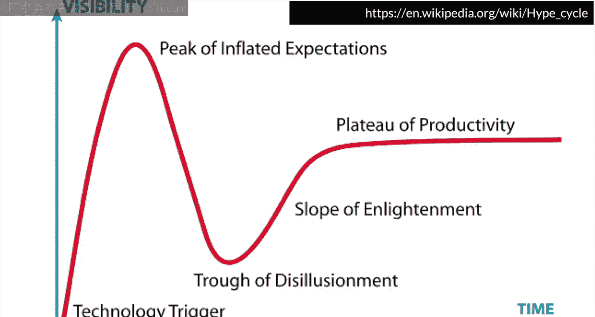

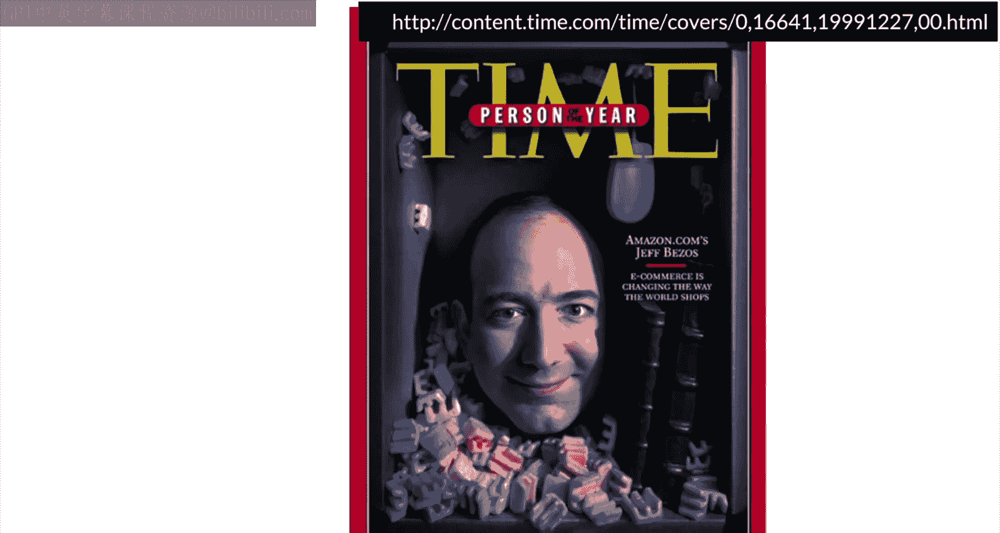

本节课中我们一起学习了数据科学的本质。我们了解到，数据科学的核心是利用数据来解答对组织有价值的、具体的问题。我们通过《点球成金》、奥巴马竞选和Netflix推荐系统等案例，看到了数据科学在实际中的应用。此外，我们还探讨了数据科学的工作流程、工程实现的挑战、实践中需要做出的各种权衡，以及如何理性看待该领域的发展阶段。记住，有效的数据科学始于一个明确的问题。