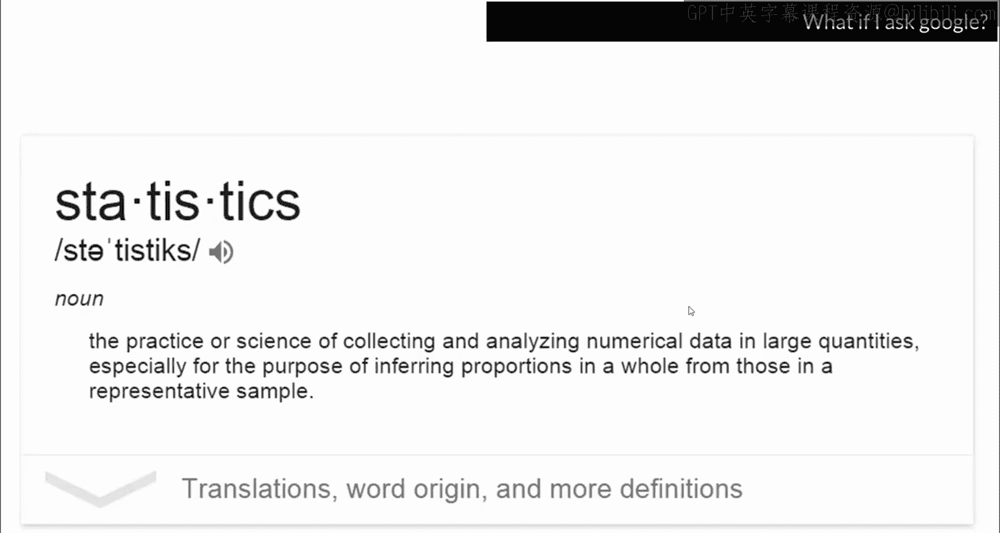
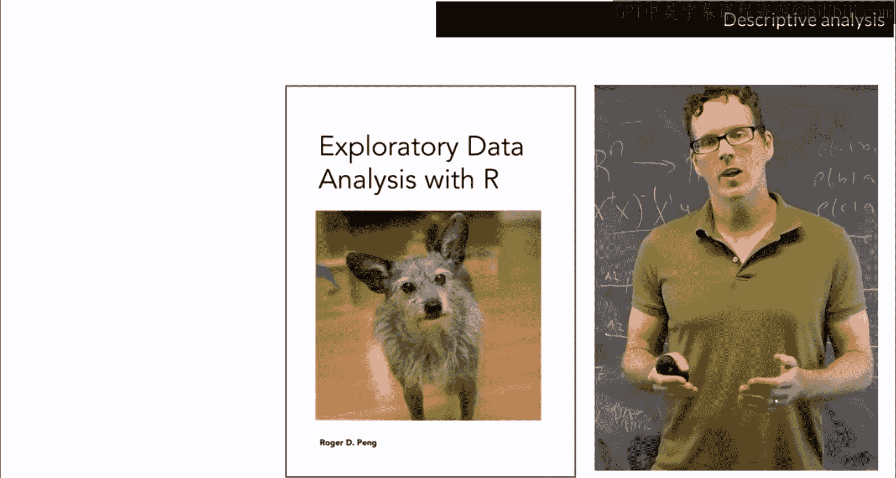
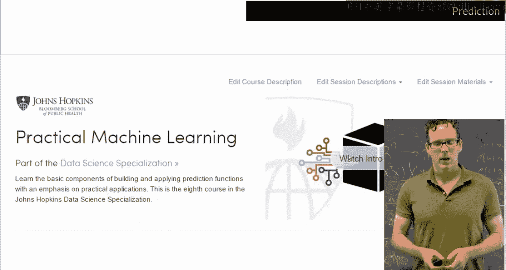
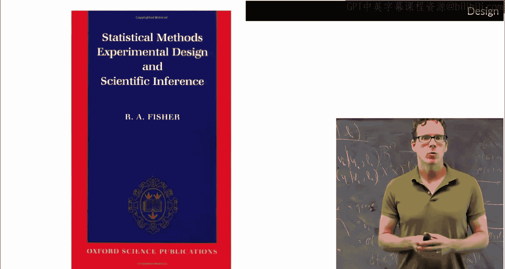

# 高管数据科学：第3课：统计学的核心活动

在本节课中，我们将探讨统计学的核心应用领域。我们将通过具体的实例，了解统计学在描述性分析、统计推断、预测和实验设计这四个关键活动中的作用。

---

## 什么是统计学？

每门课程开始时，我们都会尝试定义核心概念。为此，我查阅了权威资料，询问谷歌“统计学有什么用”。谷歌给出的定义是：“统计学是收集和分析大量数值数据的实践与科学，特别是为了从代表性样本推断整体比例。”这个定义相当冗长。

因此，我决定不纠结于定义本身，而是选取统计学的一些核心活动，并通过实例来逐一说明。

---

## 统计学的四大核心活动

当我思考统计学的核心时，我归纳出定义该领域的四项关键活动。当然还有其他活动，并且这些活动相互重叠，并非完全独立。这四项活动是：
1.  **描述性分析**
2.  **统计推断**
3.  **预测**
4.  **实验设计**

让我通过一些例子来介绍每一项活动，帮助你思考这些主题以及统计学如何发挥作用。

---

## 描述性分析 📊

上一节我们介绍了统计学的整体框架，本节中我们来看看第一项核心活动：描述性分析。描述性分析包括探索性数据分析、量化（如制作表格）、数据汇总和无监督聚类等。

一个典型的例子来自我的研究领域——功能性磁共振成像。这项研究曾引起巨大轰动。几位顶尖研究人员绘制了一幅关键的图表。他们研究的是大脑不同区域活动之间的相关性（即“连接性”）。

通过这幅探索性图表，他们发现，当剔除因头部移动而产生的低质量扫描数据后，估计的相关性发生了显著变化，并且短程相关性与长程相关性的变化模式不同。这一发现对我们领域产生了深远影响，因为它揭示了过去研究中可能残留的头部运动影响，导致许多已发表的“大脑连接性”发现可能实际上反映的是头部运动，而非具有科学意义的大脑活动。

我认为，探索性数据分析最擅长的是**提出假设**。这幅图表被纳入论文发表后，引发了大量关于fMRI扫描中运动伪影的研究。这是一个绝佳的探索性数据分析案例。

---

## 统计推断 🎯

我们了解了描述性分析如何揭示数据中的模式，接下来，我们进入第二项活动：统计推断。我将其定义为**根据样本对总体做出结论的过程**。

一个著名的、我们经常遇到的统计推断例子是**选举民意调查**。在这种情况下，我们感兴趣的总体是选举日的全体选民。我们想知道其中将投票给某位候选人的比例。这实际上是一个经典的统计推断问题。

在2012年美国总统选举中，关于统计推断过程曾有过激烈争论。选举当晚，一位政治评论员甚至拒绝相信他们自己团队的民调结果。而统计学家内特·西尔弗早前就通过分析公开表示奥巴马很可能赢得选举。选举后的讨论非常有趣，它涉及推断的作用以及我们在讨论民调时对推断结果的信任程度。

选举民调是统计推断的一个绝佳例子：我们有明确定义的目标总体、感兴趣的明确参数，并且由于无法调查所有人，我们必须通过样本来估计这个总体参数。

---

## 预测 🔮

在讨论了如何从样本推断总体之后，我们转向第三项活动：预测。预测包括机器学习、监督学习等，即我们希望通过多个（甚至少数几个）预测变量来创建大量预测。

预测的一个标志性特征是，其重点从试图理解机制和模型，转向实际创建预测并主要通过预测的准确性来评估，而不是看模型能解释多少未知的世界状态。

**股市预测**就是一个很好的例子。对于许多预测股市的人来说，他们真正关心的只是预测带来的货币损益。这是现代预测的思维方式。相比之下，研究市场的学者可能更感兴趣的是市场为何如此波动，而不太在意个人是否能从中获利。

另一个推动你学习本课程的重要预测例子是**推荐系统**，例如亚马逊想推荐你可能想买的商品，网飞想推荐电影。这些活动的核心都是产生推荐的机器学习过程。同样，它们较少关心你行为背后的根本原因，而更关心推荐的相关性，以促使你点击和购买。如今，市场营销、在线零售等领域在很大程度上都依赖于机器学习，这可以说是一场革命。

---

## 实验设计 🧪

最后，我们要讨论的是实验设计。这可能是我们涵盖的最重要内容之一，但却常被忽视。因为在许多情况下，我们无法控制数据收集的设计，只能接受现有的数据。

然而，当情况至关重要时，例如政府必须决定是否允许某种药物或疗法面向大众时，就要求进行**临床试验**。临床试验的标志是治疗组的随机化，以平衡未观测到的协变量。随机化是临床试验和A/B测试的基本标志。

与我们今天的讨论相关的是，这种随机化是精心控制的实验设计的一部分。在临床试验中，研究者试图尽可能控制实验设计的各个方面。这是统计学领域中如此重要的一个支柱。

---

## 总结

本节课中，我们一起学习了统计学的四大核心活动：
1.  **描述性分析**：通过探索数据来提出假设和发现模式。
2.  **统计推断**：基于样本对总体参数做出结论。
3.  **预测**：利用模型对未来结果或未知数据进行估计，侧重准确性。
4.  **实验设计**：规划数据收集过程，以可靠地回答特定问题，其核心是控制与随机化。

这些活动相互关联、相互重叠，共同构成了统计学解决现实世界问题的基础工具箱。在后续课程中，我们将更深入地探讨这些主题。