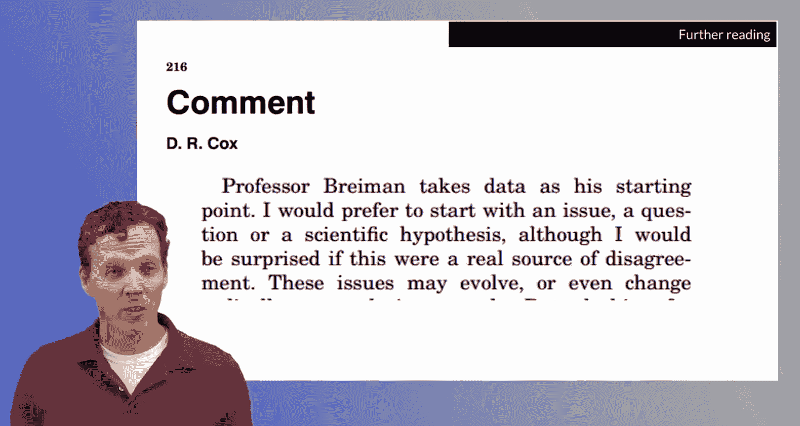
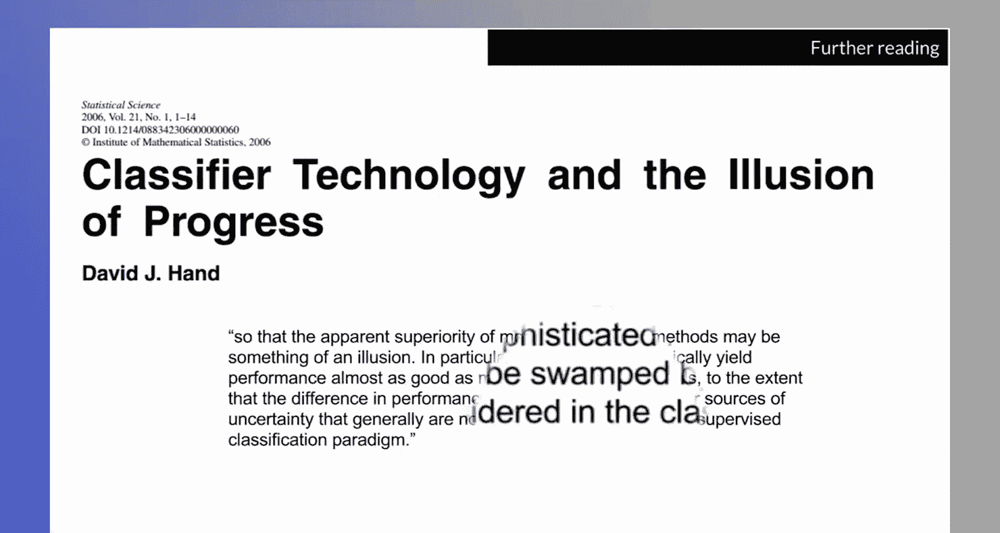

# 高管数据科学：P05：机器学习进阶阅读 📚

在本节课中，我们将探讨几篇关于机器学习与传统统计学差异的经典文章。这些文章由领域内的顶尖学者撰写，从不同视角剖析了两种方法的哲学、实践与争议，有助于我们更深入地理解数据科学的全貌。

上一节我们介绍了机器学习的基础概念，本节中我们来看看几位统计学泰斗如何评价机器学习及其与传统统计学的分野。

## 拉里·瓦瑟曼的博客文章 📝

如果你想进一步了解机器学习与传统统计学的区别，可以阅读拉里·瓦瑟曼的一篇博客文章。瓦瑟曼是一位非常知名的统计学家。如果你搜索名为“The Rise of the Mach”的文章，就能找到它。这篇文章很好地论述了二者的区别，或许也算是对统计学界的一种呼吁，希望他们能更好地接纳机器学习。

## 利奥·布雷曼的论文 📄

已故的著名统计学家利奥·布雷曼撰写了一篇极具影响力的论文，名为《统计建模的两种文化》。我的许多思考都源于这篇论文，它非常通俗易懂，发表在《统计科学》杂志上。可以说，他的观点对传统统计学持批判态度，或至少暗示传统统计学已经落后。他在文中给出了这样一段引述：

> “在这篇论文中，我认为统计学界对数据模型的关注，导致了一种不相干的理论，这阻碍了统计学家使用更合适的算法模型，也阻碍了统计学家研究令人兴奋的新问题。”

因此，他对自己的学术共同体提出了相当多的批评。这是一篇非常有趣的文章，不像大多数统计学研究论文那样枯燥。

另一位备受尊敬的统计学家D.R. Cox是这篇论文的讨论者。他提出的比例风险模型是被引用次数最多的统计学论文之一。他的一句评论让我印象深刻：

> “布雷曼教授以数据为出发点，而我更倾向于从一个议题、一个问题或一个科学假设开始，尽管如果这真是一个分歧点，我会感到惊讶。”

我非常喜欢这个评论，因为它确实触及了问题的核心。我认为，机器学习最让我感到困扰的一点，就是当你不得不用同一套数据来推导和检验假设时。对我来说，这是最难接受的地方。

## 大卫·汉德的文章 🔍

你可能会有兴趣阅读的最后一篇文章是大卫·汉德所写，他也是一位伟大的统计学家。文章名为《分类器技术与进步的幻象》。这篇文章对机器学习方法的批评更为尖锐。以下是其中的一段引述：

> “因此，更复杂方法表面上的优越性可能只是一种幻象。特别是，简单方法通常能产生与更复杂方法几乎一样好的性能，以至于性能上的差异可能被经典监督分类范式中通常未考虑的其他不确定性来源所淹没。”

他基本上是在说，构建复杂的机器学习算法所付出的努力常常是不值得的。他提出的观点之一是，复杂度的增加只会带来边际收益。

以下是这三篇核心文献的要点总结：

*   **拉里·瓦瑟曼**：呼吁统计学界拥抱机器学习，弥合文化差异。
*   **利奥·布雷曼**：批判传统统计学过度依赖数据模型，倡导采用算法模型应对新问题。
*   **大卫·汉德**：提醒我们警惕“复杂性幻觉”，指出简单方法往往足够有效，且更稳健。

---

本节课中我们一起学习了三篇关于机器学习与统计学关系的经典文献。我们看到了统计学内部对机器学习的不同态度：有的呼吁接纳与融合，有的批判传统方法的局限，有的则提醒我们不要盲目追求复杂模型。理解这些观点有助于我们在实际数据科学工作中，更明智地选择方法，平衡预测能力与可解释性，避免陷入“为复杂而复杂”的陷阱。记住，最好的模型通常是能够解决实际问题的最简单模型。